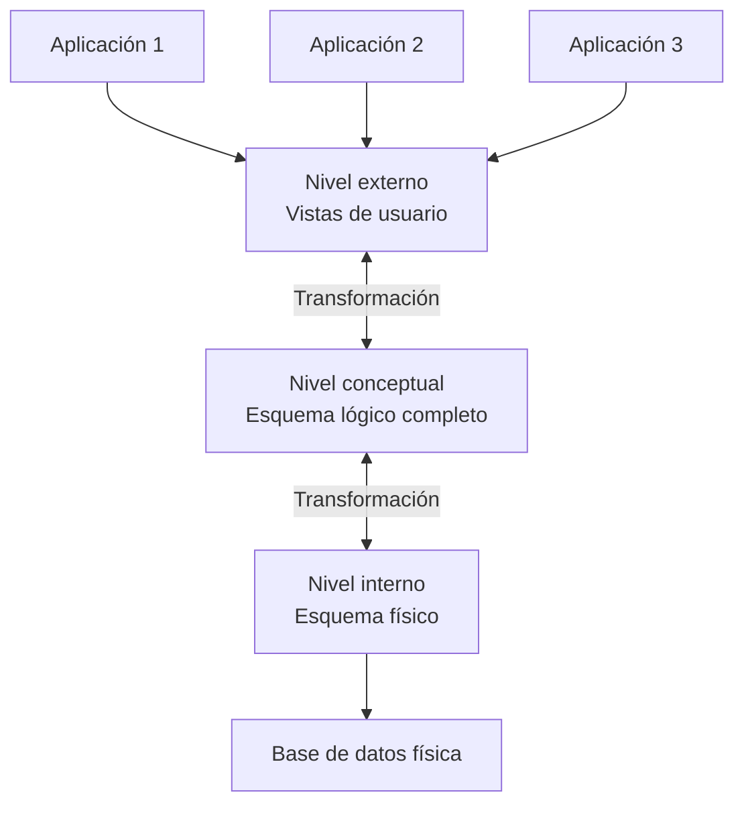

# Fundamentos de Bases de Datos - Introducción

## 1.2 Conceptos básicos de las bases de datos.

---

Los conceptos básicos de las bases de datos son fundamentales para comprender cómo se organiza, almacena y gestiona la información en los sistemas modernos de gestión de datos. Esta guía cubre los elementos esenciales que forman la base de cualquier sistema de bases de datos.

### Definiciones fundamentales

#### Base de Datos (BD)

Una base de datos es una colección organizada de datos interrelacionados que representan elementos de información sobre un dominio específico, diseñada para satisfacer los requisitos de información de una organización o usuario.

#### Sistema de Gestión de Bases de Datos (DBMS)

Un DBMS es un software que permite crear, mantener y manipular bases de datos de manera eficiente. Proporciona una interfaz entre la base de datos y los usuarios o aplicaciones.

#### Datos e Información

- **Datos**: Hechos crudos o valores simples que por sí solos no comunican significado
- **Información**: Datos procesados y organizados que tienen significado y valor para el receptor

#### Metadatos

Datos sobre datos que describen las características de los datos almacenados en la base de datos. Los metadatos definen la estructura, el tipo, el formato y las restricciones de los datos.

### Componentes de un sistema de bases de datos

#### Esquema

Descripción de la estructura de la base de datos, que incluye:

- **Esquema conceptual**: Descripción a nivel lógico de toda la base de datos
- **Esquema interno**: Descripción de la estructura de almacenamiento físico
- **Esquema externo**: Vista parcial de la base de datos para usuarios específicos

#### Instancia

Colección de datos almacenados en la base de datos en un momento particular.

#### Independencia de datos

Capacidad de modificar un esquema en un nivel sin afectar el esquema en el nivel superior:

- **Independencia física**: Capacidad de modificar el esquema interno sin afectar el esquema conceptual
- **Independencia lógica**: Capacidad de modificar el esquema conceptual sin afectar los esquemas externos

### Modelos de datos

#### Modelo conceptual

Descripción de alto nivel de la estructura de la base de datos que oculta detalles de implementación.

#### Modelo lógico

Define cómo se representan los datos para su implementación (relacional, red, jerárquico, orientado a objetos).

#### Modelo físico

Describe cómo se almacenan físicamente los datos en el sistema.

### Arquitectura de tres niveles ANSI/SPARC



### Lenguajes de bases de datos

#### Lenguaje de Definición de Datos (DDL)

Permite definir las estructuras de datos y las restricciones.

```sql
-- Ejemplo de DDL
CREATE TABLE Empleados (
    id INT PRIMARY KEY,
    nombre VARCHAR(50) NOT NULL,
    departamento_id INT,
    salario DECIMAL(10, 2),
    FOREIGN KEY (departamento_id) REFERENCES Departamentos(id)
);
```

#### Lenguaje de Manipulación de Datos (DML)

Permite manipular (insertar, actualizar, eliminar, consultar) los datos.

```sql
-- Ejemplo de DML
SELECT nombre, salario
FROM Empleados
WHERE departamento_id = 3
ORDER BY salario DESC;
```

#### Lenguaje de Control de Datos (DCL)

Gestiona los permisos y el control de acceso.

```sql
-- Ejemplo de DCL
GRANT SELECT, INSERT ON Empleados TO usuario1;
REVOKE DELETE ON Empleados FROM usuario2;
```

### Características de los DBMS

#### Abstracción de datos

Oculta los detalles de almacenamiento físico y proporciona una vista conceptual de los datos.

#### Control de redundancia

Minimiza la duplicación de datos mediante la normalización.

#### Restricciones de integridad

Mecanismos para mantener la precisión y consistencia de los datos:

- **Integridad de entidad**: PRIMARY KEY, UNIQUE
- **Integridad referencial**: FOREIGN KEY
- **Integridad semántica**: CHECK, triggers

#### Control de concurrencia

Mecanismos para manejar el acceso simultáneo a los datos por múltiples usuarios.

#### Recuperación ante fallos

Mecanismos para restaurar la base de datos después de fallos del sistema.

#### Seguridad

Mecanismos de control de acceso para proteger los datos contra accesos no autorizados.

### Usuarios de bases de datos

#### Administradores de Bases de Datos (DBA)

Responsables de la implementación, mantenimiento y seguridad del sistema.

#### Diseñadores de Bases de Datos

Definen la estructura, restricciones y funciones de la base de datos.

#### Usuarios finales

Interactúan con la base de datos mediante aplicaciones o interfaces de consulta.

#### Programadores de aplicaciones

Desarrollan programas que interactúan con la base de datos.

### Ejercicios propuestos

1. **Identificación de componentes**: Para el siguiente escenario, identifique los datos, información y metadatos:
   "Un sistema de biblioteca almacena registros de libros que incluyen ISBN, título, autor, año de publicación y número de copias disponibles. Un bibliotecario consulta cuántos libros de Gabriel García Márquez están disponibles para préstamo."

2. **Diseño de esquema**: Diseñe un esquema conceptual para un sistema de reservas de hotel que incluya huéspedes, habitaciones, reservas y facturas.

3. **Conversión entre niveles**: Dado el siguiente esquema conceptual, proponga un posible esquema interno y dos esquemas externos para diferentes tipos de usuarios:

   **Esquema conceptual**:
   - Estudiante (matrícula, nombre, fecha_nacimiento, carrera)
   - Curso (código, nombre, créditos)
   - Inscripción (matrícula, código_curso, calificación)

4. **Análisis de independencia**: Explique cómo se mantendría la independencia física si se decide cambiar el almacenamiento de una tabla de un sistema de archivos a un formato particionado.

5. **Escritura de sentencias**: Escriba sentencias DDL para crear las tablas del ejercicio 2 y sentencias DML para:
   - Insertar un nuevo huésped
   - Consultar las habitaciones disponibles para ciertas fechas
   - Actualizar el estado de una reserva

### Caso de estudio: Sistema universitario

Analice los requerimientos de un sistema de gestión universitaria que debe manejar información sobre estudiantes, profesores, cursos, inscripciones y calificaciones. Diseñe:

1. Los esquemas conceptual, lógico y físico
2. Las vistas necesarias para diferentes usuarios (estudiantes, profesores, administradores)
3. Las restricciones de integridad necesarias
4. Un plan de seguridad con diferentes niveles de acceso

### Ejemplos de código

#### Creación de tablas con restricciones

```sql
CREATE TABLE Estudiantes (
    matricula INT PRIMARY KEY,
    nombre VARCHAR(100) NOT NULL,
    fecha_nacimiento DATE,
    carrera VARCHAR(50),
    semestre INT CHECK (semestre BETWEEN 1 AND 12)
);

CREATE TABLE Cursos (
    codigo CHAR(6) PRIMARY KEY,
    nombre VARCHAR(100) NOT NULL,
    creditos INT DEFAULT 3 CHECK (creditos > 0)
);

CREATE TABLE Inscripciones (
    matricula INT,
    codigo_curso CHAR(6),
    calificación DECIMAL(3,1) CHECK (calificación BETWEEN 0 AND 10),
    PRIMARY KEY (matricula, codigo_curso),
    FOREIGN KEY (matricula) REFERENCES Estudiantes(matricula),
    FOREIGN KEY (codigo_curso) REFERENCES Cursos(codigo)
);
```

#### Consultas básicas

```sql
-- Consulta con filtro y ordenamiento
SELECT nombre, carrera
FROM Estudiantes
WHERE semestre > 5
ORDER BY carrera, nombre;

-- Consulta con agregación
SELECT carrera, COUNT(*) as total_estudiantes
FROM Estudiantes
GROUP BY carrera
HAVING COUNT(*) > 50;
```

### Referencias

#### Bibliografía básica

1. Elmasri and Navathe. Fundamentals of Database Systems. Addison-Wesley. Cuarta Edición. 2006. (Capítulo 1, 2)
2. Silberschatz A., Kort H. y Sudarshan S. Fundamentos de BD. McGraw Hill. Quinta edición. 2006. (Capítulo 1)
3. Ullman J.D. and Widom J. A First Course in Data Base System. Prentice Hall. Tercera edición. 2008. (Capítulo 1, 2)

#### Bibliografía complementaria

1. Harrington J. Relational Database Design and Implementation. Tercera edición. Morgan Kaufmann. 2009. (Capítulo 1, 2)
2. Kline K., Kline D., and Hunt B. SQL in a nutshell. O'Reilly. 2008. (Capítulo 1)

### Evaluación de conocimientos

1. Defina los conceptos de: base de datos, DBMS, metadatos y esquema.
2. Explique la diferencia entre independencia física e independencia lógica de datos.
3. Describa los tres niveles de la arquitectura ANSI/SPARC y su propósito.
4. Mencione al menos cuatro características esenciales de un DBMS moderno.
5. Diferencie entre DDL, DML y DCL, proporcionando un ejemplo de cada uno.
