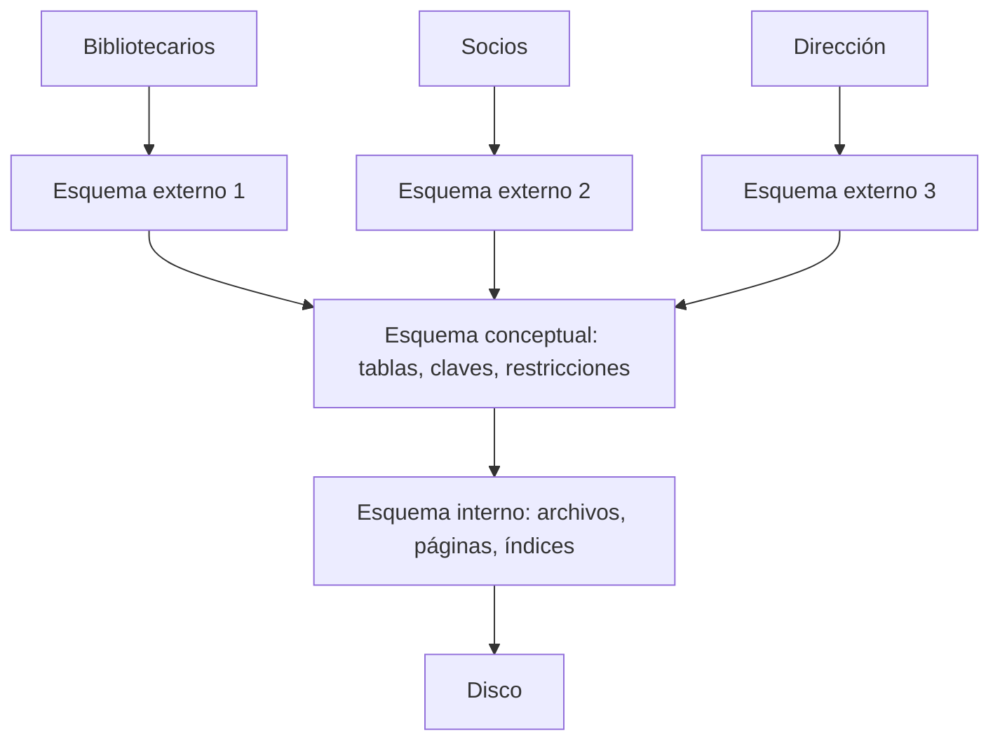

# Fundamentos de Bases de Datos - Introducción

## 1.3 Arquitectura de tres niveles (físico, conceptual y externo).

---

La **arquitectura de tres niveles**, propuesta por el comité ANSI/SPARC en 1975 y en 1978, organiza la descripción de una base de datos en tres esquemas: uno **interno** que dice cómo se almacenan los datos, uno **conceptual** que dice qué datos hay y cómo se relacionan, y varios **externos** que dicen qué parte ve cada grupo de usuarios. Su objetivo es que los cambios en un nivel no se propaguen a los otros: la **independencia de datos**. Este tema describe cada nivel, los **mapeos** entre ellos, las dos formas de independencia y cómo se realizan en un SMBD relacional, con un sistema de biblioteca como ejemplo.

### Los tres niveles

**Nivel interno** (físico). Describe el almacenamiento: en qué archivos y páginas se guardan los registros, en qué orden, con qué **índices** (árboles B, dispersión), compresión, particionamiento y ubicación en disco. Lo maneja el SMBD y lo ajusta el administrador para el rendimiento. Por debajo está el sistema operativo y el hardware.

**Nivel conceptual** (lógico). Describe toda la base de datos para la comunidad de usuarios: las tablas, sus columnas y tipos, las claves y las restricciones de integridad, sin detalles de almacenamiento. Hay **un solo** esquema conceptual; se escribe con el DDL (`CREATE TABLE`).

**Nivel externo** (de vistas). Describe la parte de la base que interesa a cada grupo de usuarios, en la forma más conveniente para ellos: un subconjunto de columnas y filas, nombres distintos, datos derivados y agregados. Hay **muchos** esquemas externos; en SQL se escriben como **vistas** (`CREATE VIEW`, tema 7.1), y sirven también para la seguridad: un usuario solo recibe permisos sobre su vista.



### Mapeos

- **Mapeo externo-conceptual:** cómo se obtiene cada objeto de una vista a partir del esquema conceptual. Por ejemplo, la columna `nombre_completo` de una vista es `nombre || ' ' || apellido`, y `edad` se calcula a partir de `fecha_nacimiento` y la fecha actual. En un SMBD relacional es la definición de la vista.
- **Mapeo conceptual-interno:** cómo se almacena cada tabla: el archivo, el orden de los registros, los índices disponibles. Lo usa el **optimizador** para elegir cómo ejecutar cada consulta.

Una consulta sobre una vista recorre ambos mapeos: el SMBD **sustituye** la vista por su definición sobre las tablas base y después elige un plan físico. Ese trabajo es el costo de la independencia, y por eso los SMBD optimizan las consultas sobre vistas igual que las demás.

### Independencia de datos

- **Física:** se puede cambiar el esquema interno sin cambiar el conceptual: agregar o quitar índices, reorganizar o comprimir archivos, particionar tablas, mover datos a otro disco. Solo cambia el mapeo conceptual-interno. Los SMBD relacionales la logran muy bien.
- **Lógica:** se puede cambiar el esquema conceptual sin cambiar los externos: agregar columnas o tablas, dividir una tabla en dos. Se redefine el mapeo externo-conceptual para que las vistas sigan dando lo mismo. Es más difícil, porque no todo cambio conceptual es transparente (eliminar un dato que una vista usa no lo es) y porque las vistas complejas no siempre se pueden actualizar (tema 7.3).

**Ventajas de la arquitectura:** cada usuario ve lo que necesita, con seguridad por vistas; el administrador ajusta el almacenamiento sin tocar las aplicaciones; el esquema puede evolucionar con menos costo. **Desventaja:** el costo de los mapeos, que en la práctica el optimizador reduce a casi nada.

### Implementación en Python

El programa define en SQLite el esquema conceptual de una biblioteca con libros, ejemplares, socios y préstamos (ejercicio 1), y tres vistas para el ejercicio 3 más una con columnas derivadas para el ejercicio 4. Muestra que el plan de una consulta sobre una vista se expresa con las tablas base; que crear un índice parcial y reorganizar el archivo no cambia lo que devuelven las vistas (ejercicio 2), y que dividir una tabla en dos y redefinir la vista conserva el esquema externo: la independencia lógica.

```python
import sqlite3

db = sqlite3.connect(":memory:")
db.execute("PRAGMA foreign_keys = ON")

# --- Ejercicio 1: esquema conceptual de la biblioteca ---
db.executescript("""
CREATE TABLE libro (isbn TEXT PRIMARY KEY, titulo TEXT NOT NULL, autor TEXT NOT NULL, anio INTEGER);
CREATE TABLE ejemplar (id_ejemplar INTEGER PRIMARY KEY, isbn TEXT NOT NULL REFERENCES libro, ubicacion TEXT);
CREATE TABLE socio (id_socio INTEGER PRIMARY KEY, nombre TEXT NOT NULL, apellido TEXT NOT NULL,
                    fecha_nacimiento TEXT, correo TEXT);
CREATE TABLE prestamo (id_prestamo INTEGER PRIMARY KEY, id_ejemplar INTEGER NOT NULL REFERENCES ejemplar,
                       id_socio INTEGER NOT NULL REFERENCES socio, salida TEXT NOT NULL, devolucion TEXT);
INSERT INTO libro VALUES ('L1', 'Cien años de soledad', 'García Márquez', 1967), ('L2', 'Pedro Páramo', 'Rulfo', 1955),
                         ('L3', 'Rayuela', 'Cortázar', 1963);
INSERT INTO ejemplar (isbn, ubicacion) VALUES ('L1', 'A-1'), ('L1', 'A-1'), ('L2', 'B-3'), ('L3', 'C-2');
INSERT INTO socio VALUES (1, 'Elena', 'Paz', '2000-05-14', 'elena@ejemplo.mx'), (2, 'Marco', 'Gil', '1988-09-30', 'marco@ejemplo.mx');
INSERT INTO prestamo (id_ejemplar, id_socio, salida, devolucion) VALUES
    (1, 1, '2026-09-02', '2026-09-16'), (3, 2, '2026-09-10', '2026-09-20'), (1, 2, '2026-10-01', '2026-10-12'),
    (3, 1, '2026-10-05', NULL), (4, 2, '2026-10-20', NULL), (2, 1, '2026-10-21', '2026-10-28');
""")

# --- Ejercicio 3: vistas (nivel externo) ---
db.executescript("""
CREATE VIEW libros_disponibles AS
    SELECT l.titulo, l.autor, COUNT(*) AS disponibles
    FROM ejemplar e JOIN libro l USING (isbn)
    WHERE NOT EXISTS (SELECT 1 FROM prestamo p WHERE p.id_ejemplar = e.id_ejemplar AND p.devolucion IS NULL)
    GROUP BY l.isbn;
CREATE VIEW mas_prestados AS
    SELECT l.titulo, COUNT(*) AS prestamos
    FROM prestamo p JOIN ejemplar e USING (id_ejemplar) JOIN libro l USING (isbn)
    GROUP BY l.isbn ORDER BY prestamos DESC, l.titulo;
CREATE VIEW prestamos_por_mes AS
    SELECT strftime('%Y-%m', salida) AS mes, COUNT(*) AS prestamos,
           SUM(devolucion IS NULL) AS pendientes
    FROM prestamo GROUP BY mes ORDER BY mes;
-- Ejercicio 4: mapeos externo-conceptual con columnas derivadas
CREATE VIEW socio_publico AS
    SELECT id_socio, nombre || ' ' || apellido AS nombre_completo,
           CAST((julianday('2026-11-03') - julianday(fecha_nacimiento)) / 365.2425 AS INTEGER) AS edad
    FROM socio;
""")
for vista in ("libros_disponibles", "mas_prestados", "prestamos_por_mes", "socio_publico"):
    print(f"{vista}:", db.execute(f"SELECT * FROM {vista}").fetchall())

# El SMBD sustituye la vista por su definición: el plan de la consulta usa las tablas base
print("plan de SELECT * FROM mas_prestados:", [r[3] for r in db.execute("EXPLAIN QUERY PLAN SELECT * FROM mas_prestados")])

# --- Ejercicio 2: cambios internos que no afectan a las vistas ---
antes = db.execute("SELECT * FROM libros_disponibles").fetchall()
db.executescript("""
CREATE INDEX idx_prestamo_pendiente ON prestamo(id_ejemplar) WHERE devolucion IS NULL;   -- índice parcial
VACUUM;                                                                                 -- reorganiza el archivo
""")
print("tras crear un índice parcial y reorganizar el almacenamiento, la vista da lo mismo:",
      db.execute("SELECT * FROM libros_disponibles").fetchall() == antes)
print("   plan:", [r[3] for r in db.execute("EXPLAIN QUERY PLAN SELECT * FROM libros_disponibles")])

# --- independencia lógica: dividir socio en dos tablas sin romper la vista externa ---
db.executescript("""
CREATE TABLE persona (id_socio INTEGER PRIMARY KEY, nombre TEXT, apellido TEXT, fecha_nacimiento TEXT);
CREATE TABLE contacto (id_socio INTEGER PRIMARY KEY REFERENCES persona, correo TEXT);
INSERT INTO persona SELECT id_socio, nombre, apellido, fecha_nacimiento FROM socio;
INSERT INTO contacto SELECT id_socio, correo FROM socio;
DROP VIEW socio_publico;
CREATE VIEW socio_publico AS
    SELECT id_socio, nombre || ' ' || apellido AS nombre_completo,
           CAST((julianday('2026-11-03') - julianday(fecha_nacimiento)) / 365.2425 AS INTEGER) AS edad
    FROM persona;
""")
print("independencia lógica: tras dividir socio, socio_publico =", db.execute("SELECT * FROM socio_publico").fetchall())
```

Salida:

```text
libros_disponibles: [('Cien años de soledad', 'García Márquez', 2)]
mas_prestados: [('Cien años de soledad', 3), ('Pedro Páramo', 2), ('Rayuela', 1)]
prestamos_por_mes: [('2026-09', 2, 0), ('2026-10', 4, 2)]
socio_publico: [(1, 'Elena Paz', 26), (2, 'Marco Gil', 38)]
plan de SELECT * FROM mas_prestados: ['CO-ROUTINE mas_prestados', 'SCAN p', 'SEARCH e USING INTEGER PRIMARY KEY (rowid=?)', 'SEARCH l USING INDEX sqlite_autoindex_libro_1 (isbn=?)', 'USE TEMP B-TREE FOR GROUP BY', 'USE TEMP B-TREE FOR ORDER BY', 'SCAN mas_prestados']
tras crear un índice parcial y reorganizar el almacenamiento, la vista da lo mismo: True
   plan: ['CO-ROUTINE libros_disponibles', 'SCAN e', 'CORRELATED SCALAR SUBQUERY 3', 'SEARCH p USING INDEX idx_prestamo_pendiente (id_ejemplar=?)', 'SEARCH l USING INDEX sqlite_autoindex_libro_1 (isbn=?)', 'USE TEMP B-TREE FOR GROUP BY', 'SCAN libros_disponibles']
independencia lógica: tras dividir socio, socio_publico = [(1, 'Elena Paz', 26), (2, 'Marco Gil', 38)]
```

### Ejercicios Propuestos

1. **Niveles.** Para un sistema de biblioteca, diseña un esquema conceptual con al menos 3 entidades, dos esquemas externos (para bibliotecarios y para usuarios) y una descripción del esquema interno.

2. **Independencia física.** Explica cómo se mantiene la independencia física si se cambia la organización de una tabla de secuencial a indexada, si se comprimen los datos o si se migra a otro sistema de almacenamiento.

3. **Vistas.** Escribe vistas para los libros disponibles, los libros más prestados y las estadísticas de préstamos por mes.

4. **Mapeos.** Describe el mapeo de una vista que muestra `nombre_completo` a partir de `nombre` y `apellido`, y de otra que calcula `edad` a partir de `fecha_nacimiento`.

5. **Comercio electrónico.** Explica cómo implementarías la arquitectura de tres niveles en una tienda en línea, con vistas para clientes, administradores, envíos y finanzas.

### Soluciones

**Ejercicio 1.** **Conceptual:** `libro(isbn, titulo, autor, anio)`, `ejemplar(id_ejemplar, isbn, ubicacion)`, `socio(id_socio, nombre, apellido, fecha_nacimiento, correo)` y `prestamo(id_prestamo, id_ejemplar, id_socio, salida, devolucion)`, con claves foráneas. Separar el libro (la obra) del ejemplar (la copia física) permite tener varias copias. **Externo de bibliotecarios:** préstamos pendientes con datos de contacto del socio y ubicación del ejemplar. **Externo de socios:** el catálogo con disponibilidad (`libros_disponibles`) y sus propios préstamos, sin datos de otros socios. **Interno:** cada tabla en un árbol B por su clave primaria; índices sobre `ejemplar(isbn)`, `prestamo(id_socio)` y un índice parcial sobre los préstamos pendientes, que son los que más se consultan y son pocos.

**Ejercicio 2.** En los tres casos solo cambia el esquema interno y el mapeo conceptual-interno: **pasar a indexada** agrega una estructura que el optimizador usará si conviene, sin que cambie ninguna consulta; **comprimir** cambia el formato de las páginas, y el SMBD descomprime al leer; **migrar el almacenamiento**, por ejemplo a discos de estado sólido o a la nube, cambia dónde están los archivos. Las tablas, las vistas y los programas no cambian. El programa lo comprueba con un índice parcial y una reorganización: el plan de la vista pasa a usar el índice y el resultado es el mismo.

**Ejercicio 3.** Son las vistas `libros_disponibles` (ejemplares sin préstamo pendiente, agrupados por libro), `mas_prestados` (número de préstamos por libro, en orden descendente) y `prestamos_por_mes` (préstamos y pendientes por mes) del programa. En el ejemplo, solo "Cien años de soledad" tiene ejemplares disponibles, y es también el más prestado.

**Ejercicio 4.** El mapeo es la definición de la vista: `nombre_completo` es `nombre || ' ' || apellido`, y `edad` es la diferencia en años entre la fecha actual y `fecha_nacimiento`, redondeada hacia abajo. Ambas son **columnas derivadas**: no se almacenan y se calculan en cada consulta, así que la edad siempre está actualizada. Una consecuencia es que no se pueden actualizar directamente: ¿qué significaría cambiar `nombre_completo`? (tema 7.3). En el programa, la fecha actual está fija para que el resultado sea reproducible.

**Ejercicio 5.** **Conceptual:** clientes, productos, inventario, pedidos, líneas de pedido, pagos y envíos. **Externos:** para **clientes**, el catálogo con precios y existencias y sus propios pedidos (con seguridad por fila, cada cliente solo ve los suyos); para **administradores**, todo el catálogo con costos y proveedores; para **envíos**, los pedidos pagados pendientes de envío con dirección y paquetería, sin datos de pago; para **finanzas**, ventas, pagos e impuestos agregados por periodo, sin datos personales. **Interno:** índices por cliente y por estado del pedido, particionamiento de pedidos por fecha y réplicas de lectura para el catálogo, que se consulta mucho más de lo que cambia. Cuando el negocio cambie, por ejemplo con pedidos de varios almacenes, se modifica el esquema conceptual y se redefinen las vistas para que las aplicaciones de cada área no cambien.

### Referencias

1. ANSI/X3/SPARC Study Group on Database Management Systems, Interim report. _FDT, Bulletin of ACM SIGMOD_ 7(2), 1975.
2. Elmasri, R., and Navathe, S. B., _Fundamentals of Database Systems_. Pearson, 2016. Capítulo 2.
3. Date, C. J., _An Introduction to Database Systems_. Addison-Wesley, 2003. Capítulo 2.
4. Silberschatz, A., Korth, H. F., and Sudarshan, S., _Database System Concepts_. McGraw-Hill, 2019. Capítulos 1 y 4.
