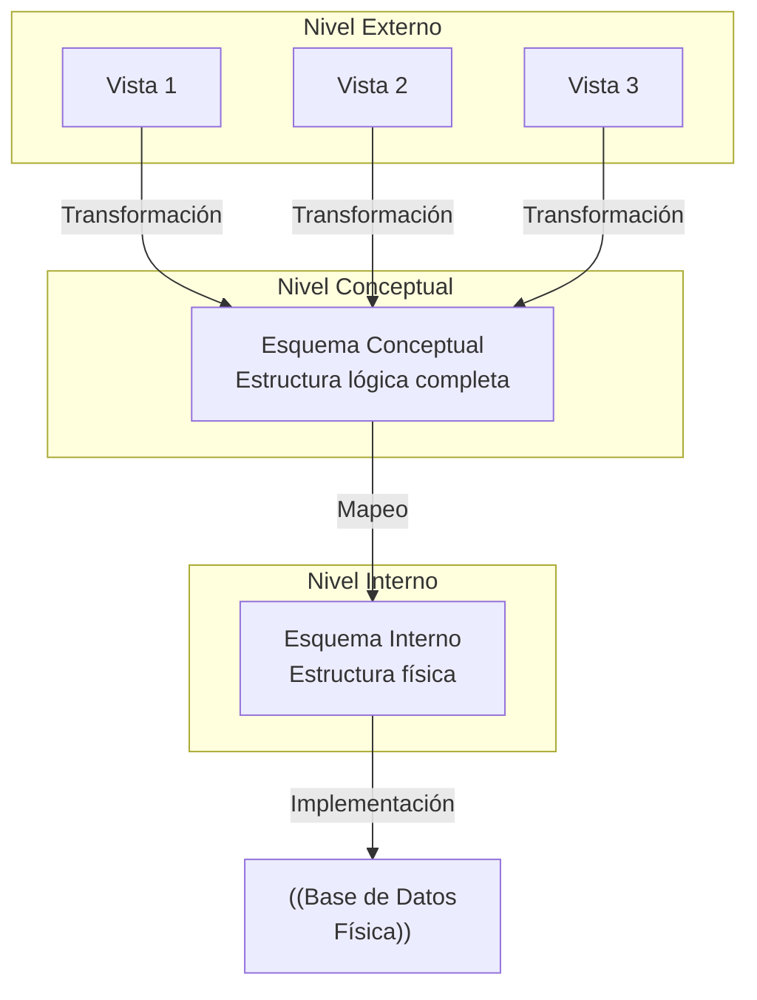

# Fundamentos de Bases de Datos - Introducción

## 1.3 Arquitectura de tres niveles (físico, conceptual y externo).

---

La arquitectura de tres niveles, también conocida como arquitectura ANSI/SPARC, es un framework fundamental para el diseño de sistemas de bases de datos. Esta arquitectura proporciona independencia entre los programas de aplicación y los datos físicos, permitiendo modificaciones en un nivel sin afectar los otros niveles.

### Definición de la arquitectura de tres niveles

La arquitectura de tres niveles separa el sistema de base de datos en tres niveles de abstracción:

1. **Nivel interno (físico)**: Describe cómo se almacenan físicamente los datos
2. **Nivel conceptual (lógico)**: Describe qué datos se almacenan y las relaciones entre ellos
3. **Nivel externo (vistas)**: Describe la parte de la base de datos que es relevante para cada usuario

### Diagrama de la arquitectura de tres niveles



### Nivel interno (físico)

#### Definición

El nivel interno describe la estructura de almacenamiento físico de la base de datos y los métodos de acceso a los datos. Incluye detalles como:

- Organización de archivos
- Estructuras de almacenamiento (heap, secuencial, indexado)
- Métodos de acceso (índices, hashing)
- Compresión de datos
- Encryption

#### Características

- Define cómo se almacenan los datos en dispositivos de almacenamiento
- Incluye detalles de implementación como punteros, estructuras de almacenamiento y algoritmos de acceso
- Es específico del DBMS utilizado

#### Ejemplo de descripción de nivel interno

```
ALMACENAMIENTO EMPLEADOS (
    BLOQUE_SIZE = 4096 bytes,
    ORGANIZACIÓN = INDEXADA,
    ÍNDICE_PRIMARIO = BTREE (id),
    ÍNDICE_SECUNDARIO = HASH (departamento_id),
    COMPRESIÓN = TRUE
)
```

### Nivel conceptual (lógico)

#### Definición

El nivel conceptual describe la estructura lógica de toda la base de datos para una comunidad de usuarios. Oculta los detalles de almacenamiento físico y se centra en:

- Entidades, atributos y relaciones
- Restricciones de integridad
- Operaciones sobre los datos
- Seguridad a nivel de datos

#### Características

- Proporciona una vista global de la base de datos
- Define todas las entidades, atributos, relaciones y constraints
- Es independiente de las aplicaciones y del almacenamiento físico

#### Ejemplo de esquema conceptual en SQL

```sql
CREATE TABLE Empleados (
    id INT PRIMARY KEY,
    nombre VARCHAR(50) NOT NULL,
    apellido VARCHAR(50) NOT NULL,
    fecha_nacimiento DATE,
    salario DECIMAL(10, 2) CHECK (salario > 0),
    departamento_id INT,
    FOREIGN KEY (departamento_id) REFERENCES Departamentos(id)
);

CREATE TABLE Departamentos (
    id INT PRIMARY KEY,
    nombre VARCHAR(50) NOT NULL UNIQUE,
    presupuesto DECIMAL(15, 2)
);
```

### Nivel externo (vistas)

#### Definición

El nivel externo describe las vistas de la base de datos que son relevantes para diferentes grupos de usuarios. Cada vista:

- Muestra solo los datos relevantes para un usuario o grupo de usuarios
- Puede ocultar datos sensibles o irrelevantes
- Proporciona una interfaz personalizada para diferentes aplicaciones

#### Características

- Permite múltiples vistas de los mismos datos
- Proporciona un mecanismo de seguridad al ocultar datos no autorizados
- Simplifica las consultas para usuarios específicos

#### Ejemplos de vistas externas

**Vista para el departamento de recursos humanos:**

```sql
CREATE VIEW Vista_RRHH AS
SELECT id, nombre, apellido, fecha_nacimiento, salario, d.nombre as departamento
FROM Empleados e
JOIN Departamentos d ON e.departamento_id = d.id;
```

**Vista para el departamento financiero:**

```sql
CREATE VIEW Vista_Finanzas AS
SELECT d.id as depto_id, d.nombre as departamento,
       d.presupuesto, COUNT(e.id) as num_empleados,
       SUM(e.salario) as total_salarios
FROM Departamentos d
LEFT JOIN Empleados e ON d.id = e.departamento_id
GROUP BY d.id, d.nombre, d.presupuesto;
```

### Mapeos entre niveles

#### Mapeo conceptual-interno

Define la correspondencia entre el esquema conceptual y el esquema interno. Permite la independencia física de datos.

**Ejemplo de mapeo:**

```
Tabla Empleados → Archivo EMP.dat con organización indexada
Atributo id → Campo ID: INTEGER(4) en posición 0-3
Atributo nombre → Campo NOMBRE: VARCHAR(50) en posición 4-53
```

#### Mapeo externo-conceptual

Define la correspondencia entre esquemas externos y el esquema conceptual. Permite la independencia lógica de datos.

**Ejemplo de mapeo:**

```
Vista_RRHH.nombre → Empleados.nombre
Vista_RRHH.departamento → Departamentos.nombre
```

### Independencia de datos

#### Independencia física

Capacidad de modificar el esquema interno sin afectar el esquema conceptual o los esquemas externos.

$\Delta\text{EsquemaInterno}$ $\nrightarrow$ $\Delta\text{EsquemaConceptual}$ $\nrightarrow$ $\Delta\text{EsquemaExterno}$

#### Independencia lógica

Capacidad de modificar el esquema conceptual sin afectar los esquemas externos.

$\Delta\text{EsquemaConceptual}$ $\nrightarrow$ $\Delta\text{EsquemaExterno}$

### Implementación en sistemas reales

#### Ejemplo de arquitectura completa

```sql
-- Nivel conceptual
CREATE TABLE Estudiantes (
    id INT PRIMARY KEY,
    nombre VARCHAR(100) NOT NULL,
    email VARCHAR(100) UNIQUE,
    carrera VARCHAR(50),
    fecha_ingreso DATE
);

CREATE TABLE Cursos (
    codigo CHAR(6) PRIMARY KEY,
    nombre VARCHAR(100) NOT NULL,
    creditos INT CHECK (creditos > 0)
);

CREATE TABLE Matriculas (
    estudiante_id INT,
    curso_codigo CHAR(6),
    semestre CHAR(5),
    calificacion DECIMAL(3,1),
    PRIMARY KEY (estudiante_id, curso_codigo, semestre),
    FOREIGN KEY (estudiante_id) REFERENCES Estudiantes(id),
    FOREIGN KEY (curso_codigo) REFERENCES Cursos(codigo)
);

-- Nivel externo: Vista para profesores
CREATE VIEW Vista_Profesores AS
SELECT e.id, e.nombre, e.carrera,
       m.curso_codigo, m.semestre, m.calificacion
FROM Estudiantes e
JOIN Matriculas m ON e.id = m.estudiante_id;

-- Nivel externo: Vista para estudiantes
CREATE VIEW Vista_Estudiantes AS
SELECT e.id, e.nombre, e.carrera, e.email,
       c.codigo, c.nombre as curso, c.creditos,
       m.semestre, m.calificacion
FROM Estudiantes e
JOIN Matriculas m ON e.id = m.estudiante_id
JOIN Cursos c ON m.curso_codigo = c.codigo;
```

### Ventajas de la arquitectura de tres niveles

1. **Independencia de datos**: Cambios en un nivel no afectan otros niveles
2. **Seguridad**: Diferentes vistas para diferentes usuarios
3. **Personalización**: Interfaces adaptadas a necesidades específicas
4. **Mantenibilidad**: Facilita modificaciones y optimizaciones
5. **Consistencia**: Múltiples vistas sobre los mismos datos consistentes

### Ejercicios propuestos

1. **Diseño de niveles**: Para un sistema de biblioteca, diseñe:
   - Esquema conceptual con al menos 3 entidades
   - Dos esquemas externos diferentes (para bibliotecarios y usuarios)
   - Descripción del esquema interno con estructuras de almacenamiento

2. **Análisis de independencia**: Explique cómo se mantendría la independencia física si se decide:
   - Cambiar la organización de una tabla de secuencial a indexada
   - Añadir compresión a los datos
   - Migrar a un diferente sistema de almacenamiento

3. **Creación de vistas**: Para el esquema de biblioteca, escriba sentencias SQL para crear:
   - Una vista que muestre libros disponibles para préstamo
   - Una vista que muestre los libros más prestados
   - Una vista para estadísticas de préstamos por mes

4. **Mapeo entre niveles**: Describa el mapeo para:
   - Una vista externa que muestra "nombre_completo" mapeado a "nombre + apellido"
   - Una vista que calcula "edad" a partir de "fecha_nacimiento"

5. **Caso de estudio**: Analice cómo implementaría la arquitectura de tres niveles para un sistema de comercio electrónico, considerando las vistas necesarias para:
   - Clientes
   - Administradores
   - Departamento de envíos
   - Departamento de finanzas

### Caso práctico: Sistema hospitalario

Implemente la arquitectura de tres niveles para un sistema hospitalario con las siguientes entidades: Pacientes, Doctores, Citas, Tratamientos.

```sql
-- Nivel Conceptual
CREATE TABLE Pacientes (
    id INT PRIMARY KEY,
    nombre VARCHAR(100),
    fecha_nacimiento DATE,
    telefono VARCHAR(15),
    seguro_medico VARCHAR(50)
);

CREATE TABLE Doctores (
    id INT PRIMARY KEY,
    nombre VARCHAR(100),
    especialidad VARCHAR(50),
    telefono VARCHAR(15)
);

CREATE TABLE Citas (
    id INT PRIMARY KEY,
    paciente_id INT,
    doctor_id INT,
    fecha_hora TIMESTAMP,
    estado VARCHAR(20),
    FOREIGN KEY (paciente_id) REFERENCES Pacientes(id),
    FOREIGN KEY (doctor_id) REFERENCES Doctores(id)
);

-- Nivel Externo: Vista para doctores
CREATE VIEW Vista_Doctores AS
SELECT c.id as cita_id, p.nombre as paciente,
       p.fecha_nacimiento, c.fecha_hora, c.estado
FROM Citas c
JOIN Pacientes p ON c.paciente_id = p.id
WHERE c.doctor_id = CURRENT_DOCTOR_ID;  -- Variable de sesión

-- Nivel Externo: Vista para administración
CREATE VIEW Vista_Administracion AS
SELECT d.nombre as doctor, d.especialidad,
       COUNT(c.id) as total_citas,
       AVG(CASE WHEN c.estado = 'completada' THEN 1 ELSE 0 END) as tasa_completadas
FROM Doctores d
LEFT JOIN Citas c ON d.id = c.doctor_id
GROUP BY d.id, d.nombre, d.especialidad;
```

### Referencias

#### Bibliografía básica

1. Elmasri and Navathe. Fundamentals of Database Systems. Addison-Wesley. Cuarta Edición. 2006. (Capítulo 2)
2. Silberschatz A., Kort H. y Sudarshan S. Fundamentos de BD. McGraw Hill. Quinta edición. 2006. (Capítulo 1)
3. Ullman J.D. and Widom J. A First Course in Data Base System. Prentice Hall. Tercera edición. 2008. (Capítulo 1)

#### Bibliografía complementaria

1. Harrington J. Relational Database Design and Implementation. Tercera edición. Morgan Kaufmann. 2009. (Capítulo 3)
2. Date C.J. An Introduction to Database Systems. Eighth Edition. Addison-Wesley. 2003.

### Evaluación de conocimientos

1. Describa los tres niveles de la arquitectura ANSI/SPARC y su propósito.
2. Explique la diferencia entre independencia física e independencia lógica.
3. ¿Por qué es importante el mapeo entre niveles en esta arquitectura?
4. Proporcione un ejemplo de cómo una vista externa puede mejorar la seguridad.
5. Describa cómo se mantiene la consistencia de datos a través de los tres niveles.
