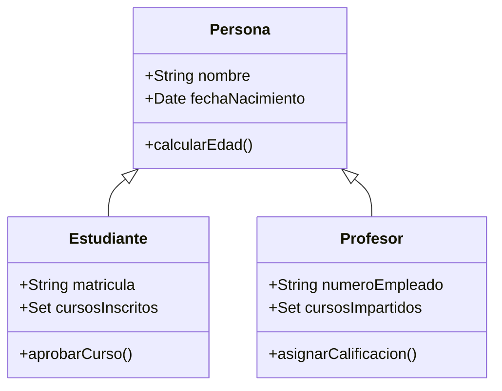

# Fundamentos de Bases de Datos - Modelos de datos

## 2.1 Modelo orientado a objetos.

---

El modelo orientado a objetos (MOO) surge como respuesta a las limitaciones del modelo relacional para representar datos complejos y relaciones sofisticadas. Combina principios de la programación orientada a objetos con sistemas de bases de datos, permitiendo el almacenamiento persistente de objetos complejos.

### Definición

El **modelo orientado a objetos** es un paradigma de base de datos que representa la información como objetos, similar a los utilizados en la programación orientada a objetos. Según Elmasri y Navathe, "extiende el modelo de objetos de los lenguajes de programación para proporcionar persistencia a los objetos y capacidades de consulta" (2006).

### Conceptos Fundamentales

#### Objetos y Identidad

Cada objeto tiene una **identidad única** (OID - Object Identifier) independiente de su valor:

$$OID = \text{identificador único e inmutable}$$

#### Clases y Herencia

Las clases definen la estructura y comportamiento de los objetos:

```java
// Ejemplo de definición de clase en un MOO
class Persona {
    attribute string nombre;
    attribute date fechaNacimiento;
    method int calcularEdad();
}

class Estudiante extends Persona {
    attribute string matricula;
    attribute set<Curso> cursosInscritos;
    method boolean aprobarCurso(Curso c);
}
```

#### Encapsulación

Los objetos encapsulan tanto datos como métodos que operan sobre esos datos:

$$\text{Encapsulación} = \text{Datos} + \text{Comportamiento}$$

### Características Principales

#### Herencia

La herencia permite que las clases compartan características:



#### Polimorfismo

El polimorfismo permite que métodos con el mismo nombre se comporten diferentemente según el objeto:

$$f(x) \rightarrow \text{resultado diferente según el tipo de } x$$

#### Persistencia Transparente

Los objetos existen más allá del tiempo de ejecución del programa:

```java
// Ejemplo de persistencia
Transaccion.begin();
Estudiante est = new Estudiante("Juan Pérez", "A12345");
est.inscribirCurso(new Curso("BDD101"));
Transaccion.commit(); // Objeto persiste en la base de datos
```

### Estructuras de Datos Complejas

#### Colecciones y Tipos de Datos Abstractos

El MOO soporta estructuras complejas:

- **Conjuntos**: `set<T>`
- **Listas**: `list<T>`
- **Arrays**: `array<T>`
- **Multiconjuntos**: `bag<T>`

#### Ejemplo de Definición de Tipos Complejos

```sql
CREATE TYPE Direccion AS (
    calle VARCHAR(100),
    ciudad VARCHAR(50),
    codigo_postal VARCHAR(10)
);

CREATE TYPE Telefono AS (
    tipo VARCHAR(10),
    numero VARCHAR(15)
);
```

### Operaciones y Consultas

#### ODL (Object Definition Language)

Lenguaje para definir esquemas de bases de datos orientadas a objetos:

```odl
interface Persona {
    attribute string nombre;
    attribute date fechaNacimiento;
    relationship set<Curso> cursos inverse Curso::estudiantes;
};

interface Estudiante extends Persona {
    attribute string matricula;
    relationship set<Curso> cursosInscritos inverse Curso::inscritos;
};
```

#### OQL (Object Query Language)

Lenguaje de consulta para bases de datos orientadas a objetos:

```sql
SELECT e.nombre, e.matricula
FROM Estudiante e
WHERE e.cursosInscritos.count() > 3
```

### Ventajas y Desventajas

#### Ventajas

- Modelado más natural de entidades complejas
- Mejor integración con lenguajes OO
- Soporte para tipos de datos complejos
- Herencia y polimorfismo
- Mayor expresividad en el modelado

#### Desventajas

- Curva de aprendizaje más pronunciada
- Menor estandarización que SQL
- Menor madurez en herramientas
- Complejidad en optimización de consultas

### Ejemplo Práctico Completo

#### Sistema Académico en MOO

```java
// Definición de clases
class Universidad {
    attribute string nombre;
    attribute set<Departamento> departamentos;
    attribute set<Estudiante> estudiantes;
}

class Departamento {
    attribute string nombre;
    attribute set<Profesor> profesores;
    attribute set<Curso> cursos;
}

class Curso {
    attribute string codigo;
    attribute string nombre;
    attribute int creditos;
    relationship Profesor instructor inverse Profesor::cursosImpartidos;
    relationship set<Estudiante> inscritos inverse Estudiante::cursosInscritos;
}
```

### Ejercicios Propuestos

#### Ejercicio 1: Diseño de Esquema

Diseñe un esquema OO para una biblioteca que incluya:

- Libros con múltiples autores
- Revistas con volúmenes y números
- Usuarios con historial de préstamos
- Sistema de multas por retrasos

#### Ejercicio 2: Consultas OQL

Para el esquema anterior, escriba consultas OQL para:

1. Encontrar todos los libros prestados actualmente
2. Calcular la multa total de un usuario específico
3. Listar revistas publicadas en el último año

#### Ejercicio 3: Herencia y Polimorfismo

Diseñe una jerarquía de clases para vehículos que incluya:

- Clase base Vehículo
- Subclases: Automóvil, Motocicleta, Camión
- Implemente métodos polimórficos para calcular impuestos

### Implementación en Lenguajes de Programación

#### Integración con Java

```java
// Ejemplo usando JDO (Java Data Objects)
@PersistenceCapable
public class Estudiante {
    @PrimaryKey
    private String matricula;

    private String nombre;
    private Date fechaNacimiento;

    @Persistent
    private Set<Curso> cursosInscritos;

    // Getters, setters y métodos
}
```

### Referencias

#### Bibliografía Básica

1. Elmasri, R., & Navathe, S. B. (2006). _Fundamentals of Database Systems_ (4th ed.). Addison-Wesley. (Capítulo 20: Object and Object-Relational Databases)

2. Silberschatz, A., Korth, H. F., & Sudarshan, S. (2006). _Fundamentals of Database Systems_ (5th ed.). McGraw-Hill. (Capítulo 22: Object-Based Databases)

3. Ullman, J. D., & Widom, J. (2008). _A First Course in Database Systems_ (3rd ed.). Prentice Hall. (Capítulo 10: The Object-Oriented Model)

#### Bibliografía Complementaria

1. Hamilton, G., Cattell, R., & Fisher, M. (2002). _JDBC Database Access with Java_ (2nd ed.). Addison-Wesley.

2. Harrington, J. (2009). _Relational Database Design and Implementation_ (3rd ed.). Morgan Kaufmann.

3. Kline, K., Kline, D., & Hunt, B. (2008). _SQL in a Nutshell_. O'Reilly.

### Recursos Adicionales

- ODMG (Object Data Management Group) estándar
- Documentación de JDO (Java Data Objects)
- Especificaciones OQL
- Sistemas de gestión de bases de datos orientadas a objetos como: ObjectStore, Versant, db4o
