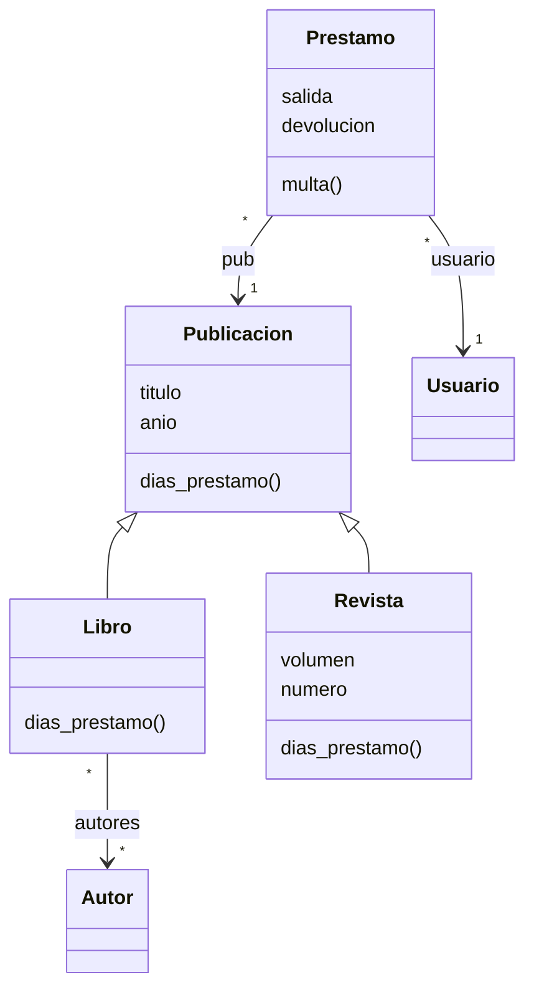

# Fundamentos de Bases de Datos - Modelos de datos

## 2.1 Modelo orientado a objetos.

---

El **modelo orientado a objetos** traslada a las bases de datos los conceptos de la programación orientada a objetos: los datos se guardan como **objetos** con identidad propia, agrupados en **clases** con atributos, relaciones y métodos, organizadas en jerarquías de **herencia**. Surgió en los años ochenta para aplicaciones con estructuras complejas (diseño asistido por computadora, multimedia, sistemas geográficos), donde el modelo relacional obligaba a repartir un objeto entre muchas tablas y a reconstruirlo con reuniones. El grupo ODMG publicó en 1993 un estándar con un lenguaje de definición (**ODL**) y uno de consulta (**OQL**). Este tema describe sus conceptos, compara su forma de consultar con la relacional y muestra cómo se implementa hoy, sobre todo mediante el **mapeo objeto-relacional**.

### Objetos e identidad

Un **objeto** tiene un **estado** (los valores de sus atributos), un **comportamiento** (sus métodos) y una **identidad**: un identificador de objeto (OID) que el sistema asigna, que no cambia durante la vida del objeto y que no depende de sus valores. En el modelo relacional, en cambio, una fila se identifica por el valor de su clave.

La diferencia importa: dos objetos pueden tener exactamente el mismo estado y ser objetos distintos, y un objeto puede cambiar todos sus atributos y seguir siendo el mismo. Por eso se distinguen la **igualdad de identidad** (son el mismo objeto) y la **igualdad de valor** (tienen el mismo estado). Los objetos se relacionan mediante **referencias** a otros objetos, por su OID, en lugar de claves foráneas.

### Tipos complejos

Los atributos de un objeto no tienen que ser atómicos, como exige la primera forma normal relacional. Pueden ser:

- **Estructuras** o tuplas: una dirección con calle, número y ciudad.
- **Colecciones:** conjuntos (`set`), multiconjuntos (`bag`), listas (`list`) y arreglos (`array`); por ejemplo, la lista de autores de un libro.
- **Referencias** a otros objetos, y colecciones de referencias para las relaciones de uno a muchos y de muchos a muchos. ODL permite declarar la **relación inversa**, y el sistema mantiene ambos lados consistentes.

### Clases, encapsulamiento y herencia

Una **clase** describe el tipo de un conjunto de objetos; su **extensión** es el conjunto de objetos de la clase que existen en la base, el equivalente a una tabla. El **encapsulamiento** separa la interfaz pública (los métodos) de la implementación, y en una base de datos se relaja para que las consultas puedan leer los atributos.

La **herencia** organiza las clases en una jerarquía: una subclase hereda los atributos y métodos de su superclase, agrega los suyos y puede **redefinir** métodos. Todo objeto de una subclase pertenece también a la extensión de la superclase: un `Libro` es una `Publicacion`. Con ello llega el **polimorfismo**: una misma operación, aplicada a objetos de distintas clases, ejecuta la implementación de cada clase, elegida en tiempo de ejecución.



### ODL y OQL

En ODL, la clase `Libro` del diagrama se declara así:

```text
class Libro extends Publicacion (extent Libros key isbn) {
    attribute string isbn;
    relationship list<Autor> autores inverse Autor::libros;
    long dias_prestamo();
};
```

OQL tiene la forma `select ... from ... where ...` de SQL, pero recorre extensiones y **navega por referencias** con expresiones de camino: `p.usuario.nombre` sigue la referencia del préstamo a su usuario sin escribir una reunión. Las consultas pueden invocar métodos y devolver colecciones anidadas:

```text
select p.pub.titulo
from p in Prestamos
where p.usuario.nombre = "Ana" and p.multa() > 0
```

### Persistencia y mapeo objeto-relacional

En un SMBD orientado a objetos (ObjectStore, Versant, db4o, ObjectDB), los objetos del programa se vuelven **persistentes** sin traducirlos: el programa los usa igual que los objetos en memoria. Así se evita el **desajuste de impedancia**, la distancia entre los objetos del lenguaje y las tablas de la base.

En la práctica, el modelo que se impuso es otro: SMBD relacionales con extensiones de objetos (los tipos estructurados y las tablas tipadas de SQL:1999, que PostgreSQL y Oracle implementan en parte) y, sobre todo, **mapeadores objeto-relacionales** (ORM) como Hibernate, JPA, SQLAlchemy o el ORM de Django. Un ORM guarda los objetos en tablas y los reconstruye al leerlos. Una jerarquía de herencia se puede mapear de tres formas:

- **Una tabla por jerarquía:** todas las clases en una tabla con una columna discriminadora del tipo; las columnas propias de cada subclase quedan nulas en las demás filas.
- **Una tabla por clase concreta:** cada subclase en su propia tabla, con todos sus atributos.
- **Una tabla por clase:** la superclase y cada subclase en tablas distintas, unidas por la clave.

**Ventajas** del modelo: representa directamente estructuras complejas, la navegación por referencias es rápida, el comportamiento vive con los datos y no hay desajuste de impedancia. **Desventajas:** no tiene una base matemática tan sencilla como la del álgebra relacional, la optimización de consultas que navegan y llaman métodos es más difícil, el estándar ODMG tuvo poca adopción, y el acceso ad hoc desde fuera de la aplicación es más difícil que con SQL.

### Implementación en Python

El programa define en Python las clases de la biblioteca del ejercicio 1, con herencia entre `Publicacion`, `Libro` y `Revista`, referencias entre objetos y un método `multa` que depende de un método redefinido en cada subclase. Escribe las tres consultas OQL del ejercicio 2 como comprensiones sobre las extensiones, con la consulta OQL equivalente en un comentario, y compara la identidad de objetos con la igualdad de valores. Después implementa la jerarquía de vehículos del ejercicio 3 y la guarda en SQLite con el mapeo de una tabla por jerarquía, reconstruyendo cada objeto con su clase.

```python
import sqlite3
from datetime import date, timedelta

HOY = date(2026, 11, 3)

# --- Ejercicio 1: esquema orientado a objetos de una biblioteca ---
class Autor:
    def __init__(self, nombre): self.nombre = nombre

class Publicacion:                                   # clase abstracta: título y año
    def __init__(self, titulo, anio): self.titulo, self.anio = titulo, anio
    def dias_prestamo(self): raise NotImplementedError

class Libro(Publicacion):
    def __init__(self, titulo, anio, autores):
        super().__init__(titulo, anio); self.autores = autores      # asociación de muchos a muchos
    def dias_prestamo(self): return 14

class Revista(Publicacion):
    def __init__(self, titulo, anio, volumen, numero, publicada):
        super().__init__(titulo, anio); self.volumen, self.numero, self.publicada = volumen, numero, publicada
    def dias_prestamo(self): return 3

class Prestamo:
    MULTA_DIARIA = 10
    def __init__(self, usuario, pub, salida, devolucion=None):
        self.usuario, self.pub, self.salida, self.devolucion = usuario, pub, salida, devolucion
        usuario.historial.append(self)                               # relación inversa
    def vence(self): return self.salida + timedelta(days=self.pub.dias_prestamo())
    def activo(self): return self.devolucion is None
    def multa(self):                                                 # método polimórfico vía dias_prestamo
        fin = self.devolucion or HOY
        return max(0, (fin - self.vence()).days) * self.MULTA_DIARIA

class Usuario:
    def __init__(self, nombre): self.nombre, self.historial = nombre, []
    def multa_total(self): return sum(p.multa() for p in self.historial)

elmasri, navathe, date_ = Autor("Elmasri"), Autor("Navathe"), Autor("Date")
fundamentos = Libro("Fundamentals of Database Systems", 2016, [elmasri, navathe])
intro = Libro("An Introduction to Database Systems", 2003, [date_])
cacm = Revista("Communications of the ACM", 2026, 69, 10, date(2026, 10, 1))
viejo = Revista("Communications of the ACM", 2024, 67, 3, date(2024, 3, 1))
ana, luis = Usuario("Ana"), Usuario("Luis")
prestamos = [Prestamo(ana, fundamentos, date(2026, 10, 1), date(2026, 10, 20)),
             Prestamo(ana, cacm, date(2026, 10, 28)),
             Prestamo(luis, intro, date(2026, 10, 25)),
             Prestamo(luis, fundamentos, date(2026, 10, 25))]
extension = [fundamentos, intro, cacm, viejo]                       # extensión de la clase Publicacion

# --- Ejercicio 2: las consultas OQL, escritas como comprensiones ---
# select p.pub.titulo from p in Prestamos where p.devolucion = nil
print("ejercicio 2.1, prestados ahora:", sorted({p.pub.titulo for p in prestamos if p.activo()}))
# select sum(p.multa()) from p in Prestamos where p.usuario.nombre = "Ana"
print("ejercicio 2.2, multa de Ana:", ana.multa_total(), "| de Luis:", luis.multa_total())
for p in ana.historial:
    print(f"   {p.pub.titulo}: vence {p.vence()}, devuelto {p.devolucion}, multa {p.multa()}")
# select r from r in Revistas where r.publicada >= date '2025-11-03'
print("ejercicio 2.3, revistas del último año:",
      [(r.titulo, r.volumen, r.numero) for r in extension if isinstance(r, Revista) and r.publicada >= HOY - timedelta(days=365)])
# navegación por referencias: autores de los libros que tiene Luis
print("   navegación: autores de lo que tiene Luis:", sorted({a.nombre for p in luis.historial if p.activo() for a in p.pub.autores}))

# --- identidad de objetos frente a igualdad de valores ---
copia = Libro("Fundamentals of Database Systems", 2016, [elmasri, navathe])
print("identidad: mismo estado", vars(copia) == vars(fundamentos), "| mismo objeto", copia is fundamentos)

# --- Ejercicio 3: herencia y polimorfismo ---
class Vehiculo:
    def __init__(self, placa, valor): self.placa, self.valor = placa, valor
    def impuesto(self): return round(0.02 * self.valor, 2)
    def __repr__(self): return f"{type(self).__name__}({self.placa})"
class Automovil(Vehiculo):
    def __init__(self, placa, valor, electrico=False):
        super().__init__(placa, valor); self.electrico = electrico
    def impuesto(self): return 0.0 if self.electrico else super().impuesto()
class Motocicleta(Vehiculo):
    def impuesto(self): return round(0.01 * self.valor, 2)
class Camion(Vehiculo):
    def __init__(self, placa, valor, ejes): super().__init__(placa, valor); self.ejes = ejes
    def impuesto(self): return round(super().impuesto() + 1500 * self.ejes, 2)

flota = [Automovil("ABC-1", 350000), Automovil("ELE-2", 600000, electrico=True),
         Motocicleta("MOT-3", 80000), Camion("CAM-4", 1200000, ejes=3)]
print("ejercicio 3:", [(v, v.impuesto()) for v in flota], "total", sum(v.impuesto() for v in flota))

# --- persistencia: mapeo objeto-relacional de la jerarquía Vehiculo (una tabla por jerarquía) ---
db = sqlite3.connect(":memory:")
db.execute("""CREATE TABLE vehiculo (placa TEXT PRIMARY KEY, tipo TEXT NOT NULL, valor NUMERIC NOT NULL,
              electrico INTEGER, ejes INTEGER)""")
for v in flota:
    db.execute("INSERT INTO vehiculo VALUES (?, ?, ?, ?, ?)",
               (v.placa, type(v).__name__, v.valor, getattr(v, "electrico", None), getattr(v, "ejes", None)))
clases = {"Automovil": lambda r: Automovil(r[0], r[2], bool(r[3])), "Motocicleta": lambda r: Motocicleta(r[0], r[2]),
          "Camion": lambda r: Camion(r[0], r[2], r[4])}
recuperados = [clases[r[1]](r) for r in db.execute("SELECT * FROM vehiculo ORDER BY placa")]
print("ORM: objetos reconstruidos desde la tabla:", [(v, v.impuesto()) for v in recuperados])
```

Salida:

```text
ejercicio 2.1, prestados ahora: ['An Introduction to Database Systems', 'Communications of the ACM', 'Fundamentals of Database Systems']
ejercicio 2.2, multa de Ana: 80 | de Luis: 0
   Fundamentals of Database Systems: vence 2026-10-15, devuelto 2026-10-20, multa 50
   Communications of the ACM: vence 2026-10-31, devuelto None, multa 30
ejercicio 2.3, revistas del último año: [('Communications of the ACM', 69, 10)]
   navegación: autores de lo que tiene Luis: ['Date', 'Elmasri', 'Navathe']
identidad: mismo estado True | mismo objeto False
ejercicio 3: [(Automovil(ABC-1), 7000.0), (Automovil(ELE-2), 0.0), (Motocicleta(MOT-3), 800.0), (Camion(CAM-4), 28500.0)] total 36300.0
ORM: objetos reconstruidos desde la tabla: [(Automovil(ABC-1), 7000.0), (Camion(CAM-4), 28500.0), (Automovil(ELE-2), 0.0), (Motocicleta(MOT-3), 800.0)]
```

### Ejercicios Propuestos

1. **Esquema.** Diseña un esquema orientado a objetos para una biblioteca con libros de varios autores, revistas con volúmenes y números, usuarios con su historial de préstamos y multas por retraso.

2. **OQL.** Para el esquema del ejercicio 1, escribe consultas OQL para los libros prestados actualmente, el total de multas de un usuario y las revistas publicadas en el último año.

3. **Herencia y polimorfismo.** Implementa una jerarquía de vehículos (`Automovil`, `Motocicleta`, `Camion`) con un método polimórfico para calcular el impuesto de cada uno.

### Soluciones

**Ejercicio 1.** Es el esquema del diagrama. `Publicacion` es la superclase con título y año, y un método `dias_prestamo` que cada subclase redefine: 14 días para los libros y 3 para las revistas. `Libro` tiene una relación de muchos a muchos con `Autor`, como lista porque el orden de los autores importa. `Revista` agrega volumen, número y fecha de publicación. `Prestamo` tiene referencias a un usuario y a una publicación, y `Usuario` guarda su historial como la relación inversa, de modo que crear un préstamo lo agrega al historial. La multa no se almacena: es el método `multa`, que cobra 10 pesos por cada día de retraso hasta la devolución o hasta hoy. Como usa `dias_prestamo`, funciona para cualquier tipo de publicación, incluso uno que se agregue después.

**Ejercicio 2.**

```text
select p.pub.titulo from p in Prestamos where p.devolucion = nil

sum(select p.multa() from p in Prestamos where p.usuario.nombre = "Ana")

select r from r in Revistas where r.publicada >= date '2025-11-03'
```

La primera navega del préstamo a su publicación; la segunda llama un método dentro de la consulta; la tercera recorre la extensión `Revistas`, que es parte de la de `Publicaciones`. En el programa, al 3 de noviembre de 2026, hay tres títulos prestados. Ana debe 80 pesos: devolvió un libro 5 días tarde (50) y tiene una revista vencida desde hace 3 días (30). La única revista del último año es el volumen 69, número 10. La última línea muestra la navegación de dos pasos, de los préstamos de Luis a los autores de sus libros, que en SQL requeriría reunir cuatro tablas.

**Ejercicio 3.** `Vehiculo` define el impuesto general, 2 % del valor. `Automovil` lo redefine para que los eléctricos paguen 0, `Motocicleta` cobra 1 %, y `Camion` llama al método de la superclase y suma 1500 pesos por eje. El total de la flota se calcula con una sola expresión que llama `impuesto` sin preguntar el tipo de cada vehículo: eso es el polimorfismo. Al guardar la flota en una tabla con la columna discriminadora `tipo` y reconstruirla, cada fila se convierte en un objeto de su clase y los impuestos coinciden, aunque el orden cambie porque la consulta ordena por placa. Las columnas `electrico` y `ejes` quedan nulas en las filas que no las usan, que es el costo de este mapeo.

### Referencias

1. Cattell, R. G. G., and Barry, D. K. (eds.), _The Object Data Standard: ODMG 3.0_. Morgan Kaufmann, 2000.
2. Elmasri, R., and Navathe, S. B., _Fundamentals of Database Systems_. Pearson, 2016. Capítulo 12.
3. Silberschatz, A., Korth, H. F., and Sudarshan, S., _Database System Concepts_. McGraw-Hill, 2019. Capítulo 8.
4. Atkinson, M., et al., The object-oriented database system manifesto. _Proceedings of DOOD_, 1989.
5. Fowler, M., _Patterns of Enterprise Application Architecture_. Addison-Wesley, 2002. Capítulo 12.
