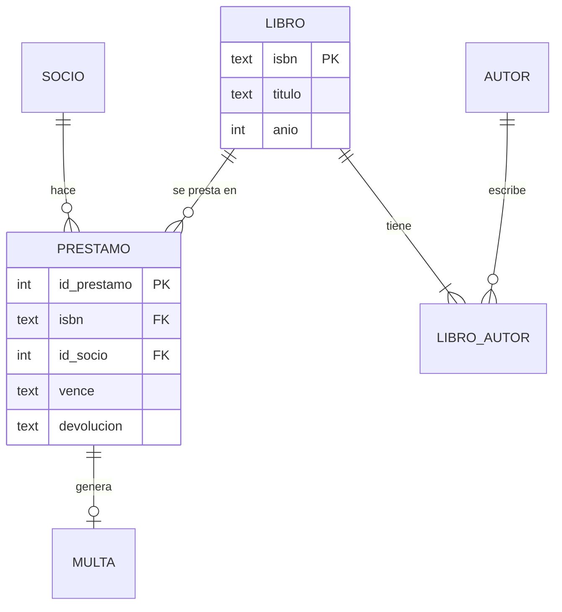

# Fundamentos de Bases de Datos - Modelos de datos

## 2.2 Modelo relacional.

---

El **modelo relacional**, propuesto por Edgar F. Codd en 1970, representa todos los datos como **relaciones**: conjuntos de tuplas que se dibujan como tablas. Su fuerza está en la sencillez y en la base matemática: los datos se describen con teoría de conjuntos, las consultas son expresiones de un **álgebra** cerrada, y la forma de almacenar los datos queda fuera del modelo. Es el modelo de casi todos los SMBD en uso (PostgreSQL, MySQL, Oracle, SQL Server, SQLite). Este tema presenta sus definiciones, sus restricciones de integridad, las operaciones del álgebra relacional y una primera idea de la normalización; los temas 4, 5 y 6 desarrollan cada parte.

### Dominios, relaciones y tuplas

Un **dominio** $D$ es un conjunto de valores atómicos: los enteros, las cadenas de a lo más 100 caracteres, las fechas. Un **esquema de relación** $R(A_1, \dots, A_n)$ es un nombre con una lista de **atributos**, cada uno con su dominio $\operatorname{dom}(A_i).$ Una **relación** o **instancia** de ese esquema es un conjunto finito de tuplas,

$$r(R) \subseteq \operatorname{dom}(A_1) \times \operatorname{dom}(A_2) \times \dots \times \operatorname{dom}(A_n),$$

y cada tupla $t$ asigna a cada atributo $A_i$ un valor $t[A_i]$ de su dominio o el valor especial **nulo**. El **grado** de la relación es el número $n$ de atributos y su **cardinalidad** es el número de tuplas.

Como una relación es un conjunto, de la definición se siguen tres propiedades: no hay tuplas repetidas, el orden de las tuplas no importa y, como los atributos se identifican por nombre, tampoco importa el orden de las columnas. Que los valores sean atómicos es la **primera forma normal**: un atributo no puede contener una lista ni una tabla. SQL relaja la primera propiedad: una tabla puede tener filas repetidas si no tiene clave, y una consulta devuelve duplicados salvo que se pida `DISTINCT`.

### Claves

- **Superclave:** un conjunto de atributos $K$ tal que ninguna instancia válida tiene dos tuplas distintas con los mismos valores en $K,$ es decir, $t_1[K] = t_2[K]$ implica $t_1 = t_2.$ El conjunto de todos los atributos siempre es superclave, porque no hay tuplas repetidas.
- **Clave candidata:** una superclave mínima: si se le quita cualquier atributo, deja de ser superclave.
- **Clave primaria:** la clave candidata elegida para identificar las tuplas; se subraya en el esquema.
- **Clave foránea:** un conjunto de atributos $FK$ de una relación $R$ que hace referencia a la clave primaria de otra relación $S.$

Ser clave es una propiedad del esquema, no de una instancia en particular: que en la tabla actual no haya dos empleados con el mismo nombre no hace del nombre una clave.

### Restricciones de integridad

1. **De dominio:** cada valor pertenece al dominio de su atributo, o es nulo si se permite.
2. **De entidad:** ningún atributo de la clave primaria es nulo, porque la clave identifica a la tupla.
3. **Referencial:** cada valor de una clave foránea es nulo o aparece como clave primaria en la relación referenciada:

$$\forall t \in r(R): \; t[FK] \text{ es nulo} \;\lor\; \exists s \in r(S): s[PK] = t[FK].$$

El SMBD rechaza cualquier inserción, actualización o eliminación que viole alguna de ellas, o, para la referencial, puede propagar el cambio en cascada (tema 8.3).



### Álgebra relacional

El álgebra relacional tiene operaciones que toman relaciones y producen relaciones; esa **cerradura** permite componerlas. Las operaciones básicas son seis:

- **Selección:** $\sigma_{p}(R) = \{t \in R \mid p(t)\}$ conserva las tuplas que cumplen el predicado $p.$
- **Proyección:** $\pi_{A_1, \dots, A_k}(R)$ conserva solo esos atributos y, por ser un conjunto, elimina los duplicados que resulten.
- **Unión** $R \cup S$ y **diferencia** $R - S,$ para relaciones **compatibles**: con el mismo número de atributos y dominios correspondientes iguales.
- **Producto cartesiano:** $R \times S$ combina cada tupla de $R$ con cada tupla de $S;$ tiene grado $n + m$ y cardinalidad $|R| \cdot |S|.$
- **Renombramiento:** $\rho_{S(B_1, \dots, B_n)}(R)$ cambia el nombre de la relación o de sus atributos.

Las demás se definen con ellas:

- **Intersección:** $R \cap S = R - (R - S).$
- **Theta-reunión:** $R \bowtie_{\theta} S = \sigma_{\theta}(R \times S),$ que combina solo los pares que cumplen la condición $\theta.$
- **Reunión natural:** $R \bowtie S$ iguala los atributos con el mismo nombre y los deja una sola vez.
- **División:** $R \div S$ da las tuplas de $R$ que están combinadas con **todas** las tuplas de $S;$ responde preguntas como "los socios que han leído todos los libros de Date".

Por ejemplo, los nombres de los empleados que ganan más de 50,000 en un departamento de Nueva York son

$$\pi_{\text{nombre}}\Big(\sigma_{\text{salario} \gt 50000}(\text{Empleado}) \bowtie_{\text{departamento} = \text{id\_departamento}} \sigma_{\text{ubicacion} = \text{'Nueva York'}}(\text{Departamento})\Big).$$

SQL es una versión de esta álgebra con duplicados: `SELECT` es la proyección, `WHERE` la selección y `JOIN` la reunión. El tema 4.3 desarrolla el álgebra y el 4.4 su equivalente declarativo, el cálculo relacional.

### Normalización

Una relación con datos de varias entidades repite información, y la repetición provoca **anomalías**: al actualizar el nombre de un producto hay que cambiarlo en todas sus ventas; no se puede registrar un producto que aún no se ha vendido; al borrar la única venta de un cliente se pierde el cliente. La **normalización** descompone la relación según sus **dependencias funcionales**, de modo que cada hecho se guarde una sola vez y la reunión de las partes reconstruya exactamente la relación original:

- **Primera forma normal** (1FN): valores atómicos, sin grupos repetidos.
- **Segunda forma normal** (2FN): 1FN, y ningún atributo que no sea de clave depende de solo una parte de una clave candidata.
- **Tercera forma normal** (3FN): 2FN, y ningún atributo que no sea de clave depende transitivamente de una clave.
- **Forma normal de Boyce-Codd:** todo determinante de una dependencia no trivial es superclave.

El tema 5 las define con precisión y demuestra cuándo una descomposición no pierde información.

**Ventajas** del modelo: es sencillo, tiene una base formal que permite optimizar las consultas reescribiéndolas, ofrece independencia de datos y un lenguaje declarativo estándar. **Desventajas:** los objetos complejos se reparten entre varias tablas que hay que reunir, el esquema fijo se adapta mal a datos heterogéneos (tema 2.3) y queda un desajuste con los lenguajes orientados a objetos (tema 2.1).

### Implementación en Python

El programa implementa el álgebra relacional sobre relaciones representadas como conjuntos de tuplas, con selección, proyección, renombramiento, producto, theta-reunión y reunión natural. Resuelve con ella el ejercicio 3 y comprueba que las consultas SQL equivalentes en SQLite dan las mismas relaciones; muestra al SMBD rechazando violaciones de integridad. Después normaliza la relación de ventas del ejercicio 2 por proyecciones y verifica que la reunión natural de las partes la reconstruye. Por último crea el esquema de biblioteca del ejercicio 1 y ejecuta las consultas del ejercicio 4.

```python
import sqlite3

# --- álgebra relacional sobre relaciones como conjuntos de tuplas con nombre ---
class Rel:
    def __init__(self, atributos, tuplas):
        self.atr = tuple(atributos); self.t = {tuple(x) for x in tuplas}     # conjunto: sin duplicados
    def filas(self): return [dict(zip(self.atr, x)) for x in sorted(self.t, key=str)]
    def __repr__(self): return f"{self.atr} {sorted(self.t, key=str)}"

def sigma(R, pred): return Rel(R.atr, [x for x in R.t if pred(dict(zip(R.atr, x)))])
def pi(R, *atrs): return Rel(atrs, [tuple(dict(zip(R.atr, x))[a] for a in atrs) for x in R.t])
def rho(R, **nuevo): return Rel([nuevo.get(a, a) for a in R.atr], R.t)
def producto(R, S):
    assert not set(R.atr) & set(S.atr), "renombra antes los atributos repetidos"
    return Rel(R.atr + S.atr, [x + y for x in R.t for y in S.t])
def reunion(R, S, pred): return sigma(producto(R, S), pred)                # theta-reunión
def natural(R, S):
    comunes = [a for a in R.atr if a in S.atr]
    extra = [a for a in S.atr if a not in comunes]
    out = []
    for x in R.t:
        dx = dict(zip(R.atr, x))
        for y in S.t:
            dy = dict(zip(S.atr, y))
            if all(dx[a] == dy[a] for a in comunes): out.append(x + tuple(dy[a] for a in extra))
    return Rel(R.atr + tuple(extra), out)

# --- Ejercicio 3: Empleado y Departamento ---
emp = Rel(("id_empleado", "nombre", "departamento", "salario"),
          [(1, "Ana", 10, 62000), (2, "Beto", 20, 48000), (3, "Carla", 10, 51000), (4, "Dante", 30, 39000), (5, "Eva", 20, 75000)])
dep = Rel(("id_departamento", "nombre", "ubicacion"),
          [(10, "Ventas", "Nueva York"), (20, "Sistemas", "Monterrey"), (30, "Legal", "Nueva York"), (40, "Compras", "Lima")])
r1 = pi(sigma(emp, lambda t: t["salario"] > 50000), "nombre")
d = rho(dep, nombre="nombre_dep")
r2 = pi(reunion(emp, d, lambda t: t["departamento"] == t["id_departamento"]), "nombre_dep", "nombre")
r3 = pi(reunion(emp, sigma(d, lambda t: t["ubicacion"] == "Nueva York"),
                lambda t: t["departamento"] == t["id_departamento"]), "nombre")
print("ejercicio 3.1:", r1)
print("ejercicio 3.2:", r2)
print("ejercicio 3.3:", r3)

# las mismas consultas en SQL dan las mismas relaciones
db = sqlite3.connect(":memory:")
db.execute("PRAGMA foreign_keys = ON")
db.executescript("""
CREATE TABLE departamento (id_departamento INTEGER PRIMARY KEY, nombre TEXT NOT NULL, ubicacion TEXT);
CREATE TABLE empleado (id_empleado INTEGER PRIMARY KEY, nombre TEXT NOT NULL,
                       departamento INTEGER REFERENCES departamento, salario NUMERIC CHECK (salario >= 0));
""")
db.executemany("INSERT INTO departamento VALUES (?, ?, ?)", sorted(dep.t))
db.executemany("INSERT INTO empleado VALUES (?, ?, ?, ?)", sorted(emp.t))
sql = {"3.1": ("SELECT DISTINCT nombre FROM empleado WHERE salario > 50000", r1),
       "3.2": ("""SELECT DISTINCT d.nombre, e.nombre FROM empleado e JOIN departamento d
                  ON e.departamento = d.id_departamento""", r2),
       "3.3": ("""SELECT DISTINCT e.nombre FROM empleado e JOIN departamento d
                  ON e.departamento = d.id_departamento WHERE d.ubicacion = 'Nueva York'""", r3)}
print("SQL = álgebra:", {k: set(db.execute(q).fetchall()) == r.t for k, (q, r) in sql.items()})
try:
    db.execute("INSERT INTO empleado VALUES (6, 'Fer', 99, 40000)")
except sqlite3.IntegrityError as e:
    print("integridad referencial:", e)
try:
    db.execute("INSERT INTO empleado VALUES (1, 'Gil', 10, 40000)")
except sqlite3.IntegrityError as e:
    print("integridad de entidad (clave repetida):", e)

# --- Ejercicio 2: normalización de Ventas ---
plana = Rel(("id_venta", "fecha", "id_cliente", "nombre_cliente", "id_producto", "nombre_producto", "cantidad", "precio"),
            [(1, "2026-10-01", "C1", "Rosa", "P1", "Teclado", 2, 450), (1, "2026-10-01", "C1", "Rosa", "P2", "Ratón", 1, 200),
             (2, "2026-10-02", "C2", "Iván", "P1", "Teclado", 1, 450), (3, "2026-10-05", "C1", "Rosa", "P3", "Monitor", 1, 3200)])
venta = pi(plana, "id_venta", "fecha", "id_cliente")
cliente = pi(plana, "id_cliente", "nombre_cliente")
producto_ = pi(plana, "id_producto", "nombre_producto", "precio")
detalle = pi(plana, "id_venta", "id_producto", "cantidad")
print("ejercicio 2: 1FN tiene", len(plana.t), "tuplas; 3FN:", {"venta": len(venta.t), "cliente": len(cliente.t),
      "producto": len(producto_.t), "detalle": len(detalle.t)})
print("   'Teclado' aparece", sum(x[5] == "Teclado" for x in plana.t), "veces en 1FN y",
      sum(x[1] == "Teclado" for x in producto_.t), "vez en 3FN")
reconstruida = natural(natural(natural(detalle, venta), cliente), producto_)
print("   la reunión natural reconstruye la relación original:",
      {tuple(f[a] for a in plana.atr) for f in reconstruida.filas()} == plana.t)

# --- Ejercicios 1 y 4: biblioteca relacional ---
db.executescript("""
CREATE TABLE autor (id_autor INTEGER PRIMARY KEY, nombre TEXT NOT NULL);
CREATE TABLE libro (isbn TEXT PRIMARY KEY, titulo TEXT NOT NULL, anio INTEGER);
CREATE TABLE libro_autor (isbn TEXT REFERENCES libro, id_autor INTEGER REFERENCES autor, orden INTEGER NOT NULL,
                          PRIMARY KEY (isbn, id_autor));
CREATE TABLE socio (id_socio INTEGER PRIMARY KEY, nombre TEXT NOT NULL);
CREATE TABLE prestamo (id_prestamo INTEGER PRIMARY KEY, isbn TEXT NOT NULL REFERENCES libro,
                       id_socio INTEGER NOT NULL REFERENCES socio, salida TEXT NOT NULL, vence TEXT NOT NULL,
                       devolucion TEXT, CHECK (vence > salida));
CREATE TABLE multa (id_prestamo INTEGER PRIMARY KEY REFERENCES prestamo, monto NUMERIC NOT NULL CHECK (monto > 0),
                    pagada INTEGER NOT NULL DEFAULT 0);
INSERT INTO autor VALUES (1, 'Elmasri'), (2, 'Navathe'), (3, 'Date'), (4, 'Codd');
INSERT INTO libro VALUES ('B1', 'Fundamentals of Database Systems', 2016), ('B2', 'An Introduction to Database Systems', 2003),
                         ('B3', 'The Relational Model for Database Management', 1990), ('B4', 'Database in Depth', 2005),
                         ('B5', 'SQL and Relational Theory', 2015), ('B6', 'Readings in Database Systems', 2005);
INSERT INTO libro_autor VALUES ('B1', 1, 1), ('B1', 2, 2), ('B2', 3, 1), ('B3', 4, 1), ('B4', 3, 1), ('B5', 3, 1);
INSERT INTO socio VALUES (1, 'Ana'), (2, 'Luis'), (3, 'Marta');
INSERT INTO prestamo (isbn, id_socio, salida, vence, devolucion) VALUES
  ('B1', 1, '2026-08-01', '2026-08-15', '2026-08-20'), ('B1', 2, '2026-09-01', '2026-09-15', '2026-09-14'),
  ('B1', 3, '2026-10-20', '2026-11-03', NULL),         ('B2', 1, '2026-09-05', '2026-09-19', '2026-09-25'),
  ('B2', 2, '2026-10-25', '2026-11-08', NULL),         ('B3', 1, '2026-10-01', '2026-10-15', NULL),
  ('B4', 3, '2026-07-01', '2026-07-15', '2026-07-10'), ('B5', 2, '2026-06-01', '2026-06-15', '2026-06-16'),
  ('B4', 1, '2026-09-10', '2026-09-24', '2026-09-24'), ('B6', 3, '2026-05-02', '2026-05-16', '2026-05-15');
INSERT INTO multa VALUES (1, 50, 1), (4, 60, 0), (8, 10, 0);
""")
print("ejercicio 4.1, prestados ahora:", db.execute("""
    SELECT l.titulo, s.nombre, p.vence FROM prestamo p JOIN libro l USING (isbn) JOIN socio s USING (id_socio)
    WHERE p.devolucion IS NULL ORDER BY p.vence""").fetchall())
print("ejercicio 4.2, multas de Ana (total, pendiente):", db.execute("""
    SELECT COALESCE(SUM(m.monto), 0), COALESCE(SUM(m.monto) FILTER (WHERE m.pagada = 0), 0)
    FROM socio s JOIN prestamo p USING (id_socio) JOIN multa m USING (id_prestamo) WHERE s.nombre = 'Ana'""").fetchone())
print("ejercicio 4.3, los 5 más prestados:", db.execute("""
    SELECT l.titulo, COUNT(*) AS veces FROM prestamo p JOIN libro l USING (isbn)
    GROUP BY l.isbn ORDER BY veces DESC, l.titulo LIMIT 5""").fetchall())
print("   autores de B1 en orden:", db.execute("""
    SELECT GROUP_CONCAT(nombre, ', ') FROM (SELECT a.nombre FROM libro_autor la JOIN autor a USING (id_autor)
    WHERE la.isbn = 'B1' ORDER BY la.orden)""").fetchone()[0])
```

Salida:

```text
ejercicio 3.1: ('nombre',) [('Ana',), ('Carla',), ('Eva',)]
ejercicio 3.2: ('nombre_dep', 'nombre') [('Legal', 'Dante'), ('Sistemas', 'Beto'), ('Sistemas', 'Eva'), ('Ventas', 'Ana'), ('Ventas', 'Carla')]
ejercicio 3.3: ('nombre',) [('Ana',), ('Carla',), ('Dante',)]
SQL = álgebra: {'3.1': True, '3.2': True, '3.3': True}
integridad referencial: FOREIGN KEY constraint failed
integridad de entidad (clave repetida): UNIQUE constraint failed: empleado.id_empleado
ejercicio 2: 1FN tiene 4 tuplas; 3FN: {'venta': 3, 'cliente': 2, 'producto': 3, 'detalle': 4}
   'Teclado' aparece 2 veces en 1FN y 1 vez en 3FN
   la reunión natural reconstruye la relación original: True
ejercicio 4.1, prestados ahora: [('The Relational Model for Database Management', 'Ana', '2026-10-15'), ('Fundamentals of Database Systems', 'Marta', '2026-11-03'), ('An Introduction to Database Systems', 'Luis', '2026-11-08')]
ejercicio 4.2, multas de Ana (total, pendiente): (110, 60)
ejercicio 4.3, los 5 más prestados: [('Fundamentals of Database Systems', 3), ('An Introduction to Database Systems', 2), ('Database in Depth', 2), ('Readings in Database Systems', 1), ('SQL and Relational Theory', 1)]
   autores de B1 en orden: Elmasri, Navathe
```

### Ejercicios Propuestos

1. **Diseño.** Diseña un esquema relacional para una biblioteca con libros de varios autores, socios, préstamos y multas por retraso.

2. **Normalización.** Normaliza hasta la tercera forma normal la relación no normalizada `Ventas(id_venta, fecha, id_cliente, nombre_cliente, (id_producto, nombre_producto, cantidad, precio))`, donde el paréntesis interior es un grupo repetido.

3. **Álgebra relacional.** Con las relaciones `Empleado(id_empleado, nombre, departamento, salario)` y `Departamento(id_departamento, nombre, ubicacion)`, escribe expresiones para los empleados que ganan más de 50,000, los nombres de los departamentos con sus empleados y los empleados que trabajan en Nueva York.

4. **SQL.** Para el esquema del ejercicio 1, escribe consultas para los libros prestados actualmente, la multa total de un socio y los 5 libros más prestados.

### Soluciones

**Ejercicio 1.** Son seis relaciones, las del diagrama: `autor`, `libro`, `socio`, `prestamo`, `multa` y `libro_autor`. La relación de muchos a muchos entre libros y autores no cabe en ninguna de las dos tablas sin romper la primera forma normal, así que se representa con `libro_autor(isbn, id_autor, orden)`, cuya clave es el par y cuyo atributo `orden` guarda el orden de los autores, que en una relación no existe por sí mismo. Cada préstamo hace referencia a un libro y a un socio, con la restricción de que el vencimiento sea posterior a la salida, y `devolucion` nula significa que el libro sigue prestado. `multa` usa como clave primaria la clave foránea del préstamo: así cada préstamo genera a lo sumo una multa.

**Ejercicio 2.** Para pasar a **1FN** se aplana el grupo repetido: una tupla por cada producto de cada venta, con clave $(\text{id\_venta}, \text{id\_producto}).$ Las dependencias funcionales son

$$\text{id\_venta} \to \text{fecha}, \text{id\_cliente}; \quad \text{id\_cliente} \to \text{nombre\_cliente}; \quad \text{id\_producto} \to \text{nombre\_producto}, \text{precio};$$

$$\text{id\_venta}, \text{id\_producto} \to \text{cantidad}.$$

Para pasar a **2FN** se separan las dependencias de partes de la clave: `Venta(id_venta, fecha, id_cliente, nombre_cliente)`, `Producto(id_producto, nombre_producto, precio)` y `Detalle(id_venta, id_producto, cantidad)`. Para **3FN** falta quitar la dependencia transitiva de `nombre_cliente` respecto de `id_venta` a través de `id_cliente`: `Cliente(id_cliente, nombre_cliente)` y `Venta(id_venta, fecha, id_cliente)`. Queda en cuatro relaciones. Si el precio puede cambiar con el tiempo, el precio cobrado es un hecho de la venta y no del producto, y debe ir en `Detalle`; aquí se supuso un precio fijo. El programa construye las proyecciones: el nombre "Teclado", que aparecía en dos tuplas, queda en una, y la reunión natural de las cuatro relaciones da exactamente las tuplas originales, así que la descomposición no perdió información.

**Ejercicio 3.**

$$\pi_{\text{nombre}}(\sigma_{\text{salario} \gt 50000}(\text{Empleado}))$$

$$\pi_{\text{nombre\_dep}, \text{nombre}}\big(\text{Empleado} \bowtie_{\text{departamento} = \text{id\_departamento}} \rho_{\text{nombre} \to \text{nombre\_dep}}(\text{Departamento})\big)$$

$$\pi_{\text{nombre}}\big(\text{Empleado} \bowtie_{\text{departamento} = \text{id\_departamento}} \sigma_{\text{ubicacion} = \text{'Nueva York'}}(\text{Departamento})\big)$$

En la segunda hace falta el renombramiento porque las dos relaciones tienen un atributo `nombre` con significados distintos; sin él, la reunión natural los igualaría y buscaría empleados que se llamen como su departamento. En la tercera conviene seleccionar antes de reunir: el resultado es el mismo y la reunión trabaja con menos tuplas, que es la idea de la optimización algebraica. En el programa, Compras no aparece en la segunda consulta porque no tiene empleados; para conservarlo haría falta una reunión externa.

**Ejercicio 4.** Son las consultas del programa. Los libros prestados actualmente son los de préstamos con `devolucion` nula; al 3 de noviembre de 2026, el préstamo de Ana ya venció. La multa de un socio se obtiene reuniendo sus préstamos con las multas; `COALESCE` hace que un socio sin multas dé 0 en lugar de nulo, y el filtro separa lo pendiente de lo pagado. Los más prestados se agrupan por libro, se ordenan por número de préstamos y se cortan con `LIMIT 5`; el desempate por título hace el resultado determinista, y sin él el quinto lugar entre dos libros con un préstamo quedaría al azar.

### Referencias

1. Codd, E. F., A relational model of data for large shared data banks. _Communications of the ACM_ 13(6), 1970.
2. Elmasri, R., and Navathe, S. B., _Fundamentals of Database Systems_. Pearson, 2016. Capítulos 5 y 8.
3. Silberschatz, A., Korth, H. F., and Sudarshan, S., _Database System Concepts_. McGraw-Hill, 2019. Capítulo 2.
4. Ullman, J. D., and Widom, J., _A First Course in Database Systems_. Pearson, 2008. Capítulo 2.
5. Date, C. J., _SQL and Relational Theory_. O'Reilly, 2015.
