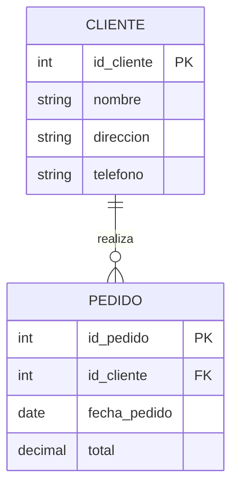

# Fundamentos de Bases de Datos - Modelos de datos

## 2.2 Modelo relacional.

---

El modelo relacional, propuesto por Edgar F. Codd en 1970, es el paradigma más utilizado en la actualidad para la gestión de bases de datos. Se basa en el concepto matemático de relación y utiliza tablas para representar tanto los datos como las relaciones entre ellos.

### Definición y Conceptos Fundamentales

#### Relación

Una **relación** es una estructura de datos bidimensional que organiza la información en filas y columnas. Matemáticamente, una relación es un subconjunto del producto cartesiano de uno o más dominios.

$$R \subseteq D_1 \times D_2 \times \dots \times D_n$$

Donde $D_1, D_2, \dots, D_n$ son dominios (conjuntos de valores válidos).

#### Tupla y Atributos

- **Tupla**: Cada fila en una relación representa una tupla
- **Atributo**: Cada columna representa un atributo con un nombre único
- **Grado**: Número de atributos de una relación
- **Cardinalidad**: Número de tuplas de una relación

#### Esquema e Instancia

- **Esquema de relación**: Estructura que describe la relación (nombre y tipo de atributos)
- **Instancia de relación**: Conjunto actual de tuplas en la relación

### Estructura del Modelo Relacional



### Restricciones del Modelo Relacional

#### Restricciones de Integridad

1. **Integridad de entidad**: Ningún atributo de la clave primaria puede contener valores nulos

   $$\forall t \in R, t[PK] \neq \text{null}$$

2. **Integridad referencial**: Para cada valor de clave foránea debe existir un valor correspondiente en la relación referenciada

   $$\forall t \in R, t[FK] = \text{null} \lor \exists s \in S \text{ tal que } s[PK] = t[FK]$$

3. **Restricciones de dominio**: Los valores de los atributos deben pertenecer a su dominio definido

#### Claves

- **Superclave**: Conjunto de atributos que identifican unívocamente cada tupla
- **Clave candidata**: Superclave mínima (sin atributos redundantes)
- **Clave primaria**: Clave candidata seleccionada para identificar tuplas
- **Clave foránea**: Atributos que referencian la clave primaria de otra relación

### Álgebra Relacional

El álgebra relacional proporciona operaciones fundamentales para manipular relaciones:

#### Operaciones Básicas

1. **Selección $(\sigma)$**: Selecciona tuplas que satisfacen un predicado

   $$\sigma_{\text{condición}}(R)$$

2. **Proyección $(\pi)$**: Selecciona columnas específicas

   $$\pi_{atributo1, atributo2, \dots}(R)$$

3. **Unión $(\cup)$**: Combina tuplas de dos relaciones compatibles

   $$R \cup S = \{t \mid t \in R \lor t \in S\}$$

4. **Diferencia $(-)$**: Encuentra tuplas en R pero no en S

   $$R - S = \{t \mid t \in R \land t \notin S\}$$

5. **Producto Cartesiano $(\times)$**: Combina cada tupla de R con cada tupla de S

   $$R \times S = \{t \cdot s \mid t \in R \land s \in S\}$$

6. **Renombramiento $(\rho)$**: Cambia el nombre de los atributos

   $$\rho_{nuevo\_nombre}(R)$$

#### Operaciones Adicionales

7. **Intersección $(\cap)$**: Encuentra tuplas comunes a R y S

   $$R \cap S = \{t \mid t \in R \land t \in S\}$$

8. **Reunión ( Join $\bowtie$ )**: Combina tuplas relacionadas de dos relaciones

   $$R \bowtie_{\text{condición}} S = \sigma_{\text{condición}}(R \times S)$$

9. **División $(/)$**: Encuentra valores que se relacionan con todos los valores de otra relación

### Normalización

La normalización es el proceso de organizar los datos para reducir la redundancia y mejorar la integridad.

#### Formas Normales

1. **Primera Forma Normal (1NF)**: Eliminar grupos repetitivos y asegurar atomicidad
2. **Segunda Forma Normal (2NF)**: Cumplir con 1NF y que todos los atributos no clave dependan de toda la clave primaria
3. **Tercera Forma Normal (3NF)**: Cumplir con 2NF y que ningún atributo no clave dependa transitivamente de la clave primaria
4. **Forma Normal de Boyce-Codd (BCNF)**: Versión más fuerte de 3NF donde toda determinante es una clave candidata

### Ejemplos Prácticos

#### Creación de Tablas en SQL

```sql
-- Ejemplo de creación de tablas
CREATE TABLE Cliente (
    id_cliente INT PRIMARY KEY,
    nombre VARCHAR(100) NOT NULL,
    direccion VARCHAR(200),
    telefono VARCHAR(15)
);

CREATE TABLE Pedido (
    id_pedido INT PRIMARY KEY,
    id_cliente INT,
    fecha_pedido DATE NOT NULL,
    total DECIMAL(10, 2),
    FOREIGN KEY (id_cliente) REFERENCES Cliente(id_cliente)
);
```

#### Consultas con Álgebra Relacional

Encontrar nombres de clientes con pedidos superiores a $100:

$$\pi_{nombre}(\sigma_{total > 100}(Cliente \bowtie_{Cliente.id\_cliente = Pedido.id\_cliente} Pedido))$$

#### Consulta SQL Equivalente

```sql
SELECT c.nombre
FROM Cliente c
JOIN Pedido p ON c.id_cliente = p.id_cliente
WHERE p.total > 100;
```

### Ventajas y Desventajas

#### Ventajas

- Independencia de los datos físicos y lógicos
- Flexibilidad en las consultas
- Base matemática sólida
- Reducción de redundancia
- Facilidad de uso

#### Desventajas

- Puede tener menor rendimiento en aplicaciones complejas
- Dificultad para representar ciertos tipos de datos complejos
- Sobrecarga en operaciones de join para consultas complejas

### Ejercicios Propuestos

#### Ejercicio 1: Diseño de Base de Datos

Diseñe un esquema relacional para un sistema de biblioteca que incluya:

- Libros (con múltiples autores)
- Socios
- Préstamos
- Multas por retraso

#### Ejercicio 2: Normalización

Dada la siguiente relación no normalizada:

**Ventas** (id_venta, fecha, id_cliente, nombre_cliente, (id_producto, nombre_producto, cantidad, precio))

Normalice hasta la tercera forma normal (3NF).

#### Ejercicio 3: Álgebra Relacional

Dadas las relaciones:

- **Empleado** (id_empleado, nombre, departamento, salario)
- **Departamento** (id_departamento, nombre, ubicación)

Escriba expresiones de álgebra relacional para:

1. Encontrar empleados que ganen más de $50,000
2. Listar nombres de departamentos con sus empleados
3. Encontrar empleados que trabajen en la ubicación "Nueva York"

#### Ejercicio 4: SQL

Para el esquema del ejercicio 1, escriba consultas SQL para:

1. Encontrar libros prestados actualmente
2. Calcular la multa total de un socio específico
3. Listar los 5 libros más prestados

### Referencias

#### Bibliografía Básica

1. Elmasri, R., & Navathe, S. B. (2006). _Fundamentals of Database Systems_ (4th ed.). Addison-Wesley. (Capítulos 3, 5, 6, 7)
2. Silberschatz, A., Korth, H. F., & Sudarshan, S. (2006). _Fundamentals of Database Systems_ (5th ed.). McGraw-Hill. (Capítulos 2, 3, 6, 7)
3. Ullman, J. D., & Widom, J. (2008). _A First Course in Database Systems_ (3rd ed.). Prentice Hall. (Capítulos 2, 3, 6)

#### Bibliografía Complementaria

1. Harrington, J. (2009). _Relational Database Design and Implementation_ (3rd ed.). Morgan Kaufmann.
2. Kline, K., Kline, D., & Hunt, B. (2008). _SQL in a Nutshell_. O'Reilly.

### Recursos Adicionales

- Diagramas Entidad-Relación para modelar antes de implementar el modelo relacional
- Herramientas de normalización y análisis de dependencias
- Sistemas de gestión de bases de datos relacionales populares: MySQL, PostgreSQL, Oracle, SQL Server
