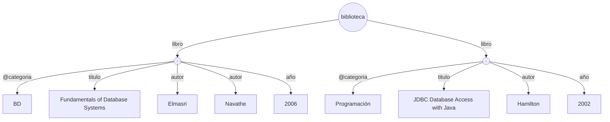

# Fundamentos de Bases de Datos - Modelos de datos

## 2.3 Modelo de datos semiestructurados.

---

Los **datos semiestructurados** tienen estructura, pero no un esquema fijo declarado de antemano: cada dato lleva consigo los nombres de sus campos, distintos registros pueden tener campos distintos, y los valores pueden anidarse. Son los datos de la web, de los mensajes entre sistemas, de las bitácoras y de las bases de documentos. Este tema presenta el modelo de **árbol** o **grafo etiquetado** que los describe, sus dos formatos principales, **XML** y **JSON**, sus lenguajes de consulta, y lo compara con el modelo relacional, con un mismo conjunto de datos en los tres formatos.

### El modelo: datos que se describen a sí mismos

En el modelo relacional, el esquema se declara una vez y las tuplas solo llevan valores. En el semiestructurado, cada valor viaja con su etiqueta: el dato es `"titulo": "SQL in a Nutshell"`, no solo la cadena. Por eso se dice que los datos son **autodescriptivos**, y el esquema, si existe, se puede deducir de ellos.

Formalmente, un documento es un **árbol con raíz** cuyos nodos internos son objetos o elementos, cuyas aristas llevan etiquetas (los nombres de los campos) y cuyas hojas son valores atómicos. Si se permiten referencias entre nodos, como los atributos `id` e `idref` de XML, el árbol se vuelve un **grafo dirigido etiquetado**. Este modelo, con lenguajes como Lorel y UnQL, se estudió en los años noventa para integrar datos de fuentes heterogéneas.



Sus características son:

- **Esquema flexible:** dos registros del mismo tipo pueden tener campos distintos, y un campo puede faltar sin que haga falta un nulo.
- **Anidamiento:** un valor puede ser un objeto o una lista, así que un libro contiene directamente su lista de autores, sin una tabla aparte.
- **Orden:** en XML el orden de los elementos hijos forma parte del documento; en JSON importa en los arreglos y no en los campos de un objeto.
- **Tipos débiles:** en XML todo valor es texto mientras un esquema no diga otra cosa; JSON distingue cadenas, números, booleanos y nulo, pero no tiene fechas.

### XML

XML (W3C, 1998) es un lenguaje de marcado: un documento es un árbol de **elementos** delimitados por etiquetas, con **atributos** dentro de la etiqueta de apertura. Un documento está **bien formado** si cumple la sintaxis (una raíz, etiquetas bien anidadas y cerradas), y es **válido** si además cumple un esquema escrito en DTD o en **XML Schema**, que declaran los elementos permitidos, su orden, su número de apariciones y sus tipos. El esquema es opcional: esa es la flexibilidad del modelo.

Para consultar XML existen:

- **XPath:** expresiones de camino que seleccionan nodos. `/biblioteca/libro/titulo` baja por el árbol desde la raíz; `//autor` busca en cualquier profundidad; los **predicados** entre corchetes filtran, como `//libro[@categoria='BD']` o `//libro[año > 2005]`.
- **XQuery:** un lenguaje completo construido sobre XPath, con expresiones **FLWOR** (`for`, `let`, `where`, `order by`, `return`) análogas a `SELECT ... FROM ... WHERE` y capaces de construir documentos nuevos.
- **XSLT:** transformaciones de un documento XML en otro, en HTML o en texto.

### JSON

JSON (ECMA-404) nació de la sintaxis de los objetos de JavaScript y hoy es el formato más usado en servicios web. Tiene objetos (pares nombre-valor entre llaves), arreglos (entre corchetes), cadenas, números, booleanos y `null`. Es más compacto que XML y se lee directamente como estructuras de datos de casi cualquier lenguaje. Sus esquemas se describen con **JSON Schema**, y se consulta con **JSONPath** (`$.libros[?(@.anio > 2005)].titulo`), con los lenguajes de las bases de documentos o con las funciones JSON de SQL.

### Almacenamiento

- **Bases de documentos:** MongoDB y CouchDB guardan documentos JSON (MongoDB en su formato binario BSON) en colecciones sin esquema fijo, con índices sobre campos anidados y consultas como `db.libros.find({"anio": {"$gt": 2005}})`.
- **SMBD relacionales con tipos JSON y XML:** PostgreSQL (`jsonb`), MySQL, SQL Server, Oracle y SQLite guardan documentos en una columna y los consultan con funciones de SQL estándar desde SQL:2016. Así se combinan columnas fijas para lo que siempre existe con un documento para lo variable.
- **Bases XML nativas,** como BaseX y eXist-db, que se consultan con XQuery.

### Comparación con el modelo relacional

| Aspecto           | Relacional                                                      | Semiestructurado                                                                |
| ----------------- | --------------------------------------------------------------- | ------------------------------------------------------------------------------- |
| Esquema           | Fijo, declarado antes de los datos                              | Implícito en los datos, opcional                                                |
| Datos variables   | Columnas nulas o tablas adicionales                             | Cada documento tiene sus propios campos                                         |
| Datos anidados    | Se reparten en tablas y se reconstruyen con reuniones           | Se guardan juntos y se leen de una vez                                          |
| Integridad        | Tipos, claves, claves foráneas y `CHECK` en el SMBD             | Débil; la aplicación o un esquema opcional la verifican                         |
| Consultas         | SQL declarativo, optimizable, con reuniones arbitrarias         | Muy rápidas por camino dentro de un documento; las reuniones son más difíciles |
| Redundancia       | La normalización la elimina                                     | Frecuente: un dato compartido se copia en cada documento                        |
| Escala horizontal | Más difícil con transacciones entre tablas                      | Natural si cada documento se procesa por separado                               |

Ninguno es mejor en general: el semiestructurado conviene cuando los datos son heterogéneos o cambian de forma, cuando se leen como unidades completas, o para intercambio entre sistemas; el relacional, cuando hay que consultarlos de muchas formas, garantizar integridad entre entidades y evitar redundancia.

### Implementación en Python

El programa carga el documento XML del ejercicio 2 con `xml.etree.ElementTree` y responde sus consultas con el subconjunto de XPath que esa biblioteca implementa; el filtro numérico, que ese subconjunto no permite, se escribe como el `where` de una expresión FLWOR. Para el ejercicio 1 representa dos estudiantes con campos distintos en JSON y los convierte en XML, y muestra cómo se consulta un dato heterogéneo. Para el ejercicio 3 carga los mismos datos en un esquema relacional en SQLite, repite la consulta en SQL, muestra una restricción que el documento no habría verificado y reconstruye el documento anidado con las funciones JSON de SQLite.

```python
import json, sqlite3
import xml.etree.ElementTree as ET

# --- Ejercicio 2: el documento del enunciado y sus consultas ---
biblioteca = ET.fromstring("""
<biblioteca>
  <libro categoria="BD">
    <titulo>Fundamentals of Database Systems</titulo>
    <autor>Elmasri</autor>
    <autor>Navathe</autor>
    <año>2006</año>
  </libro>
  <libro categoria="Programación">
    <titulo>JDBC Database Access with Java</titulo>
    <autor>Hamilton</autor>
    <año>2002</año>
  </libro>
  <libro categoria="BD">
    <titulo>SQL in a Nutshell</titulo>
    <autor>Kline</autor>
    <año>2008</año>
  </libro>
</biblioteca>""")
# ElementTree implementa un subconjunto de XPath: caminos, // y predicados [@atr='v'] y [hijo='v']
print("2.1 //libro/titulo:", [t.text for t in biblioteca.findall(".//libro/titulo")])
print("2.2 //libro[@categoria='BD']/titulo:", [t.text for t in biblioteca.findall(".//libro[@categoria='BD']/titulo")])
# los predicados numéricos como [año > 2005] no están en ese subconjunto: se filtra en Python, como un where de XQuery
print("2.3 libros con año > 2005:", [l.findtext("titulo") for l in biblioteca.iter("libro") if int(l.findtext("año")) > 2005])
print("2.4 //libro[@categoria='BD']/autor:", [a.text for a in biblioteca.findall(".//libro[@categoria='BD']/autor")])
print("    distinct-values(//autor):", sorted({a.text for a in biblioteca.iter("autor")}))

# --- Ejercicio 1: el mismo estudiante en JSON y en XML ---
estudiantes = [
    {"matricula": "A01", "nombre": "Elena Paz", "correo": "elena@ejemplo.mx", "carrera": "Ciencias de la Computación",
     "cursos": [{"codigo": "BD1", "nombre": "Bases de datos", "creditos": 8, "calificacion": 9.5},
                {"codigo": "AL1", "nombre": "Álgebra lineal", "creditos": 10, "calificacion": 8.0}],
     "historial": [{"semestre": "2026-1", "promedio": 9.1}, {"semestre": "2025-2", "promedio": 8.7}]},
    {"matricula": "A02", "nombre": "Marco Gil", "carrera": "Matemáticas",                   # sin correo: otro esquema
     "cursos": [{"codigo": "AL1", "nombre": "Álgebra lineal", "creditos": 10}],             # curso sin calificar aún
     "historial": [], "beca": {"tipo": "excelencia", "porcentaje": 50}}]                     # atributo que A01 no tiene
texto = json.dumps(estudiantes, ensure_ascii=False)
print("JSON:", len(texto), "caracteres; claves de A01:", sorted(estudiantes[0]), "| de A02:", sorted(estudiantes[1]))

raiz = ET.Element("estudiantes")
for e in estudiantes:
    x = ET.SubElement(raiz, "estudiante", matricula=e["matricula"])
    for campo in ("nombre", "correo", "carrera"):
        if campo in e: ET.SubElement(x, campo).text = e[campo]
    cs = ET.SubElement(x, "cursos")
    for c in e["cursos"]:
        ET.SubElement(cs, "curso", {k: str(v) for k, v in c.items() if k != "nombre"}).text = c["nombre"]
    if "beca" in e: ET.SubElement(x, "beca", {k: str(v) for k, v in e["beca"].items()})
print("XML de A02:", ET.tostring(raiz[1], encoding="unicode"))
print("en XML todo es texto: calificación de BD1 =", repr(raiz.find(".//curso[@codigo='BD1']").get("calificacion")),
      "| en JSON =", repr(estudiantes[0]["cursos"][0]["calificacion"]))
# consulta sobre datos heterogéneos: los campos ausentes se tratan como faltantes
def promedio(e):
    calif = [c for c in e["cursos"] if "calificacion" in c]
    if not calif: return None                                  # nada que promediar todavía
    return round(sum(c["calificacion"] * c["creditos"] for c in calif) / sum(c["creditos"] for c in calif), 2)
print("promedio ponderado por estudiante (solo cursos calificados):", {e["matricula"]: promedio(e) for e in estudiantes})

# --- Ejercicio 3: el mismo contenido en un esquema relacional ---
db = sqlite3.connect(":memory:")
db.execute("PRAGMA foreign_keys = ON")
db.executescript("""
CREATE TABLE carrera (id_carrera INTEGER PRIMARY KEY, nombre TEXT NOT NULL UNIQUE);
CREATE TABLE estudiante (matricula TEXT PRIMARY KEY, nombre TEXT NOT NULL, correo TEXT UNIQUE,
                         id_carrera INTEGER NOT NULL REFERENCES carrera);
CREATE TABLE curso (codigo TEXT PRIMARY KEY, nombre TEXT NOT NULL, creditos INTEGER NOT NULL CHECK (creditos > 0));
CREATE TABLE inscripcion (matricula TEXT REFERENCES estudiante, codigo TEXT REFERENCES curso,
                          calificacion NUMERIC CHECK (calificacion BETWEEN 0 AND 10),
                          PRIMARY KEY (matricula, codigo));
CREATE TABLE historial (matricula TEXT REFERENCES estudiante, semestre TEXT, promedio NUMERIC,
                        PRIMARY KEY (matricula, semestre));
CREATE TABLE beca (matricula TEXT PRIMARY KEY REFERENCES estudiante, tipo TEXT NOT NULL,
                   porcentaje INTEGER CHECK (porcentaje BETWEEN 1 AND 100));
""")
for e in estudiantes:
    db.execute("INSERT OR IGNORE INTO carrera (nombre) VALUES (?)", (e["carrera"],))
    db.execute("INSERT INTO estudiante SELECT ?, ?, ?, id_carrera FROM carrera WHERE nombre = ?",
               (e["matricula"], e["nombre"], e.get("correo"), e["carrera"]))
    for c in e["cursos"]:
        db.execute("INSERT OR IGNORE INTO curso VALUES (?, ?, ?)", (c["codigo"], c["nombre"], c["creditos"]))
        db.execute("INSERT INTO inscripcion VALUES (?, ?, ?)", (e["matricula"], c["codigo"], c.get("calificacion")))
    db.executemany("INSERT INTO historial VALUES (?, ?, ?)", [(e["matricula"], h["semestre"], h["promedio"]) for h in e["historial"]])
    if "beca" in e: db.execute("INSERT INTO beca VALUES (?, ?, ?)", (e["matricula"], e["beca"]["tipo"], e["beca"]["porcentaje"]))
print("filas por tabla:", {t: db.execute(f"SELECT COUNT(*) FROM {t}").fetchone()[0]
                           for t in ("carrera", "estudiante", "curso", "inscripcion", "historial", "beca")})
print("la misma consulta en SQL:", db.execute("""
    SELECT e.matricula, ROUND(SUM(i.calificacion * c.creditos) / SUM(c.creditos), 2)
    FROM estudiante e JOIN inscripcion i USING (matricula) JOIN curso c USING (codigo)
    WHERE i.calificacion IS NOT NULL GROUP BY e.matricula""").fetchall())
try:
    db.execute("INSERT INTO inscripcion VALUES ('A01', 'BD1', 11)")
except sqlite3.IntegrityError as err:
    print("el esquema relacional rechaza lo que el documento aceptaría:", err)

# --- reconstruir el documento desde las tablas: la consulta anidada que en JSON era gratis ---
doc = db.execute("""
    SELECT json_group_array(json_object('matricula', e.matricula, 'nombre', e.nombre,
           'cursos', (SELECT json_group_array(json_object('codigo', i.codigo, 'calificacion', i.calificacion))
                      FROM inscripcion i WHERE i.matricula = e.matricula)))
    FROM estudiante e""").fetchone()[0]
print("JSON desde SQL:", doc)
```

Salida:

```text
2.1 //libro/titulo: ['Fundamentals of Database Systems', 'JDBC Database Access with Java', 'SQL in a Nutshell']
2.2 //libro[@categoria='BD']/titulo: ['Fundamentals of Database Systems', 'SQL in a Nutshell']
2.3 libros con año > 2005: ['Fundamentals of Database Systems', 'SQL in a Nutshell']
2.4 //libro[@categoria='BD']/autor: ['Elmasri', 'Navathe', 'Kline']
    distinct-values(//autor): ['Elmasri', 'Hamilton', 'Kline', 'Navathe']
JSON: 605 caracteres; claves de A01: ['carrera', 'correo', 'cursos', 'historial', 'matricula', 'nombre'] | de A02: ['beca', 'carrera', 'cursos', 'historial', 'matricula', 'nombre']
XML de A02: <estudiante matricula="A02"><nombre>Marco Gil</nombre><carrera>Matemáticas</carrera><cursos><curso codigo="AL1" creditos="10">Álgebra lineal</curso></cursos><beca tipo="excelencia" porcentaje="50" /></estudiante>
en XML todo es texto: calificación de BD1 = '9.5' | en JSON = 9.5
promedio ponderado por estudiante (solo cursos calificados): {'A01': 8.67, 'A02': None}
filas por tabla: {'carrera': 2, 'estudiante': 2, 'curso': 2, 'inscripcion': 3, 'historial': 2, 'beca': 1}
la misma consulta en SQL: [('A01', 8.67)]
el esquema relacional rechaza lo que el documento aceptaría: CHECK constraint failed: calificacion BETWEEN 0 AND 10
JSON desde SQL: [{"matricula":"A01","nombre":"Elena Paz","cursos":[{"codigo":"AL1","calificacion":8},{"codigo":"BD1","calificacion":9.5}]},{"matricula":"A02","nombre":"Marco Gil","cursos":[{"codigo":"AL1","calificacion":null}]}]
```

### Ejercicios Propuestos

1. **Estructura.** Diseña una estructura en XML y en JSON para estudiantes universitarios con sus datos personales, su carrera, la lista de cursos inscritos con código, nombre, créditos y calificación, y su historial académico por semestre.

2. **XPath y XQuery.** Dado el documento

    ```xml
    <biblioteca>
      <libro categoria="BD">
        <titulo>Fundamentals of Database Systems</titulo>
        <autor>Elmasri</autor>
        <autor>Navathe</autor>
        <año>2006</año>
      </libro>
      <libro categoria="Programación">
        <titulo>JDBC Database Access with Java</titulo>
        <autor>Hamilton</autor>
        <año>2002</año>
      </libro>
      <libro categoria="BD">
        <titulo>SQL in a Nutshell</titulo>
        <autor>Kline</autor>
        <año>2008</año>
      </libro>
    </biblioteca>
    ```

    escribe consultas para todos los títulos, los libros de la categoría "BD", los libros publicados después de 2005 y los autores de libros de bases de datos.

3. **Transformación al modelo relacional.** Diseña un esquema relacional para la información del ejercicio 1, con sus tablas, claves primarias y foráneas, y restricciones de integridad.

4. **Comparación.** Compara el modelo semiestructurado con el relacional en flexibilidad, rendimiento de consultas complejas, facilidad de implementación, mantenimiento y escalabilidad.

### Soluciones

**Ejercicio 1.** En JSON, cada estudiante es un objeto con matrícula, nombre, correo y carrera; `cursos` es un arreglo de objetos con código, nombre, créditos y calificación, e `historial` un arreglo de objetos con semestre y promedio. En XML, la matrícula va bien como **atributo**, porque es un identificador atómico, y los cursos como elementos hijos de `cursos`:

```xml
<estudiante matricula="A01">
  <nombre>Elena Paz</nombre>
  <carrera>Ciencias de la Computación</carrera>
  <cursos>
    <curso codigo="BD1" creditos="8" calificacion="9.5">Bases de datos</curso>
  </cursos>
  <historial>
    <semestre periodo="2026-1" promedio="9.1"/>
  </historial>
</estudiante>
```

El programa muestra lo que permite el modelo: el segundo estudiante no tiene correo, tiene un curso sin calificar y una beca que el primero no tiene, y ambos documentos son válidos sin cambiar ningún esquema. El precio aparece al consultar: el código que calcula el promedio debe prever que la calificación falte, y en XML todos los valores llegan como texto y hay que convertirlos.

**Ejercicio 2.**

```text
1.  /biblioteca/libro/titulo
2.  //libro[@categoria = 'BD']
3.  //libro[año > 2005]
    for $l in //libro where xs:integer($l/año) > 2005 return $l/titulo
4.  //libro[@categoria = 'BD']/autor
    distinct-values(//libro[@categoria = 'BD']/autor)
```

La consulta 2 devuelve los elementos `libro` completos; el programa imprime sus títulos. En la 3, el predicado de XPath compara el texto como número; la versión XQuery hace la conversión explícita. En la 4, `distinct-values` elimina repeticiones si un autor tuviera varios libros. Resultados: los tres títulos; "Fundamentals of Database Systems" y "SQL in a Nutshell" para la 2 y para la 3; Elmasri, Navathe y Kline para la 4.

**Ejercicio 3.** Cada nivel de anidamiento se vuelve una tabla con una clave foránea hacia su padre: `estudiante(matricula, nombre, correo, id_carrera)`, `carrera(id_carrera, nombre)`, `curso(codigo, nombre, creditos)`, `inscripcion(matricula, codigo, calificacion)` con clave compuesta, `historial(matricula, semestre, promedio)` y `beca(matricula, tipo, porcentaje)`. Los campos opcionales se resuelven de dos formas: el correo como columna que admite nulos, la beca como tabla aparte para no llenar de nulos a los estudiantes sin beca. El curso se separa de la inscripción porque su nombre y créditos son los mismos para todos los estudiantes: en el JSON, "Álgebra lineal" con sus 10 créditos aparece dos veces; en las tablas, una. Las restricciones `CHECK` sobre calificaciones y créditos y las claves foráneas las verifica el SMBD, que rechaza una calificación de 11 que el documento habría aceptado. Reconstruir el documento anidado requiere subconsultas y las funciones JSON de SQL, mientras que en el documento estaba listo para leerse.

**Ejercicio 4.** Lo resume la tabla de la comparación. **Flexibilidad:** gana el semiestructurado, porque agregar un campo no requiere alterar un esquema. **Consultas complejas:** gana el relacional cuando cruzan entidades, como "estudiantes de Matemáticas con más de 8 en algún curso de 10 créditos", porque las reuniones y la optimización son su fuerte; el semiestructurado gana cuando se lee un documento completo por su clave. **Implementación:** el semiestructurado es más rápido de empezar, porque los objetos del programa se guardan tal cual. **Mantenimiento:** el relacional es más fácil a largo plazo, porque el esquema documenta los datos y la normalización evita que una copia de un dato quede desactualizada; en el semiestructurado, la evolución del esquema se traslada al código, que debe aceptar todas las versiones de los documentos. **Escalabilidad:** las bases de documentos se reparten entre servidores con más facilidad, porque cada documento es independiente; los SMBD relacionales escalan bien en una máquina y con réplicas, y su escala horizontal con transacciones es más difícil, aunque existe.

### Referencias

1. Abiteboul, S., Buneman, P., and Suciu, D., _Data on the Web: From Relations to Semistructured Data and XML_. Morgan Kaufmann, 2000.
2. Elmasri, R., and Navathe, S. B., _Fundamentals of Database Systems_. Pearson, 2016. Capítulos 13 y 24.
3. Silberschatz, A., Korth, H. F., and Sudarshan, S., _Database System Concepts_. McGraw-Hill, 2019. Capítulo 8.
4. W3C, _XML Path Language (XPath) 3.1_ y _XQuery 3.1_. Recomendaciones, 2017.
5. ECMA International, _ECMA-404: The JSON Data Interchange Syntax_, 2017.
