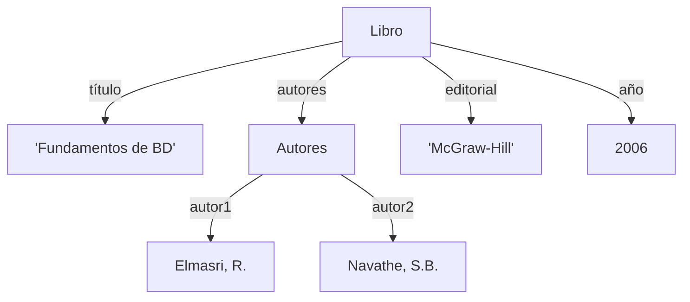

# Fundamentos de Bases de Datos - Modelos de datos

## 2.3 Modelo de datos semiestructurados.

---

Los modelos de datos semiestructurados representan una evolución importante en la gestión de datos, diseñados para manejar información que no se ajusta perfectamente al formato tabular del modelo relacional. Este modelo es especialmente útil para datos con estructura irregular, heterogénea o en evolución.

### Definición

Los **datos semiestructurados** son información que no sigue la estructura formal de tablas y relaciones de los modelos de bases de datos tradicionales, pero que contiene etiquetas u otros marcadores que permiten separar elementos semánticos y establecer jerarquías de registros y campos.

Según Silberschatz et al. (2006), "los datos semiestructurados se caracterizan por la falta de un esquema fijo, aunque contienen información sobre su propia estructura".

### Características Principales

#### Flexibilidad Estructural

- **Esquema flexible**: Los datos pueden variar en estructura entre diferentes instancias
- **Evolución dinámica**: La estructura puede cambiar con el tiempo sin necesidad de redefinir el esquema completo
- **Auto-descripción**: Los datos contienen información sobre su propia estructura

#### Heterogeneidad

- **Tipos variables**: Diferentes instancias pueden tener diferentes atributos
- **Estructuras anidadas**: Soporte para jerarquías y anidamiento complejo
- **Ordenación**: Mantenimiento del orden de los elementos cuando es relevante

### Representación de Datos Semiestructurados

#### Modelo de Grafos Etiquetados

Los datos semiestructurados pueden representarse como grafos donde:

- Nodos representan objetos o valores
- Aristas etiquetadas representan atributos o relaciones

$$G = (V, E)$$
donde $V$ es un conjunto de vértices y $E$ es un conjunto de aristas etiquetadas

#### Ejemplo de Estructura Semiestructurada



### Formatos de Datos Semiestructurados

#### XML (eXtensible Markup Language)

XML es un metalenguaje que permite definir lenguajes de marcado para representar datos estructurados.

```xml
<!-- Ejemplo de datos bibliográficos en XML -->
<libro>
    <titulo>Fundamentos de Database Systems</titulo>
    <autores>
        <autor>
            <apellido>Elmasri</apellido>
            <nombre>R.</nombre>
        </autor>
        <autor>
            <apellido>Navathe</apellido>
            <nombre>S.B.</nombre>
        </autor>
    </autores>
    <editorial>Addison-Wesley</editorial>
    <año>2006</año>
    <edición>4</edición>
</libro>
```

#### JSON (JavaScript Object Notation)

JSON es un formato ligero de intercambio de datos fácil de leer y escribir para humanos.

```json
// Ejemplo de datos bibliográficos en JSON
{
  "libro": {
    "titulo": "Fundamentos de Database Systems",
    "autores": [
      {
        "apellido": "Elmasri",
        "nombre": "R."
      },
      {
        "apellido": "Navathe",
        "nombre": "S.B."
      }
    ],
    "editorial": "Addison-Wesley",
    "año": 2006,
    "edición": 4
  }
}
```

### Consultas en Datos Semiestructurados

#### XPath para XML

XPath es un lenguaje para navegar y consultar documentos XML.

```xpath
// Ejemplos de consultas XPath
/libro/titulo
//autor[apellido='Elmasri']
/libro[edición > 3]/titulo
```

#### XQuery para XML

XQuery es un lenguaje de consulta diseñado para documentos XML.

```xquery
for $libro in //libro
where $libro/año > 2000
return $libro/titulo
```

#### JSONPath para JSON

JSONPath permite consultar y extraer datos de documentos JSON.

```jsonpath
// Ejemplos de consultas JSONPath
$.libro.titulo
$.libro.autores[?(@.apellido == 'Elmasri')]
$.libro[?(@.edición > 3)].titulo
```

### Almacenamiento de Datos Semiestructurados

#### Bases de Datos NoSQL

Las bases de datos NoSQL están diseñadas específicamente para manejar datos semiestructurados:

- **Document stores**: MongoDB, CouchDB
- **Column stores**: Cassandra, HBase
- **Key-value stores**: Redis, DynamoDB
- **Graph databases**: Neo4j, OrientDB

#### Ejemplo con MongoDB

```javascript
// Inserción de documento semiestructurado en MongoDB
db.libros.insertOne({
  titulo: 'Fundamentos de Database Systems',
  autores: [
    { apellido: 'Elmasri', nombre: 'R.' },
    { apellido: 'Navathe', nombre: 'S.B.' },
  ],
  detalles: {
    editorial: 'Addison-Wesley',
    año: 2006,
    edición: 4,
    temas: ['Bases de datos', 'Sistemas de información'],
  },
});

// Consulta en MongoDB
db.libros.find({
  'detalles.año': { $gt: 2000 },
  'detalles.temas': 'Bases de datos',
});
```

### Ventajas y Desventajas

#### Ventajas

- **Flexibilidad**: Adaptación a cambios en la estructura de datos
- **Integración**: Facilita la integración de datos de fuentes heterogéneas
- **Escalabilidad**: Adecuado para grandes volúmenes de datos no estructurados
- **Representación natural**: Modela más fielmente objetos del mundo real

#### Desventajas

- **Consistencia**: Mayor dificultad para mantener la integridad y consistencia
- **Consultas complejas**: Las consultas pueden ser más complejas que en SQL
- **Rendimiento**: Puede tener menor rendimiento para ciertos tipos de consultas
- **Estandarización**: Menor estandarización que el modelo relacional

### Aplicaciones Típicas

1. **Integración de datos**: Combinar información de múltiples fuentes con esquemas diferentes
2. **Datos web**: Almacenamiento y procesamiento de contenido web
3. **Logs y datos de sensores**: Información con estructura variable
4. **Contenido multimedia**: Metadatos asociados a archivos multimedia
5. **Intercambio de datos**: Comunicación entre sistemas heterogéneos

### Ejercicios Propuestos

#### Ejercicio 1: Diseño de Estructura Semiestructurada

Diseñe una estructura en XML y JSON para representar información de estudiantes universitarios que incluya:

- Datos personales
- Carrera que estudia
- Lista de cursos matriculados (con código, nombre, créditos y calificación)
- Historial académico semestral

#### Ejercicio 2: Consultas XPath y XQuery

Dado el siguiente documento XML:

```xml
<biblioteca>
  <libro categoria="BD">
    <titulo>Fundamentos de Database Systems</titulo>
    <autor>Elmasri</autor>
    <autor>Navathe</autor>
    <año>2006</año>
  </libro>
  <libro categoria="Programación">
    <titulo>JDBC Database Access with Java</titulo>
    <autor>Hamilton</autor>
    <año>2002</año>
  </libro>
  <libro categoria="BD">
    <titulo>SQL in a Nutshell</titulo>
    <autor>Kline</autor>
    <año>2008</año>
  </libro>
</biblioteca>
```

Escriba consultas para:

1. Todos los títulos de libros
2. Libros de la categoría "BD"
3. Libros publicados después de 2005
4. Autores de libros de bases de datos

#### Ejercicio 3: Transformación a Modelo Relacional

Diseñe un esquema relacional para almacenar la información del ejercicio 1, considerando:

- Tablas necesarias
- Claves primarias y foráneas
- Restricciones de integridad

#### Ejercicio 4: Análisis Comparativo

Compare el modelo semiestructurado con el modelo relacional en términos de:

- Flexibilidad
- Rendimiento en consultas complejas
- Facilidad de implementación
- Mantenimiento
- Escalabilidad

### Referencias

#### Bibliografía Básica

1. Elmasri, R., & Navathe, S. B. (2006). _Fundamentals of Database Systems_ (4th ed.). Addison-Wesley. (Capítulo 26: XML and Web Data)
2. Silberschatz, A., Korth, H. F., & Sudarshan, S. (2006). _Fundamentals of Database Systems_ (5th ed.). McGraw-Hill. (Capítulo 23: XML)
3. Ullman, J. D., & Widom, J. (2008). _A First Course in Database Systems_ (3rd ed.). Prentice Hall. (Capítulo 11: The Semistructured-Data Model)

#### Bibliografía Complementaria

1. Hamilton, G., Cattell, R., & Fisher, M. (2002). _JDBC Database Access with Java_. Addison-Wesley.
2. Harrington, J. (2009). _Relational Database Design and Implementation_. Morgan Kaufmann.
3. Kline, K., Kline, D., & Hunt, B. (2008). _SQL in a Nutshell_. O'Reilly.

### Recursos Adicionales

- Estándares XML: XML Schema, XSLT, XQuery
- Herramientas de procesamiento: SAX, DOM, StAX
- Bases de datos NoSQL: MongoDB, Cassandra, Redis
- Formatos de intercambio: JSON, BSON, YAML
- Herramientas de transformación: Apache Spark, Pandas para datos semiestructurados
