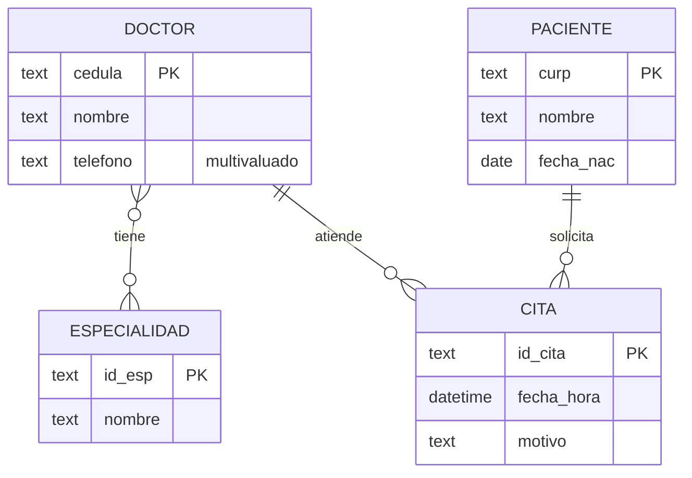

# Fundamentos de Bases de Datos - Modelado de bases de datos usando el modelo entidad/relación

## 3.1 Elementos del modelo E/R.

---

El **modelo entidad-relación** (E/R), propuesto por Peter Chen en 1976, es el modelo conceptual más usado para diseñar bases de datos. Describe el dominio con tres conceptos (**entidades**, **atributos** y **relaciones**) y con restricciones sobre cuántas veces participa cada entidad en cada relación. No dice cómo se almacenan los datos ni cómo se consultan: sirve para acordar con los usuarios qué datos hay, y después se traduce de manera casi mecánica al modelo relacional (tema 4.2). Este tema define sus elementos y su notación, y los aplica a tres sistemas.

### Entidades

Una **entidad** es un objeto del dominio que se distingue de los demás: un paciente, un libro, un pedido. Un **conjunto de entidades** o **tipo de entidad** agrupa entidades con las mismas propiedades; en el diagrama se dibuja como un rectángulo con un nombre en singular: `PACIENTE`.

Una entidad **débil** no tiene atributos suficientes para identificarse por sí misma: se identifica por su relación con una entidad **propietaria** más un **discriminador**, o clave parcial. El ejemplo clásico es un dependiente de un empleado, identificado por el empleado y su nombre; otro es un préstamo, identificado por el socio, el libro y la fecha. Una entidad débil tiene participación total en su relación identificadora y desaparece si desaparece su propietaria. Se dibuja con doble rectángulo.

### Atributos

Un **atributo** es una propiedad de una entidad o de una relación, con un **dominio** de valores posibles. Se clasifican así:

- **Simple** o atómico, como el precio, o **compuesto**, como la dirección, formada por calle, número y ciudad.
- **Monovaluado**, con un valor por entidad, como la fecha de nacimiento, o **multivaluado**, con un conjunto de valores, como los teléfonos de un doctor; se dibuja con doble óvalo.
- **Almacenado** o **derivado**, que se calcula a partir de otros, como la edad a partir de la fecha de nacimiento o el total de un pedido a partir de sus líneas; se dibuja con óvalo punteado y por lo general no se guarda.
- **Nulo** cuando no aplica o se desconoce: el número de departamento de una dirección que no lo tiene.

Una **clave** de un conjunto de entidades es un conjunto mínimo de atributos cuyos valores no se repiten entre dos entidades distintas; la elegida como **clave primaria** se subraya. En el modelo E/R no hay claves foráneas: las referencias entre entidades se expresan con relaciones, y las claves foráneas aparecen al traducir al modelo relacional.

### Relaciones

Una **relación** es una asociación entre entidades: el paciente Sofía **solicita** la cita C1. Un **conjunto de relaciones** $R$ entre los conjuntos de entidades $E_1, \dots, E_n$ es un subconjunto de

$$E_1 \times E_2 \times \dots \times E_n,$$

y $n$ es su **grado**: binaria si $n = 2,$ ternaria si $n = 3.$ Cada entidad cumple un **papel** en la relación; los papeles se nombran cuando la misma entidad aparece dos veces, como en una relación **recursiva** `supervisa` entre empleados, donde uno es el jefe y otro el subordinado. Una relación puede tener atributos propios: la calificación pertenece a la inscripción de un estudiante en un curso, no al estudiante ni al curso. Se dibuja como un rombo.

### Cardinalidad y participación

Para una relación binaria $R \subseteq A \times B,$ la **razón de cardinalidad** dice con cuántas entidades de $B$ puede relacionarse, a lo más, cada entidad de $A,$ y viceversa:

- **Uno a uno** (1:1): cada $a$ se relaciona con a lo más un $b,$ y cada $b$ con a lo más un $a.$
- **Uno a muchos** (1:N): cada $a$ con cualquier número de $b,$ pero cada $b$ con a lo más un $a.$ En términos de funciones, $R$ es una función parcial de $B$ en $A.$
- **Muchos a muchos** (M:N): sin restricción en ninguno de los dos sentidos.

La **participación** dice el mínimo: es **total** si toda entidad de $A$ debe participar en al menos una relación, y **parcial** si puede no participar. Toda cita es con algún doctor (total), pero un doctor recién contratado puede no tener citas (parcial). Las dos restricciones juntas se escriben como pares $(\min, \max),$ como $(1, 1)$ para cita en la relación con doctor y $(0, N)$ para doctor. La notación de **pata de gallo** de los diagramas de este curso las dibuja en cada extremo de la línea: `||` es exactamente uno, `o|` cero o uno, `|{` uno o más y `o{` cero o más.



### Del modelo E/R al relacional

El tema 4.2 desarrolla la traducción; sus reglas básicas son:

- Cada conjunto de **entidades fuertes** es una tabla con sus atributos simples, y su clave es la clave primaria. Los atributos compuestos se aplanan en sus componentes.
- Cada **atributo multivaluado** es una tabla con la clave de la entidad y el valor, con clave primaria compuesta por ambos.
- Una relación **1:N** se representa con una clave foránea en la tabla del lado N; si la participación de ese lado es total, la clave foránea es `NOT NULL`.
- Una relación **1:1** es una clave foránea `UNIQUE` en cualquiera de los dos lados, de preferencia el de participación total.
- Una relación **M:N** es una tabla nueva con las claves de ambas entidades, que juntas forman su clave primaria, y con los atributos de la relación.
- Una **entidad débil** es una tabla cuya clave primaria combina la clave de la propietaria y el discriminador.

### Implementación en Python

El programa representa un modelo E/R como datos (entidades con su clave, atributos multivaluados marcados y relaciones binarias con su cardinalidad y participación) y escribe una función que aplica las reglas de traducción. La usa para los tres ejercicios, crea las tablas en SQLite y comprueba con datos que el esquema respeta las cardinalidades: un doctor con dos especialidades, una paciente con citas con dos doctores, una cita sin doctor rechazada, un usuario con dos préstamos simultáneos y un producto en dos categorías. También muestra un error de diseño común que la traducción hace visible y su corrección.

```python
import sqlite3

# Un modelo E/R como datos: entidades con atributos (la clave primero, los multivaluados con *)
# y relaciones binarias con su cardinalidad máxima de cada lado y sus atributos propios.
def a_relacional(entidades, relaciones):
    tablas = {}
    for ent, atrs in entidades.items():
        clave, simples = atrs[0], [a for a in atrs if not a.startswith("*")]
        tablas[ent] = [f"{clave} TEXT PRIMARY KEY"] + [f"{a} TEXT" for a in simples[1:]]
        for a in atrs:                                     # atributo multivaluado: tabla propia
            if a.startswith("*"):
                tablas[f"{ent}_{a[1:]}"] = [f"{clave} TEXT REFERENCES {ent}", f"{a[1:]} TEXT",
                                            f"PRIMARY KEY ({clave}, {a[1:]})"]
    for nombre, (e1, c1, e2, c2, atrs, total) in relaciones.items():
        k1, k2 = entidades[e1][0], entidades[e2][0]
        if c1 == "N" and c2 == "N":                         # M:N: tabla intermedia con clave compuesta
            tablas[nombre] = [f"{k1} TEXT REFERENCES {e1}", f"{k2} TEXT REFERENCES {e2}"] + \
                             [f"{a} TEXT" for a in atrs] + [f"PRIMARY KEY ({k1}, {k2})"]
        else:                                               # 1:N o 1:1: clave foránea del lado N
            lado, otro, k = (e1, e2, k2) if c2 == "1" else (e2, e1, k1)
            fk = f"{k} TEXT {'NOT NULL ' if total else ''}REFERENCES {otro}"
            if c1 == "1" and c2 == "1": fk += " UNIQUE"     # 1:1: la clave foránea no se repite
            tablas[lado] += [fk] + [f"{a} TEXT" for a in atrs]
    return tablas

def crear(titulo, entidades, relaciones):
    tablas = a_relacional(entidades, relaciones)
    db = sqlite3.connect(":memory:"); db.execute("PRAGMA foreign_keys = ON")
    orden = list(entidades) + [t for t in tablas if t not in entidades]
    for t in orden: db.execute(f"CREATE TABLE {t} ({', '.join(tablas[t])})")
    print(f"{titulo}:")
    for t in orden: print(f"   {t}({', '.join(c.split()[0] if not c.startswith('PRIMARY') else c for c in tablas[t])})")
    return db

# --- Ejercicio 1: hospital ---
h = crear("ejercicio 1, hospital",
    {"doctor": ["cedula", "nombre", "*telefono"], "paciente": ["curp", "nombre", "fecha_nac"],
     "especialidad": ["id_esp", "nombre"], "cita": ["id_cita", "fecha_hora", "motivo"]},
    {"doctor_especialidad": ("doctor", "N", "especialidad", "N", [], False),
     "agenda": ("cita", "N", "doctor", "1", [], True),          # cada cita es con exactamente un doctor
     "solicita": ("cita", "N", "paciente", "1", [], True)})
h.executescript("""
INSERT INTO doctor VALUES ('D1', 'Dra. Ríos'), ('D2', 'Dr. Lara');
INSERT INTO especialidad VALUES ('E1', 'Cardiología'), ('E2', 'Medicina interna'), ('E3', 'Pediatría');
INSERT INTO doctor_especialidad VALUES ('D1', 'E1'), ('D1', 'E2'), ('D2', 'E3');
INSERT INTO paciente VALUES ('P1', 'Sofía', '1990-02-01');
INSERT INTO cita VALUES ('C1', '2026-11-04 10:00', 'revisión', 'D1', 'P1'), ('C2', '2026-11-05 12:00', 'control', 'D2', 'P1');
""")
print("   especialidades por doctor:", h.execute("""SELECT d.nombre, COUNT(*) FROM doctor d JOIN doctor_especialidad USING (cedula)
                                             GROUP BY d.cedula ORDER BY d.nombre""").fetchall())
print("   doctores distintos de Sofía:", h.execute("SELECT COUNT(DISTINCT cedula) FROM cita WHERE curp = 'P1'").fetchone()[0])
try:
    h.execute("INSERT INTO cita VALUES ('C3', '2026-11-06 09:00', 'urgencia', NULL, 'P1')")
except sqlite3.IntegrityError as e:
    print("   participación total de cita en agenda:", e)

# --- Ejercicio 2: biblioteca digital ---
b = crear("ejercicio 2, biblioteca digital",
    {"libro": ["isbn", "titulo", "formato"], "autor": ["id_autor", "nombre"], "usuario": ["id_usuario", "nombre", "correo"]},
    {"escribe": ("libro", "N", "autor", "N", ["orden"], False),
     "prestamo": ("usuario", "N", "libro", "N", ["inicio", "fin"], False)})
b.executescript("""
INSERT INTO libro VALUES ('L1', 'Bases de datos', 'PDF'), ('L2', 'Algoritmos', 'EPUB'), ('L3', 'Redes', 'PDF');
INSERT INTO autor VALUES ('A1', 'Elmasri'), ('A2', 'Navathe');
INSERT INTO escribe VALUES ('L1', 'A1', 1), ('L1', 'A2', 2);
INSERT INTO usuario VALUES ('U1', 'Iris', 'iris@ejemplo.mx');
INSERT INTO prestamo VALUES ('U1', 'L1', '2026-11-01', '2026-11-15'), ('U1', 'L2', '2026-11-02', '2026-11-16');
""")
print("   préstamos simultáneos de Iris:", b.execute("SELECT COUNT(*) FROM prestamo WHERE id_usuario = 'U1'").fetchone()[0])
try:
    b.execute("INSERT INTO prestamo VALUES ('U1', 'L1', '2026-12-01', '2026-12-15')")
except sqlite3.IntegrityError as e:
    print("   la clave (usuario, libro) impide volver a prestar el mismo libro:", e)

# corrección: el préstamo es un evento con identidad propia; como entidad débil, su clave incluye la fecha de inicio
b.executescript("""
DROP TABLE prestamo;
CREATE TABLE prestamo (id_usuario TEXT REFERENCES usuario, isbn TEXT REFERENCES libro, inicio TEXT, fin TEXT,
                       PRIMARY KEY (id_usuario, isbn, inicio), CHECK (fin > inicio));
INSERT INTO prestamo VALUES ('U1', 'L1', '2026-11-01', '2026-11-15'), ('U1', 'L1', '2026-12-01', '2026-12-15');
""")
print("   con préstamo como entidad débil, historial de L1:", b.execute("SELECT inicio FROM prestamo WHERE isbn = 'L1'").fetchall())

# --- Ejercicio 3: comercio electrónico ---
c = crear("ejercicio 3, comercio electrónico",
    {"cliente": ["id_cliente", "nombre", "correo"], "producto": ["sku", "nombre", "precio"],
     "pedido": ["id_pedido", "fecha"], "categoria": ["id_cat", "nombre"]},
    {"realiza": ("pedido", "N", "cliente", "1", [], True),
     "linea": ("pedido", "N", "producto", "N", ["cantidad", "precio_unitario"], False),
     "clasifica": ("producto", "N", "categoria", "N", [], False)})
c.executescript("""
INSERT INTO cliente VALUES ('K1', 'Noé', 'noe@ejemplo.mx');
INSERT INTO producto VALUES ('S1', 'Audífonos', 800), ('S2', 'Cable USB', 120);
INSERT INTO categoria VALUES ('G1', 'Audio'), ('G2', 'Accesorios');
INSERT INTO clasifica VALUES ('S1', 'G1'), ('S1', 'G2'), ('S2', 'G2');
INSERT INTO pedido VALUES ('O1', '2026-11-02', 'K1');
INSERT INTO linea VALUES ('O1', 'S1', 1, 750), ('O1', 'S2', 3, 120);
""")
print("   total del pedido O1:", c.execute("SELECT SUM(cantidad * precio_unitario) FROM linea WHERE id_pedido = 'O1'").fetchone()[0],
      "| categorías de Audífonos:", c.execute("SELECT COUNT(*) FROM clasifica WHERE sku = 'S1'").fetchone()[0])
```

Salida:

```text
ejercicio 1, hospital:
   doctor(cedula, nombre)
   paciente(curp, nombre, fecha_nac)
   especialidad(id_esp, nombre)
   cita(id_cita, fecha_hora, motivo, cedula, curp)
   doctor_telefono(cedula, telefono, PRIMARY KEY (cedula, telefono))
   doctor_especialidad(cedula, id_esp, PRIMARY KEY (cedula, id_esp))
   especialidades por doctor: [('Dr. Lara', 1), ('Dra. Ríos', 2)]
   doctores distintos de Sofía: 2
   participación total de cita en agenda: NOT NULL constraint failed: cita.cedula
ejercicio 2, biblioteca digital:
   libro(isbn, titulo, formato)
   autor(id_autor, nombre)
   usuario(id_usuario, nombre, correo)
   escribe(isbn, id_autor, orden, PRIMARY KEY (isbn, id_autor))
   prestamo(id_usuario, isbn, inicio, fin, PRIMARY KEY (id_usuario, isbn))
   préstamos simultáneos de Iris: 2
   la clave (usuario, libro) impide volver a prestar el mismo libro: UNIQUE constraint failed: prestamo.id_usuario, prestamo.isbn
   con préstamo como entidad débil, historial de L1: [('2026-11-01',), ('2026-12-01',)]
ejercicio 3, comercio electrónico:
   cliente(id_cliente, nombre, correo)
   producto(sku, nombre, precio)
   pedido(id_pedido, fecha, id_cliente)
   categoria(id_cat, nombre)
   linea(id_pedido, sku, cantidad, precio_unitario, PRIMARY KEY (id_pedido, sku))
   clasifica(sku, id_cat, PRIMARY KEY (sku, id_cat))
   total del pedido O1: 1110 | categorías de Audífonos: 2
```

### Ejercicios Propuestos

1. **Hospital.** Diseña un diagrama E/R con doctores, pacientes, citas y especialidades, donde un doctor puede tener varias especialidades y un paciente puede tener varias citas con distintos doctores.

2. **Biblioteca digital.** Modela libros, autores, préstamos y usuarios, donde un libro puede tener varios autores y un usuario puede tener varios préstamos simultáneos.

3. **Comercio electrónico.** Diseña un modelo E/R con clientes, productos, pedidos y categorías, donde un pedido puede contener varios productos y un producto puede pertenecer a varias categorías.

### Soluciones

**Ejercicio 1.** Es el diagrama de este tema. `DOCTOR` y `ESPECIALIDAD` tienen una relación M:N con participación parcial de ambos lados: puede haber una especialidad sin doctores todavía. La cita se modela como **entidad**, no como relación M:N entre doctor y paciente, porque un paciente puede tener varias citas con el mismo doctor y una relación M:N solo admite un par por pareja. Así, `CITA` participa de forma total en dos relaciones 1:N, con `DOCTOR` y con `PACIENTE`. El teléfono del doctor es multivaluado y produce la tabla `doctor_telefono`. En el programa, la Dra. Ríos tiene dos especialidades, Sofía tiene citas con dos doctores, y una cita sin doctor se rechaza por la participación total.

**Ejercicio 2.** `LIBRO` y `AUTOR` en M:N con el atributo `orden` en la relación, porque el lugar de un autor depende del libro. Para los préstamos, la primera idea es una relación M:N entre usuario y libro con atributos `inicio` y `fin`, y la traducción muestra su problema: la clave $(\text{usuario}, \text{libro})$ impide que un usuario vuelva a tomar el mismo libro, así que se pierde el historial. La solución es modelar el préstamo como **entidad débil** de usuario y libro, con discriminador `inicio`; con la clave $(\text{usuario}, \text{libro}, \text{inicio})$ el historial cabe y un usuario puede tener varios préstamos simultáneos. En una biblioteca digital con licencias limitadas por título, una entidad `LICENCIA` sustituiría al ejemplar físico.

**Ejercicio 3.** `CLIENTE` con `PEDIDO` en 1:N, con participación total del pedido; `PEDIDO` con `PRODUCTO` en M:N mediante la relación `LINEA` con atributos `cantidad` y `precio_unitario`, y `PRODUCTO` con `CATEGORIA` en M:N. El precio unitario se guarda en la línea aunque el producto ya tenga precio: es el precio al que se vendió, que puede diferir del actual por un descuento o un cambio de precio, y no es redundante. El total del pedido es un atributo **derivado**, la suma de las líneas, y el programa lo calcula en lugar de guardarlo: 1110 pesos para el pedido de ejemplo. Si las categorías forman una jerarquía, se agrega una relación recursiva `subcategoria_de` en `CATEGORIA`.

### Referencias

1. Chen, P. P., The entity-relationship model: toward a unified view of data. _ACM Transactions on Database Systems_ 1(1), 1976.
2. Elmasri, R., and Navathe, S. B., _Fundamentals of Database Systems_. Pearson, 2016. Capítulos 3 y 9.
3. Silberschatz, A., Korth, H. F., and Sudarshan, S., _Database System Concepts_. McGraw-Hill, 2019. Capítulo 6.
4. Batini, C., Ceri, S., and Navathe, S. B., _Conceptual Database Design: An Entity-Relationship Approach_. Benjamin/Cummings, 1992.
