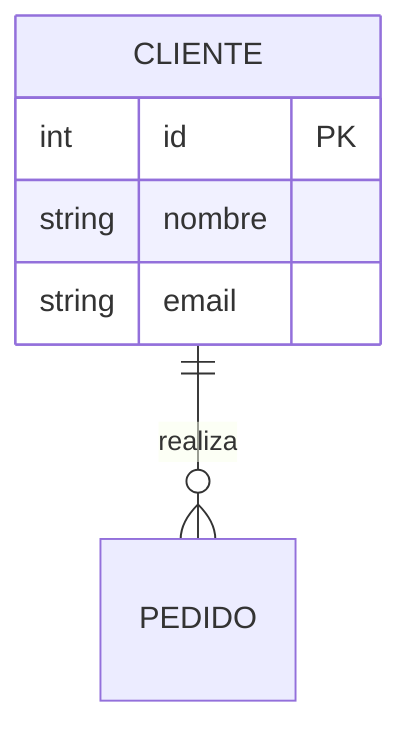
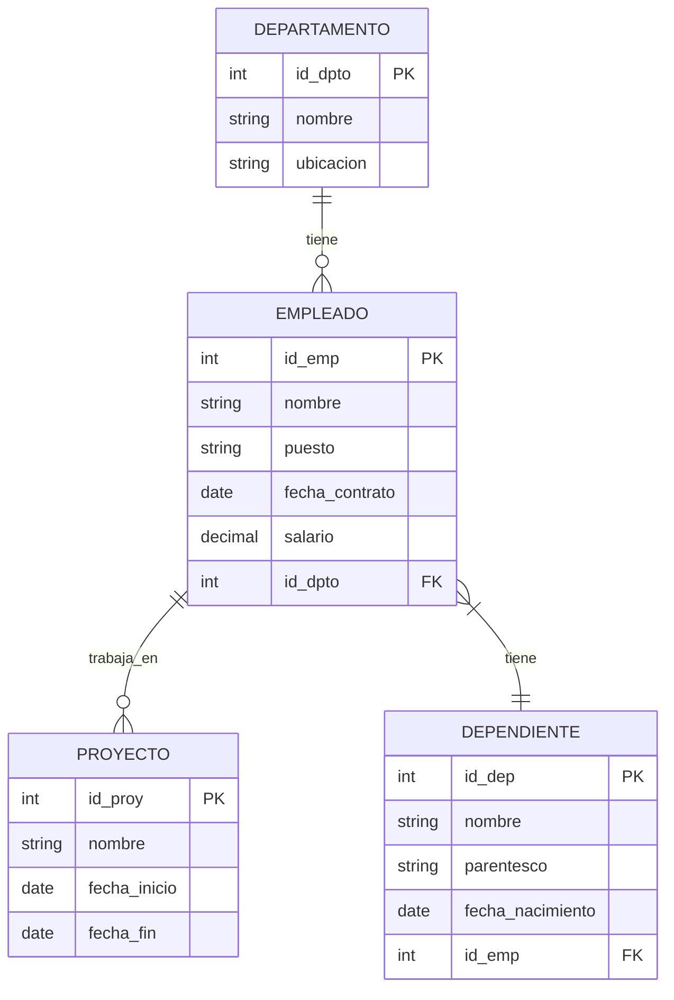
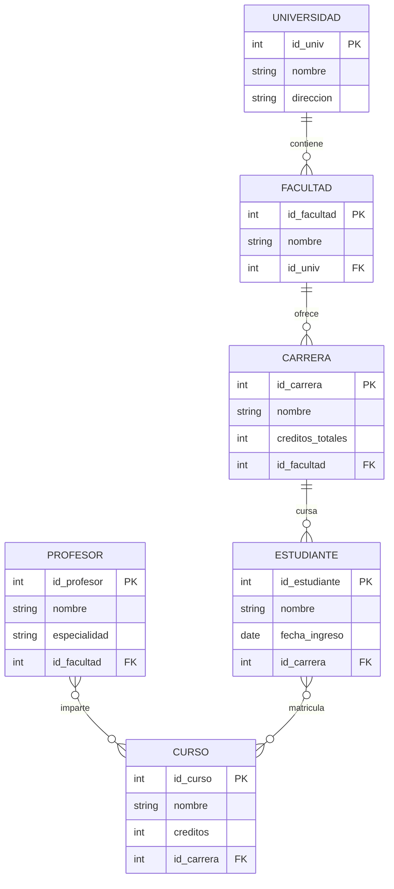

# Fundamentos de Bases de Datos - Modelado de bases de datos usando el modelo entidad/relación

## 3.1 Elementos del modelo E/R.

---

El modelo Entidad/Relación (E/R) es una herramienta conceptual fundamental para el diseño de bases de datos. Proporciona una representación visual de los datos y sus relaciones, permitiendo modelar los requisitos de información de una organización antes de implementar la base de datos física.

### Elementos Fundamentales del Modelo E/R

#### Entidades

**Definición:** Una entidad es un objeto o concepto del mundo real que puede identificarse de manera única y sobre el cual se almacena información.

**Función:** Representar "cosas" significativas en el dominio del problema.

**Tipos de entidades:**

- **Entidades fuertes:** Existen independientemente
- **Entidades débiles:** Dependen de otra entidad para su existencia

**Notación:** Rectángulos

#### Atributos

**Definición:** Son propiedades o características que describen una entidad o relación.

**Función:** Almacenan los datos específicos de las entidades y relaciones.

**Tipos de atributos:**

- **Simples:** No pueden dividirse en componentes más pequeños
- **Compuestos:** Pueden dividirse en subpartes
- **Derivados:** Pueden calcularse a partir de otros atributos
- **Multivaluados:** Pueden tener múltiples valores para una misma entidad

**Notación:** Óvalos conectados a su entidad o relación

**Fórmula para atributos derivados:**
$$ edad = \text{añoActual} - \text{añoNacimiento} $$

#### Claves

**Definición:** Atributos o conjuntos de atributos que identifican únicamente instancias de entidades.

**Tipos de claves:**

- **Superclave:** Conjunto de atributos que identifica unívocamente
- **Clave candidata:** Superclave mínima (sin atributos redundantes)
- **Clave primaria (PK):** Clave candidata seleccionada como identificador principal
- **Clave foránea (FK):** Atributo que referencia la clave primaria de otra entidad

#### Relaciones

**Definición:** Asociaciones significativas entre dos o más entidades.

**Función:** Establecer cómo se relacionan las entidades entre sí.

**Grado de relaciones:**

- **Binarias:** Entre dos entidades
- **Ternarias:** Entre tres entidades
- **n-arias:** Entre n entidades

**Notación:** Rombos conectados a las entidades participantes

#### Cardinalidad de Relaciones

**Definición:** Especifica el número máximo de instancias de una entidad que pueden asociarse con instancias de la entidad relacionada.

**Tipos de cardinalidad:**

- **Uno a uno (1:1):** $∀e₁ ∈ E₁, ∃! e₂ ∈ E₂$ y viceversa
- **Uno a muchos (1:N):** $∀e₁ ∈ E₁, ∃ \text{múltiples} e₂ ∈ E₂$
- **Muchos a muchos (M:N):** $∀e₁ ∈ E₁, ∃ \text{múltiples} e₂ ∈ E₂$ y viceversa

#### Restricciones de Participación

**Definición:** Especifican si la participación de una entidad en una relación es obligatoria o opcional.

**Tipos:**

- **Participación total:** Todas las instancias deben participar
- **Participación parcial:** Algunas instancias pueden no participar

**Notación:** Doble línea para participación total, línea simple para parcial

### Diagrama E/R Completo

### Ejemplo Práctico: Sistema Universitario

### Ejercicios Propuestos

#### Ejercicio 1: Sistema Hospitalario

Diseñe un diagrama E/R para un sistema hospitalario que incluya:

- Doctores, pacientes, citas médicas y especialidades
- Un doctor puede tener múltiples especialidades
- Un paciente puede tener múltiples citas con diferentes doctores

#### Ejercicio 2: Biblioteca Digital

Modele una biblioteca digital considerando:

- Libros, autores, préstamos y usuarios
- Un libro puede tener múltiples autores
- Un usuario puede tener múltiples préstamos simultáneos

#### Ejercicio 3: Comercio Electrónico

Cree un modelo E/R para un sistema de comercio electrónico con:

- Clientes, productos, pedidos y categorías
- Un pedido puede contener múltiples productos
- Un producto puede pertenecer a múltiples categorías

### Buenas Prácticas en el Modelado E/R

1. **Nomenclatura clara:** Use nombres descriptivos en singular
2. **Consistencia:** Mantenga un estilo uniforme en todo el diagrama
3. **Normalización:** Evite la redundancia de datos
4. **Documentación:** Incluya comentarios para aclarar decisiones de diseño
5. **Validación:** Verifique que el modelo cumpla con todos los requisitos

### Conversión a Modelo Relacional

Para convertir el modelo E/R al modelo relacional:

- Entidades → Tablas
- Atributos → Columnas
- Relaciones 1:N → Claves foráneas
- Relaciones M:N → Tablas intermedias
- Relaciones 1:1 → Claves foráneas únicas

### Referencias

#### Bibliografía Básica

1. Elmasri and Navathe. Fundamentals of Database Systems. Addison-Wesley. Cuarta Edición. 2006. (Capítulo 3)
2. Silberschatz A., Kort H. y Sudarshan S. Fundamentos de BD. McGraw Hill. Quinta edición. 2006. (Capítulo 6)
3. Ullman J.D. and Widom J. A First Course in Data Base System. Prentice Hall. Tercera edición. 2008. (Capítulo 2)

#### Bibliografía Complementaria

1. Harrington J. Relational Database Design and Implementation. Tercera edición. Morgan Kaufmann. 2009. (Capítulo 4)
2. Connolly, T. and Begg, C. Database Systems: A Practical Approach to Design, Implementation, and Management. Pearson Education. (Capítulo 11)

### Autoevaluación

1. ¿Cuál es la diferencia entre una entidad fuerte y una débil?
2. Explique con un ejemplo la diferencia entre atributos simples y compuestos
3. ¿Cómo se representan las relaciones muchos-a-muchos en el modelo relacional?
4. ¿Qué significa "cardinalidad mínima" en una relación?
5. Proporcione un ejemplo de atributo derivado y su fórmula de cálculo
