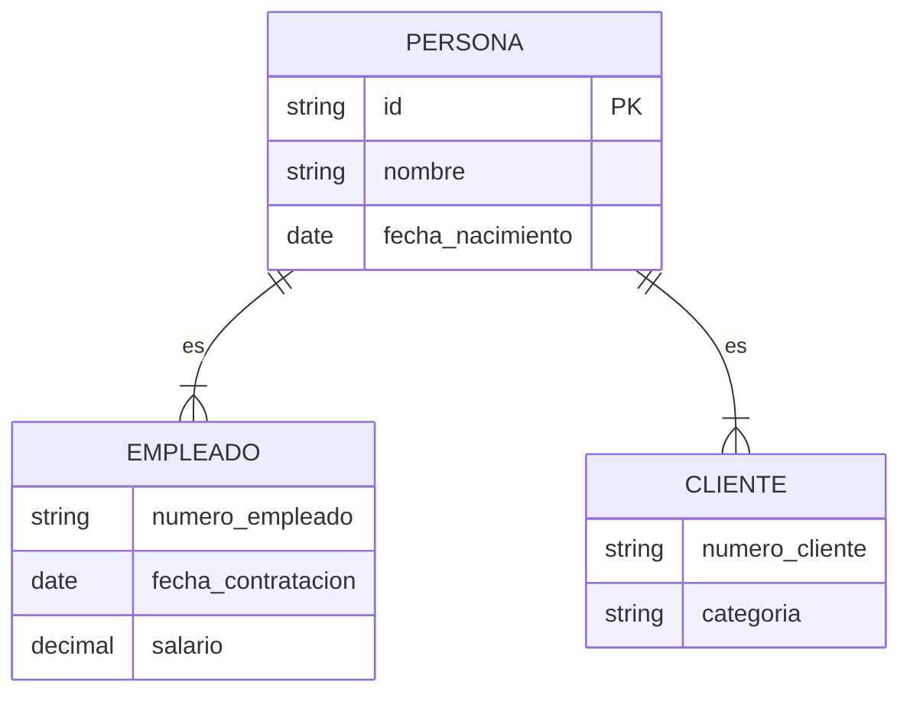
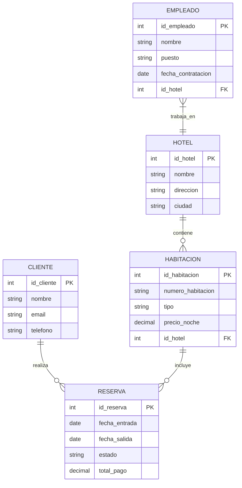
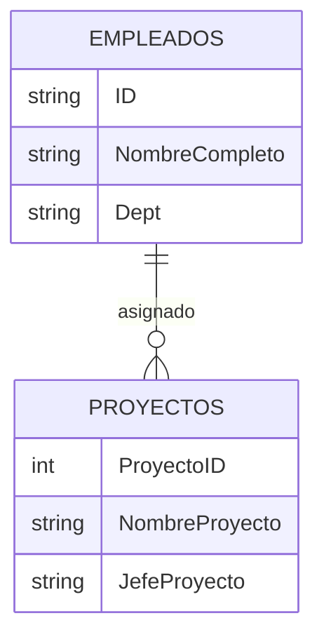

# Fundamentos de Bases de Datos - Modelado de bases de datos usando el modelo entidad/relación

## 3.2 Convensiones y aspectos de diseño.

---

El diseño de bases de datos utilizando el modelo Entidad/Relación requiere seguir convenciones específicas y considerar aspectos cruciales que garantizan la calidad, consistencia y eficiencia del modelo resultante. Estas convenciones establecen estándares para la representación gráfica y conceptual de los elementos del modelo.

### Convenciones de Notación

#### Notación para Entidades

**Convenciones:**

- Nombres en singular y con la primera letra en mayúscula
- Uso de sustantivos para nombrar entidades
- Representación mediante rectángulos

**Ejemplo correcto:** `Empleado`, `Departamento`, `Proyecto`
**Ejemplo incorrecto:** `empleados`, `LosDepartamentos`, `trabaja_en`

#### Notación para Atributos

**Convenciones:**

- Nombres en minúscula con palabras separadas por guiones bajos
- Uso de sustantivos o adjetivos calificativos
- Representación mediante óvalos conectados a su entidad

**Ejemplo correcto:** `nombre_empleado`, `fecha_contratacion`, `salario_base`
**Ejemplo incorrecto:** `NombreEmpleado`, `fechaDeContratacion`, `getSalario()`

#### Notación para Relaciones

**Convenciones:**

- Nombres que expresan acción o asociación
- Uso de verbos en infinitivo
- Representación mediante rombos

**Ejemplo correcto:** `trabaja_en`, `pertenece_a`, `supervisa`
**Ejemplo incorrecto:** `trabajo`, `pertenencia`, `supervisor`

### Aspectos de Diseño Fundamental

#### Diseño de Entidades

**Principios:**

1. **Abstracción:** Identificar las entidades relevantes para el dominio del problema
2. **Relevancia:** Incluir solo entidades que requieran almacenamiento de datos
3. **Atomicidad:** Evitar entidades que representen múltiples conceptos

**Proceso de identificación:**

- Analizar sustantivos en los requisitos del sistema
- Verificar que cada entidad tenga atributos propios
- Confirmar que existan instancias identificables

#### Diseño de Relaciones

**Directrices:**

1. **Semántica clara:** El nombre debe describir precisamente la asociación
2. **Grado apropiado:** Determinar si la relación es binaria, ternaria o n-aria
3. **Completitud:** Verificar que todas las asociaciones relevantes estén representadas

**Fórmula para determinar el grado de relación:**
$$Grado(R) = |{E_i : E_i \ participa \ en \ R}|$$

#### Cardinalidades y Restricciones

**Enfoque de diseño:**

- Analizar las reglas de negocio para determinar cardinalidades
- Especificar participación (obligatoria/opcional) según requisitos
- Documentar restricciones complejas con notas explicativas

**Notación para cardinalidad:**

- (0,1): Cero o uno
- (1,1): Exactamente uno
- (0,N): Cero o muchos
- (1,N): Uno o muchos

### Decisiones de Diseño Críticas

#### Entidad vs. Atributo

**Criterios para convertir atributo en entidad:**

- Cuando el "atributo" tiene sus propios atributos
- Cuando el "atributo" participa en relaciones con otras entidades
- Cuando el "atributo" tiene múltiples valores para una misma entidad

**Ejemplo:**
`direccion_empleado` como atributo compuesto vs. `Direccion` como entidad relacionada

#### Relación vs. Entidad

**Criterios para convertir relación en entidad:**

- Cuando la relación tiene atributos descriptivos
- Cuando la relación participa en otras relaciones
- Cuando se necesita registrar información sobre la asociación

**Ejemplo:**
`Empleado` trabaja_en `Proyecto` vs. `Asignacion` (entidad) que relaciona `Empleado` y `Proyecto` con atributos como `fecha_inicio` y `horas_asignadas`

#### Especialización y Generalización

**Decisiones de diseño:**

- **Herencia:** Cuando existen subtipos con atributos o relaciones específicas
- **Solapamiento:** Determinar si una instancia puede pertenecer a múltiples subtipos
- **Completitud:** Especificar si todas las instancias deben pertenecer a algún subtipo

**Notación en diagramas:**

### Calidad en el Diseño E/R

#### Métricas de Calidad

**Criterios de evaluación:**

1. **Completitud:** El modelo representa todos los requisitos
2. **Corrección:** Las estructuras reflejan accurately el dominio
3. **Minimalidad:** Evitar elementos redundantes
4. **Expresividad:** Uso adecuado de todas las construcciones E/R
5. **Legibilidad:** Diagrama claro y bien organizado

**Fórmula de complejidad relacional:**
$$Complejidad = \frac{N_e + N_r + N_a}{N_{tr}}$$
Donde:

- $N_e$: Número de entidades
- $N_r$: Número de relaciones
- $N_a$: Número de atributos
- $N_{tr}$: Número de transacciones o requisitos

#### Normalización Conceptual

**Principios:**

- Eliminar redundancias en el modelo conceptual
- Garantizar que los atributos dependan fully de la clave de identificación
- Verificar que no existan dependencias multivaluadas no representadas como entidades

### Ejemplo de Diseño: Sistema de Reservas

### Ejercicios Propuestos

#### Ejercicio 1: Análisis de Decisiones de Diseño

Dado el siguiente requisito: "Cada empleado tiene un jefe directo que también es empleado de la empresa", diseñe dos alternativas de modelado:
a) Usando una relación reflexiva
b) Creando una entidad intermedia
Justifique cuál approach sería más apropiado en diferentes contextos.

#### Ejercicio 2: Mejora de Diseño

Analice el siguiente fragmento de diagrama E/R e identifique violaciones a las convenciones y aspectos de diseño recomendados:

Proporcione una versión mejorada aplicando las convenciones correctas.

#### Ejercicio 3: Diseño Completo

Modele un sistema de biblioteca considerando:

- Libros pueden tener múltiples autores y un autor puede escribir múltiples libros
- Los usuarios pueden tomar prestados múltiples libros pero cada copia física solo puede ser prestada a un usuario a la vez
- Los libros pueden tener múltiples ediciones con diferentes ISBN
- Debe registrar historial de préstamos y multas por retrasos

Aplique todas las convenciones de nomenclatura y aspectos de diseño estudiados.

### Técnicas de Verificación

#### Validación del Modelo

**Checklist de verificación:**

- [ ] Todas las entidades tienen identificador único
- [ ] Los nombres siguen las convenciones establecidas
- [ ] Las cardinalidades reflejan correctamente las reglas de negocio
- [ ] No existen relaciones redundantes
- [ ] Las especializaciones/generalizaciones están justificadas
- [ ] Todos los atributos son atómicos o correctamente descompuestos
- [ ] No hay atributos multivaluados representados incorrectamente

#### Técnicas de Normalización Conceptual

**Proceso:**

1. Identificar dependencias funcionales entre atributos
2. Verificar que cada atributo dependa fully de la clave primaria
3. Eliminar dependencias transitivas mediante creación de nuevas entidades
4. Asegurar que no existan dependencias multivaluadas

**Ejemplo de dependencia funcional:**
$$id_empleado \rightarrow nombre_empleado, fecha_contratacion, salario$$
$$id_empleado, id_proyecto \rightarrow horas_trabajadas$$

### Referencias

#### Bibliografía Básica

1. Elmasri and Navathe. Fundamentals of Database Systems. Addison-Wesley. Cuarta Edición. 2006. (Capítulo 3 - Secciones 3.8-3.9)
2. Silberschatz A., Kort H. y Sudarshan S. Fundamentos de BD. McGraw Hill. Quinta edición. 2006. (Capítulo 6 - Sección 6.6)
3. Ullman J.D. and Widom J. A First Course in Data Base System. Prentice Hall. Tercera edición. 2008. (Capítulo 2 - Sección 2.3)

#### Bibliografía Complementaria

1. Harrington J. Relational Database Design and Implementation. Tercera edición. Morgan Kaufmann. 2009. (Capítulo 5 - "Data Modeling")
2. Connolly, T. and Begg, C. Database Systems: A Practical Approach to Design, Implementation, and Management. Pearson Education. (Capítulo 12 - "Entity-Relationship Modeling")

### Buenas Prácticas Resumen

1. **Consistencia:** Mantener las mismas convenciones en todo el modelo
2. **Documentación:** Incluir comentarios para explicar decisiones de diseño complejas
3. **Simplicidad:** Evitar elementos innecesarios que compliquen el modelo
4. **Validación:** Revisar el modelo con stakeholders del dominio
5. **Iteración:** Refinar el modelo mediante múltiples revisiones
