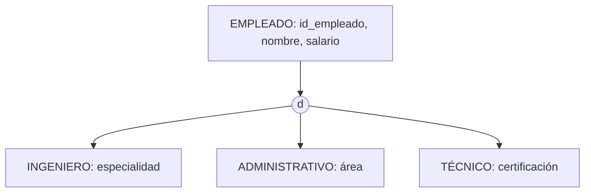

# Fundamentos de Bases de Datos - Modelado de bases de datos usando el modelo entidad/relación

## 3.2 Convensiones y aspectos de diseño.

---

Un mismo dominio admite muchos diagramas E/R correctos, y no todos son igual de buenos: unos repiten información, otros no pueden registrar hechos que el negocio necesita, otros se vuelven difíciles de leer. Este tema reúne las **convenciones** de notación y de nombres que hacen legible un diagrama, y las **decisiones de diseño** que más se repiten: entidad o atributo, entidad o relación, relaciones recursivas, especialización y generalización, y cómo verificar la calidad del resultado.

### Notaciones

Hay varias notaciones para el mismo modelo, y conviene elegir una y usarla en todo el proyecto:

- **Chen:** rectángulos para entidades, óvalos para atributos, rombos para relaciones, con 1, N y M junto a las líneas; doble rectángulo para entidades débiles y doble línea para participación total. Es la de los libros de texto.
- **Pata de gallo** (Martin, o de ingeniería de la información): las relaciones son líneas y los extremos dicen el mínimo y el máximo (`||` exactamente uno, `o|` cero o uno, `|{` uno o más, `o{` cero o más). Los atributos van dentro de la caja de la entidad. Es la de las herramientas de diseño y la de los diagramas de este curso.
- **Mín-máx:** cada extremo lleva un par $(\min, \max)$ que dice en cuántas relaciones participa **esa** entidad. Hay que tener cuidado al leerla: el par va del lado opuesto al que se usa en la pata de gallo.
- **UML:** diagramas de clases con multiplicidades como `1`, `0..1` y `*`, usados cuando el diseño de la base comparte modelo con el del software.

### Convenciones de nombres

- **Entidades:** sustantivos en **singular**, porque la caja describe a cada elemento: `EMPLEADO`, no `EMPLEADOS`.
- **Relaciones:** verbos o frases verbales que se lean de izquierda a derecha: `EMPLEADO trabaja_en PROYECTO`.
- **Atributos:** nombres descriptivos sin abreviaturas ambiguas (`departamento`, no `Dept`), con un estilo uniforme de mayúsculas y separadores. La clave se nombra de manera consistente, como `id_empleado`.
- **Sin información de implementación en el modelo conceptual:** los tipos de SQL, los índices y las claves foráneas pertenecen al diseño lógico. Si una entidad hace referencia a otra, eso es una relación, no un atributo.

### Entidad o atributo

Un concepto debe ser **entidad** si tiene propiedades propias, si participa en relaciones o si varias entidades comparten sus valores; si no, basta un **atributo**. El departamento de un empleado puede ser un atributo de texto mientras solo importe su nombre, pero en cuanto tenga un jefe, un presupuesto o una ubicación, debe ser una entidad relacionada. Un atributo de texto que repite el nombre de otra entidad, como `Dept` en `EMPLEADOS`, es la señal: dos grafías del mismo valor, como "Ventas" y "ventas", parecen dos departamentos distintos.

Un atributo **multivaluado** es candidato a entidad si cada valor tiene propiedades: los teléfonos con su tipo y horario son una entidad débil `TELEFONO`.

### Entidad o relación

Una relación M:N con atributos expresa un **hecho único** por par de entidades: la calificación de un estudiante en un curso. Si el mismo par puede relacionarse **varias veces** (un paciente con varias citas con el mismo doctor, un socio que pide prestado el mismo libro en distintas fechas), el hecho es un **evento** y debe modelarse como entidad, débil o con clave propia. La pregunta que lo decide es: ¿puede repetirse el par?

### Relaciones recursivas y de grado mayor

Una **relación recursiva** relaciona un conjunto de entidades consigo mismo, con dos papeles: `supervisa` entre un jefe y un subordinado, `prerrequisito_de` entre cursos. Al traducirla, la tabla de la entidad tiene una clave foránea a sí misma. Como cada empleado tiene a lo más un jefe, la relación es 1:N; la jerarquía se recorre con consultas recursivas (`WITH RECURSIVE`).

Una relación **ternaria** no siempre equivale a tres binarias. Que el proveedor $p$ surta la pieza $q$ al proyecto $r$ dice más que los tres hechos binarios por separado, a saber, que $p$ surte $q,$ que $q$ se usa en $r$ y que $p$ surte a $r.$ Esos tres hechos se cumplen también si $p$ surte $q$ a otro proyecto y surte otra pieza a $r.$ Se usa la ternaria cuando el hecho involucra a las tres entidades a la vez.

### Especialización y generalización

La **especialización** divide un conjunto de entidades en **subclases** con atributos o relaciones propias: un `EMPLEADO` puede ser `INGENIERO`, con su especialidad, o `ADMINISTRATIVO`. La **generalización** es el proceso inverso: reconocer que `AUTOMOVIL` y `CAMION` comparten atributos y crear la superclase `VEHICULO`. Las subclases heredan los atributos y relaciones de la superclase. Dos restricciones describen una especialización:

- **Disjunta** (cada entidad pertenece a lo más a una subclase) o **solapada** (puede estar en varias).
- **Total** (toda entidad de la superclase está en alguna subclase) o **parcial**.



La `d` del círculo indica que la especialización es disjunta; una `o` indicaría que es solapada.

### Calidad de un diagrama

Un buen diagrama cumple estas condiciones:

- **Completo:** cada requisito se puede responder con los datos del modelo.
- **Correcto:** cada cardinalidad y cada participación coinciden con una regla del negocio que alguien confirmó.
- **Mínimo:** no tiene relaciones **redundantes**. Si cada empleado trabaja en un departamento que pertenece a una sucursal, una relación directa entre empleado y sucursal sobra, salvo que signifique otra cosa.
- **Legible:** tiene nombres consistentes y no cruza líneas sin necesidad.
- **Sin atributos derivados almacenados** ni atributos que repitan los de otra entidad.

Toda entidad tiene un identificador, y todo atributo depende de él y solo de él: es la idea de la normalización (tema 5) aplicada en el nivel conceptual.

### Implementación en Python

El programa traduce a SQLite las dos alternativas del ejercicio 1: la relación recursiva, con una consulta recursiva para la cadena de mando y una restricción que impide que alguien sea su propio jefe, y la entidad intermedia con vigencia y tipo de supervisión. Para el ejercicio 2 crea el diseño original con sus datos y muestra los problemas que sus defectos provocan, y después el diseño corregido, que los rechaza. Para el ejercicio 3 implementa la biblioteca con obras, ediciones y ejemplares, y garantiza con un índice único parcial que un ejemplar tenga a lo más un préstamo abierto.

```python
import sqlite3

db = sqlite3.connect(":memory:")
db.execute("PRAGMA foreign_keys = ON")

# --- Ejercicio 1a: relación recursiva "supervisa" como clave foránea en la misma tabla ---
db.executescript("""
CREATE TABLE empleado (id_empleado INTEGER PRIMARY KEY, nombre TEXT NOT NULL,
                       id_jefe INTEGER REFERENCES empleado CHECK (id_jefe <> id_empleado));
INSERT INTO empleado VALUES (1, 'Dirección', NULL), (2, 'Ana', 1), (3, 'Beto', 1), (4, 'Carla', 2), (5, 'Dante', 4);
""")
cadena = db.execute("""
    WITH RECURSIVE sube(id, nombre, id_jefe, nivel) AS (
        SELECT id_empleado, nombre, id_jefe, 0 FROM empleado WHERE nombre = 'Dante'
        UNION ALL
        SELECT e.id_empleado, e.nombre, e.id_jefe, s.nivel + 1 FROM empleado e JOIN sube s ON e.id_empleado = s.id_jefe)
    SELECT nombre FROM sube ORDER BY nivel""").fetchall()
print("1a. cadena de mando de Dante:", " -> ".join(n for (n,) in cadena))
print("    subordinados directos de Ana:", db.execute("""SELECT s.nombre FROM empleado s JOIN empleado j ON s.id_jefe = j.id_empleado
                                                     WHERE j.nombre = 'Ana'""").fetchall())
try:
    db.execute("UPDATE empleado SET id_jefe = 3 WHERE id_empleado = 3")
except sqlite3.IntegrityError as e:
    print("    nadie es su propio jefe:", e)

# --- Ejercicio 1b: entidad intermedia "supervision" con vigencia y tipo ---
db.executescript("""
CREATE TABLE supervision (id_jefe INTEGER NOT NULL REFERENCES empleado, id_subordinado INTEGER NOT NULL REFERENCES empleado,
                          tipo TEXT NOT NULL CHECK (tipo IN ('directo', 'funcional')), desde TEXT NOT NULL, hasta TEXT,
                          PRIMARY KEY (id_subordinado, tipo, desde), CHECK (id_jefe <> id_subordinado));
INSERT INTO supervision VALUES (2, 4, 'directo', '2024-01-01', '2026-06-30'), (3, 4, 'directo', '2026-07-01', NULL),
                               (1, 4, 'funcional', '2025-03-01', NULL);
""")
print("1b. jefes de Carla a lo largo del tiempo:", db.execute("""
    SELECT j.nombre, s.tipo, s.desde, s.hasta FROM supervision s JOIN empleado j ON j.id_empleado = s.id_jefe
    WHERE s.id_subordinado = 4 ORDER BY s.desde""").fetchall())
print("    jefes vigentes hoy:", db.execute("""SELECT j.nombre, s.tipo FROM supervision s JOIN empleado j ON j.id_empleado = s.id_jefe
                                           WHERE s.id_subordinado = 4 AND s.hasta IS NULL ORDER BY s.tipo""").fetchall())

# --- Ejercicio 2: el diseño original y su versión corregida ---
db.executescript("""
CREATE TABLE EMPLEADOS (ID TEXT, NombreCompleto TEXT, Dept TEXT);
CREATE TABLE PROYECTOS (ProyectoID INTEGER, NombreProyecto TEXT, JefeProyecto TEXT);
INSERT INTO EMPLEADOS VALUES ('7', 'Luis Mora', 'Ventas'), ('7', 'Eva Paz', 'ventas');      -- clave repetida, sin PK
INSERT INTO PROYECTOS VALUES (1, 'Portal', 'Luis Mora'), (2, 'App', 'L. Mora');           -- el jefe es un texto libre
""")
print("2.  diseño original: departamentos distintos según el texto:",
      db.execute("SELECT COUNT(DISTINCT Dept) FROM EMPLEADOS").fetchone()[0],
      "| proyectos cuyo jefe se encuentra:",
      db.execute("SELECT COUNT(*) FROM PROYECTOS p JOIN EMPLEADOS e ON e.NombreCompleto = p.JefeProyecto").fetchone()[0], "de 2")
db.executescript("""
CREATE TABLE departamento (id_departamento INTEGER PRIMARY KEY, nombre TEXT NOT NULL UNIQUE);
CREATE TABLE empleado2 (id_empleado INTEGER PRIMARY KEY, nombre TEXT NOT NULL, apellido TEXT NOT NULL,
                        id_departamento INTEGER NOT NULL REFERENCES departamento);
CREATE TABLE proyecto (id_proyecto INTEGER PRIMARY KEY, nombre TEXT NOT NULL,
                       id_lider INTEGER NOT NULL REFERENCES empleado2);
CREATE TABLE asignacion (id_empleado INTEGER REFERENCES empleado2, id_proyecto INTEGER REFERENCES proyecto,
                         rol TEXT, PRIMARY KEY (id_empleado, id_proyecto));
INSERT INTO departamento VALUES (10, 'Ventas');
INSERT INTO empleado2 VALUES (7, 'Luis', 'Mora', 10), (8, 'Eva', 'Paz', 10);
INSERT INTO proyecto VALUES (1, 'Portal', 7), (2, 'App', 7);
INSERT INTO asignacion VALUES (7, 1, 'líder'), (8, 1, 'desarrollo'), (8, 2, 'desarrollo');
""")
print("    diseño corregido: líderes encontrados:",
      db.execute("SELECT COUNT(*) FROM proyecto p JOIN empleado2 e ON e.id_empleado = p.id_lider").fetchone()[0], "de 2")
for sql in ("INSERT INTO empleado2 VALUES (7, 'Otro', 'Más', 10)", "INSERT INTO proyecto VALUES (3, 'Datos', 99)"):
    try:
        db.execute(sql)
    except sqlite3.IntegrityError as e:
        print("    rechazado:", e)

# --- Ejercicio 3: biblioteca con obras, ediciones, ejemplares, préstamos y multas ---
db.executescript("""
CREATE TABLE obra (id_obra INTEGER PRIMARY KEY, titulo TEXT NOT NULL);
CREATE TABLE autor (id_autor INTEGER PRIMARY KEY, nombre TEXT NOT NULL);
CREATE TABLE obra_autor (id_obra INTEGER REFERENCES obra, id_autor INTEGER REFERENCES autor, orden INTEGER NOT NULL,
                         PRIMARY KEY (id_obra, id_autor));
CREATE TABLE edicion (isbn TEXT PRIMARY KEY, id_obra INTEGER NOT NULL REFERENCES obra, numero INTEGER NOT NULL,
                      anio INTEGER NOT NULL, UNIQUE (id_obra, numero));
CREATE TABLE ejemplar (id_ejemplar INTEGER PRIMARY KEY, isbn TEXT NOT NULL REFERENCES edicion);
CREATE TABLE usuario (id_usuario INTEGER PRIMARY KEY, nombre TEXT NOT NULL);
CREATE TABLE prestamo (id_prestamo INTEGER PRIMARY KEY, id_ejemplar INTEGER NOT NULL REFERENCES ejemplar,
                       id_usuario INTEGER NOT NULL REFERENCES usuario, salida TEXT NOT NULL, vence TEXT NOT NULL,
                       devolucion TEXT, CHECK (vence > salida), CHECK (devolucion IS NULL OR devolucion >= salida));
-- un ejemplar solo puede tener un préstamo abierto a la vez
CREATE UNIQUE INDEX un_prestamo_abierto ON prestamo(id_ejemplar) WHERE devolucion IS NULL;
CREATE TABLE multa (id_prestamo INTEGER PRIMARY KEY REFERENCES prestamo, monto NUMERIC NOT NULL CHECK (monto > 0));
INSERT INTO obra VALUES (1, 'Fundamentals of Database Systems');
INSERT INTO autor VALUES (1, 'Elmasri'), (2, 'Navathe');
INSERT INTO obra_autor VALUES (1, 1, 1), (1, 2, 2);
INSERT INTO edicion VALUES ('978-0321122261', 1, 4, 2003), ('978-0133970777', 1, 7, 2016);
INSERT INTO ejemplar VALUES (1, '978-0321122261'), (2, '978-0133970777'), (3, '978-0133970777');
INSERT INTO usuario VALUES (1, 'Iris'), (2, 'Noé');
INSERT INTO prestamo VALUES (1, 2, 1, '2026-09-01', '2026-09-15', '2026-09-20'), (2, 2, 2, '2026-10-20', '2026-11-03', NULL);
INSERT INTO multa VALUES (1, 50);
""")
try:
    db.execute("INSERT INTO prestamo VALUES (3, 2, 1, '2026-10-25', '2026-11-08', NULL)")
except sqlite3.IntegrityError as e:
    print("3.  el ejemplar 2 ya está prestado:", e)
db.execute("INSERT INTO prestamo VALUES (3, 3, 1, '2026-10-25', '2026-11-08', NULL)")
print("    otro ejemplar de la misma edición sí se presta; disponibles por edición:", db.execute("""
    SELECT ed.numero, COUNT(*) FILTER (WHERE p.id_prestamo IS NULL) FROM ejemplar e JOIN edicion ed USING (isbn)
    LEFT JOIN prestamo p ON p.id_ejemplar = e.id_ejemplar AND p.devolucion IS NULL
    GROUP BY ed.isbn ORDER BY ed.numero""").fetchall())
print("    historial del ejemplar 2:", db.execute("""
    SELECT u.nombre, p.salida, p.devolucion, m.monto FROM prestamo p JOIN usuario u USING (id_usuario)
    LEFT JOIN multa m USING (id_prestamo) WHERE p.id_ejemplar = 2 ORDER BY p.salida""").fetchall())
```

Salida:

```text
1a. cadena de mando de Dante: Dante -> Carla -> Ana -> Dirección
    subordinados directos de Ana: [('Carla',)]
    nadie es su propio jefe: CHECK constraint failed: id_jefe <> id_empleado
1b. jefes de Carla a lo largo del tiempo: [('Ana', 'directo', '2024-01-01', '2026-06-30'), ('Dirección', 'funcional', '2025-03-01', None), ('Beto', 'directo', '2026-07-01', None)]
    jefes vigentes hoy: [('Beto', 'directo'), ('Dirección', 'funcional')]
2.  diseño original: departamentos distintos según el texto: 2 | proyectos cuyo jefe se encuentra: 1 de 2
    diseño corregido: líderes encontrados: 2 de 2
    rechazado: UNIQUE constraint failed: empleado2.id_empleado
    rechazado: FOREIGN KEY constraint failed
3.  el ejemplar 2 ya está prestado: UNIQUE constraint failed: prestamo.id_ejemplar
    otro ejemplar de la misma edición sí se presta; disponibles por edición: [(4, 1), (7, 0)]
    historial del ejemplar 2: [('Iris', '2026-09-01', '2026-09-20', 50), ('Noé', '2026-10-20', None, None)]
```

### Ejercicios Propuestos

1. **Decisiones de diseño.** Cada empleado tiene un jefe directo que también es empleado de la empresa. Diseña dos alternativas: con una relación recursiva y con una entidad intermedia. Justifica cuál conviene en distintos contextos.

2. **Mejora de un diseño.** Identifica las violaciones a las convenciones y a los criterios de diseño en el siguiente fragmento y propón una versión corregida.

    ```mermaid
    erDiagram
        EMPLEADOS ||--o{ PROYECTOS : asignado
        EMPLEADOS {
            string ID
            string NombreCompleto
            string Dept
        }
        PROYECTOS {
            int ProyectoID
            string NombreProyecto
            string JefeProyecto
        }
    ```

3. **Diseño completo.** Modela una biblioteca en la que los libros tienen varios autores y un autor escribe varios libros; los usuarios toman prestados varios libros, pero cada copia física se presta a un solo usuario a la vez; los libros tienen varias ediciones con distinto ISBN, y se registra el historial de préstamos y las multas por retraso.

### Soluciones

**Ejercicio 1.** **(a) Relación recursiva** `supervisa` en `EMPLEADO`, 1:N, con papeles jefe y subordinado y participación parcial del lado del subordinado, porque la dirección general no tiene jefe. Se traduce en una columna `id_jefe` que hace referencia a la misma tabla. Es la opción sencilla cuando cada empleado tiene un solo jefe y basta con el estado actual. **(b) Entidad intermedia** `SUPERVISION`, relacionada dos veces con `EMPLEADO`, con atributos `tipo`, `desde` y `hasta`. Conviene cuando hay que guardar el **historial** de jefes, cuando un empleado tiene varios jefes a la vez (estructuras matriciales, con un jefe directo y uno funcional) o cuando la supervisión tiene atributos propios. En el programa, la versión (a) responde la cadena de mando de Dante con una consulta recursiva, y la (b) muestra que Carla cambió de jefe directo en julio y además tiene un jefe funcional. Ninguna de las dos impide por sí sola los **ciclos**, como que Ana sea jefa de Carla y Carla de Ana; eso requiere un disparador (tema 8.4).

**Ejercicio 2.** Los defectos son estos:

- **Nombres en plural:** `EMPLEADOS` y `PROYECTOS` deben ser `EMPLEADO` y `PROYECTO`.
- **Sin claves marcadas:** `ID` y `ProyectoID` no se declaran como identificadores, así que nada impide repetirlos. Además `ID` es una cadena y `ProyectoID` un entero, sin una razón.
- **Estilos mezclados:** `NombreCompleto` y `Dept` no siguen la misma convención.
- **Atributo compuesto sin descomponer:** `NombreCompleto` impide ordenar por apellido.
- **`Dept` es un texto** que debería ser una entidad `DEPARTAMENTO` relacionada.
- **`JefeProyecto` es un texto** que duplica el nombre de un empleado en lugar de ser una relación con `EMPLEADO`.
- **La relación `asignado` como 1:N** dice que cada proyecto tiene un solo empleado; lo usual es M:N con un rol.

La versión corregida es `EMPLEADO(id_empleado, nombre, apellido)`, `DEPARTAMENTO(id_departamento, nombre)`, `PROYECTO(id_proyecto, nombre)` y las relaciones `pertenece` (empleado-departamento, N:1, total), `lidera` (empleado-proyecto, 1:N, total del lado del proyecto) y `asignado` (M:N con atributo `rol`). El programa muestra los efectos del diseño original: "Ventas" y "ventas" cuentan como dos departamentos, dos empleados comparten el `ID` 7, y el jefe escrito "L. Mora" no se encuentra; el diseño corregido rechaza la clave repetida y un líder inexistente.

**Ejercicio 3.** La clave es separar tres niveles: la **obra** (el contenido, con sus autores, en M:N con orden), la **edición** (identificada por su ISBN, con número y año, en 1:N con la obra) y el **ejemplar** (la copia física, en 1:N con la edición). El **préstamo** es una entidad, porque el mismo usuario puede pedir el mismo ejemplar varias veces, relacionada con un ejemplar y un usuario. Su historial queda completo porque los préstamos devueltos no se borran. La regla "una copia a la vez" dice que un ejemplar tiene a lo más un préstamo **abierto**; no es una cardinalidad de la relación, que es 1:N a lo largo del tiempo, sino una restricción sobre un subconjunto, y en SQLite se expresa con un índice único parcial sobre los préstamos sin devolución. La **multa** es débil respecto del préstamo, 1:1 parcial. En el programa, el ejemplar prestado se rechaza, otro ejemplar de la misma edición sí se presta, y el historial muestra la multa del primer préstamo.

### Referencias

1. Elmasri, R., and Navathe, S. B., _Fundamentals of Database Systems_. Pearson, 2016. Capítulos 3 y 4.
2. Batini, C., Ceri, S., and Navathe, S. B., _Conceptual Database Design: An Entity-Relationship Approach_. Benjamin/Cummings, 1992.
3. Silberschatz, A., Korth, H. F., and Sudarshan, S., _Database System Concepts_. McGraw-Hill, 2019. Capítulo 6.
4. Teorey, T., Lightstone, S., Nadeau, T., and Jagadish, H. V., _Database Modeling and Design_. Morgan Kaufmann, 2011.
