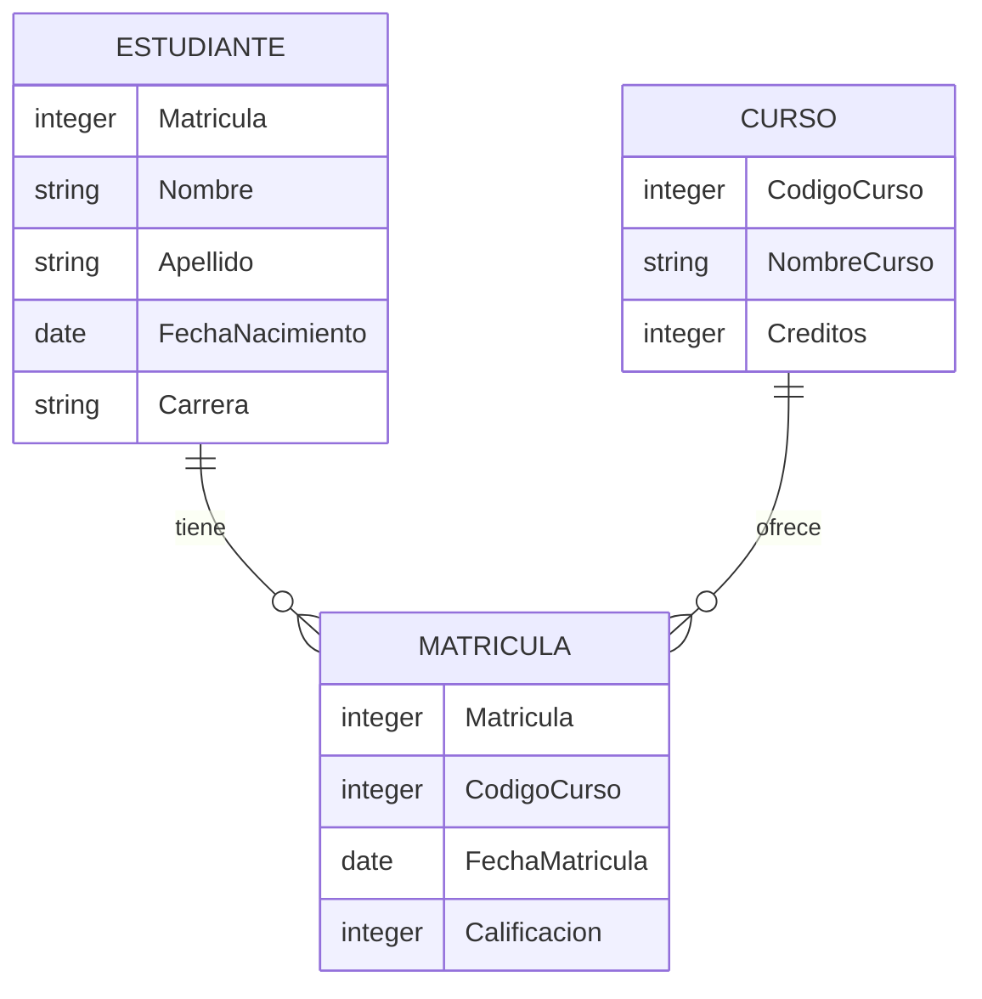

# Fundamentos de Bases de Datos - Modelo Relacional

## 4.1 Estructura de los datos.

---

El modelo relacional, propuesto por E.F. Codd en 1970, organiza los datos en estructuras bidimensionales llamadas relaciones (tablas). Esta estructura proporciona una forma lógica de representar datos sin depender de su implementación física.

### Conceptos Fundamentales

#### Relación

Una relación es una estructura bidimensional que consiste en:

- Un conjunto de atributos (columnas)
- Un conjunto de tuplas (filas)

Matemáticamente, una relación R es un subconjunto del producto cartesiano de los dominios:

$$R \subseteq D_1 × D_2 × ... × D_n$$

donde $D_1, D_2, ..., D_n$ son dominios.

#### Atributos

Cada atributo representa una característica de la entidad y tiene:

- Un nombre único dentro de la relación
- Un dominio que define los valores posibles

#### Tuplas

Cada tupla representa una instancia de la relación y contiene valores para cada atributo:

$$t = (v_1, v_2, ..., v_n)$$

donde $v_i \in D_i$ para $i = 1, 2, ..., n$

#### Dominios

Un dominio define el conjunto de valores permitidos para un atributo:

$$D_i = \{v | v \text{ es un valor válido}\}$$

### Esquema de Relación

El esquema de una relación define su estructura:

$$R(A_1, A_2, ..., A_n)$$

donde $A_i$ son los atributos y cada uno tiene un dominio asociado $D(A_i)$.

#### Ejemplo de Esquema

```sql
ESTUDIANTE(Matricula, Nombre, Apellido, FechaNacimiento, Carrera)
```

Donde:

- Matricula: DOMINIO_ENTERO
- Nombre: DOMINIO_TEXTO(50)
- Apellido: DOMINIO_TEXTO(50)
- FechaNacimiento: DOMINIO_FECHA
- Carrera: DOMINIO_TEXTO(100)

### Diagrama de Relación



### Propiedades de las Relaciones

1. **No ordenación de tuplas**: Las tuplas no tienen un orden específico
2. **No ordenación de atributos**: Los atributos se identifican por nombre, no por posición
3. **Valores atómicos**: Cada valor debe ser indivisible (primera forma normal)
4. **Valores nulos**: Representan valores desconocidos o no aplicables

### Restricciones Estructurales

#### Restricción de Dominio

Cada atributo debe tomar valores únicamente de su dominio:

$$\forall t \in R, t[A_i] \in D(A_i)$$

#### Restricción de Clave

- **Clave candidata**: Conjunto mínimo de atributos que identifica unívocamente cada tupla
- **Clave primaria**: Clave candidata seleccionada para identificar tuplas
- **Clave foránea**: Atributos que referencian la clave primaria de otra relación

### Ejemplo Práctico

#### Instancia de Relación ESTUDIANTE

| Matricula | Nombre | Apellido | FechaNacimiento | Carrera    |
| --------- | ------ | -------- | --------------- | ---------- |
| 2023001   | María  | González | 2000-05-15      | Ingeniería |
| 2023002   | Carlos | López    | 1999-08-22      | Medicina   |
| 2023003   | Ana    | Martínez | 2001-02-10      | Derecho    |

#### Código SQL para Crear la Estructura

```sql
CREATE DOMAIN DOMINIO_ENTERO AS INTEGER CHECK (VALUE > 0);
CREATE DOMAIN DOMINIO_TEXTO AS VARCHAR(100);
CREATE DOMAIN DOMINIO_FECHA AS DATE;

CREATE TABLE ESTUDIANTE (
    Matricula DOMINIO_ENTERO PRIMARY KEY,
    Nombre DOMINIO_TEXTO NOT NULL,
    Apellido DOMINIO_TEXTO NOT NULL,
    FechaNacimiento DOMINIO_FECHA,
    Carrera DOMINIO_TEXTO
);
```

### Ejercicios Propuestos

#### Ejercicio 1

Diseñe el esquema de relación para una biblioteca que incluya libros, autores y préstamos. Defina los dominios apropiados.

#### Ejercicio 2

Dada la siguiente relación, identifique las claves candidatas y proponga una clave primaria:

**EMPLEADO**(ID_Empleado, DNI, Nombre, Apellido, Departamento, Email)

#### Ejercicio 3

Cree el diagrama entidad-relación para un sistema de reservas de hotel usando notación relacional.

#### Ejercicio 4

Escriba las sentencias SQL para implementar la estructura del ejercicio 1, incluyendo todas las restricciones de dominio.

#### Ejercicio 5

Analice la siguiente instancia e identifique violaciones a las propiedades relacionales:

| ProductoID | Nombre     | Categorías             | Precio |
| ---------- | ---------- | ---------------------- | ------ |
| 1          | Laptop XYZ | Tecnología,Electrónica | 1200   |
| 2          | Mouse ABC  | Tecnología             | 25.50  |
| 1          | Laptop XYZ | Computación            | 1200   |

### Conceptos Avanzados

#### Valor Nulo

El valor nulo $(\bot)$ representa:

- Valor desconocido
- Valor no existente
- Valor no aplicable

#### Dependencias Funcionales

Una dependencia funcional $X → Y$ significa que los valores de Y están determinados por los valores de X:

$$\forall t_1, t_2 \in R, t_1[X] = t_2[X] \Rightarrow t_1[Y] = t_2[Y]$$

### Referencias

#### Bibliografía Básica

1. Elmasri and Navathe. _Fundamentals of Database Systems_. Addison-Wesley. 2006. (Capítulo 3)
2. Silberschatz A., Kort H. y Sudarshan S. _Fundamentos de BD_. McGraw Hill. 2006. (Capítulo 2)
3. Ullman J.D. and Widom J. _A First Course in Data Base System_. Prentice Hall. 2008. (Capítulo 2)

#### Bibliografía Complementaria

1. Harrington J. _Relational Database Design and Implementation_. Morgan Kaufmann. 2009.
2. Kline K., Kline D., and Hunt B. _SQL in a nutshell_. O'Reilly. 2008.

### Resumen de Fórmulas y Notación

- **Producto cartesiano**: $D_1 × D_2 × ... × D_n$
- **Relación**: $R \subseteq D_1 × D_2 × ... × D_n$
- **Tupla**: $t = (v_1, v_2, ..., v_n)$ donde $v_i \in D_i$
- **Dependencia funcional**: $X → Y$
- **Valor nulo**: $\bot$
