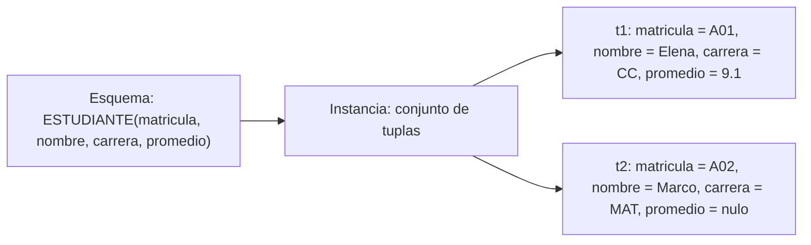
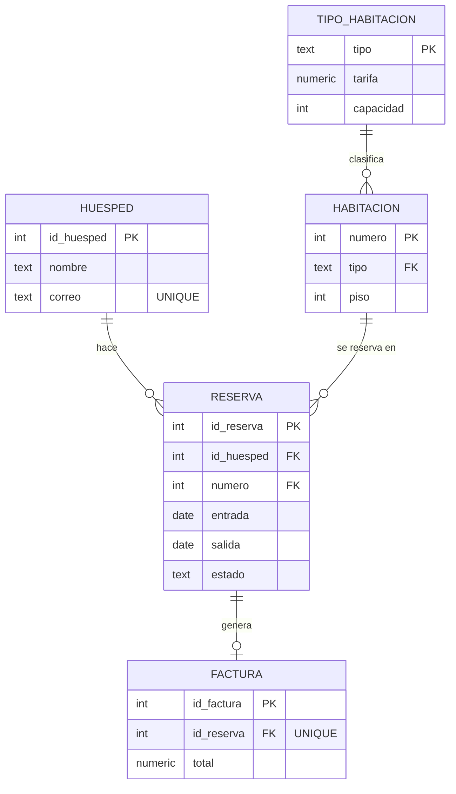

# Fundamentos de Bases de Datos - Modelo Relacional

## 4.1 Estructura de los datos.

---

El modelo relacional describe todos los datos con una sola estructura, la **relación**, definida a partir de conjuntos de valores llamados **dominios**. El tema 2.2 la presentó de forma general; aquí se dan las definiciones precisas de dominio, atributo, tupla, relación, esquema de relación y esquema de base de datos, las propiedades que se siguen de ellas, el tratamiento de los **valores nulos** y las restricciones estructurales: de dominio, de clave y de integridad.

### Dominios

Un **dominio** $D$ es un conjunto de valores **atómicos**, es decir, que el modelo no descompone. Se especifica con un tipo de dato y, a menudo, con una condición adicional:

- $\text{Edades} = \{0, 1, \dots, 150\} \subset \mathbb{Z}.$
- $\text{ISBN} =$ cadenas de 13 dígitos cuyo último dígito es el verificador.
- $\text{Fechas} =$ fechas válidas del calendario gregoriano en el formato AAAA-MM-DD.
- $\text{Estados} = \{\text{confirmada}, \text{cancelada}, \text{concluida}\}.$

Dos atributos con el mismo tipo pueden tener dominios distintos: la edad y el número de habitación son enteros, pero compararlos o sumarlos no tiene sentido. Codd propuso que el sistema impidiera comparar atributos de dominios distintos; SQL solo lo aproxima con `CREATE DOMAIN`, que PostgreSQL implementa y SQLite no, y con restricciones `CHECK`.

### Atributos, tuplas y relaciones

Un **esquema de relación** $R(A_1, \dots, A_n)$ es un nombre $R$ con un conjunto de **atributos** $A_i,$ cada uno con su dominio $\operatorname{dom}(A_i).$ Su **grado** es $n.$

Una **tupla** sobre $R$ es una función $t$ que asigna a cada atributo un valor de su dominio, $t(A_i) \in \operatorname{dom}(A_i),$ escrito también $t[A_i]$ o $t.A_i.$ Para un conjunto de atributos $X,$ $t[X]$ es la restricción de $t$ a $X.$ Definir la tupla como función, y no como lista ordenada, hace que el orden de las columnas sea irrelevante: lo que identifica un valor es su atributo, no su posición.

Una **relación** o **instancia** $r(R)$ es un conjunto **finito** de tuplas sobre $R.$ Su **cardinalidad** es $|r(R)|.$ Equivalentemente, si se fija un orden de los atributos,

$$r(R) \subseteq \operatorname{dom}(A_1) \times \dots \times \operatorname{dom}(A_n).$$

Un **esquema de base de datos** es un conjunto de esquemas de relación $\{R_1, \dots, R_m\}$ con un conjunto de restricciones de integridad; una **instancia de base de datos** asigna una relación a cada $R_j,$ y es **válida** si cumple todas las restricciones.



### Propiedades de las relaciones

De que una relación sea un conjunto de funciones se siguen cuatro propiedades:

1. **No hay tuplas repetidas,** porque un conjunto no tiene elementos repetidos. En consecuencia, toda relación tiene al menos una clave: el conjunto de todos sus atributos.
2. **Las tuplas no tienen orden.** Un orden es una forma de presentar el resultado, no una propiedad de los datos; en SQL se pide con `ORDER BY`.
3. **Los atributos no tienen orden,** porque se identifican por su nombre.
4. **Los valores son atómicos:** cada $t[A]$ es un elemento de $\operatorname{dom}(A),$ no un conjunto ni una lista. Esta es la **primera forma normal**.

Una tabla de SQL no siempre es una relación: puede tener filas repetidas si no declara clave, y sus columnas tienen una posición (`SELECT *` las devuelve en el orden en que se crearon).

### Valores nulos

Un **nulo** marca la ausencia de un valor. Puede significar tres cosas distintas: que el valor existe pero se desconoce (la fecha de nacimiento no registrada), que no existe (la fecha de devolución de un libro aún prestado) o que no aplica (el número interior de una casa). El modelo usa una sola marca para los tres casos.

Con nulos, las comparaciones dejan de ser verdaderas o falsas: $\text{nulo} = 5$ es **desconocido**. SQL usa una lógica de **tres valores**, en la que `WHERE` conserva solo las filas cuya condición es verdadera. Por eso `x = NULL` nunca selecciona nada y hay que escribir `x IS NULL`, y por eso una consulta con `NOT IN` sobre una subconsulta que devuelve un nulo da un resultado vacío. El tema 6 vuelve sobre esto.

### Restricciones estructurales

- **De dominio:** $\forall t \in r(R): t[A] \in \operatorname{dom}(A)$ o $t[A]$ es nulo, si $A$ admite nulos.
- **De clave:** un conjunto $K$ de atributos es **superclave** si en toda instancia válida $t_1[K] = t_2[K]$ implica $t_1 = t_2,$ y es **clave candidata** si además ningún subconjunto propio de $K$ lo es. Una de las claves candidatas se elige como **clave primaria**; las demás se llaman claves **alternativas** y se declaran `UNIQUE`.
- **De entidad:** los atributos de la clave primaria no son nulos.
- **De integridad referencial:** el valor de una clave foránea aparece como clave primaria en la relación referenciada, o es nulo.

Ser clave es una afirmación sobre **todas** las instancias válidas, y por eso se decide con las reglas del negocio y no observando los datos: una instancia puede **refutar** que un conjunto sea clave, si tiene dos tuplas que coinciden en él, pero no puede demostrarlo.

### Implementación en Python

El programa busca las superclaves mínimas de la instancia de empleados del ejercicio 2 probando todos los subconjuntos de atributos, y muestra con una contratación nueva por qué una instancia no basta para decidir qué es clave. Para los ejercicios 1 y 4 crea en SQLite el esquema de la biblioteca con sus dominios expresados como `CHECK` y con tipos estrictos, calcula el dígito verificador del ISBN y prueba valores fuera de cada dominio. Para el ejercicio 5 detecta las violaciones de la instancia de productos y la lleva a primera forma normal.

```python
import sqlite3
from itertools import combinations

# --- Ejercicio 2: claves candidatas de EMPLEADO ---
atributos = ("id_empleado", "dni", "nombre", "apellido", "departamento", "email")
instancia = [(1, "12345678A", "Ana", "Ruiz", "Ventas", "ana.ruiz@empresa.mx"),
             (2, "23456789B", "Ana", "Soto", "Ventas", "ana.soto@empresa.mx"),
             (3, "34567890C", "Luis", "Ruiz", "Sistemas", "luis.ruiz@empresa.mx"),
             (4, "45678901D", "Luis", "Ruiz", "Ventas", "lruiz@empresa.mx")]

def es_superclave_en(X, filas):
    idx = [atributos.index(a) for a in X]
    vistos = {tuple(f[i] for i in idx) for f in filas}
    return len(vistos) == len(filas)

minimales = []
for k in range(1, len(atributos) + 1):
    for X in combinations(atributos, k):
        if es_superclave_en(X, instancia) and not any(set(m) <= set(X) for m in minimales):
            minimales.append(X)
print("ejercicio 2: superclaves mínimas en esta instancia:", minimales)
# una instancia solo puede refutar una clave; las reglas del negocio deciden cuáles lo son
print("   ¿(nombre, apellido, departamento) es clave? en la instancia:",
      es_superclave_en(("nombre", "apellido", "departamento"), instancia),
      "| tras contratar a otra Ana Ruiz en Ventas:",
      es_superclave_en(("nombre", "apellido", "departamento"),
                       instancia + [(5, "56789012E", "Ana", "Ruiz", "Ventas", "aruiz2@empresa.mx")]))

# --- Ejercicios 1 y 4: biblioteca con dominios ---
db = sqlite3.connect(":memory:")
db.execute("PRAGMA foreign_keys = ON")
db.executescript("""
CREATE TABLE autor (
    id_autor     INTEGER PRIMARY KEY,
    nombre       TEXT NOT NULL CHECK (length(trim(nombre)) > 0),
    nacionalidad TEXT CHECK (length(nacionalidad) = 2)                    -- código ISO 3166 de dos letras
);
CREATE TABLE libro (
    isbn   TEXT PRIMARY KEY CHECK (length(isbn) = 13 AND isbn NOT GLOB '*[^0-9]*'),   -- ISBN-13: 13 dígitos
    titulo TEXT NOT NULL,
    anio   INTEGER CHECK (anio BETWEEN 1450 AND 2100)
) STRICT;
CREATE TABLE libro_autor (
    isbn TEXT REFERENCES libro, id_autor INTEGER REFERENCES autor, PRIMARY KEY (isbn, id_autor)
);
CREATE TABLE prestamo (
    id_prestamo INTEGER PRIMARY KEY,
    isbn        TEXT NOT NULL REFERENCES libro,
    socio       TEXT NOT NULL,
    salida      TEXT NOT NULL CHECK (date(salida) IS salida),                -- una fecha válida AAAA-MM-DD
    devolucion  TEXT CHECK (devolucion IS NULL OR (date(devolucion) IS devolucion AND devolucion >= salida))
);
INSERT INTO autor VALUES (1, 'Gabriel García Márquez', 'CO');
INSERT INTO libro VALUES ('9780307474728', 'Cien años de soledad', 1967);
INSERT INTO libro_autor VALUES ('9780307474728', 1);
""")

def digito_isbn13(doce):            # dominio más fino: el dígito verificador del ISBN-13
    return (10 - sum(int(c) * (1 if i % 2 == 0 else 3) for i, c in enumerate(doce)) % 10) % 10
print("ejercicio 4: dígito verificador de 978030747472:", digito_isbn13("978030747472"), "(el ISBN termina en 8)")

print("   valores fuera de su dominio:")
for sql in ("INSERT INTO libro VALUES ('978030747472X', 'Prueba', 2000)",
            "INSERT INTO libro VALUES ('9780307474735', 'Prueba', 3000)",
            "INSERT INTO libro VALUES ('9780307474742', 'Prueba', 'dos mil')",
            "INSERT INTO autor VALUES (2, '   ', 'MX')",
            "INSERT INTO prestamo VALUES (1, '9780307474728', 'S1', '2026-02-30', NULL)",
            "INSERT INTO prestamo VALUES (2, '9780307474728', 'S1', '2026-10-10', '2026-10-01')"):
    try:
        db.execute(sql); print("      aceptado:", sql)
    except (sqlite3.IntegrityError, sqlite3.DataError) as e:
        print("     ", type(e).__name__, "->", e)

# --- Ejercicio 5: la instancia de productos ---
productos = [(1, "Laptop XYZ", "Tecnología,Electrónica", 1200), (2, "Mouse ABC", "Tecnología", 25.50),
             (1, "Laptop XYZ", "Computación", 1200)]
print("ejercicio 5: valores no atómicos:", [p for p in productos if "," in p[2]])
print("   ProductoID repetido:", [i for i in {p[0] for p in productos} if sum(q[0] == i for q in productos) > 1])
db.executescript("""
CREATE TABLE producto (id_producto INTEGER PRIMARY KEY, nombre TEXT NOT NULL, precio NUMERIC NOT NULL CHECK (precio > 0));
CREATE TABLE categoria (id_categoria INTEGER PRIMARY KEY, nombre TEXT NOT NULL UNIQUE);
CREATE TABLE producto_categoria (id_producto INTEGER REFERENCES producto, id_categoria INTEGER REFERENCES categoria,
                                 PRIMARY KEY (id_producto, id_categoria));
""")
for pid, nombre, cats, precio in productos:
    db.execute("INSERT OR IGNORE INTO producto VALUES (?, ?, ?)", (pid, nombre, precio))
    for c in cats.split(","):
        db.execute("INSERT OR IGNORE INTO categoria (nombre) VALUES (?)", (c,))
        db.execute("INSERT INTO producto_categoria SELECT ?, id_categoria FROM categoria WHERE nombre = ?", (pid, c))
print("   en 1FN:", db.execute("""SELECT p.id_producto, p.nombre, GROUP_CONCAT(c.nombre, ' | ') FROM producto p
    JOIN producto_categoria USING (id_producto) JOIN categoria c USING (id_categoria)
    GROUP BY p.id_producto ORDER BY p.id_producto""").fetchall())
print("   productos con categoría Tecnología:", db.execute("""SELECT COUNT(*) FROM producto_categoria
    JOIN categoria USING (id_categoria) WHERE nombre = 'Tecnología'""").fetchone()[0],
      "| con Categorías = 'Tecnología' sobre la tabla original:", sum(p[2] == "Tecnología" for p in productos))
```

Salida:

```text
ejercicio 2: superclaves mínimas en esta instancia: [('id_empleado',), ('dni',), ('email',), ('nombre', 'apellido', 'departamento')]
   ¿(nombre, apellido, departamento) es clave? en la instancia: True | tras contratar a otra Ana Ruiz en Ventas: False
ejercicio 4: dígito verificador de 978030747472: 8 (el ISBN termina en 8)
   valores fuera de su dominio:
      IntegrityError -> CHECK constraint failed: length(isbn) = 13 AND isbn NOT GLOB '*[^0-9]*'
      IntegrityError -> CHECK constraint failed: anio BETWEEN 1450 AND 2100
      IntegrityError -> cannot store TEXT value in INTEGER column libro.anio
      IntegrityError -> CHECK constraint failed: length(trim(nombre)) > 0
      IntegrityError -> CHECK constraint failed: date(salida) IS salida
      IntegrityError -> CHECK constraint failed: devolucion IS NULL OR (date(devolucion) IS devolucion AND devolucion >= salida)
ejercicio 5: valores no atómicos: [(1, 'Laptop XYZ', 'Tecnología,Electrónica', 1200)]
   ProductoID repetido: [1]
   en 1FN: [(1, 'Laptop XYZ', 'Tecnología | Electrónica | Computación'), (2, 'Mouse ABC', 'Tecnología')]
   productos con categoría Tecnología: 2 | con Categorías = 'Tecnología' sobre la tabla original: 1
```

### Ejercicios Propuestos

1. **Esquema.** Diseña el esquema de relación de una biblioteca con libros, autores y préstamos, y define los dominios apropiados.

2. **Claves.** Identifica las claves candidatas de `EMPLEADO(id_empleado, dni, nombre, apellido, departamento, email)` y propón una clave primaria.

3. **Notación relacional.** Dibuja el esquema de un sistema de reservas de hotel con sus relaciones, claves primarias y claves foráneas.

4. **SQL.** Escribe las sentencias SQL para el esquema del ejercicio 1, con todas las restricciones de dominio.

5. **Propiedades.** Identifica las violaciones a las propiedades de una relación en la siguiente instancia:

    | ProductoID | Nombre     | Categorías             | Precio |
    | ---------- | ---------- | ---------------------- | ------ |
    | 1          | Laptop XYZ | Tecnología,Electrónica | 1200   |
    | 2          | Mouse ABC  | Tecnología             | 25.50  |
    | 1          | Laptop XYZ | Computación            | 1200   |

### Soluciones

**Ejercicio 1.** `Autor(id_autor, nombre, nacionalidad)`, `Libro(isbn, titulo, anio)`, `Libro_autor(isbn, id_autor)` y `Prestamo(id_prestamo, isbn, socio, salida, devolucion)`. Dominios: `id_autor` y `id_prestamo`, enteros positivos generados por el sistema; `nombre`, cadenas no vacías; `nacionalidad`, los códigos de país de dos letras de ISO 3166; `isbn`, cadenas de 13 dígitos con dígito verificador válido; `anio`, enteros entre 1450, por la imprenta de Gutenberg, y el año próximo; `salida` y `devolucion`, fechas válidas, con `devolucion` nula mientras el libro está prestado y no anterior a `salida`. La relación entre libros y autores necesita su propia tabla porque un libro con dos autores no puede guardarlos en un solo valor atómico.

**Ejercicio 2.** `id_empleado` es clave por diseño: el sistema lo asigna. `dni` es clave porque el documento nacional de identidad es único por persona, y `email` lo es si la empresa asigna un correo único a cada empleado. Las tres son claves candidatas. El programa encuentra además que en esta instancia la combinación `(nombre, apellido, departamento)` no se repite, pero no es clave: basta contratar a otra Ana Ruiz en Ventas para que se repita. La mejor clave primaria es `id_empleado`: no tiene significado fuera del sistema, así que no cambia nunca, es corta y no expone datos personales en las claves foráneas de otras tablas. `dni` y `email` se declaran `UNIQUE NOT NULL` como claves alternativas, aunque el correo puede cambiar.

**Ejercicio 3.**



La tarifa depende del tipo de habitación y no de la habitación, por eso va en `TIPO_HABITACION`; guardarla en cada habitación la repetiría. `FACTURA.id_reserva` es `UNIQUE` para que cada reserva tenga a lo más una factura.

**Ejercicio 4.** Es el DDL del programa. `STRICT` hace que SQLite rechace un texto en una columna entera, que por omisión aceptaría. El ISBN se restringe a 13 dígitos con `GLOB`, la fecha se valida comprobando que `date()` la devuelve sin cambios, lo que rechaza el 30 de febrero, y `devolucion` tiene una condición que combina el nulo con el orden de las fechas. El dígito verificador del ISBN-13 se calcula multiplicando los 12 primeros dígitos alternadamente por 1 y por 3, sumando y tomando el complemento a 10 del último dígito de la suma; para "Cien años de soledad" da 8, y ese es su último dígito. Esa condición también se puede escribir en un `CHECK`, aunque resulta larga.

**Ejercicio 5.** Hay tres violaciones:

1. **Valores no atómicos:** "Tecnología,Electrónica" son dos valores en una celda. La consulta de los productos de Tecnología por igualdad encuentra solo el ratón y omite la laptop.
2. **Clave repetida:** `ProductoID` 1 aparece dos veces, así que no puede ser clave tal como está la tabla.
3. **Redundancia:** el nombre y el precio de la laptop se repiten, y una actualización que cambie solo una de las filas dejaría dos precios.

En el fondo, la tabla intenta guardar en una relación dos hechos distintos: los datos del producto y sus categorías. La solución separa `producto(id_producto, nombre, precio)`, `categoria(id_categoria, nombre)` y `producto_categoria(id_producto, id_categoria)`. La laptop queda con sus tres categorías y la consulta por categoría encuentra los dos productos. El precio 25.50 se guarda como `NUMERIC`; para dinero conviene un tipo decimal exacto (`DECIMAL(10, 2)`) o guardar centavos como enteros, porque los flotantes no representan 25.10 exactamente.

### Referencias

1. Codd, E. F., A relational model of data for large shared data banks. _Communications of the ACM_ 13(6), 1970.
2. Elmasri, R., and Navathe, S. B., _Fundamentals of Database Systems_. Pearson, 2016. Capítulo 5.
3. Date, C. J., _An Introduction to Database Systems_. Addison-Wesley, 2003. Capítulos 5 y 6.
4. Silberschatz, A., Korth, H. F., and Sudarshan, S., _Database System Concepts_. McGraw-Hill, 2019. Capítulo 2.
5. SQLite, _STRICT Tables_ y _Date And Time Functions_. Documentación en línea, sqlite.org.
