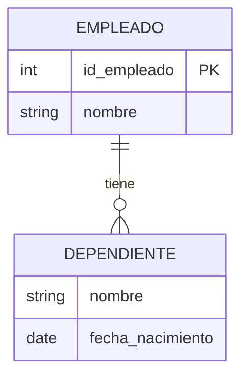
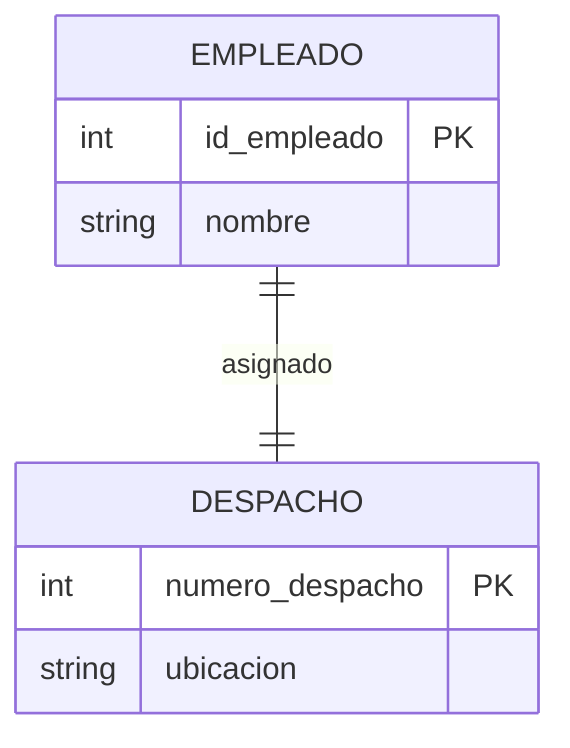
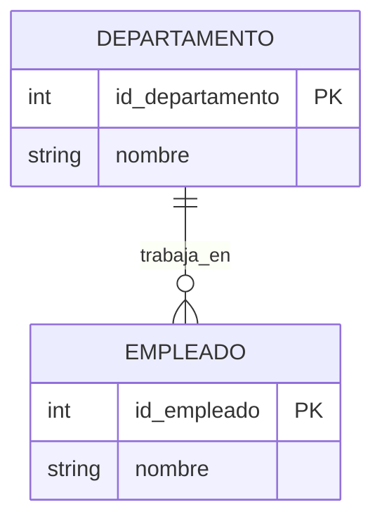
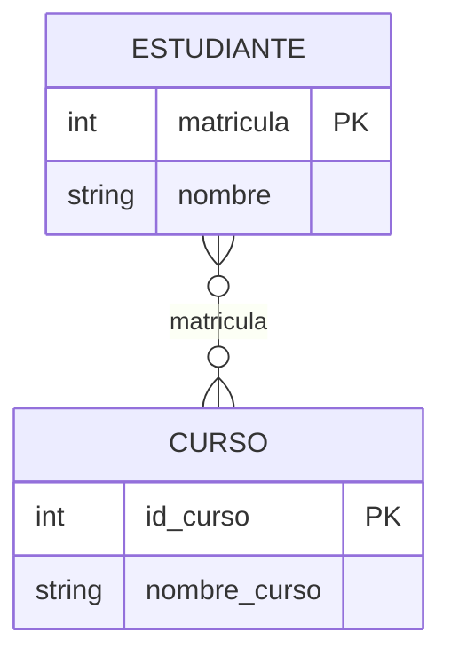
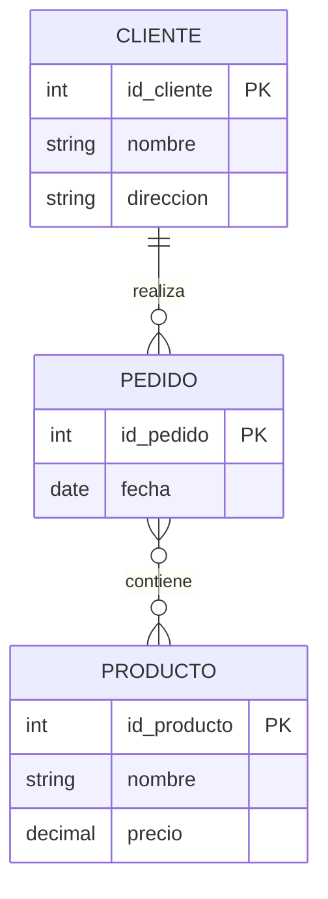
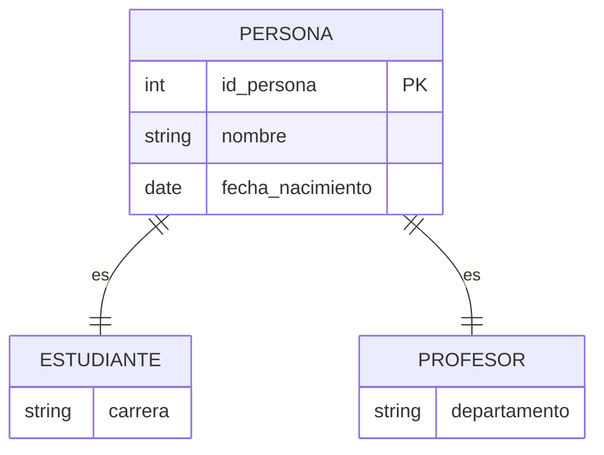

# Fundamentos de Bases de Datos - Modelo Relacional

## 4.2 Mapeo del esquema conceptual al esquema relacional.

---

El mapeo del esquema conceptual (modelo ER) al esquema relacional es un proceso fundamental en el diseño de bases de datos. Este proceso transforma las entidades, atributos y relaciones del modelo conceptual en estructuras relacionales que pueden implementarse en un SGBD.

### Proceso de Mapeo

#### Reglas de Transformación

##### 1. Mapeo de Entidades Regulares

Cada entidad regular se convierte en una relación (tabla). Los atributos simples se convierten en columnas, y el identificador principal se convierte en la clave primaria.

$$Entidad(E, A_1, A_2, ..., A_n) \rightarrow \text{Relación}(E, A_1, A_2, ..., A_n)$$

**Ejemplo:**


Se transforma en:

```sql
CREATE TABLE ESTUDIANTE (
    matricula INT PRIMARY KEY,
    nombre VARCHAR(50),
    apellido VARCHAR(50),
    fecha_nacimiento DATE
);
```

##### 2. Mapeo de Entidades Débiles

Las entidades débiles se transforman en tablas que incluyen la clave primaria de la entidad fuerte como parte de su clave primaria.

$$ \text{EntidadDébil}(ED, A_1, A_2, ..., A_n) \rightarrow \text{Relación}(ED, A_1, A_2, ..., A_n, PK_E)$$

**Ejemplo:**



Se transforma en:

```sql
CREATE TABLE DEPENDIENTE (
    id_empleado INT,
    nombre VARCHAR(50),
    fecha_nacimiento DATE,
    PRIMARY KEY (id_empleado, nombre),
    FOREIGN KEY (id_empleado) REFERENCES EMPLEADO(id_empleado)
);
```

##### 3. Mapeo de Relaciones Binarias 1:1

Para relaciones uno a uno, se puede agregar la clave de una entidad a la tabla de la otra entidad, junto con los atributos de la relación.

$$R_{1:1}(E_1, E_2) \rightarrow \text{Añadir}\,PK_{E_1}\,a\,E_2\,o\,viceversa$$

**Ejemplo:**



Se transforma en:

```sql
CREATE TABLE EMPLEADO (
    id_empleado INT PRIMARY KEY,
    nombre VARCHAR(50),
    numero_despacho INT UNIQUE,
    FOREIGN KEY (numero_despacho) REFERENCES DESPACHO(numero_despacho)
);

CREATE TABLE DESPACHO (
    numero_despacho INT PRIMARY KEY,
    ubicacion VARCHAR(100)
);
```

##### 4. Mapeo de Relaciones Binarias 1:N

Para relaciones uno a muchos, se añade la clave de la entidad del lado "uno" a la tabla del lado "muchos".

$$R_{1:N}(E_1, E_2) \rightarrow \text{Añadir}\,PK_{E_1}\,a\,E_2$$

**Ejemplo:**



Se transforma en:

```sql
CREATE TABLE EMPLEADO (
    id_empleado INT PRIMARY KEY,
    nombre VARCHAR(50),
    id_departamento INT,
    FOREIGN KEY (id_departamento) REFERENCES DEPARTAMENTO(id_departamento)
);
```

##### 5. Mapeo de Relaciones Binarias M:N

Para relaciones muchos a muchos, se crea una nueva tabla que contiene las claves primarias de ambas entidades.

$$R_{M:N}(E_1, E_2) \rightarrow Nueva\,Tabla(PK_{E_1}, PK_{E_2}, Atributos\,R)$$

**Ejemplo:**



Se transforma en:

```sql
CREATE TABLE MATRICULA (
    matricula INT,
    id_curso INT,
    fecha_matricula DATE,
    calificacion DECIMAL(4,2),
    PRIMARY KEY (matricula, id_curso),
    FOREIGN KEY (matricula) REFERENCES ESTUDIANTE(matricula),
    FOREIGN KEY (id_curso) REFERENCES CURSO(id_curso)
);
```

##### 6. Mapeo de Relaciones Multivaluadas

Los atributos multivaluados se transforman en tablas separadas.

$$AtributoMultivaluado(A, E) \rightarrow Nueva\,Tabla(PK_E, A)$$

**Ejemplo:**

```sql
EMPLEADO {
    int id_empleado PK
    string nombre
    string telefono MV
}
```

Se transforma en:

```sql
CREATE TABLE TELEFONO_EMPLEADO (
    id_empleado INT,
    telefono VARCHAR(15),
    PRIMARY KEY (id_empleado, telefono),
    FOREIGN KEY (id_empleado) REFERENCES EMPLEADO(id_empleado)
);
```

##### 7. Mapeo de Jerarquías de Generalización

Existen varias estrategias para mapear jerarquías:

**a) Estrategia de una tabla por entidad:**

```sql
CREATE TABLE PERSONA (
    id_persona INT PRIMARY KEY,
    nombre VARCHAR(50),
    tipo VARCHAR(15) CHECK (tipo IN ('ESTUDIANTE', 'PROFESOR', 'PERSONAL'))
);

CREATE TABLE ESTUDIANTE (
    id_persona INT PRIMARY KEY,
    carrera VARCHAR(50),
    FOREIGN KEY (id_persona) REFERENCES PERSONA(id_persona)
);

CREATE TABLE PROFESOR (
    id_persona INT PRIMARY KEY,
    departamento VARCHAR(50),
    FOREIGN KEY (id_persona) REFERENCES PERSONA(id_persona)
);
```

**b) Estrategia de una tabla por categoría:**

```sql
CREATE TABLE PERSONA (
    id_persona INT PRIMARY KEY,
    nombre VARCHAR(50)
);

CREATE TABLE ESTUDIANTE (
    id_persona INT PRIMARY KEY,
    nombre VARCHAR(50),
    carrera VARCHAR(50)
);

CREATE TABLE PROFESOR (
    id_persona INT PRIMARY KEY,
    nombre VARCHAR(50),
    departamento VARCHAR(50)
);
```

### Ejemplo Completo de Mapeo

#### Modelo ER Original

```sql
    DEPARTAMENTO {
        int id_departamento PK
        string nombre
    }

    EMPLEADO {
        int id_empleado PK
        string nombre
        string telefono MV
    }

    PROYECTO {
        int id_proyecto PK
        string nombre
    }

    -- DEPARTAMENTO ||--o{ EMPLEADO : trabaja_en
    -- EMPLEADO }o--o{ PROYECTO : participa
    -- EMPLEADO ||--o{ EMPLEADO : supervisa
```

#### Esquema Relacional Resultante

```sql
-- Tabla DEPARTAMENTO
CREATE TABLE DEPARTAMENTO (
    id_departamento INT PRIMARY KEY,
    nombre VARCHAR(50)
);

-- Tabla EMPLEADO
CREATE TABLE EMPLEADO (
    id_empleado INT PRIMARY KEY,
    nombre VARCHAR(50),
    id_departamento INT,
    id_supervisor INT,
    FOREIGN KEY (id_departamento) REFERENCES DEPARTAMENTO(id_departamento),
    FOREIGN KEY (id_supervisor) REFERENCES EMPLEADO(id_empleado)
);

-- Tabla para teléfonos multivaluados
CREATE TABLE TELEFONO_EMPLEADO (
    id_empleado INT,
    telefono VARCHAR(15),
    PRIMARY KEY (id_empleado, telefono),
    FOREIGN KEY (id_empleado) REFERENCES EMPLEADO(id_empleado)
);

-- Tabla PROYECTO
CREATE TABLE PROYECTO (
    id_proyecto INT PRIMARY KEY,
    nombre VARCHAR(50)
);

-- Tabla para relación M:N entre EMPLEADO y PROYECTO
CREATE TABLE PARTICIPA (
    id_empleado INT,
    id_proyecto INT,
    horas INT,
    PRIMARY KEY (id_empleado, id_proyecto),
    FOREIGN KEY (id_empleado) REFERENCES EMPLEADO(id_empleado),
    FOREIGN KEY (id_proyecto) REFERENCES PROYECTO(id_proyecto)
);
```

### Consideraciones Importantes

#### Integridad Referencial

Las claves foráneas deben mantener la integridad referencial mediante:

- Restricciones `ON DELETE` y `ON UPDATE`
- Opciones: CASCADE, SET NULL, SET DEFAULT, RESTRICT

#### Normalización

El esquema resultante debe cumplir con las formas normales para evitar anomalías:

- Primera Forma Normal (1FN): Eliminar atributos multivaluados
- Segunda Forma Normal (2FN): Eliminar dependencias parciales
- Tercera Forma Normal (3FN): Eliminar dependencias transitivas

### Ejercicios Propuestos

#### Ejercicio 1

Dado el siguiente modelo ER, realice el mapeo al modelo relacional:



#### Ejercicio 2

Transforme el siguiente esquema ER con especialización:



#### Ejercicio 3

Identifique y corrija los problemas en el siguiente mapeo:

```sql
CREATE TABLE EMPLEADO (
    id_empleado INT,
    nombre VARCHAR(50),
    id_departamento INT
);

CREATE TABLE DEPARTAMENTO (
    id_departamento INT,
    nombre VARCHAR(50)
);

CREATE TABLE PROYECTO (
    id_proyecto INT,
    nombre VARCHAR(50),
    id_empleado INT
);
```

#### Ejercicio 4

Diseñe el modelo relacional para un sistema de biblioteca con las siguientes entidades:

- Libro (ISBN, título, año)
- Autor (id_autor, nombre, nacionalidad)
- Ejemplar (id_ejemplar, estado)
- Usuario (id_usuario, nombre, dirección)
- Préstamo (fecha_préstamo, fecha_devolución)

Considere que:

- Un libro tiene uno o más autores
- Un libro tiene uno o más ejemplares
- Un usuario puede tomar prestados varios ejemplares
- Un ejemplar puede ser prestado múltiples veces

#### Ejercicio 5

Analice el siguiente esquema relacional y proponga mejoras de normalización:

```sql
CREATE TABLE VENTA (
    id_venta INT PRIMARY KEY,
    fecha DATE,
    id_cliente INT,
    nombre_cliente VARCHAR(50),
    direccion_cliente VARCHAR(100),
    id_producto INT,
    nombre_producto VARCHAR(50),
    categoria_producto VARCHAR(30),
    precio DECIMAL(10,2),
    cantidad INT,
    total DECIMAL(10,2)
);
```

### Referencias

#### Bibliografía Básica

1. Elmasri and Navathe. _Fundamentals of Database Systems_. Addison-Wesley. 2006. (Capítulo 9)
2. Silberschatz A., Kort H. y Sudarshan S. _Fundamentos de BD_. McGraw Hill. 2006. (Capítulo 7)
3. Ullman J.D. and Widom J. _A First Course in Data Base System_. Prentice Hall. 2008. (Capítulo 3)

#### Bibliografía Complementaria

1. Harrington J. _Relational Database Design and Implementation_. Morgan Kaufmann. 2009. (Capítulo 8)
2. Kline K., Kline D., and Hunt B. _SQL in a nutshell_. O'Reilly. 2008. (Capítulo 4)

### Resumen

El mapeo del esquema conceptual al esquema relacional sigue reglas sistemáticas:

- Entidades → Tablas
- Atributos → Columnas
- Identificadores → Claves primarias
- Relaciones 1:1 y 1:N → Claves foráneas
- Relaciones M:N → Tablas intermedias
- Atributos multivaluados → Tablas separadas
- Jerarquías → Múltiples estrategias

El proceso debe considerar la integridad referencial y la normalización para obtener un esquema eficiente y libre de anomalías.
