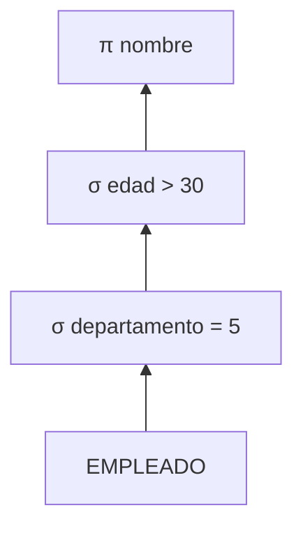

# Fundamentos de Bases de Datos - Modelo Relacional

## 4.3 Álgebra relacional.

---

El **álgebra relacional** es el lenguaje de consulta procedimental del modelo relacional: un conjunto de operadores que toman relaciones y producen relaciones. Como el resultado de cada operador es otra relación, los operadores se componen en expresiones, igual que la suma y el producto en el álgebra de los números. Su importancia es doble: define qué consultas puede expresar un lenguaje relacional, y sus **leyes de equivalencia** son la base de la optimización de consultas, porque permiten reescribir una expresión en otra que da el mismo resultado con menos trabajo. Este tema define los operadores, deriva los no básicos, demuestra algunas equivalencias y resuelve consultas con ellos.

### Operadores básicos

Sean $R$ y $S$ relaciones, $p$ un predicado sobre las tuplas y $L$ una lista de atributos.

- **Selección:** $\sigma_p(R) = \{t \in R \mid p(t)\}.$ El predicado combina comparaciones entre atributos y constantes con $\land,$ $\lor$ y $\lnot.$ El resultado tiene el esquema de $R$ y a lo más $|R|$ tuplas.
- **Proyección:** $\pi_L(R) = \{t[L] \mid t \in R\}.$ Conserva los atributos de $L$ y, al ser un conjunto, elimina las tuplas que resulten repetidas: $|\pi_L(R)| \le |R|.$
- **Unión:** $R \cup S = \{t \mid t \in R \lor t \in S\}.$
- **Diferencia:** $R - S = \{t \mid t \in R \land t \notin S\}.$ Unión y diferencia requieren relaciones **compatibles**: con el mismo grado y con dominios iguales posición por posición.
- **Producto cartesiano:** $R \times S = \{t s \mid t \in R, s \in S\},$ donde $t s$ es la concatenación. Tiene grado $n + m$ y $|R| \cdot |S|$ tuplas; si los esquemas comparten nombres de atributos, hay que renombrar antes.
- **Renombramiento:** $\rho_{S(B_1, \dots, B_n)}(R)$ da a la relación el nombre $S$ y a sus atributos los nombres $B_i;$ $\rho_{B \leftarrow A}(R)$ renombra solo el atributo $A.$

Estos seis operadores son **independientes**: ninguno se puede expresar con los otros cinco. Un lenguaje que expresa todo lo que expresan ellos se llama **relacionalmente completo** (Codd, 1972).

### Operadores derivados

- **Intersección:** $R \cap S = R - (R - S).$
- **Theta-reunión:** $R \bowtie_\theta S = \sigma_\theta(R \times S),$ donde $\theta$ compara atributos de $R$ con atributos de $S.$ Si $\theta$ solo usa igualdades, es una **equirreunión**.
- **Reunión natural:** $R \bowtie S$ es la equirreunión sobre todos los atributos comunes, seguida de una proyección que deja una sola copia de cada uno. Si no hay atributos comunes, es el producto.
- **División:** si $R$ tiene atributos $A \cup B$ y $S$ tiene atributos $B,$ entonces $R \div S$ es el conjunto de tuplas $a$ sobre $A$ tales que, para **toda** $b \in S,$ la tupla $(a, b)$ está en $R.$ Responde las consultas con "todos": los estudiantes que aprobaron **todos** los cursos. Se expresa con los básicos como

$$R \div S = \pi_A(R) - \pi_A\big((\pi_A(R) \times S) - R\big).$$

La fórmula se lee así: $\pi_A(R) \times S$ son todas las combinaciones que deberían estar; al restarles $R$ quedan las que faltan; las $a$ con alguna combinación faltante se restan de los candidatos.

- **Semirreunión** $R \ltimes S = \pi_{\text{atr}(R)}(R \bowtie S)$ y **antirreunión** $R \triangleright S = R - (R \ltimes S):$ las tuplas de $R$ que tienen, o no tienen, pareja en $S.$ Corresponden a `EXISTS` y `NOT EXISTS` en SQL.

### Operadores extendidos

El álgebra básica no puede contar ni sumar. Se extiende con la **agregación** $_{G}\gamma_{f(A)}(R),$ que agrupa por los atributos $G$ y aplica funciones como `COUNT`, `SUM`, `AVG`, `MIN` y `MAX`; con las **reuniones externas** izquierda, derecha y completa (`LEFT`, `RIGHT` y `FULL OUTER JOIN` en SQL), que conservan las tuplas sin pareja rellenando con nulos, y con la **proyección generalizada**, que calcula expresiones como $\pi_{\text{precio} \cdot 1.16}(R).$ SQL además trabaja con **multiconjuntos**, en los que una tupla puede repetirse; `DISTINCT` convierte el resultado en conjunto.

### Leyes de equivalencia

Dos expresiones son **equivalentes** si dan el mismo resultado en **toda** instancia. Algunas leyes, con $p$ y $q$ predicados y $L$ una lista de atributos:

1. **Cascada de selecciones:** $\sigma_{p \land q}(R) = \sigma_p(\sigma_q(R)).$
2. **Conmutatividad de la selección:** $\sigma_p(\sigma_q(R)) = \sigma_q(\sigma_p(R)).$
3. **Cascada de proyecciones:** $\pi_L(\pi_M(R)) = \pi_L(R)$ si $L \subseteq M.$
4. **Selección con proyección:** $\pi_L(\sigma_p(R)) = \sigma_p(\pi_L(R))$ si $p$ solo usa atributos de $L.$
5. **Selección antes de la reunión:** $\sigma_p(R \bowtie S) = \sigma_p(R) \bowtie S$ si $p$ solo usa atributos de $R.$
6. **Proyección antes de la reunión:** $\pi_L(R \bowtie S) = \pi_{L_R}(R) \bowtie \pi_{L_S}(S),$ donde $L_R$ y $L_S$ son los atributos de $L$ de cada relación más los atributos de la reunión.
7. **Conmutatividad y asociatividad** de $\bowtie,$ $\times,$ $\cup$ y $\cap.$
8. **Distributividad** de la selección sobre $\cup,$ $\cap$ y $-,$ y de la proyección sobre $\cup.$

La proyección **no** distribuye sobre la diferencia ni sobre la intersección. Con $R = \{(1, 0)\}$ y $S = \{(1, 1)\},$ $\pi_a(R - S) = \{1\}$ pero $\pi_a(R) - \pi_a(S) = \varnothing.$

La heurística de optimización que se sigue de estas leyes es **reducir pronto**: aplicar las selecciones lo antes posible (leyes 1, 2 y 5) y proyectar los atributos que no se necesitan (leyes 3 y 6), para que las reuniones, que son lo más caro, trabajen con relaciones pequeñas. El tema 6.6 la desarrolla.



### Implementación en Python

El programa implementa los operadores sobre relaciones representadas como conjuntos de tuplas, con la división escrita mediante la fórmula con operadores básicos, y cuenta las tuplas que examina cada operador como una medida aproximada del costo. Con datos de ejemplo resuelve los ejercicios 1, 2 y 5; compara el costo de las formas original y optimizada del ejercicio 3; verifica las equivalencias del ejercicio 4 en 130 pares de relaciones y muestra el contraejemplo de la diferencia. Para la consulta con conteo del ejercicio 5 compara una expresión del álgebra básica con la agregación en SQL.

```python
import sqlite3
from itertools import product as prod
from collections import Counter

class Rel:                                            # relación: atributos con nombre y un conjunto de tuplas
    def __init__(self, atr, tuplas): self.atr, self.t = tuple(atr), frozenset(map(tuple, tuplas))
    def dic(self): return [dict(zip(self.atr, x)) for x in self.t]
    def col(self, a): return sorted(x[self.atr.index(a)] for x in self.t)
    def __eq__(self, o): return set(self.atr) == set(o.atr) and {frozenset(zip(self.atr, x)) for x in self.t} == {frozenset(zip(o.atr, x)) for x in o.t}

TRABAJO = Counter()                                   # tuplas que cada operador examina: un costo aproximado
def sigma(R, p): TRABAJO["sigma"] += len(R.t); return Rel(R.atr, [x for x, d in zip(R.t, R.dic()) if p(d)])
def pi(R, *A): TRABAJO["pi"] += len(R.t); return Rel(A, [tuple(d[a] for a in A) for d in R.dic()])
def rho(R, **m): return Rel([m.get(a, a) for a in R.atr], R.t)
def union(R, S): assert len(R.atr) == len(S.atr); return Rel(R.atr, R.t | S.t)
def dif(R, S): assert len(R.atr) == len(S.atr); return Rel(R.atr, R.t - S.t)
def natural(R, S):
    com = [a for a in R.atr if a in S.atr]; ext = [a for a in S.atr if a not in com]
    TRABAJO["reunion"] += len(R.t) * len(S.t)
    return Rel(R.atr + tuple(ext), [x + tuple(e[a] for a in ext) for x, d in zip(R.t, R.dic())
                                    for e in S.dic() if all(d[a] == e[a] for a in com)])
def division(R, S):                                   # R(A ∪ B) ÷ S(B) = π_A(R) − π_A((π_A(R) × S) − R)
    A = [a for a in R.atr if a not in S.atr]
    candidatos = pi(R, *A)
    todas = Rel(tuple(A) + S.atr, [x + y for x in candidatos.t for y in S.t])
    faltan = dif(todas, pi(R, *(tuple(A) + S.atr)))
    return dif(candidatos, pi(faltan, *A))

# --- Ejercicio 1 ---
est = Rel(("matricula", "nombre", "carrera"), [(1, "Elena", "Ingeniería"), (2, "Marco", "Matemáticas"), (3, "Iris", "Ingeniería")])
cur = Rel(("id_curso", "nombre_curso", "creditos"), [(10, "Bases de Datos", 8), (11, "Cálculo", 10), (12, "Ética", 4)])
mat = Rel(("matricula", "id_curso", "semestre", "calificacion"),
          [(1, 10, "2026-1", 95), (1, 11, "2026-1", 80), (1, 12, "2025-2", 72), (2, 11, "2026-1", 90),
           (2, 10, "2025-2", 65), (2, 10, "2026-1", 85), (3, 10, "2026-1", 60), (3, 12, "2026-1", 88)])
print("1.1:", pi(sigma(est, lambda t: t["carrera"] == "Ingeniería"), "nombre").col("nombre"))
print("1.2:", pi(natural(natural(est, mat), sigma(cur, lambda t: t["nombre_curso"] == "Bases de Datos")), "nombre").col("nombre"))
print("1.3:", pi(sigma(cur, lambda t: t["creditos"] > 4), "nombre_curso").col("nombre_curso"))
aprobados = pi(sigma(mat, lambda t: t["calificacion"] >= 70), "matricula", "id_curso")
print("1.4a aprobaron todos los cursos que existen (división):",
      pi(natural(division(aprobados, pi(cur, "id_curso")), est), "nombre").col("nombre"))
reprobo = pi(sigma(mat, lambda t: t["calificacion"] < 70), "matricula")
print("1.4b nunca reprobaron un curso que tomaron:", pi(natural(dif(pi(mat, "matricula"), reprobo), est), "nombre").col("nombre"))
cursados = pi(mat, "matricula", "id_curso")
print("1.4c aprobaron alguna vez cada curso que cursaron:",
      pi(natural(dif(pi(mat, "matricula"), pi(dif(cursados, aprobados), "matricula")), est), "nombre").col("nombre"))

# --- Ejercicio 2 ---
cli = Rel(("id_cliente", "nombre", "ciudad"), [(1, "Rosa", "Madrid"), (2, "Iván", "Lima"), (3, "Lola", "Madrid")])
ped = Rel(("id_pedido", "id_cliente", "fecha", "total"), [(100, 1, "2026-10-01", 1500), (101, 2, "2026-10-02", 300), (102, 1, "2026-10-05", 80)])
pro = Rel(("id_producto", "nombre_p", "precio"), [(1, "Laptop", 1200), (2, "Ratón", 25), (3, "Monitor", 300), (4, "Webcam", 80), (5, "Bocina", 450)])
det = Rel(("id_pedido", "id_producto", "cantidad"), [(100, 1, 1), (100, 2, 12), (101, 3, 1), (102, 4, 1)])
print("2.1:", pi(sigma(cli, lambda t: t["ciudad"] == "Madrid"), "nombre").col("nombre"))
print("2.2:", pi(natural(dif(pi(pro, "id_producto"), pi(det, "id_producto")), pro), "nombre_p").col("nombre_p"))
print("2.3:", pi(sigma(ped, lambda t: t["total"] > 1000), "id_pedido").col("id_pedido"))
print("2.4:", pi(natural(natural(natural(cli, ped), det), sigma(pro, lambda t: t["nombre_p"] == "Laptop")), "nombre").col("nombre"))

# --- Ejercicio 3: optimización, misma respuesta con menos trabajo ---
emp = Rel(("id", "nombre", "edad", "departamento", "salario"),
          [(i, f"E{i}", 20 + i % 30, i % 10, 30000 + 1000 * (i % 50)) for i in range(1000)])
def mide(f):
    TRABAJO.clear(); r = f(); return r, sum(TRABAJO.values())
r1, c1 = mide(lambda: pi(sigma(sigma(emp, lambda t: t["edad"] > 30), lambda t: t["departamento"] == 5), "nombre"))
r2, c2 = mide(lambda: pi(sigma(emp, lambda t: t["departamento"] == 5 and t["edad"] > 30), "nombre"))
r3, c3 = mide(lambda: pi(sigma(sigma(emp, lambda t: t["departamento"] == 5), lambda t: t["edad"] > 30), "nombre"))
print("3.1: iguales", r1 == r2 == r3, "| tuplas examinadas: original", c1, "| una selección conjuntiva", c2, "| la más selectiva primero", c3)
s1, d1 = mide(lambda: sigma(pi(emp, "nombre", "salario"), lambda t: t["salario"] > 50000))
s2, d2 = mide(lambda: pi(sigma(emp, lambda t: t["salario"] > 50000), "nombre", "salario"))
print("3.2: iguales", s1 == s2, "| proyectar y luego seleccionar", d1, "| seleccionar y luego proyectar", d2)
R = Rel(("A", "B", "X"), [(a, b, a * b) for a in range(30) for b in range(5)])
S = Rel(("B", "C", "Y"), [(b, c, b + c) for b in range(5) for c in range(30)])
j1, e1 = mide(lambda: natural(pi(R, "A", "B"), pi(S, "B", "C")))
j2, e2 = mide(lambda: pi(natural(R, S), "A", "B", "C"))
print("3.3: iguales", j1 == j2, "| proyectar antes de reunir", e1, "| reunir y luego proyectar", e2)

# --- Ejercicio 4: verificación exhaustiva de las equivalencias en relaciones pequeñas ---
dominio = [(a, b) for a in range(3) for b in range(2)]
subconjuntos = [[x for i, x in enumerate(dominio) if m >> i & 1] for m in range(1 << len(dominio))]
P = lambda t: t["a"] >= 1
ok1 = ok2 = True
for X, Y in prod(subconjuntos[::5], subconjuntos[::7]):
    Rx, Sy = Rel(("a", "b"), X), Rel(("a", "b"), Y)
    ok1 &= sigma(dif(Rx, Sy), P) == dif(sigma(Rx, P), sigma(Sy, P))
    ok2 &= pi(union(Rx, Sy), "a") == union(pi(Rx, "a"), pi(Sy, "a"))
print("4: equivalencias verificadas en", len(subconjuntos[::5]) * len(subconjuntos[::7]), "pares:", ok1, ok2)
R4, S4 = Rel(("a", "b"), [(1, 0)]), Rel(("a", "b"), [(1, 1)])
print("   pero π no distribuye sobre la diferencia: π_a(R − S) =", pi(dif(R4, S4), "a").col("a"),
      "y π_a(R) − π_a(S) =", dif(pi(R4, "a"), pi(S4, "a")).col("a"))

# --- Ejercicio 5: biblioteca ---
lib = Rel(("isbn", "titulo", "autor", "anio"), [("B1", "Ensayos", "Paz", 2008), ("B2", "Poemas", "Paz", 2012),
          ("B3", "Cuentos", "Rulfo", 2015), ("B4", "Crónicas", "Paz", 2014), ("B5", "Diarios", "Paz", 2019), ("B6", "Notas", "Rulfo", 2003)])
eje = Rel(("id_ejemplar", "isbn", "estado"), [(1, "B1", "bueno"), (2, "B2", "bueno"), (3, "B3", "dañado"), (4, "B4", "bueno"), (5, "B5", "bueno"), (6, "B6", "bueno")])
usu = Rel(("id_usuario", "nombre", "direccion"), [(1, "Ana", "Centro"), (2, "Luis", "Norte")])
pre = Rel(("id_prestamo", "id_ejemplar", "id_usuario", "fecha_prestamo", "fecha_devolucion"),
          [(1, 1, 1, "2026-10-28", "2026-11-11"), (2, 3, 2, "2026-10-20", "2026-11-03"), (3, 2, 1, "2026-10-25", "2026-11-08")])
hoy = "2026-11-04"
print("5.1:", pi(sigma(lib, lambda t: t["anio"] > 2010), "titulo").col("titulo"))
print("5.2:", pi(natural(sigma(pre, lambda t: t["fecha_devolucion"] < hoy), usu), "nombre").col("nombre"))
print("5.3:", pi(natural(dif(pi(lib, "isbn"), pi(natural(pre, eje), "isbn")), lib), "titulo").col("titulo"))
# 5.4 sin agregación: cuatro libros distintos del mismo autor (autoproducto)
L = [rho(pi(lib, "isbn", "autor"), isbn=f"i{k}") for k in range(4)]
cuatro = natural(natural(natural(L[0], L[1]), L[2]), L[3])
print("5.4 álgebra básica:", sorted(set(pi(sigma(cuatro, lambda t: len({t["i0"], t["i1"], t["i2"], t["i3"]}) == 4), "autor").col("autor"))))
db = sqlite3.connect(":memory:")
db.execute("CREATE TABLE libro (isbn, titulo, autor, anio)"); db.executemany("INSERT INTO libro VALUES (?, ?, ?, ?)", sorted(lib.t))
print("    con agregación, γ autor; COUNT(isbn) en SQL:",
      db.execute("SELECT autor, COUNT(*) FROM libro GROUP BY autor HAVING COUNT(*) > 3").fetchall())
```

Salida:

```text
1.1: ['Elena', 'Iris']
1.2: ['Elena', 'Iris', 'Marco']
1.3: ['Bases de Datos', 'Cálculo']
1.4a aprobaron todos los cursos que existen (división): ['Elena']
1.4b nunca reprobaron un curso que tomaron: ['Elena']
1.4c aprobaron alguna vez cada curso que cursaron: ['Elena', 'Marco']
2.1: ['Lola', 'Rosa']
2.2: ['Bocina']
2.3: [100]
2.4: ['Rosa']
3.1: iguales True | tuplas examinadas: original 1693 | una selección conjuntiva 1066 | la más selectiva primero 1166
3.2: iguales True | proyectar y luego seleccionar 2000 | seleccionar y luego proyectar 1580
3.3: iguales True | proyectar antes de reunir 22800 | reunir y luego proyectar 27000
4: equivalencias verificadas en 130 pares: True True
   pero π no distribuye sobre la diferencia: π_a(R − S) = [1] y π_a(R) − π_a(S) = []
5.1: ['Crónicas', 'Cuentos', 'Diarios', 'Poemas']
5.2: ['Luis']
5.3: ['Crónicas', 'Diarios', 'Notas']
5.4 álgebra básica: ['Paz']
    con agregación, γ autor; COUNT(isbn) en SQL: [('Paz', 4)]
```

### Ejercicios Propuestos

1. **Estudiantes.** Con `ESTUDIANTE(matricula, nombre, carrera)`, `CURSO(id_curso, nombre_curso, creditos)` y `MATRICULA(matricula, id_curso, semestre, calificacion)`, expresa en álgebra relacional: los nombres de los estudiantes de Ingeniería, los estudiantes que han tomado Bases de Datos, los cursos con más de 4 créditos y los estudiantes que han aprobado todos los cursos, con calificación de al menos 70.

2. **Pedidos.** Con `CLIENTE(id_cliente, nombre, ciudad)`, `PEDIDO(id_pedido, id_cliente, fecha, total)`, `PRODUCTO(id_producto, nombre, precio)` y `DETALLE_PEDIDO(id_pedido, id_producto, cantidad)`, expresa: los clientes de Madrid, los productos que nunca se han pedido, los pedidos con total mayor que 1000 euros y los clientes que han comprado una laptop.

3. **Optimización.** Optimiza $\pi_{\text{nombre}}(\sigma_{\text{edad} \gt 30}(\sigma_{\text{departamento} = 5}(\text{EMPLEADO}))),$ $\sigma_{\text{salario} \gt 50000}(\pi_{\text{nombre}, \text{salario}}(\text{EMPLEADO}))$ y $\pi_{A, B}(R) \bowtie \pi_{B, C}(S).$

4. **Equivalencias.** Demuestra que $\sigma_P(R - S) = \sigma_P(R) - \sigma_P(S)$ y que $\pi_L(R \cup S) = \pi_L(R) \cup \pi_L(S).$

5. **Biblioteca.** Con `LIBRO(isbn, titulo, autor, anio)`, `EJEMPLAR(id_ejemplar, isbn, estado)`, `PRESTAMO(id_prestamo, id_ejemplar, id_usuario, fecha_prestamo, fecha_devolucion)` y `USUARIO(id_usuario, nombre, direccion)`, expresa: los libros publicados después de 2010, los usuarios con préstamos vencidos, los libros que nunca se han prestado y los autores con más de 3 libros.

### Soluciones

**Ejercicio 1.** Se abrevian las relaciones con sus iniciales $E,$ $C$ y $M.$

$$\pi_{\text{nombre}}(\sigma_{\text{carrera} = \text{'Ingeniería'}}(E))$$

$$\pi_{\text{nombre}}\big(E \bowtie M \bowtie \sigma_{\text{nombre\_curso} = \text{'Bases de Datos'}}(C)\big)$$

$$\pi_{\text{nombre\_curso}}(\sigma_{\text{creditos} \gt 4}(C))$$

La cuarta es ambigua, y el programa calcula las tres lecturas razonables:

- **(a) Todos los cursos que existen:** es una división, $\pi_{\text{nombre}}\big(E \bowtie (\pi_{\text{matricula}, \text{id\_curso}}(\sigma_{\text{calificacion} \ge 70}(M)) \div \pi_{\text{id\_curso}}(C))\big).$
- **(b) Nunca reprobó un curso que tomó:** $\pi_{\text{matricula}}(M) - \pi_{\text{matricula}}(\sigma_{\text{calificacion} \lt 70}(M)),$ reunida con $E$ para el nombre.
- **(c) Aprobó alguna vez cada curso que tomó:** restar de los cursos tomados los aprobados y quedarse con los estudiantes sin cursos pendientes.

En los datos, Elena cumple las tres; Marco cumple la (c) porque reprobó Bases de Datos y la aprobó al repetirla; Iris reprobó Bases de Datos y no cumple ninguna. La división necesita que cada estudiante haya aprobado los tres cursos que existen.

**Ejercicio 2.**

$$\pi_{\text{nombre}}(\sigma_{\text{ciudad} = \text{'Madrid'}}(\text{CLIENTE}))$$

$$\pi_{\text{nombre}}\big((\pi_{\text{id\_producto}}(\text{PRODUCTO}) - \pi_{\text{id\_producto}}(\text{DETALLE\_PEDIDO})) \bowtie \text{PRODUCTO}\big)$$

$$\pi_{\text{id\_pedido}}(\sigma_{\text{total} \gt 1000}(\text{PEDIDO}))$$

$$\pi_{\text{CLIENTE.nombre}}\big(\text{CLIENTE} \bowtie \text{PEDIDO} \bowtie \text{DETALLE\_PEDIDO} \bowtie \sigma_{\text{nombre} = \text{'Laptop'}}(\text{PRODUCTO})\big)$$

En la segunda, la diferencia se hace sobre las claves, porque las relaciones completas no son compatibles; luego se reúne con `PRODUCTO` para obtener el nombre. En la cuarta, `CLIENTE` y `PRODUCTO` tienen ambos un atributo `nombre`, y la reunión natural los igualaría: hay que renombrar uno antes, como hace el programa con `nombre_p`.

**Ejercicio 3.**

1. Por la ley 1, las dos selecciones se combinan en una: $\pi_{\text{nombre}}(\sigma_{\text{departamento} = 5 \land \text{edad} \gt 30}(\text{EMPLEADO})),$ que recorre la tabla una vez. Si se mantienen separadas, por la ley 2 conviene aplicar primero la más selectiva; con un índice sobre `departamento`, esa es la que se resuelve con el índice. En el programa, la forma conjuntiva examina 1066 tuplas contra 1693 de la original.
2. La selección usa solo `salario`, que está en la proyección, así que por la ley 4 se pueden intercambiar: $\pi_{\text{nombre}, \text{salario}}(\sigma_{\text{salario} \gt 50000}(\text{EMPLEADO})).$ Seleccionar primero reduce las tuplas que la proyección procesa, y si la proyección debe eliminar duplicados, eso es lo más caro: 1580 contra 2000 en el programa.
3. La expresión ya proyecta antes de reunir. Es equivalente a $\pi_{A, B, C}(R \bowtie S)$ **solo si** $B$ es el único atributo común de $R$ y $S:$ si compartieran otro atributo, proyectarlo antes eliminaría una condición de la reunión. Con esa condición, la forma dada es la buena, porque la reunión opera con tuplas más cortas y, si la proyección elimina duplicados, con menos tuplas.

**Ejercicio 4.** Para la primera, una tupla $t$ pertenece a $\sigma_P(R - S)$ si y solo si $P(t),$ $t \in R$ y $t \notin S.$ Pertenece a $\sigma_P(R) - \sigma_P(S)$ si y solo si $t \in R,$ $P(t),$ y no ocurre que $t \in S$ y $P(t)$ a la vez. Como $P(t)$ es verdadero, esta última condición equivale a $t \notin S.$ Las dos condiciones coinciden, así que los conjuntos son iguales.

Para la segunda, si $u \in \pi_L(R \cup S),$ existe $t \in R \cup S$ con $t[L] = u;$ si $t \in R,$ entonces $u \in \pi_L(R),$ y si $t \in S,$ $u \in \pi_L(S).$ Recíprocamente, si $u \in \pi_L(R),$ existe $t \in R \subseteq R \cup S$ con $t[L] = u,$ y lo mismo para $S.$ La prueba de la segunda no funciona con la diferencia: $u \in \pi_L(R - S)$ dice que **alguna** tupla de $R$ con proyección $u$ no está en $S,$ mientras que $u \notin \pi_L(S)$ exige que **ninguna** tupla de $S$ tenga proyección $u.$ Ese es el contraejemplo del programa. La verificación exhaustiva en relaciones pequeñas no es una demostración, pero encuentra rápido una ley falsa.

**Ejercicio 5.**

$$\pi_{\text{titulo}}(\sigma_{\text{anio} \gt 2010}(\text{LIBRO}))$$

$$\pi_{\text{nombre}}(\sigma_{\text{fecha\_devolucion} \lt \text{hoy}}(\text{PRESTAMO}) \bowtie \text{USUARIO})$$

$$\pi_{\text{titulo}}\big((\pi_{\text{isbn}}(\text{LIBRO}) - \pi_{\text{isbn}}(\text{PRESTAMO} \bowtie \text{EJEMPLAR})) \bowtie \text{LIBRO}\big)$$

$$_{\text{autor}}\gamma_{\text{COUNT}(\text{isbn}) \to n}(\text{LIBRO}), \text{ seguida de } \sigma_{n \gt 3}$$

La segunda supone que `fecha_devolucion` es la fecha **prevista** y que la tabla solo contiene préstamos sin devolver; con un historial completo hace falta otro atributo para la devolución real, como en los temas anteriores. La cuarta requiere contar, que el álgebra básica no hace en general. Para un número fijo sí se puede: un autor tiene más de 3 libros si hay cuatro tuplas suyas con ISBN distintos, que es el producto de cuatro copias renombradas de $\pi_{\text{isbn}, \text{autor}}(\text{LIBRO})$ reunidas por autor, seleccionadas con los ISBN distintos dos a dos. El programa la evalúa y coincide con `GROUP BY ... HAVING COUNT(*) > 3`, pero la expresión crece con el número y no sirve para "más que el promedio".

### Referencias

1. Codd, E. F., Relational completeness of data base sublanguages. En _Data Base Systems_, R. Rustin (ed.). Prentice Hall, 1972.
2. Elmasri, R., and Navathe, S. B., _Fundamentals of Database Systems_. Pearson, 2016. Capítulo 8.
3. Silberschatz, A., Korth, H. F., and Sudarshan, S., _Database System Concepts_. McGraw-Hill, 2019. Capítulos 2 y 16.
4. Garcia-Molina, H., Ullman, J. D., and Widom, J., _Database Systems: The Complete Book_. Pearson, 2009. Capítulos 2, 5 y 16.
5. Abiteboul, S., Hull, R., and Vianu, V., _Foundations of Databases_. Addison-Wesley, 1995. Capítulo 4.
