# Fundamentos de Bases de Datos - Modelo Relacional

## 4.3 Álgebra relacional.

---

El álgebra relacional es un lenguaje de consulta procedural que constituye la base teórica de los sistemas de bases de datos relacionales. Proporciona un conjunto de operaciones que toman una o más relaciones como entrada y producen una nueva relación como resultado.

### Conceptos Fundamentales

#### Definición Formal

El álgebra relacional consiste en un conjunto de operaciones que operan sobre relaciones y producen relaciones como resultado. Formalmente, si $R$ y $S$ son relaciones, entonces:

$$OP(R, S) \rightarrow T$$

donde $T$ es también una relación.

#### Propiedades de Clausura

Una propiedad fundamental del álgebra relacional es la **propiedad de clausura**: el resultado de cualquier operación es siempre una relación. Esto permite la composición de operaciones.

### Operaciones Fundamentales

#### 1. Selección (σ)

La operación de selección escoge tuplas que satisfacen un predicado dado.

$$\sigma_{predicado}(R)$$

**Ejemplo:**

$$\sigma_{edad > 30}(EMPLEADO)$$

```sql
-- Equivalente SQL
SELECT * FROM EMPLEADO WHERE edad > 30;
```

#### 2. Proyección (π)

La operación de proyección selecciona columnas específicas de una relación.

$$\pi_{atributo1, atributo2, ..., atributoN}(R)$$

**Ejemplo:**

$$\pi_{nombre, salario}(EMPLEADO)$$

```sql
-- Equivalente SQL
SELECT nombre, salario FROM EMPLEADO;
```

#### 3. Producto Cartesiano (×)

Combina cada tupla de la primera relación con cada tupla de la segunda relación.

$$R × S$$

**Ejemplo:**
$$EMPLEADO × DEPARTAMENTO$$

```sql
-- Equivalente SQL
SELECT * FROM EMPLEADO CROSS JOIN DEPARTAMENTO;
```

#### 4. Unión (∪)

Combina todas las tuplas de dos relaciones compatibles (mismo esquema).

$$R ∪ S$$

**Ejemplo:**

$$\pi_{nombre}(EMPLEADOS) ∪ \pi_{nombre}(CLIENTES)$$

```sql
-- Equivalente SQL
SELECT nombre FROM EMPLEADOS
UNION
SELECT nombre FROM CLIENTES;
```

#### 5. Diferencia (-)

Encuentra las tuplas que están en la primera relación pero no en la segunda.

$$R - S$$

**Ejemplo:**

$$\pi_{id}(\sigma_{departamento='Ventas'}(EMPLEADOS)) - \pi_{id}(GERENTES)$$

```sql
-- Equivalente SQL
SELECT id FROM EMPLEADOS WHERE departamento = 'Ventas'
EXCEPT
SELECT id FROM GERENTES;
```

#### 6. Renombramiento (ρ)

Cambia el nombre de una relación o de sus atributos.

$$ \rho\_{\text{nueva\_relación}}(R) $$

$$ \rho\_{\text{nueva\_relación}(atributo1, atributo2)}(R) $$

**Ejemplo:**

$$\rho_{EMP(ident, nom, sal)}(EMPLEADO)$$

### Operaciones Adicionales

#### 7. Intersección (∩)

Encuentra las tuplas comunes a dos relaciones compatibles.

$$ R ∩ S = R - (R - S) $$

**Ejemplo:**

$$ \pi\_{id}(EMPLEADOS) ∩ \pi\_{id}(GERENTES) $$

```sql
-- Equivalente SQL
SELECT id FROM EMPLEADOS
INTERSECT
SELECT id FROM GERENTES;
```

#### 8. Reunión Natural (⨝)

Combina tuplas de dos relaciones basándose en atributos comunes con el mismo nombre. `R ⨝ S`

**Ejemplo:** `EMPLEADO ⨝ DEPARTAMENTO`

```sql
-- Equivalente SQL
SELECT * FROM EMPLEADO NATURAL JOIN DEPARTAMENTO;
```

#### 9. Theta-Reunión (⨝θ)

Combina tuplas de dos relaciones basándose en una condición específica. `R ⨝_θ S`

**Ejemplo:** `EMPLEADO ⨝_EMPLEADO.dept_id = DEPARTAMENTO.id DEPARTAMENTO`

```sql
-- Equivalente SQL
SELECT * FROM EMPLEADO JOIN DEPARTAMENTO
ON EMPLEADO.dept_id = DEPARTAMENTO.id;
```

#### 10. División (÷)

Encuentra todos los valores de un atributo que están relacionados con todos los valores de otro atributo.

$$ R ÷ S $$

**Ejemplo:**
$$ \pi_{estudiante, curso}(MATRICULAS) ÷ \pi_{curso}(CURSOS\_OBLIGATORIOS) $$

```sql
-- Equivalente SQL (más complejo)
SELECT estudiante FROM MATRICULAS M1
WHERE NOT EXISTS (
    SELECT curso FROM CURSOS_OBLIGATORIOS
    EXCEPT
    SELECT curso FROM MATRICULAS M2
    WHERE M2.estudiante = M1.estudiante
);
```

### Ejemplos Completos

#### Base de Datos de Ejemplo

```mermaid
erDiagram
    EMPLEADO {
        int id PK
        string nombre
        string apellido
        int edad
        int id_departamento FK
        decimal salario
    }

    DEPARTAMENTO {
        int id PK
        string nombre
        string ubicacion
    }

    PROYECTO {
        int id PK
        string nombre
        int id_departamento FK
    }

    TRABAJA_EN {
        int id_empleado FK
        int id_proyecto FK
        int horas
    }

    EMPLEADO }|--|| DEPARTAMENTO : pertenece_a
    DEPARTAMENTO ||--o{ PROYECTO : tiene
    EMPLEADO }o--o{ PROYECTO : trabaja_en
```



#### Consultas con Álgebra Relacional

**Ejemplo 1:** Empleados del departamento de "Ventas" que ganan más de 50000

`π_nombre, apellido(σ_departamento.nombre='Ventas' ∧ empleado.salario > 50000 (EMPLEADO ⨝ DEPARTAMENTO) )`

**Ejemplo 2:** Nombres de empleados que trabajan en todos los proyectos del departamento 5

`π_nombre, apellido(π_id_empleado, id_proyecto(TRABAJA_EN) ÷ π_id_proyecto(σ_id_departamento = 5(PROYECTO)) ⨝ EMPLEADO )`

**Ejemplo 3:** Departamentos que tienen al menos un empleado con salario mayor a 60000

`π_nombre(σ_salario > 60000(EMPLEADO) ⨝ DEPARTAMENTO)`

### Propiedades Algebraicas

#### Conmutatividad

Algunas operaciones son conmutativas:

`R ∪ S = S ∪ R`

`R ∩ S = S ∩ R`

#### Asociatividad

Algunas operaciones son asociativas:

`(R ∪ S) ∪ T = R ∪ (S ∪ T)`

`(R ⨝ S) ⨝ T = R ⨝ (S ⨝ T)`

#### Distributividad

Algunas operaciones se distribuyen sobre otras:

`σ_P(R∪S) = σ_P(R)∪σ_P(S)`

`π_L(R⨝S) = πL(π_M(R)⨝π_N(S))`

### Optimización de Consultas

Las propiedades algebraicas permiten transformar consultas en expresiones equivalentes pero más eficientes.

**Ejemplo de optimización:**

$$ \sigma\_{edad>30}(\pi\_{nombre, edad}(EMPLEADO)) \equiv \pi\_{nombre, edad}(\sigma\_{edad>30}(EMPLEADO)) $$

La segunda expresión es más eficiente porque aplica la selección primero, reduciendo el número de tuplas antes de la proyección.

### Ejercicios Propuestos

#### Ejercicio 1

Dadas las relaciones:

- ESTUDIANTE(matricula, nombre, carrera)
- CURSO(id_curso, nombre_curso, creditos)
- MATRICULA(matricula, id_curso, semestre, calificación)

Exprese en álgebra relacional:

1. Nombres de estudiantes de la carrera "Ingeniería"
2. Estudiantes que han tomado el curso "Bases de Datos"
3. Cursos con más de 4 créditos
4. Estudiantes que han aprobado todos los cursos (calificación ≥ 70)

#### Ejercicio 2

Dadas las relaciones:

- CLIENTE(id_cliente, nombre, ciudad)
- PEDIDO(id_pedido, id_cliente, fecha, total)
- PRODUCTO(id_producto, nombre, precio)
- DETALLE_PEDIDO(id_pedido, id_producto, cantidad)

Exprese en álgebra relacional:

1. Clientes de la ciudad "Madrid"
2. Productos que nunca han sido pedidos
3. Pedidos con un total mayor a 1000 euros
4. Clientes que han comprado el producto "Laptop"

#### Ejercicio 3

Optimice las siguientes expresiones:

1. $ \pi\_{nombre}(\sigma\_{edad>30}(\sigma\_{departamento=5}(EMPLEADO))) $
2. $ \sigma\_{salario>50000}(\pi\_{nombre, salario}(EMPLEADO)) $
3. `(π_A, B(R))⨝(π_B,C(S))`

#### Ejercicio 4

Demuestre las siguientes equivalencias:

1. $ \sigma\_{P}(R - S) ≡ \sigma\_{P}(R) - \sigma\_{P}(S) $
2. $ \pi\_{L}(R ∪ S) ≡ \pi\_{L}(R) ∪ \pi\_{L}(S) $

#### Ejercicio 5

Diseñe expresiones de álgebra relacional para un sistema de biblioteca con:

- LIBRO(ISBN, titulo, autor, año)
- EJEMPLAR(id_ejemplar, ISBN, estado)
- PRESTAMO(id_prestamo, id_ejemplar, id_usuario, fecha_prestamo, fecha_devolucion)
- USUARIO(id_usuario, nombre, direccion)

Consultas:

1. Libros publicados después de 2010
2. Usuarios con préstamos vencidos (fecha_devolucion < fecha_actual)
3. Libros que nunca han sido prestados
4. Autores con más de 3 libros en la biblioteca

### Referencias

#### Bibliografía Básica

1. Elmasri and Navathe. _Fundamentals of Database Systems_. Addison-Wesley. 2006. (Capítulo 6)
2. Silberschatz A., Kort H. y Sudarshan S. _Fundamentos de BD_. McGraw Hill. 2006. (Capítulo 6)
3. Ullman J.D. and Widom J. _A First Course in Data Base System_. Prentice Hall. 2008. (Capítulo 5)

#### Bibliografía Complementaria

1. Harrington J. _Relational Database Design and Implementation_. Morgan Kaufmann. 2009. (Capítulo 10)
2. Kline K., Kline D., and Hunt B. _SQL in a nutshell_. O'Reilly. 2008. (Capítulo 5)

### Resumen

El álgebra relacional proporciona:

- Operaciones fundamentales: selección, proyección, unión, diferencia, producto cartesiano
- Operaciones adicionales: intersección, reunión, división
- Propiedades algebraicas para optimización de consultas
- Base teórica para lenguajes de consulta como SQL

Las operaciones del álgebra relacional mantienen la propiedad de clausura, permitiendo la composición de operaciones para formar expresiones complejas.
