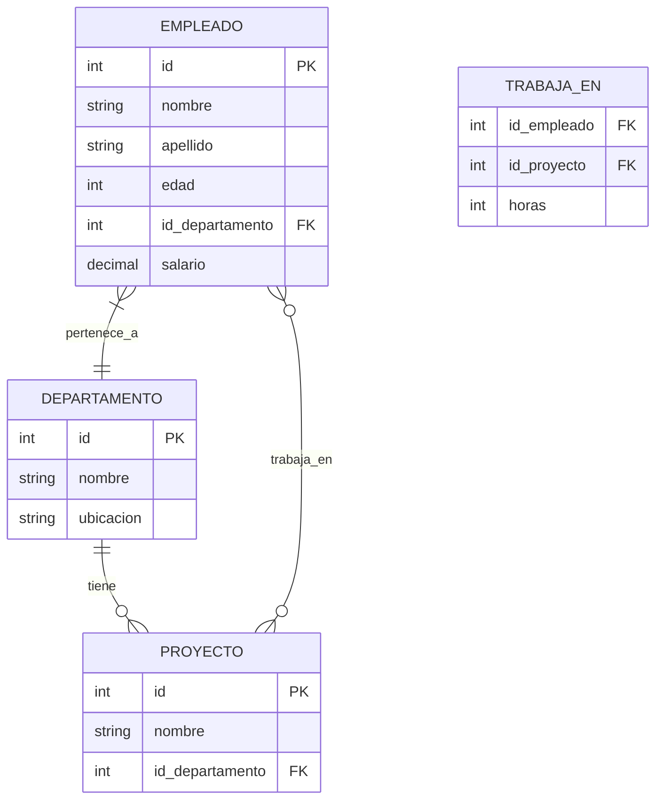

# Fundamentos de Bases de Datos - Modelo Relacional

## 4.4 Cálculo relacional.

---

El cálculo relacional es un lenguaje de consulta no procedural basado en la lógica de predicados. A diferencia del álgebra relacional (que es procedural), el cálculo relacional especifica **qué** datos se desean obtener sin especificar **cómo** obtenerlos. Existen dos variantes principales: el cálculo relacional de tuplas y el cálculo relacional de dominios.

### Cálculo Relacional de Tuplas (TRC)

#### Estructura Básica

Una expresión en cálculo relacional de tuplas tiene la forma:

$$ \lbrace t | P(t) \rbrace $$

donde:

- $t$ es una variable de tupla
- $P(t)$ es una fórmula que describe las condiciones que deben cumplir las tuplas

#### Variables y Fórmulas

Las fórmulas se construyen usando:

- **Átomos**: condiciones básicas
- **Conectivos lógicos**: ∧ (AND), ∨ (OR), ¬ (NOT)
- **Cuantificadores**: ∃ (existencial), ∀ (universal)

#### Ejemplo Básico

$$ \lbrace t | EMPLEADO(t) ∧ t.SALARIO > 50000 \rbrace $$

```sql
-- Equivalente SQL
SELECT * FROM EMPLEADO WHERE SALARIO > 50000;
```

### Cálculo Relacional de Dominios (DRC)

#### Estructura Básica

Una expresión en cálculo relacional de dominios tiene la forma:

$$ \lbrace ⟨x₁, x₂, ..., xₙ⟩ | P(x₁, x₂, ..., xₙ) \rbrace $$

donde:

- $x₁, x₂, ..., xₙ$ son variables de dominio
- $P(x₁, x₂, ..., xₙ)$ es una fórmula que describe las condiciones

#### Ejemplo Básico

$$ \lbrace ⟨n, s⟩ | ∃d (⟨n, s, d⟩ ∈ EMPLEADO ∧ s > 50000) \rbrace $$

```sql
-- Equivalente SQL
SELECT nombre, salario FROM EMPLEADO WHERE salario > 50000;
```

### Elementos Formales

#### Fórmulas Bien Formadas

Una fórmula se construye recursivamente:

1. **Átomos**:
   - $R(x₁, x₂, ..., xₙ)$ donde R es una relación de grado n
   - $x_i θ y_j$ donde θ es un operador de comparación
   - $x_i θ c$ donde c es una constante

2. **Fórmulas compuestas**:
   - ¬P, P ∧ Q, P ∨ Q, P ⇒ Q
   - ∃x P(x)
   - ∀x P(x)

#### Variables Libres y Ligadas

- **Variables libres**: Aparecen en la fórmula sin ser cuantificadas
- **Variables ligadas**: Están dentro del alcance de un cuantificador

### Ejemplos Detallados

#### Base de Datos de Ejemplo



#### Ejemplos con TRC

**Ejemplo 1:** Empleados con salario mayor a 50000

$$ \lbrace t | EMPLEADO(t) ∧ t.SALARIO > 50000 \rbrace $$

**Ejemplo 2:** Nombres de empleados del departamento "Ventas"

$$ \lbrace t | ∃u (EMPLEADO(u) ∧ u.DEPARTAMENTO = 'Ventas' ∧ t.NOMBRE = u.NOMBRE) \rbrace $$

**Ejemplo 3:** Empleados que trabajan en todos los proyectos

$$ \lbrace t | EMPLEADO(t) ∧ ∀p (PROYECTO(p) ⇒ \\\ ∃w (TRABAJA\\_EN(w) ∧ w.ID\\_EMPLEADO = t.ID ∧ w.ID\\_PROYECTO = p.ID)) \rbrace $$

#### Ejemplos con DRC

**Ejemplo 1:** Empleados con salario mayor a 50000

$$ \lbrace ⟨id, nom, ape, ed, dep, sal⟩ | ⟨id, nom, ape, ed, dep, sal⟩ ∈ EMPLEADO ∧ sal > 50000 \rbrace $$

**Ejemplo 2:** Nombres de empleados del departamento "Ventas"

$$ \lbrace ⟨nom⟩ | ∃id, ape, ed, dep, sal (⟨id, nom, ape, ed, dep, sal⟩ ∈ EMPLEADO ∧ dep = 'Ventas') \rbrace $$

**Ejemplo 3:** Empleados que trabajan en el proyecto "Sistema X"

$$ \lbrace ⟨id, nom⟩ | ∃idp, horas (⟨id, idp, horas⟩ ∈ \\\ TRABAJA\\_EN ∧ ∃nomp (⟨idp, nomp, dept⟩ ∈ PROYECTO ∧ nomp = 'Sistema X')) \rbrace $$

### Equivalencia con Álgebra Relacional

#### Correspondencia entre Operaciones

| Álgebra Relacional | Cálculo Relacional de Tuplas |
|-------------------|-----------------------------|
| $σ_P(R)$ | $\{ t \| R(t) ∧ P(t) \}$ |
| $π_{A₁,...,Aₙ}(R)$ | $\{ ⟨t.A₁,...,t.Aₙ⟩ \| R(t) \}$ |
| $R ∪ S$ | $\{ t \| R(t) ∨ S(t) \}$ |
| $R - S$ | $\{ t \| R(t) ∧ ¬S(t) \}$ |
| $R × S$ | $\{ ⟨r,s⟩ \| R(r) ∧ S(s) \}$ |
| R ⨝ S | $\{ ⟨r,s⟩ \| R(r) ∧ S(s) ∧ r.A = s.B \}$ |

### Seguridad de Expresiones

Una expresión de cálculo relacional es **segura** si garantiza que el resultado es una relación finita. Para asegurar esto, se imponen restricciones:

1. Todas las tuplas en el resultado deben satisfacer la fórmula
2. Cada componente de la tupla resultado debe provenir de un dominio conocido

#### Ejemplo de Expresión No Segura

$$\{ t | ¬EMPLEADO(t) \}$$

Esta expresión no es segura porque devolvería todas las posibles tuplas que no están en EMPLEADO, lo que podría ser infinito.

### Poder Expresivo

#### Teorema de Codd

El cálculo relacional de tuplas y el álgebra relacional tienen el mismo poder expresivo para consultas que preservan la seguridad.

$$ {\text{Consultas~del~álgebra~relacional}} ≡ {\text{Consultas~seguras~del~cálculo~relacional}} $$

#### Complejidad Expresiva

El cálculo relacional puede expresar consultas que requieren recursión en SQL:

**Ejemplo:** Empleados y todos sus supervisores directos e indirectos

$$ \{ ⟨e,s⟩ | SUPERVISA(e,s) ∨ ∃x (SUPERVISA(e,x) ∧ ⟨x,s⟩ ∈ resultado) \} $$

### Ejercicios Propuestos

#### Ejercicio 1

Dadas las relaciones:

- ESTUDIANTE(matricula, nombre, carrera)
- CURSO(id_curso, nombre_curso, creditos)
- MATRICULA(matricula, id_curso, semestre, calificación)

Exprese en cálculo relacional de tuplas:

1. Estudiantes de la carrera "Ingeniería"
2. Cursos con más de 4 créditos
3. Estudiantes que han aprobado todos los cursos (calificación ≥ 70)
4. Estudiantes que han tomado al menos un curso de "Bases de Datos"

#### Ejercicio 2

Para las mismas relaciones, exprese en cálculo relacional de dominios:

1. Nombres de estudiantes de "Matemáticas"
2. Cursos tomados por el estudiante con matrícula "2023001"
3. Estudiantes con promedio mayor a 90
4. Cursos que no tienen ningún estudiante matriculado

#### Ejercicio 3

Convierta las siguientes expresiones de TRC a DRC:

1. $\{ t | EMPLEADO(t) ∧ t.EDAD > 30 \}$
2. $\{ t | ∃u (DEPARTAMENTO(u) ∧ u.NOMBRE = 'Ventas' ∧ t.DEP\\_ID = u.ID) \}$

#### Ejercicio 4

Identifique cuáles de estas expresiones son seguras y explique por qué:

1. $\{ t | ¬EMPLEADO(t) \}$
2. $\{ t | EMPLEADO(t) ∨ t.SALARIO > 0 \}$
3. $\{ ⟨a,b⟩ | ∃c (⟨a,b,c⟩ ∈ R) ∨ a = b \}$

#### Ejercicio 5

Dada la relación SUPERVISA(empleado, supervisor), escriba una expresión en cálculo relacional para encontrar:

1. Todos los supervisores directos de "Juan"
2. Todos los supervisores indirectos de "María" (todos los niveles)
3. Empleados que no supervisan a nadie
4. Empleados que son supervisados por alguien del departamento "TI"

### Aplicaciones Prácticas

#### Lenguajes Basados en Cálculo Relacional

- **QUEL**: Uno de los primeros lenguajes basados en TRC
- **SQL**: Incorpora elementos tanto de álgebra como de cálculo relacional

#### Ejemplo de SQL vs Cálculo Relacional

**Consulta:** Empleados que ganan más que su supervisor

**TRC:**
$$\{ t | EMPLEADO(t) ∧ ∃s (EMPLEADO(s) ∧ SUPERVISA(t.ID, s.ID) ∧ t.SALARIO > s.SALARIO) \}$$

**SQL:**

```sql
SELECT e.*
FROM EMPLEADO e
JOIN SUPERVISA sup ON e.id = sup.empleado
JOIN EMPLEADO s ON sup.supervisor = s.id
WHERE e.salario > s.salario;
```

### Limitaciones y Extensiones

#### Limitaciones del Cálculo Relacional Básico

1. No puede expresar agregación (SUM, AVG, COUNT)
2. No puede expresar recursión arbitraria
3. No tiene operaciones de modificación de datos

#### Extensiones

- **Cálculo relacional con agregación**
- **Cálculo relacional con recursión limitada**
- **Datalog**: Lenguaje lógico para bases de datos deductivas

### Referencias

#### Bibliografía Básica

1. Elmasri and Navathe. _Fundamentals of Database Systems_. Addison-Wesley. 2006. (Capítulo 6, Sección 6.6-6.7)
2. Silberschatz A., Kort H. y Sudarshan S. _Fundamentos de BD_. McGraw Hill. 2006. (Capítulo 6)
3. Ullman J.D. and Widom J. _A First Course in Data Base System_. Prentice Hall. 2008. (Capítulo 5)

#### Bibliografía Complementaria

1. Abiteboul, S., Hull, R., & Vianu, V. _Foundations of Databases_. Addison-Wesley. 1995.
2. Garcia-Molina, H., Ullman, J. D., & Widom, J. _Database Systems: The Complete Book_. Prentice Hall. 2002.

### Resumen

El cálculo relacional proporciona:

- Una base formal para lenguajes de consulta declarativos
- Dos variantes principales: de tuplas (TRC) y de dominios (DRC)
- Poder expresivo equivalente al álgebra relacional para consultas seguras
- Fundamentos teóricos para entender la semántica de consultas SQL

Las expresiones de cálculo relacional deben ser seguras para garantizar que devuelvan resultados finitos. El cálculo relacional forma la base teórica de los lenguajes de consulta declarativos modernos.
