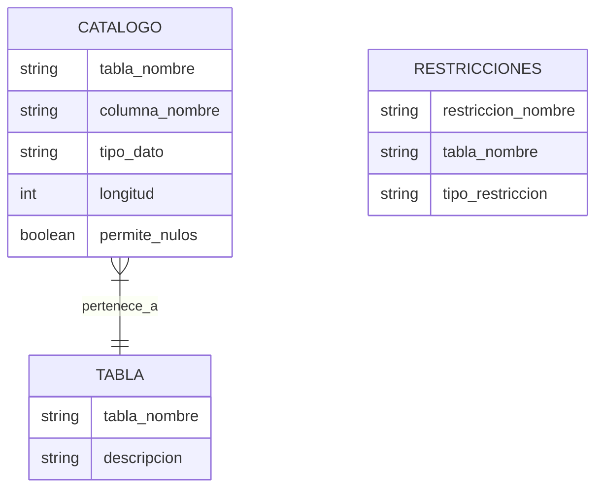

# Fundamentos de Bases de Datos - Modelo Relacional

## 4.5 Reglas de Codd.

---

Las Reglas de Codd, propuestas por Edgar F. Codd en 1985, constituyen un conjunto de 13 reglas (12 originales más la regla 0) que definen los requisitos que debe cumplir un sistema de gestión de bases de datos para ser considerado "completamente relacional". Estas reglas establecen la base teórica del modelo relacional y garantizan la integridad e independencia de los datos.

### Regla 0: Regla Fundamental

**Un sistema de gestión de bases de datos relacional debe ser capaz de gestionar bases de datos completamente mediante sus capacidades relacionales.**

Esta regla establece que todo sistema que se denomine "relacional" debe utilizar exclusivamente el modelo relacional para gestionar los datos, sin recurrir a métodos no relacionales.

### Las 12 Reglas Originales de Codd

#### Regla 1: Regla de la Información

**Toda la información en una base de datos relacional se representa explícitamente a nivel lógico mediante valores en tablas.**

Toda la información, incluidos los metadatos, debe estar representada como datos en tablas.

```sql
-- Ejemplo: Los metadatos sobre tablas también están en tablas
SELECT table_name, column_name, data_type
FROM information_schema.columns
WHERE table_name = 'EMPLEADOS';
```

#### Regla 2: Regla del Acceso Garantizado

**Cada valor atómico en una base de datos relacional debe ser accesible lógicamente mediante una combinación de nombre de tabla, valor de clave primaria y nombre de columna.**

Cada dato debe poder localizarse mediante su tabla, la clave primaria de su tupla y el nombre de su columna.

$$Acceso(tabla, clave\_primaria, columna) → valor$$

#### Regla 3: Tratamiento Sistemático de Valores Nulos

**El sistema debe soportar valores nulos para representar información faltante o inaplicable, de manera independiente del tipo de dato.**

Los valores nulos $(\bot)$ deben manejarse de forma uniforme y distinguirse de valores vacíos o cero.

```sql
-- Ejemplo: Consulta que maneja valores nulos
SELECT nombre, salario
FROM EMPLEADOS
WHERE departamento IS NULL;
```

#### Regla 4: Catálogo Dinámico en Línea Basado en el Modelo Relacional

**La descripción de la base de datos (metadatos) debe almacenarse en tablas regulares y ser accesible mediante el mismo lenguaje de consulta que los datos.**



#### Regla 5: Lenguaje de Consulta Completo

**El sistema debe soportar un lenguaje relacional completo que permita: manipulación de datos, definición de vistas, manipulación de datos en vistas, y gestión de restricciones de integridad.**

El lenguaje debe soportar operaciones relacionales completas, incluyendo álgebra relacional o cálculo relacional.

#### Regla 6: Actualización de Vistas

**Todas las vistas que sean teóricamente actualizables deben ser actualizables por el sistema.**

Las vistas deben poder ser modificadas cuando las modificaciones pueden traducirse sin ambigüedad a modificaciones de las tablas base.

```sql
-- Ejemplo: Vista actualizable
CREATE VIEW EMPLEADOS_VENTAS AS
SELECT id, nombre, salario
FROM EMPLEADOS
WHERE departamento = 'Ventas';

-- Actualización a través de la vista
UPDATE EMPLEADOS_VENTAS
SET salario = salario * 1.1
WHERE id = 101;
```

#### Regla 7: Inserción, Actualización y Eliminación de Alto Nivel

**La capacidad de manejar una relación base o derivada como operando único debe aplicarse no sólo a la recuperación de datos sino también a su inserción, actualización y eliminación.**

Operaciones como INSERT, UPDATE y DELETE deben poder trabajar con conjuntos de tuplas, no sólo con tuplas individuales.

#### Regla 8: Independencia Física de los Datos

**Los programas de aplicación y actividades terminales deben permanecer inalterados a nivel lógico cuando se realicen cambios en las representaciones de almacenamiento o métodos de acceso.**

Los cambios en la estructura física de almacenamiento no deben afectar a las aplicaciones.

#### Regla 9: Independencia Lógica de los Datos

**Los programas de aplicación y actividades terminales deben permanecer inalterados a nivel lógico cuando se realicen cambios en las tablas base que preserven la información.**

Las aplicaciones no deben verse afectadas por cambios en el esquema que mantengan la compatibilidad.

#### Regla 10: Independencia de Integridad

**Las restricciones de integridad deben poder definirse en el lenguaje relacional y almacenarse en el catálogo, no en los programas de aplicación.**

```sql
-- Ejemplo: Definición de integridad en el lenguaje
ALTER TABLE EMPLEADOS
ADD CONSTRAINT ck_salario_positivo
CHECK (salario > 0);

ALTER TABLE DEPARTAMENTOS
ADD CONSTRAINT fk_empleado_jefe
FOREIGN KEY (id_jefe) REFERENCES EMPLEADOS(id);
```

#### Regla 11: Independencia de Distribución

**El sistema debe permitir la distribución de datos en múltiples ubicaciones físicas sin que las aplicaciones necesiten ser modificadas.**

Los usuarios no deben necesitar saber si la base de datos está distribuida o no.

#### Regla 12: Regla de No Subversión

**Si el sistema proporciona un lenguaje de bajo nivel, este lenguaje no debe poder eludir las reglas de integridad y las restricciones expresadas en el lenguaje relacional de alto nivel.**

No debe haber formas de evitar las restricciones del modelo relacional.

### Implementación de las Reglas en SQL

#### Ejemplo de Sistema que Cumple las Reglas

```sql
-- Regla 1: Información en tablas
CREATE TABLE EMPLEADOS (
    id INT PRIMARY KEY,
    nombre VARCHAR(50) NOT NULL,
    salario DECIMAL(10,2) CHECK (salario > 0),
    id_departamento INT,
    FOREIGN KEY (id_departamento) REFERENCES DEPARTAMENTOS(id)
);

-- Regla 4: Catálogo accesible
SELECT * FROM INFORMATION_SCHEMA.TABLES;
SELECT * FROM INFORMATION_SCHEMA.COLUMNS WHERE TABLE_NAME = 'EMPLEADOS';

-- Regla 10: Integridad en el catálogo
SELECT * FROM INFORMATION_SCHEMA.TABLE_CONSTRAINTS;
SELECT * FROM INFORMATION_SCHEMA.CHECK_CONSTRAINTS;
```

### Evaluación de Cumplimiento

#### Grado de Cumplimiento de Diferentes SGBD

| Regla    | PostgreSQL             | MySQL | Oracle | SQL Server |
| -------- | ---------------------- | ----- | ------ | ---------- |
| Regla 0  | Alto                   | Medio | Alto   | Alto       |
| Regla 1  | Alto                   | Alto  | Alto   | Alto       |
| Regla 2  | Alto                   | Alto  | Alto   | Alto       |
| Regla 3  | Alto                   | Alto  | Alto   | Alto       |
| Regla 4  | Alto                   | Alto  | Alto   | Alto       |
| Regla 5  | Alto                   | Alto  | Alto   | Alto       |
| Regla 6  | Medio                  | Bajo  | Medio  | Medio      |
| Regla 7  | Alto                   | Alto  | Alto   | Alto       |
| Regla 8  | Alto                   | Alto  | Alto   | Alto       |
| Regla 9  | Alto                   | Medio | Alto   | Alto       |
| Regla 10 | Alto                   | Alto  | Alto   | Alto       |
| Regla 11 | Alto (con extensiones) | Medio | Alto   | Alto       |
| Regla 12 | Alto                   | Alto  | Alto   | Alto       |

### Ejercicios Propuestos

#### Ejercicio 1

Analice el siguiente esquema e identifique qué reglas de Codd se están aplicando:

```sql
CREATE TABLE CLIENTES (
    id INT PRIMARY KEY,
    nombre VARCHAR(100) NOT NULL,
    email VARCHAR(100) UNIQUE,
    fecha_registro DATE DEFAULT CURRENT_DATE
);

CREATE TABLE PEDIDOS (
    id INT PRIMARY KEY,
    id_cliente INT,
    fecha_pedido DATE,
    total DECIMAL(10,2) CHECK (total >= 0),
    FOREIGN KEY (id_cliente) REFERENCES CLIENTES(id) ON DELETE CASCADE
);
```

#### Ejercicio 2

Explique cómo se viola la Regla 6 (Actualización de Vistas) en la siguiente vista:

```sql
CREATE VIEW RESUMEN_PEDIDOS AS
SELECT c.nombre, COUNT(p.id) as total_pedidos, SUM(p.total) as monto_total
FROM CLIENTES c
JOIN PEDIDOS p ON c.id = p.id_cliente
GROUP BY c.id, c.nombre;
```

#### Ejercicio 3

Proponga un mecanismo para implementar la Regla 11 (Independencia de Distribución) en un sistema distribuido con dos nodos: Norte y Sur.

#### Ejercicio 4

Identifique qué reglas de Codd se violan en las siguientes situaciones:

1. Un SGBD que requiere el uso de punteros para acceder a datos relacionados
2. Un sistema donde los metadatos se almacenan en archivos binarios no accesibles mediante SQL
3. Una base de datos donde las vistas complejas no son actualizables

#### Ejercicio 5

Diseñe un sistema que cumpla con la Regla 10 (Independencia de Integridad) implementando las siguientes restricciones:

1. El salario de un empleado no puede ser mayor que el salario de su jefe
2. Un empleado no puede ser menor de 18 años
3. Un departamento debe tener al menos un empleado

### Importancia Histórica y Actual

#### Impacto de las Reglas de Codd

Las Reglas de Codd establecieron los fundamentos teóricos para:

1. Establecer estándares de calidad para SGBD relacionales
2. Proporcionar un marco para evaluar sistemas de bases de datos
3. Guiar el desarrollo de estándares como SQL
4. Promover la independencia entre datos y aplicaciones

#### Evolución y Críticas

Aunque las reglas siguen siendo relevantes, algunas críticas incluyen:

1. Algunas reglas son muy estrictas para implementaciones prácticas
2. No todas las reglas son igualmente importantes
3. Algunos aspectos como el rendimiento no están considerados

### Referencias

#### Bibliografía Básica

1. Elmasri and Navathe. _Fundamentals of Database Systems_. Addison-Wesley. 2006. (Capítulo 2, Sección 2.4)
2. Silberschatz A., Kort H. y Sudarshan S. _Fundamentos de BD_. McGraw Hill. 2006. (Capítulo 1)
3. Ullman J.D. and Widom J. _A First Course in Data Base System_. Prentice Hall. 2008. (Capítulo 2)

#### Bibliografía Complementaria

1. Codd, E. F. (1985). _Is Your DBMS Really Relational?_ ComputerWorld.
2. Codd, E. F. (1990). _The Relational Model for Database Management: Version 2_. Addison-Wesley.
3. Date, C. J. (2003). _An Introduction to Database Systems_. Addison-Wesley.

### Conclusión

Las Reglas de Codd constituyen el fundamento teórico del modelo relacional y siguen siendo relevantes para evaluar la calidad y completitud de los sistemas de gestión de bases de datos. Aunque ningún sistema comercial cumple todas las reglas al 100%, proporcionan un marco invaluable para entender los principios del modelo relacional y sus implementaciones prácticas.

El conocimiento de estas reglas es esencial para:

- Evaluar y comparar diferentes SGBD
- Diseñar bases de datos robustas y normalizadas
- Comprender las limitaciones y capacidades de los sistemas relacionales
- Desarrollar aplicaciones que aprovechen al máximo el modelo relacional
