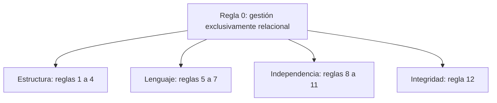

# Fundamentos de Bases de Datos - Modelo Relacional

## 4.5 Reglas de Codd.

---

A principios de los años ochenta, muchos productos se anunciaban como "relacionales" por mostrar los datos en tablas, aunque por dentro seguían siendo sistemas de archivos o de red. En 1985, Edgar F. Codd publicó en _Computerworld_ dos artículos con **doce reglas**, precedidas de una regla fundamental, que un SMBD debe cumplir para llamarse relacional. Ningún producto de la época las cumplía todas, y ninguno las cumple hoy por completo; su valor está en que precisan qué significa que un sistema sea relacional y dan un criterio para evaluarlo. Este tema enuncia las reglas, explica qué exige cada una y muestra cómo las cumple, en parte, un SMBD actual.

### Regla 0: regla fundamental

Un sistema relacional debe gestionar sus bases de datos **exclusivamente** con sus capacidades relacionales. Las doce reglas siguientes son consecuencias de esta.

### Reglas de la estructura

1. **Información:** toda la información de la base se representa de una sola manera, como valores en tablas, incluidos los metadatos. No hay punteros visibles al usuario ni información en el orden de las filas.
2. **Acceso garantizado:** todo valor atómico es accesible por la combinación del nombre de la tabla, el valor de la clave primaria y el nombre de la columna, sin recorrer estructuras.
3. **Tratamiento sistemático de los nulos:** el sistema tiene una representación de la información faltante distinta de cualquier valor, como el cero o la cadena vacía, y la trata de manera uniforme, independiente del tipo de dato.
4. **Catálogo dinámico en línea:** la descripción de la base de datos se guarda como tablas que los usuarios autorizados consultan con el mismo lenguaje que los datos.

### Reglas del lenguaje

5. **Sublenguaje de datos completo:** hay al menos un lenguaje con sintaxis lineal que permite definir datos y vistas, manipularlos, definir restricciones de integridad y autorizaciones, y delimitar transacciones. SQL lo es.
6. **Actualización de vistas:** toda vista que **teóricamente** se pueda actualizar debe poder actualizarse con el sistema.
7. **Inserción, actualización y borrado de alto nivel:** las operaciones de modificación trabajan sobre **conjuntos** de filas, no solo de una fila a la vez.

### Reglas de independencia

8. **Independencia física:** los programas y las consultas no cambian cuando cambian la forma de almacenamiento o los métodos de acceso.
9. **Independencia lógica:** los programas no cambian ante cambios en las tablas que preservan la información, como dividir una tabla en dos y definir una vista con el nombre de la original.
10. **Independencia de la integridad:** las restricciones de integridad se definen con el sublenguaje relacional y se guardan en el catálogo, no en los programas; se pueden cambiar sin modificar las aplicaciones.
11. **Independencia de la distribución:** los programas no cambian si los datos se distribuyen entre varios sitios o se redistribuyen.
12. **No subversión:** si el sistema tiene un lenguaje de bajo nivel, de una fila a la vez, ese lenguaje no puede saltarse las reglas de integridad del lenguaje relacional.



### Cumplimiento en los SMBD actuales

Los SMBD relacionales comunes cumplen bien las reglas 1, 2, 4, 5, 7 y 8, y en gran parte la 10 y la 12. Las más difíciles son estas:

- **Regla 3:** SQL tiene nulos, pero su lógica de tres valores tiene inconsistencias conocidas; por ejemplo, `NULL = NULL` es desconocido, pero `GROUP BY` y `DISTINCT` tratan los nulos como iguales entre sí.
- **Regla 6:** determinar si una vista es actualizable en teoría es indecidible en general, y los SMBD solo actualizan automáticamente vistas simples, de una tabla, sin agregación ni `DISTINCT`. Para las demás, el diseñador escribe disparadores `INSTEAD OF`.
- **Regla 9:** depende de la regla 6: si las vistas que sustituyen a las tablas divididas no se pueden actualizar, los programas que escriben sí cambian.
- **Regla 10:** no todas las restricciones se pueden declarar: sin `CREATE ASSERTION` (tema 3.3), las generales se escriben como disparadores. Aun así están en el catálogo y no en los programas.
- **Regla 11:** la cumplen en parte las bases distribuidas, las réplicas y las tablas federadas, como las tablas foráneas de PostgreSQL o los servidores vinculados de SQL Server.

Una crítica frecuente es que las reglas mezclan requisitos de distinta importancia, que algunas son difíciles o imposibles de cumplir por completo y que no dicen nada del rendimiento. Codd las amplió en 1990 a 333 reglas en el **modelo relacional versión 2**, que tuvo poca influencia práctica.

### Implementación en Python

El programa usa SQLite para ilustrar las reglas sobre el esquema del ejercicio 1: consulta el catálogo como una tabla (reglas 1 y 4), accede a un valor por tabla, clave y columna (regla 2), compara `IS NULL` con `= NULL` y `COUNT(*)` con `COUNT(email)` (regla 3), modifica tres filas con una sentencia (regla 7) y muestra restricciones verificadas por el SMBD (regla 10). Para el ejercicio 2 intenta actualizar la vista de resumen y hace actualizable con un disparador `INSTEAD OF` una vista que sí lo es en teoría. Para el ejercicio 3 simula dos nodos con dos bases adjuntas y una vista global, mueve un cliente de nodo y repite la consulta. Para el ejercicio 5 declara las tres restricciones en el catálogo y las prueba.

```python
import sqlite3

db = sqlite3.connect(":memory:")
db.execute("PRAGMA foreign_keys = ON")

def intenta(sql, etiqueta, params=()):
    try:
        db.execute(sql, params); print(f"   aceptado: {etiqueta}")
    except (sqlite3.IntegrityError, sqlite3.OperationalError) as e:
        print(f"   rechazado: {etiqueta} -> {e}")

# --- Ejercicio 1: el esquema del enunciado ---
db.executescript("""
CREATE TABLE clientes (id INTEGER PRIMARY KEY, nombre TEXT NOT NULL, email TEXT UNIQUE,
                       fecha_registro TEXT DEFAULT CURRENT_DATE);
CREATE TABLE pedidos (id INTEGER PRIMARY KEY, id_cliente INTEGER, fecha_pedido TEXT,
                      total NUMERIC CHECK (total >= 0),
                      FOREIGN KEY (id_cliente) REFERENCES clientes(id) ON DELETE CASCADE);
INSERT INTO clientes (id, nombre, email, fecha_registro) VALUES (1, 'Rosa', 'rosa@ejemplo.mx', '2026-01-10'),
                                                                (2, 'Iván', NULL, '2026-03-02');
INSERT INTO pedidos VALUES (10, 1, '2026-10-01', 1500), (11, 1, '2026-10-05', 80), (12, 2, '2026-10-07', 300);
""")
print("regla 1 (información) y regla 4 (catálogo): el esquema es una tabla más")
for nombre, sql in db.execute("SELECT name, sql FROM sqlite_master WHERE type = 'table' ORDER BY name"):
    print(f"   {nombre}: {' '.join(sql.split())[:70]}...")
print("regla 2 (acceso garantizado): tabla + clave + columna ->",
      db.execute("SELECT email FROM clientes WHERE id = 1").fetchone()[0])
print("regla 3 (nulos): email de Iván IS NULL:", db.execute("SELECT email IS NULL FROM clientes WHERE id = 2").fetchone()[0],
      "| email = NULL:", db.execute("SELECT email = NULL FROM clientes WHERE id = 2").fetchone()[0],
      "| COUNT(*) vs COUNT(email):", db.execute("SELECT COUNT(*), COUNT(email) FROM clientes").fetchone())
print("regla 7 (operaciones de conjunto): un UPDATE afecta a",
      db.execute("UPDATE pedidos SET total = total * 1.0 WHERE fecha_pedido >= '2026-10-01'").rowcount, "filas a la vez")
intenta("INSERT INTO pedidos VALUES (13, 1, '2026-10-09', -5)", "pedido con total negativo (regla 10)")
intenta("INSERT INTO pedidos VALUES (14, 9, '2026-10-09', 50)", "pedido de un cliente inexistente (regla 10)")

# --- Ejercicio 2: regla 6, actualización de vistas ---
db.execute("""CREATE VIEW resumen_pedidos AS
              SELECT c.nombre, COUNT(p.id) AS total_pedidos, SUM(p.total) AS monto_total
              FROM clientes c JOIN pedidos p ON c.id = p.id_cliente GROUP BY c.id, c.nombre""")
print("regla 6: vista resumen_pedidos =", db.execute("SELECT * FROM resumen_pedidos ORDER BY nombre").fetchall())
intenta("UPDATE resumen_pedidos SET monto_total = 2000 WHERE nombre = 'Rosa'", "cambiar el monto total de Rosa")
# una vista que sí es actualizable en teoría: selección y proyección de una tabla con su clave
db.executescript("""
CREATE VIEW pedidos_grandes AS SELECT id, id_cliente, total FROM pedidos WHERE total > 500;
CREATE TRIGGER pedidos_grandes_upd INSTEAD OF UPDATE OF total ON pedidos_grandes
BEGIN UPDATE pedidos SET total = NEW.total WHERE id = OLD.id; END;
""")
intenta("UPDATE pedidos_grandes SET total = 1600 WHERE id = 10", "cambiar el total del pedido 10 por la vista")
print("   pedido 10 en la tabla base:", db.execute("SELECT total FROM pedidos WHERE id = 10").fetchone()[0])

# --- Ejercicio 3: regla 11, independencia de distribución con dos nodos ---
db.execute("ATTACH ':memory:' AS norte")
db.execute("ATTACH ':memory:' AS sur")
for nodo, filas in (("norte", [(1, "Ana", "Monterrey"), (2, "Beto", "Chihuahua")]), ("sur", [(3, "Carla", "Oaxaca")])):
    db.execute(f"CREATE TABLE {nodo}.sucursal_cliente (id INTEGER PRIMARY KEY, nombre TEXT, ciudad TEXT)")
    db.executemany(f"INSERT INTO {nodo}.sucursal_cliente VALUES (?, ?, ?)", filas)
db.execute("""CREATE TEMP VIEW cliente_global AS
              SELECT *, 'norte' AS nodo FROM norte.sucursal_cliente UNION ALL
              SELECT *, 'sur' FROM sur.sucursal_cliente""")
consulta = "SELECT nombre, ciudad FROM cliente_global WHERE ciudad <> 'Oaxaca' ORDER BY nombre"
print("regla 11: la aplicación consulta la vista global:", db.execute(consulta).fetchall())
db.executescript("""
INSERT INTO sur.sucursal_cliente SELECT id, nombre, ciudad FROM norte.sucursal_cliente WHERE id = 2;
DELETE FROM norte.sucursal_cliente WHERE id = 2;
""")
print("   tras mover a Beto al nodo sur, la misma consulta:", db.execute(consulta).fetchall(),
      "| Beto ahora en:", db.execute("SELECT nodo FROM cliente_global WHERE id = 2").fetchone()[0])

# --- Ejercicio 5: regla 10, restricciones en el catálogo y no en la aplicación ---
db.executescript("""
CREATE TABLE departamento (id INTEGER PRIMARY KEY, nombre TEXT NOT NULL);
CREATE TABLE empleado (id INTEGER PRIMARY KEY, nombre TEXT NOT NULL, fecha_nac TEXT NOT NULL,
                       salario NUMERIC NOT NULL, id_jefe INTEGER REFERENCES empleado,
                       id_depto INTEGER NOT NULL REFERENCES departamento,
                       CHECK (date(fecha_nac, '+18 years') <= '2026-11-03'));             -- (2) mayor de edad
-- (1) nadie gana más que su jefe: al insertar o cambiar el salario o el jefe de alguien...
CREATE TRIGGER salario_jefe_ins BEFORE INSERT ON empleado
WHEN NEW.salario > (SELECT salario FROM empleado WHERE id = NEW.id_jefe)
BEGIN SELECT RAISE(ABORT, 'gana más que su jefe'); END;
CREATE TRIGGER salario_jefe_upd BEFORE UPDATE OF salario, id_jefe ON empleado
WHEN NEW.salario > (SELECT salario FROM empleado WHERE id = NEW.id_jefe)
  OR EXISTS (SELECT 1 FROM empleado s WHERE s.id_jefe = NEW.id AND s.salario > NEW.salario)   -- ...y al bajar el del jefe
BEGIN SELECT RAISE(ABORT, 'gana más que su jefe'); END;
-- (3) todo departamento conserva al menos un empleado
CREATE TRIGGER depto_no_vacio BEFORE DELETE ON empleado
WHEN NOT EXISTS (SELECT 1 FROM empleado WHERE id_depto = OLD.id_depto AND id <> OLD.id)
BEGIN SELECT RAISE(ABORT, 'el departamento quedaría sin empleados'); END;
CREATE TRIGGER depto_no_vacio_upd BEFORE UPDATE OF id_depto ON empleado
WHEN NOT EXISTS (SELECT 1 FROM empleado WHERE id_depto = OLD.id_depto AND id <> OLD.id)
BEGIN SELECT RAISE(ABORT, 'el departamento quedaría sin empleados'); END;
INSERT INTO departamento VALUES (1, 'Ventas'), (2, 'TI');
INSERT INTO empleado VALUES (1, 'Dirección', '1970-01-01', 90000, NULL, 1), (2, 'Ana', '1990-05-05', 50000, 1, 2),
                            (3, 'Beto', '1995-02-02', 40000, 2, 2);
""")
print("regla 10, ejercicio 5:")
intenta("INSERT INTO empleado VALUES (4, 'Ciro', '2000-01-01', 60000, 2, 2)", "Ciro gana 60000 y su jefa Ana 50000")
intenta("UPDATE empleado SET salario = 35000 WHERE id = 2", "bajar a Ana a 35000, menos que su subordinado Beto")
intenta("INSERT INTO empleado VALUES (5, 'Dana', '2010-06-01', 20000, 2, 2)", "Dana nació en 2010")
intenta("INSERT INTO empleado VALUES (6, 'Eli', '2008-11-03', 20000, 2, 2)", "Eli cumple 18 hoy")
intenta("DELETE FROM empleado WHERE id = 1", "despedir al único empleado de Ventas")
intenta("DELETE FROM empleado WHERE id = 6", "Eli deja TI, donde quedan Ana y Beto")
print("   las reglas viven en el catálogo:",
      [n for (n,) in db.execute("SELECT name FROM sqlite_master WHERE type = 'trigger' AND tbl_name = 'empleado' ORDER BY name")])
```

Salida:

```text
regla 1 (información) y regla 4 (catálogo): el esquema es una tabla más
   clientes: CREATE TABLE clientes (id INTEGER PRIMARY KEY, nombre TEXT NOT NULL, e...
   pedidos: CREATE TABLE pedidos (id INTEGER PRIMARY KEY, id_cliente INTEGER, fech...
regla 2 (acceso garantizado): tabla + clave + columna -> rosa@ejemplo.mx
regla 3 (nulos): email de Iván IS NULL: 1 | email = NULL: None | COUNT(*) vs COUNT(email): (2, 1)
regla 7 (operaciones de conjunto): un UPDATE afecta a 3 filas a la vez
   rechazado: pedido con total negativo (regla 10) -> CHECK constraint failed: total >= 0
   rechazado: pedido de un cliente inexistente (regla 10) -> FOREIGN KEY constraint failed
regla 6: vista resumen_pedidos = [('Iván', 1, 300), ('Rosa', 2, 1580)]
   rechazado: cambiar el monto total de Rosa -> cannot modify resumen_pedidos because it is a view
   aceptado: cambiar el total del pedido 10 por la vista
   pedido 10 en la tabla base: 1600
regla 11: la aplicación consulta la vista global: [('Ana', 'Monterrey'), ('Beto', 'Chihuahua')]
   tras mover a Beto al nodo sur, la misma consulta: [('Ana', 'Monterrey'), ('Beto', 'Chihuahua')] | Beto ahora en: sur
regla 10, ejercicio 5:
   rechazado: Ciro gana 60000 y su jefa Ana 50000 -> gana más que su jefe
   rechazado: bajar a Ana a 35000, menos que su subordinado Beto -> gana más que su jefe
   rechazado: Dana nació en 2010 -> CHECK constraint failed: date(fecha_nac, '+18 years') <= '2026-11-03'
   aceptado: Eli cumple 18 hoy
   rechazado: despedir al único empleado de Ventas -> el departamento quedaría sin empleados
   aceptado: Eli deja TI, donde quedan Ana y Beto
   las reglas viven en el catálogo: ['depto_no_vacio', 'depto_no_vacio_upd', 'salario_jefe_ins', 'salario_jefe_upd']
```

### Ejercicios Propuestos

1. **Reglas aplicadas.** Identifica qué reglas de Codd se aplican en el siguiente esquema:

    ```sql
    CREATE TABLE CLIENTES (
        id INT PRIMARY KEY, nombre VARCHAR(100) NOT NULL, email VARCHAR(100) UNIQUE,
        fecha_registro DATE DEFAULT CURRENT_DATE
    );
    CREATE TABLE PEDIDOS (
        id INT PRIMARY KEY, id_cliente INT, fecha_pedido DATE, total DECIMAL(10,2) CHECK (total >= 0),
        FOREIGN KEY (id_cliente) REFERENCES CLIENTES(id) ON DELETE CASCADE
    );
    ```

2. **Regla 6.** Explica qué ocurre con la regla 6 en la vista:

    ```sql
    CREATE VIEW RESUMEN_PEDIDOS AS
    SELECT c.nombre, COUNT(p.id) AS total_pedidos, SUM(p.total) AS monto_total
    FROM CLIENTES c JOIN PEDIDOS p ON c.id = p.id_cliente
    GROUP BY c.id, c.nombre;
    ```

3. **Regla 11.** Propón un mecanismo para cumplir la regla 11 en un sistema distribuido con dos nodos, Norte y Sur.

4. **Violaciones.** ¿Qué reglas se violan en un SMBD que requiere punteros para acceder a datos relacionados, en un sistema que guarda los metadatos en archivos binarios inaccesibles con SQL y en una base donde las vistas complejas no son actualizables?

5. **Regla 10.** Diseña un sistema que cumpla la regla 10 con estas restricciones: un empleado no gana más que su jefe, un empleado no es menor de 18 años y un departamento tiene al menos un empleado.

### Soluciones

**Ejercicio 1.** **Regla 1:** los datos están en tablas y el vínculo entre pedido y cliente es un valor, `id_cliente`, no un puntero. **Regla 2:** cada tabla tiene clave primaria, así que todo valor se alcanza por tabla, clave y columna. **Regla 3:** `email` admite nulos, distintos de la cadena vacía, y `UNIQUE` los admite; `NOT NULL` en `nombre` prohíbe la falta de dato. **Regla 4:** las definiciones quedan en el catálogo, que el programa consulta como cualquier tabla. **Regla 5:** el mismo lenguaje define las tablas, las restricciones y los valores por omisión. **Regla 10:** `CHECK`, `UNIQUE`, `NOT NULL`, la clave primaria y la clave foránea con su acción `ON DELETE CASCADE` se declaran en el esquema y el SMBD las hace cumplir, como muestran los rechazos del programa. Una observación: `id_cliente` admite nulos, así que se pueden registrar pedidos sin cliente; si eso no debe ocurrir, falta `NOT NULL`.

**Ejercicio 2.** La regla 6 no exige que **toda** vista sea actualizable, sino las que lo son en teoría, y esta no lo es: cambiar `monto_total` de Rosa a 2000 no determina qué pedidos cambian ni en cuánto, y cambiar `total_pedidos` exigiría inventar o borrar pedidos. Ninguna traducción a las tablas base es la única correcta, así que el SMBD debe rechazar la actualización, y rechazarla no viola la regla. SQLite rechaza toda escritura sobre una vista que no tenga un disparador `INSTEAD OF`; el programa define uno para `pedidos_grandes`, una selección y proyección de una sola tabla que conserva la clave y que sí es actualizable en teoría, porque cada fila de la vista corresponde a exactamente una fila de la tabla. PostgreSQL, MySQL y SQL Server actualizan ese tipo de vistas sin disparador, y eso es cumplir la regla para ese caso.

**Ejercicio 3.** Se fragmenta horizontalmente la tabla de clientes por región: cada nodo guarda los suyos, y un **catálogo global** registra qué fragmento está en qué nodo y la regla que lo define. Las aplicaciones consultan una **vista global**, la unión de los fragmentos, y el SMBD distribuido traduce cada consulta en consultas a los nodos necesarios. Si el filtro coincide con la regla de fragmentación, solo consulta un nodo. Al redistribuir los datos solo cambia el catálogo, no las aplicaciones. El programa lo simula con dos bases adjuntas y una vista `UNION ALL`: al mover a Beto del nodo Norte al Sur, la consulta de la aplicación da el mismo resultado. Un sistema real necesita además transacciones distribuidas, con confirmación en dos fases, para que mover un cliente entre nodos sea atómico, y réplicas para que la falla de un nodo no haga inaccesibles sus datos.

**Ejercicio 4.**

1. **Punteros:** viola la regla 1, porque los vínculos no están representados como valores; la 2, porque el acceso requiere navegar; y la 8, porque los programas dependen de la organización física.
2. **Metadatos binarios:** viola la regla 4, el catálogo en línea consultable con el mismo lenguaje, y por lo tanto la 1, que exige que también los metadatos estén en tablas.
3. **Vistas complejas no actualizables:** no es necesariamente una violación. Lo es solo si alguna de esas vistas es actualizable en teoría y el sistema no la actualiza, como una reunión de una tabla con otra por su clave foránea, donde cada fila de la vista determina una fila de cada tabla. Las vistas con agregación, como la del ejercicio 2, no tienen que serlo.

**Ejercicio 5.** Para cumplir la regla 10, las tres restricciones se declaran en el esquema y quedan en el catálogo, de modo que ninguna aplicación pueda saltárselas:

1. **Salario no mayor que el del jefe:** involucra dos filas, así que se implementa con disparadores. Hay que cubrir todas las operaciones que pueden violarla: insertar un empleado, subirle el salario, cambiarle el jefe y bajarle el salario al jefe. Olvidar este último caso es el error más común.
2. **Mayor de 18 años:** es una restricción de tupla, con `CHECK`. La condición depende de la fecha actual, y SQL no permite `CURRENT_DATE` en un `CHECK`, porque una fila válida dejaría de serlo con el paso del tiempo, o al revés. Por eso se usa una fecha fija, que en un sistema real sería la fecha de contratación guardada en la fila: el empleado debe tener 18 años **al ser contratado**.
3. **Al menos un empleado por departamento:** se viola al borrar o al cambiar de departamento al último empleado, que son los dos disparadores. Un departamento nuevo, que nace vacío, requiere crearlo junto con su primer empleado en una transacción, o diferir la verificación al `COMMIT`.

El programa rechaza a Ciro, que ganaría más que Ana; rechaza bajar a Ana por debajo de Beto, rechaza a Dana por su edad y el despido del único empleado de Ventas, y acepta a Eli, que cumple 18 años ese día, y su salida de TI, donde quedan otros empleados.

### Referencias

1. Codd, E. F., Is your DBMS really relational? y Does your DBMS run by the rules? _Computerworld_, 14 y 21 de octubre de 1985.
2. Codd, E. F., _The Relational Model for Database Management: Version 2_. Addison-Wesley, 1990.
3. Date, C. J., _An Introduction to Database Systems_. Addison-Wesley, 2003. Capítulos 3 y 10.
4. Elmasri, R., and Navathe, S. B., _Fundamentals of Database Systems_. Pearson, 2016. Capítulos 5 y 23.
5. SQLite, _CREATE TRIGGER_ y _ATTACH DATABASE_. Documentación en línea, sqlite.org.
