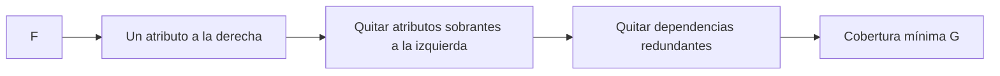

# Fundamentos de Bases de Datos - Diseño de bases de datos

## 5.1 Dependencias Funcionales.

---

Una **dependencia funcional** expresa que el valor de unos atributos determina el valor de otros: la matrícula determina el nombre del estudiante, el ISBN determina el título. Son la herramienta formal del diseño relacional: con ellas se definen las claves, se detecta la redundancia y se definen las formas normales (tema 5.2). Este tema da su definición, los **axiomas de Armstrong** para razonar con ellas, el algoritmo de **cierre** de un conjunto de atributos, el cálculo de las **claves candidatas** y de una **cobertura mínima**.

### Definición

Sea $R$ un esquema de relación y $X, Y \subseteq R$ conjuntos de atributos. La dependencia funcional $X \to Y$ se **cumple** en una instancia $r$ de $R$ si

$$\forall t_1, t_2 \in r: \; t_1[X] = t_2[X] \;\Rightarrow\; t_1[Y] = t_2[Y],$$

es decir, si dos tuplas que coinciden en $X$ coinciden también en $Y.$ $X$ es el **determinante** o lado izquierdo, y $Y$ el **dependiente**. La dependencia es **trivial** si $Y \subseteq X,$ porque entonces se cumple en toda instancia.

Una dependencia funcional es una restricción del **esquema**: dice que **toda** instancia válida la cumple, y se obtiene del significado de los atributos, no de los datos. Una instancia puede **refutar** una dependencia, si contiene dos tuplas que la violan, pero no puede demostrarla. La relación con las claves es directa: $K$ es superclave de $R$ si y solo si $K \to R.$

### Axiomas de Armstrong

Dado un conjunto $F$ de dependencias, otras se siguen de ellas: si $A \to B$ y $B \to C,$ toda instancia que cumple las dos cumple $A \to C.$ El conjunto de todas las dependencias implicadas por $F$ es su **clausura** $F^+.$ Armstrong (1974) dio tres reglas de inferencia:

1. **Reflexividad:** si $Y \subseteq X,$ entonces $X \to Y.$
2. **Aumento:** si $X \to Y,$ entonces $XZ \to YZ$ para todo $Z.$
3. **Transitividad:** si $X \to Y$ y $Y \to Z,$ entonces $X \to Z.$

Aquí $XZ$ abrevia $X \cup Z.$ Las reglas son **correctas**, porque solo derivan dependencias implicadas, y **completas**, porque derivan todas. De ellas se demuestran otras útiles:

- **Unión:** si $X \to Y$ y $X \to Z,$ entonces $X \to YZ.$ Por aumento con $X,$ $X \to XY;$ por aumento con $Y,$ $XY \to YZ;$ por transitividad, $X \to YZ.$
- **Descomposición:** si $X \to YZ,$ entonces $X \to Y$ y $X \to Z,$ porque por reflexividad $YZ \to Y,$ y basta aplicar la transitividad; lo mismo vale para $Z.$
- **Pseudotransitividad:** si $X \to Y$ y $WY \to Z,$ entonces $WX \to Z.$

Por unión y descomposición, toda dependencia se puede escribir con un solo atributo a la derecha.

### Cierre de un conjunto de atributos

Calcular $F^+$ completo es exponencial, pero casi nunca hace falta: para saber si $X \to Y$ está en $F^+$ basta calcular el **cierre** de $X,$ el conjunto $X^+$ de todos los atributos que $X$ determina, y comprobar que $Y \subseteq X^+.$

1. $X^+ \leftarrow X.$
2. Mientras haya una dependencia $V \to W$ en $F$ con $V \subseteq X^+$ y $W \not\subseteq X^+,$ hacer $X^+ \leftarrow X^+ \cup W.$

El algoritmo termina porque $X^+$ solo crece y está acotado por $R,$ y es correcto porque cada paso aplica las reglas de Armstrong. Con él:

- $X \to Y \in F^+$ si y solo si $Y \subseteq X^+.$
- $X$ es superclave si y solo si $X^+ = R.$
- $X$ es clave candidata si además ningún subconjunto propio de $X$ cumple $X^+ = R.$

Para encontrar todas las claves conviene notar que un atributo que no aparece a la derecha de ninguna dependencia no lo determina nadie más, así que está en **toda** clave; y que un atributo que solo aparece a la derecha no está en ninguna.

### Cobertura mínima

Dos conjuntos $F$ y $G$ son **equivalentes** si $F^+ = G^+,$ lo que se comprueba verificando que cada dependencia de uno está en la clausura del otro. Una **cobertura mínima** de $F$ es un conjunto $G$ equivalente tal que:

1. Cada dependencia de $G$ tiene un solo atributo a la derecha.
2. Ningún lado izquierdo tiene atributos **sobrantes**: en $X \to A,$ un atributo $B \in X$ sobra si $A \in (X - \{B\})^+.$
3. Ninguna dependencia es **redundante**: $X \to A$ es redundante si $A \in X^+$ calculado con las demás dependencias.

Se obtiene aplicando los tres pasos en ese orden; quitar primero los atributos sobrantes y después las redundancias evita que queden unos u otras. Una cobertura mínima no es única, pero todas sirven para el algoritmo de síntesis en 3FN del tema 5.2.



### Implementación en Python

El programa implementa el cierre de atributos, con la traza de las dependencias que aplica; la búsqueda de todas las claves candidatas, partiendo de los atributos que están en toda clave, y la cobertura mínima con sus tres pasos. Resuelve con ellos los ejercicios 1 y 2, verifica que la cobertura es equivalente al conjunto original y muestra un ejemplo con atributos sobrantes y dependencias redundantes. Para el ejercicio 3 calcula la clave de `VENTAS` y prueba las dependencias propuestas contra una instancia, que puede refutarlas pero no demostrarlas.

```python
from itertools import combinations

def df(texto):                                   # "AB->C, C->D" -> [({'A','B'}, {'C'}), ...]
    out = []
    for parte in texto.split(","):
        izq, der = parte.split("->")
        out.append((frozenset(izq.split() if " " in izq.strip() else izq.strip()),
                    frozenset(der.split() if " " in der.strip() else der.strip())))
    return out

def fmt(X): return "".join(sorted(X)) if all(len(a) == 1 for a in X) else "{" + ", ".join(sorted(X)) + "}"
def fmt_df(F): return ", ".join(f"{fmt(X)} -> {fmt(Y)}" for X, Y in F)

def cierre(X, F, traza=False):
    X, pasos = set(X), []
    cambio = True
    while cambio:
        cambio = False
        for izq, der in F:
            if izq <= X and not der <= X:
                X |= der; cambio = True; pasos.append(f"{fmt(izq)} -> {fmt(der)} da {fmt(X)}")
    return (frozenset(X), pasos) if traza else frozenset(X)

def claves(R, F):
    R, encontradas = frozenset(R), []
    # los atributos que no aparecen a la derecha de ninguna DF están en toda clave
    nucleo = R - frozenset().union(*(der - izq for izq, der in F))
    resto = sorted(R - nucleo)
    for k in range(len(resto) + 1):
        for extra in combinations(resto, k):
            X = nucleo | set(extra)
            if cierre(X, F) == R and not any(c <= X for c in encontradas):
                encontradas.append(frozenset(X))
    return nucleo, encontradas

def cobertura_minima(F):
    G = [(X, frozenset([a])) for X, Y in F for a in sorted(Y)]           # 1. un atributo a la derecha
    G2 = []
    for X, Y in G:                                                       # 2. quitar atributos sobrantes a la izquierda
        X = set(X)
        for a in sorted(X):
            if len(X) > 1 and Y <= cierre(X - {a}, G):
                X -= {a}
        G2.append((frozenset(X), Y))
    G3 = list(dict.fromkeys(G2))
    for d in list(G3):                                                   # 3. quitar DF redundantes
        resto = [e for e in G3 if e != d]
        if d[1] <= cierre(d[0], resto):
            G3 = resto
    return G3

# --- Ejercicio 1 ---
R = set("ABCDE")
F = df("AB->C, C->D, D->E, E->A")
for X in ("AB", "C"):
    c, pasos = cierre(set(X), F, traza=True)
    print(f"ejercicio 1: {X}+ = {fmt(c)}   ({'; '.join(pasos)})")
nucleo, ks = claves(R, F)
print("   atributos en toda clave:", fmt(nucleo), "| claves candidatas:", [fmt(k) for k in ks])
print("   atributos primos:", fmt(frozenset().union(*ks)))

# --- Ejercicio 2 ---
F2 = df("A->BC, CD->E, B->D, E->A")
print("ejercicio 2: cobertura mínima:", fmt_df(cobertura_minima(F2)))
G = cobertura_minima(F2)
print("   equivalente a F:", all(Y <= cierre(X, G) for X, Y in F2) and all(Y <= cierre(X, F2) for X, Y in G))
print("   ejemplo con atributos sobrantes:", fmt_df(df("A->B, AB->C, B->C, A->C")), "=>", fmt_df(cobertura_minima(df("A->B, AB->C, B->C, A->C"))))
print("   claves de R(ABCDE) con F:", [fmt(k) for k in claves(set("ABCDE"), F2)[1]])

# --- Ejercicio 3: VENTAS ---
A = ["cliente_id", "producto_id", "fecha", "cantidad", "precio_unitario", "total", "nombre_cliente", "categoria"]
F3 = [(frozenset(["cliente_id"]), frozenset(["nombre_cliente"])),
      (frozenset(["producto_id"]), frozenset(["categoria"])),
      (frozenset(["cliente_id", "producto_id", "fecha"]), frozenset(["cantidad", "precio_unitario"])),
      (frozenset(["cantidad", "precio_unitario"]), frozenset(["total"]))]
print("ejercicio 3: claves de VENTAS:", [fmt(k) for k in claves(A, F3)[1]])
# una DF se puede refutar con datos, nunca demostrar: se prueban las propuestas contra una instancia
filas = [("C1", "P1", "2026-10-01", 2, 450, 900, "Rosa", "Periféricos"), ("C1", "P2", "2026-10-01", 1, 200, 200, "Rosa", "Periféricos"),
         ("C2", "P1", "2026-10-02", 1, 450, 450, "Iván", "Periféricos"), ("C1", "P1", "2026-10-09", 3, 420, 1260, "Rosa", "Periféricos")]
def cumple(X, Y):
    vistos = {}
    for f in filas:
        k, v = tuple(f[A.index(a)] for a in sorted(X)), tuple(f[A.index(a)] for a in sorted(Y))
        if vistos.setdefault(k, v) != v: return False
    return True
for X, Y in F3 + [(frozenset(["producto_id"]), frozenset(["precio_unitario"]))]:
    print(f"   {fmt(X)} -> {fmt(Y)}:", "se cumple en los datos" if cumple(X, Y) else "los datos la refutan")
```

Salida:

```text
ejercicio 1: AB+ = ABCDE   (AB -> C da ABC; C -> D da ABCD; D -> E da ABCDE)
ejercicio 1: C+ = ACDE   (C -> D da CD; D -> E da CDE; E -> A da ACDE)
   atributos en toda clave: B | claves candidatas: ['AB', 'BC', 'BD', 'BE']
   atributos primos: ABCDE
ejercicio 2: cobertura mínima: A -> B, A -> C, CD -> E, B -> D, E -> A
   equivalente a F: True
   ejemplo con atributos sobrantes: A -> B, AB -> C, B -> C, A -> C => A -> B, B -> C
   claves de R(ABCDE) con F: ['A', 'E', 'BC', 'CD']
ejercicio 3: claves de VENTAS: ['{cliente_id, fecha, producto_id}']
   {cliente_id} -> {nombre_cliente}: se cumple en los datos
   {producto_id} -> {categoria}: se cumple en los datos
   {cliente_id, fecha, producto_id} -> {cantidad, precio_unitario}: se cumple en los datos
   {cantidad, precio_unitario} -> {total}: se cumple en los datos
   {producto_id} -> {precio_unitario}: los datos la refutan
```

### Ejercicios Propuestos

1. **Cierre y claves.** En $R(A, B, C, D, E)$ con $F = \{AB \to C, \; C \to D, \; D \to E, \; E \to A\},$ calcula $(AB)^+$ y $C^+,$ e identifica todas las claves candidatas.

2. **Cobertura mínima.** Encuentra una cobertura mínima de $F = \{A \to BC, \; CD \to E, \; B \to D, \; E \to A\}.$

3. **Dependencias de un caso.** Para `VENTAS(cliente_id, producto_id, fecha, cantidad, precio_unitario, total, nombre_cliente, categoria)`, identifica las dependencias funcionales y propón una normalización.

### Soluciones

**Ejercicio 1.** $(AB)^+$ empieza en $AB;$ $AB \to C$ agrega $C,$ $C \to D$ agrega $D$ y $D \to E$ agrega $E:$ $(AB)^+ = ABCDE,$ así que $AB$ es superclave, y es clave porque $A^+ = A$ y $B^+ = B.$ $C^+$ empieza en $C;$ se agregan $D,$ $E$ y $A$ por las tres últimas dependencias, y $AB \to C$ no aplica porque falta $B:$ $C^+ = ACDE.$

Para las claves: $B$ no aparece a la derecha de ninguna dependencia, así que está en toda clave, y $B^+ = B$ no basta. Se prueban $B$ con un atributo más: $(AB)^+,$ $(BC)^+,$ $(BD)^+$ y $(BE)^+$ son todos $ABCDE,$ porque de cualquiera de $C,$ $D$ o $E$ se llega a $A$ por la cadena $C \to D \to E \to A,$ y con $AB$ se obtiene $C.$ Las claves candidatas son $AB,$ $BC,$ $BD$ y $BE,$ y todos los atributos son **primos**, es decir, pertenecen a alguna clave; esto importa en el tema 5.2, porque hace que $R$ esté en 3FN.

**Ejercicio 2.** Paso 1: $A \to B,$ $A \to C,$ $CD \to E,$ $B \to D,$ $E \to A.$ Paso 2: el único lado izquierdo con dos atributos es $CD;$ $C^+ = C$ y $D^+ = D$ no contienen $E,$ así que ninguno sobra. Paso 3: sin $A \to B,$ $A^+ = AC,$ que no contiene $B;$ sin $A \to C,$ $A^+ = ABD,$ que no contiene $C;$ sin $CD \to E,$ $(CD)^+ = CD;$ sin $B \to D,$ $B^+ = B;$ sin $E \to A,$ $E^+ = E.$ Ninguna es redundante, y la cobertura mínima es

$$G = \{A \to B, \; A \to C, \; CD \to E, \; B \to D, \; E \to A\},$$

que solo separa los lados derechos. El programa muestra un caso donde los pasos 2 y 3 sí actúan: en $\{A \to B, \; AB \to C, \; B \to C, \; A \to C\},$ $B$ sobra en $AB \to C$ porque $A^+$ ya contiene $C,$ y las dependencias que resultan se reducen a $\{A \to B, \; B \to C\}.$ Sus claves, no pedidas, son $A,$ $E,$ $BC$ y $CD.$

**Ejercicio 3.** Las dependencias, a partir del significado de los atributos:

- $\text{cliente\_id} \to \text{nombre\_cliente}.$
- $\text{producto\_id} \to \text{categoria}.$
- $\text{cliente\_id}, \text{producto\_id}, \text{fecha} \to \text{cantidad}, \text{precio\_unitario},$ suponiendo que un cliente compra un producto a lo más una vez al día; si no, hace falta un identificador de venta.
- $\text{cantidad}, \text{precio\_unitario} \to \text{total},$ porque el total es su producto.

La clave es $(\text{cliente\_id}, \text{producto\_id}, \text{fecha}).$ $\text{producto\_id} \to \text{precio\_unitario}$ **no** es una dependencia, porque el precio cambia con el tiempo: el programa la refuta con dos ventas del mismo producto a 450 y a 420. Una normalización: `Cliente(cliente_id, nombre_cliente)`, `Producto(producto_id, categoria)` y `Venta(cliente_id, producto_id, fecha, cantidad, precio_unitario)`, eliminando `total`, que es derivado. Las dependencias de cada tabla tienen como determinante su clave, que es la condición de la forma normal de Boyce-Codd del tema 5.2.

### Referencias

1. Armstrong, W. W., Dependency structures of data base relationships. _Proceedings of IFIP Congress_, 1974.
2. Elmasri, R., and Navathe, S. B., _Fundamentals of Database Systems_. Pearson, 2016. Capítulos 14 y 15.
3. Silberschatz, A., Korth, H. F., and Sudarshan, S., _Database System Concepts_. McGraw-Hill, 2019. Capítulo 7.
4. Garcia-Molina, H., Ullman, J. D., and Widom, J., _Database Systems: The Complete Book_. Pearson, 2009. Capítulo 3.
5. Maier, D., _The Theory of Relational Databases_. Computer Science Press, 1983. Capítulos 4 y 5.
