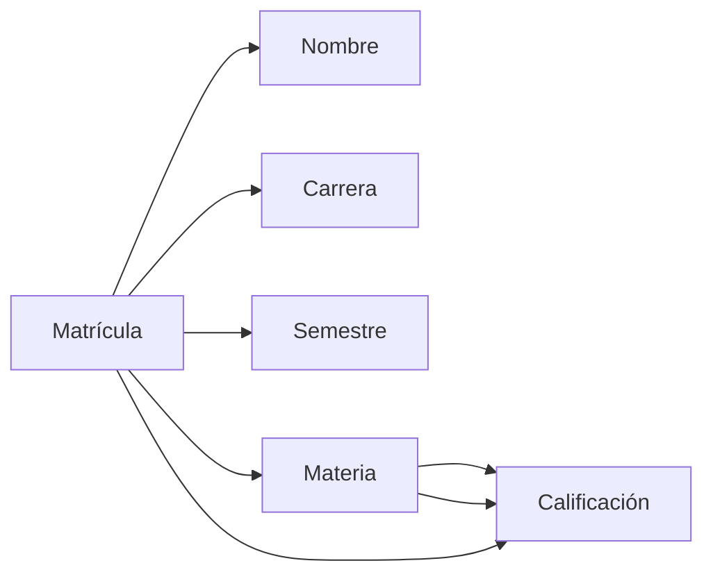

# Fundamentos de Bases de Datos - Diseño de bases de datos

## 5.1 Dependencias Funcionales.

---

Las dependencias funcionales son un concepto fundamental en el diseño de bases de datos relacionales, particularmente en el proceso de normalización. Permiten expresar restricciones semánticas sobre los datos y ayudan a identificar problemas de diseño en los esquemas de relación.

### Definición Formal

Una dependencia funcional (DF) es una restricción entre dos conjuntos de atributos en una relación. Formalmente, si $X$ e $Y$ son conjuntos de atributos en una relación $R$, se dice que $X$ determina funcionalmente a $Y$ ( denotado como $X → Y$ ) si y solo si, para cada par de tuplas $t_1$ y $t_2$ en $R$ que coinciden en todos los atributos de $X$, también coinciden en todos los atributos de $Y$.

$$X → Y \iff \forall t_1, t_2 \in R: t_1[X] = t_2[X] \Rightarrow t_1[Y] = t_2[Y]$$

### Terminología Básica

- **Determinante**: El conjunto de atributos $X$ en $X → Y$
- **Dependiente**: El conjunto de atributos $Y$ en $X → Y$
- **DF trivial**: $X → Y$ es trivial si $Y ⊆ X$
- **DF completa**: $X → Y$ es completa si ningún subconjunto propio de $X$ determina $Y$

### Axiomas de Armstrong

Los axiomas de Armstrong son un conjunto de reglas de inferencia para derivar todas las dependencias funcionales que son implicadas lógicamente por un conjunto dado de DFs.

#### Axiomas Básicos

1. **Reflexividad**: Si $Y ⊆ X$, entonces $X → Y$
2. **Aumentación**: Si $X → Y$, entonces $XZ → YZ$ para cualquier $Z$
3. **Transitividad**: Si $X → Y$ e $Y → Z$, entonces $X → Z$

#### Reglas Derivadas

4. **Unión**: Si $X → Y$ y $X → Z$, entonces $X → YZ$
5. **Descomposición**: Si $X → YZ$, entonces $X → Y$ y $X → Z$
6. **Pseudotransitividad**: Si $X → Y$ y $WY → Z$, entonces $WX → Z$

### Clausura de un Conjunto de Atributos

La clausura de un conjunto de atributos $X$ bajo un conjunto de DFs $F$, denotada como $X^+$, es el conjunto de todos los atributos que son determinados funcionalmente por $X$.

**Algoritmo para calcular $X^+$:**

```
X⁺ = X
repetir
    viejoX⁺ = X⁺
    para cada DF Y → Z en F hacer
        si Y ⊆ X⁺ entonces
            X⁺ = X⁺ ∪ Z
hasta que (viejoX⁺ = X⁺)
```

### Ejemplo Práctico

Consideremos una relación ESTUDIANTE con los siguientes atributos:

- Matrícula (M)
- Nombre (N)
- Carrera (C)
- Semestre (S)
- Materia (MAT)
- Calificación (CAL)

Las dependencias funcionales podrían ser:

- $M → N, C, S$ (La matrícula determina nombre, carrera y semestre)
- $M, MAT → CAL$ (Matrícula y materia determinan la calificación)

```sql
-- Ejemplo de tabla que violaría estas DFs
CREATE TABLE Estudiante (
    Matricula VARCHAR(10),
    Nombre VARCHAR(50),
    Carrera VARCHAR(50),
    Semestre INT,
    Materia VARCHAR(50),
    Calificación DECIMAL(3,1)
);
```

### Diagrama de Dependencias Funcionales



### Clave Candidata y DFs

Una clave candidata es un conjunto de atributos $K$ tal que:

1. $K → R$ (determina todos los atributos de la relación)
2. Ningún subconjunto propio de $K$ determina $R$

**Ejemplo**: En la relación ESTUDIANTE, {M, MAT} es una clave candidata.

### Cobertura Minimal

Un conjunto minimal de DFs es aquel que:

1. El lado derecho de cada DF contiene un solo atributo
2. No existe una DF redundante
3. No existe un atributo redundante en el lado izquierdo de ninguna DF

**Algoritmo para encontrar la cobertura minimal:**

1. Descomponer todas las DFs para que tengan un solo atributo en el lado derecho
2. Eliminar atributos redundantes del lado izquierdo
3. Eliminar DFs redundantes

### Ejercicios Propuestos

#### Ejercicio 1

Dada la relación R(A, B, C, D, E) con las siguientes DFs:

- $AB → C$
- $C → D$
- $D → E$
- $E → A$

Calcula:

1. $AB^+$
2. $C^+$
3. Identifica todas las claves candidatas

#### Ejercicio 2

Dado el conjunto de DFs F = { $A → BC$, $CD → E$, $B → D$, $E → A$ }
Encuentra la cobertura minimal de F.

#### Ejercicio 3

Para una relación VENTAS(ClienteID, ProductoID, Fecha, Cantidad, PrecioUnitario, Total, NombreCliente, CategoríaProducto), identifica las posibles DFs y propón una normalización.

### Aplicación en Normalización

Las DFs son cruciales para las formas normales:

- **1FN**: Eliminar grupos repetitivos
- **2FN**: Basada en DFs completas con respecto a la clave primaria
- **3FN**: Eliminar dependencias transitivas
- **FNBC**: Forma normal de Boyce-Codd, más estricta que 3FN

### Implementación en SQL

```sql
-- Aunque SQL no tiene soporte directo para DFs, se pueden implementar con triggers
CREATE OR REPLACE FUNCTION check_dependency()
RETURNS TRIGGER AS $$
BEGIN
    -- Verificar dependencia funcional M → N, C, S
    IF EXISTS (
        SELECT 1 FROM Estudiante
        WHERE Matricula = NEW.Matricula
        AND (Nombre <> NEW.Nombre OR Carrera <> NEW.Carrera OR Semestre <> NEW.Semestre)
    ) THEN
        RAISE EXCEPTION 'Violación de dependencia funcional M → N, C, S';
    END IF;
    RETURN NEW;
END;
$$ LANGUAGE plpgsql;

CREATE TRIGGER trg_check_dependency
BEFORE INSERT OR UPDATE ON Estudiante
FOR EACH ROW EXECUTE FUNCTION check_dependency();
```

### Referencias

1. Elmasri and Navathe. Fundamentals of Database Systems. Capítulo 10: Functional Dependencies and Normalization for Relational Databases.
2. Silberschatz A., Kort H. y Sudarshan S. Fundamentos de BD. Capítulo 7: Relational Database Design.
3. Ullman J.D. and Widom J. A First Course in Data Base System. Capítulo 3: Design Theory for Relational Databases.

### Conclusión

Las dependencias funcionales son la base teórica para el diseño de bases de datos relacionales normalizadas. Su comprensión permite identificar problemas de redundancia y anomalías en los datos, llevando a diseños más eficientes y consistentes.
