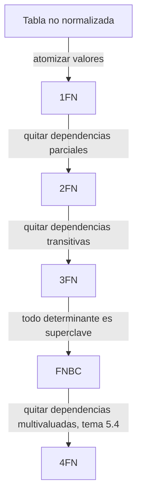

# Fundamentos de Bases de Datos - Diseño de bases de datos

## 5.2 Formas normales (1NF, 2NF, 3NF, BCNF).

---

Una relación que guarda varios hechos independientes repite información, y la repetición produce **anomalías**: de **actualización** (cambiar el nombre de un cliente obliga a cambiarlo en todos sus pedidos, y si falta uno quedan dos nombres), de **inserción** (no se puede registrar un producto que aún no tiene pedidos) y de **eliminación** (al borrar el único pedido de un cliente se pierde el cliente). Las **formas normales** son condiciones sobre las dependencias funcionales de una relación que garantizan la ausencia de cierto tipo de redundancia. Este tema define la primera, segunda y tercera formas normales y la de Boyce-Codd, presenta los dos algoritmos de normalización y las dos propiedades que debe tener una descomposición: **sin pérdida** y **con preservación de dependencias**.

### Definiciones previas

Sea $R$ con un conjunto $F$ de dependencias. Un atributo es **primo** si pertenece a alguna clave candidata. Una dependencia $X \to A$ es **completa** si ningún subconjunto propio de $X$ determina a $A,$ y **parcial** si alguno lo hace. Una dependencia $X \to A$ es **transitiva** respecto de una clave $K$ si $K \to Y$ y $Y \to A$ con $Y$ que no es superclave y $A \notin Y.$

### Primera forma normal

$R$ está en **1FN** si los dominios de todos sus atributos son atómicos: sin listas, conjuntos ni relaciones anidadas como valores. Es parte de la definición de relación (tema 4.1); una tabla con grupos repetidos se lleva a 1FN poniendo cada valor del grupo en su propia fila, o en una tabla aparte.

### Segunda forma normal

$R$ está en **2FN** si está en 1FN y ningún atributo **no primo** depende **parcialmente** de una clave candidata. Solo puede violarse cuando hay claves compuestas. En `Ventas(order, customer, customer_name, product, product_name, quantity, price)` con clave $(\text{order}, \text{product}),$ la dependencia $\text{product} \to \text{product\_name}, \text{price}$ es parcial: el nombre y el precio de un producto se repiten en cada pedido que lo incluye.

### Tercera forma normal

$R$ está en **3FN** si para toda dependencia no trivial $X \to A$ de $F^+$ se cumple al menos una de dos condiciones:

1. $X$ es superclave de $R,$ o
2. $A$ es primo.

Equivale a estar en 2FN y no tener atributos no primos que dependan **transitivamente** de una clave. En una reserva de hotel, $\text{reserva} \to \text{habitacion} \to \text{tipo} \to \text{precio\_noche}$ es una cadena transitiva, y el precio de cada tipo se repite en cada reserva.

### Forma normal de Boyce-Codd

$R$ está en **FNBC** (BCNF) si para toda dependencia no trivial $X \to A$ de $F^+,$ $X$ es superclave. Es la 3FN sin la excepción de los atributos primos: todo determinante es superclave, es decir, **cada hecho se guarda una vez por cada valor de la clave**.

Toda relación en FNBC está en 3FN, toda relación en 3FN está en 2FN y toda relación en 2FN está en 1FN. La diferencia entre 3FN y FNBC aparece cuando hay claves candidatas que se traslapan. El ejemplo clásico es `Direccion(calle, ciudad, cp)` con $\{\text{calle}, \text{ciudad}\} \to \text{cp}$ y $\text{cp} \to \text{ciudad}:$ las claves son $\{\text{calle}, \text{ciudad}\}$ y $\{\text{calle}, \text{cp}\},$ todos los atributos son primos y la relación está en 3FN, pero $\text{cp} \to \text{ciudad}$ viola FNBC porque $\text{cp}$ no es superclave.

### Propiedades de una descomposición

Normalizar es reemplazar $R$ por proyecciones $R_1, \dots, R_n$ con $R_1 \cup \dots \cup R_n = R.$ Se piden dos propiedades:

- **Sin pérdida** (*lossless join*): para toda instancia válida $r,$ $\pi_{R_1}(r) \bowtie \dots \bowtie \pi_{R_n}(r) = r.$ Una descomposición en **dos** partes no tiene pérdida si y solo si $R_1 \cap R_2 \to R_1$ o $R_1 \cap R_2 \to R_2$ está en $F^+,$ es decir, si los atributos comunes son superclave de alguna de las partes. Para más partes se usa la prueba de la **persecución** (*chase*). Con pérdida, la reunión no pierde tuplas, sino que **agrega** tuplas falsas.
- **Preservación de dependencias:** la unión de las proyecciones de $F$ sobre cada $R_i$ es equivalente a $F.$ Si se pierde una dependencia, verificarla exige reunir tablas en cada actualización.

### Algoritmos

**Descomposición en FNBC.** Mientras alguna parte $S$ tenga una dependencia $X \to Y$ de su proyección con $X$ que no es superclave de $S,$ reemplazar $S$ por $X^+ \cap S$ y $X \cup (S - X^+).$ Como los atributos comunes son $X,$ que determina la primera parte, cada paso es sin pérdida. **No siempre preserva dependencias**: en `Direccion`, la descomposición en $(\text{cp}, \text{ciudad})$ y $(\text{calle}, \text{cp})$ pierde $\{\text{calle}, \text{ciudad}\} \to \text{cp}.$

**Síntesis en 3FN.** Calcular una cobertura mínima $G$ (tema 5.1); crear un esquema $X \cup \{A_1, \dots, A_k\}$ por cada lado izquierdo $X$ con sus dependencias $X \to A_i;$ si ningún esquema contiene una clave de $R,$ agregar uno con una clave, y eliminar los esquemas contenidos en otros. El resultado está en 3FN, es sin pérdida y **siempre preserva dependencias**.

Por eso el objetivo práctico suele ser: FNBC si se puede sin perder dependencias; si no, 3FN.



### Desnormalización

Normalizar reduce la redundancia a cambio de más reuniones en las consultas. En sistemas de análisis, donde se lee mucho y se escribe poco, a veces se **desnormaliza** a propósito: un esquema en estrella guarda en una tabla de hechos datos que una consulta frecuente necesita juntos, o una tabla guarda un total precalculado. Es una decisión de diseño físico, que se toma después de normalizar, midiendo el beneficio, y que debe acompañarse de un mecanismo (disparadores, vistas materializadas, procesos de carga) que mantenga consistentes las copias.

### Implementación en Python

El programa implementa la proyección de dependencias sobre un subconjunto de atributos, la búsqueda de claves, un clasificador que decide en qué forma normal está una relación e imprime las dependencias que violan FNBC, el algoritmo de descomposición en FNBC, la síntesis en 3FN, la prueba de la persecución para la propiedad sin pérdida y la verificación de preservación de dependencias. Los aplica a los tres ejercicios y al ejemplo de calle, ciudad y código postal.

```python
from itertools import combinations

def F_(*pares): return [(frozenset(x.split()), frozenset(y.split())) for x, y in pares]
def fmt(X): return " ".join(sorted(X))
def cierre(X, F):
    X = set(X); cambio = True
    while cambio:
        cambio = False
        for a, b in F:
            if a <= X and not b <= X: X |= b; cambio = True
    return frozenset(X)

def proyecta(F, S):                 # dependencias de F+ que caben en S, con un atributo a la derecha
    S, out = frozenset(S), []
    for k in range(1, len(S)):
        for X in combinations(sorted(S), k):
            for a in sorted((cierre(X, F) & S) - set(X)):
                if not any(set(Y) < set(X) and a in cierre(Y, F) for Y in combinations(X, k - 1) if Y):
                    out.append((frozenset(X), frozenset([a])))
    return out

def claves(R, F):
    R, ks = frozenset(R), []
    for k in range(1, len(R) + 1):
        for X in combinations(sorted(R), k):
            if cierre(X, F) == R and not any(c <= set(X) for c in ks): ks.append(frozenset(X))
    return ks

def forma_normal(R, F):
    R, G = frozenset(R), proyecta(F, R)
    ks = claves(R, G); primos = frozenset().union(*ks)
    viol = [(X, Y) for X, Y in G if not Y <= X and cierre(X, G) != R]       # determinante que no es superclave
    if not viol: return "BCNF", ks, []
    if all(Y <= primos for X, Y in viol): return "3FN", ks, viol
    if all(not any(X < k for k in ks) for X, Y in viol if not Y <= primos): return "2FN", ks, viol
    return "1FN", ks, viol

def bcnf(R, F):
    pendientes, final = [frozenset(R)], []
    while pendientes:
        S = pendientes.pop()
        G = proyecta(F, S)
        mala = next(((X, Y) for X, Y in G if cierre(X, G) != S), None)
        if mala is None: final.append(S); continue
        X = mala[0]; Xc = cierre(X, G)
        pendientes += [Xc, (S - Xc) | X]                      # R1 = X+, R2 = X ∪ (S − X+)
    return sorted(final, key=lambda s: sorted(s))

def sintesis_3fn(R, Fmin):
    esquemas = []
    for X in dict.fromkeys(X for X, _ in Fmin):
        esquemas.append(X | frozenset().union(*(Y for Z, Y in Fmin if Z == X)))
    if not any(cierre(S, Fmin) == frozenset(R) for S in esquemas):
        esquemas.append(claves(R, Fmin)[0])                     # agrega una clave si ninguna parte la contiene
    return [S for S in esquemas if not any(S < T for T in esquemas)]

def sin_perdida(R, partes, F):                                  # prueba de la persecución (chase)
    R = sorted(R)
    tabla = [{a: ("a", a) if a in p else ("b", a, i) for a in R} for i, p in enumerate(partes)]
    cambio = True
    while cambio:
        cambio = False
        for X, Y in F:
            for t1, t2 in combinations(tabla, 2):
                if all(t1[a] == t2[a] for a in X):
                    for a in Y:
                        if t1[a] != t2[a]:
                            v = min(t1[a], t2[a]); t1[a] = t2[a] = v; cambio = True
    return any(all(t[a] == ("a", a) for a in R) for t in tabla)

def preserva(F, partes):
    G = [d for p in partes for d in proyecta(F, p)]
    return all(Y <= cierre(X, G) for X, Y in F)

def informe(nombre, R, F):
    fn, ks, viol = forma_normal(R, F)
    print(f"{nombre}: claves {[fmt(k) for k in ks]} | forma normal: {fn}")
    for X, Y in viol: print(f"   viola BCNF: {fmt(X)} -> {fmt(Y)}")
    partes = bcnf(R, F)
    print("   BCNF:", [fmt(p) for p in partes], "| sin pérdida:", sin_perdida(R, partes, F), "| preserva dependencias:", preserva(F, partes))
    return partes

# --- Ejercicio 1: Ventas ---
R1 = "order customer customer_name product product_name quantity price".split()
F1 = F_(("order", "customer"), ("customer", "customer_name"), ("product", "product_name price"), ("order product", "quantity"))
informe("ejercicio 1, Ventas", R1, F1)
filas = [(1001, "C001", "Juan Pérez", "P001", "Laptop", 2, 800), (1001, "C001", "Juan Pérez", "P002", "Mouse", 3, 25),
         (1002, "C002", "María López", "P001", "Laptop", 1, 800)]
print("   anomalías: 'Juan Pérez' guardado", sum(f[2] == "Juan Pérez" for f in filas), "veces; precio de Laptop", sum(f[4] == "Laptop" for f in filas),
      "veces; un producto sin pedidos no tiene dónde guardarse")

# --- Ejercicio 2 ---
R2 = list("ABCDE")
F2 = F_(("A B", "C"), ("C", "D"), ("D", "E"), ("E", "A"))
informe("ejercicio 2, R(ABCDE)", R2, F2)
partes = bcnf(R2, F2)
print("   AB -> C se puede verificar en alguna parte:", any(set("ABC") <= p for p in partes),
      "| R ya está en 3FN, que sí preserva todas las dependencias")

# --- Ejercicio 3: hotel ---
R3 = "reserva cliente nombre_cliente entrada salida habitacion tipo precio_noche".split()
F3 = F_(("reserva", "cliente entrada salida habitacion"), ("cliente", "nombre_cliente"),
        ("habitacion", "tipo"), ("tipo", "precio_noche"))
informe("ejercicio 3, hotel", R3, F3)
Fmin = F_(("reserva", "cliente"), ("reserva", "entrada"), ("reserva", "salida"), ("reserva", "habitacion"),
          ("cliente", "nombre_cliente"), ("habitacion", "tipo"), ("tipo", "precio_noche"))
print("   síntesis en 3FN:", [fmt(p) for p in sintesis_3fn(R3, Fmin)])

# --- un caso clásico donde BCNF no preserva dependencias ---
R4 = "calle ciudad cp".split()
F4 = F_(("calle ciudad", "cp"), ("cp", "ciudad"))
informe("caso calle, ciudad, código postal", R4, F4)
```

Salida:

```text
ejercicio 1, Ventas: claves ['order product'] | forma normal: 1FN
   viola BCNF: customer -> customer_name
   viola BCNF: order -> customer
   viola BCNF: order -> customer_name
   viola BCNF: product -> price
   viola BCNF: product -> product_name
   BCNF: ['customer customer_name', 'customer order', 'order product quantity', 'price product product_name'] | sin pérdida: True | preserva dependencias: True
   anomalías: 'Juan Pérez' guardado 2 veces; precio de Laptop 2 veces; un producto sin pedidos no tiene dónde guardarse
ejercicio 2, R(ABCDE): claves ['A B', 'B C', 'B D', 'B E'] | forma normal: 3FN
   viola BCNF: C -> A
   viola BCNF: C -> D
   viola BCNF: C -> E
   viola BCNF: D -> A
   viola BCNF: D -> E
   viola BCNF: E -> A
   BCNF: ['A E', 'B C', 'C D', 'D E'] | sin pérdida: True | preserva dependencias: False
   AB -> C se puede verificar en alguna parte: False | R ya está en 3FN, que sí preserva todas las dependencias
ejercicio 3, hotel: claves ['reserva'] | forma normal: 2FN
   viola BCNF: cliente -> nombre_cliente
   viola BCNF: habitacion -> precio_noche
   viola BCNF: habitacion -> tipo
   viola BCNF: tipo -> precio_noche
   BCNF: ['cliente entrada habitacion reserva salida', 'cliente nombre_cliente', 'habitacion tipo', 'precio_noche tipo'] | sin pérdida: True | preserva dependencias: True
   síntesis en 3FN: ['cliente entrada habitacion reserva salida', 'cliente nombre_cliente', 'habitacion tipo', 'precio_noche tipo']
caso calle, ciudad, código postal: claves ['calle ciudad', 'calle cp'] | forma normal: 3FN
   viola BCNF: cp -> ciudad
   BCNF: ['calle cp', 'ciudad cp'] | sin pérdida: True | preserva dependencias: False
```

### Ejercicios Propuestos

1. **Ventas.** Normaliza a 1FN, 2FN, 3FN y FNBC la siguiente tabla, identificando sus dependencias funcionales:

    | OrderID | CustomerID | CustomerName | ProductID | ProductName | Quantity | Price |
    | ------- | ---------- | ------------ | --------- | ----------- | -------- | ----- |
    | 1001    | C001       | Juan Pérez   | P001      | Laptop      | 2        | 800   |
    | 1001    | C001       | Juan Pérez   | P002      | Mouse       | 3        | 25    |
    | 1002    | C002       | María López  | P001      | Laptop      | 1        | 800   |

2. **Relación abstracta.** En $R(A, B, C, D, E)$ con $F = \{AB \to C, \; C \to D, \; D \to E, \; E \to A\},$ determina la forma normal de $R$ y descomponla en FNBC.

3. **Hotel.** Para `Reserva(reserva, cliente, nombre_cliente, entrada, salida, habitacion, tipo, precio_noche)`, identifica las dependencias funcionales, la forma normal en que está y una descomposición en FNBC.

### Soluciones

**Ejercicio 1.** La tabla ya está en **1FN**: sus valores son atómicos. Las dependencias son $\text{order} \to \text{customer},$ $\text{customer} \to \text{customer\_name},$ $\text{product} \to \text{product\_name}, \text{price}$ y $\text{order}, \text{product} \to \text{quantity},$ y la clave es $(\text{order}, \text{product}).$ No está en **2FN**: `customer` y `customer_name` dependen solo de `order`, y `product_name` y `price` solo de `product`, que son partes de la clave. Separándolas se obtienen `Pedido(order, customer, customer_name)`, `Producto(product, product_name, price)` y `Linea(order, product, quantity)`. `Pedido` no está en **3FN**, por la cadena $\text{order} \to \text{customer} \to \text{customer\_name};$ se separa `Cliente(customer, customer_name)` y queda `Pedido(order, customer)`. Las cuatro tablas tienen como único determinante su clave, así que están en **FNBC**, y el programa confirma que la descomposición es sin pérdida y preserva dependencias. Si el precio puede variar entre pedidos, el precio cobrado va en `Linea`.

**Ejercicio 2.** Las claves son $AB,$ $BC,$ $BD$ y $BE$ (tema 5.1), así que **todos los atributos son primos** y $R$ está en **3FN**: toda dependencia tiene a la derecha un atributo primo. No está en FNBC, porque $C,$ $D$ y $E$ son determinantes que no son superclaves. El algoritmo separa primero $E \to A$ en $(A, E)$ y $(B, C, D, E);$ después $D \to E$ en $(D, E)$ y $(B, C, D),$ y finalmente $C \to D$ en $(C, D)$ y $(B, C).$ Resultado: $(A, E),$ $(D, E),$ $(C, D)$ y $(B, C),$ sin pérdida, pero que **no preserva** $AB \to C:$ ninguna parte contiene $A,$ $B$ y $C,$ así que verificarla exige reunir las cuatro tablas. Otras elecciones del orden dan otras descomposiciones, con el mismo problema, porque $AB \to C$ y la dependencia implicada $C \to A,$ que se obtiene de la cadena $C \to D \to E \to A,$ forman el patrón de `Direccion`. La recomendación es dejar $R$ en 3FN.

**Ejercicio 3.** Dependencias: $\text{reserva} \to \text{cliente}, \text{entrada}, \text{salida}, \text{habitacion};$ $\text{cliente} \to \text{nombre\_cliente};$ $\text{habitacion} \to \text{tipo};$ $\text{tipo} \to \text{precio\_noche}.$ La clave es `reserva`. Al ser una clave de un solo atributo no hay dependencias parciales, así que la relación está en **2FN**, pero no en 3FN, por las cadenas transitivas a través de `cliente`, `habitacion` y `tipo`. La descomposición en FNBC es `Reserva(reserva, cliente, entrada, salida, habitacion)`, `Cliente(cliente, nombre_cliente)`, `Habitacion(habitacion, tipo)` y `Tipo(tipo, precio_noche)`, sin pérdida y con todas las dependencias; la síntesis en 3FN produce exactamente las mismas tablas. Si el precio varía por temporada, `precio_noche` deja de depender solo del tipo y la dependencia correcta sería $\text{tipo}, \text{fecha} \to \text{precio\_noche},$ con una tabla de tarifas.

### Referencias

1. Codd, E. F., Further normalization of the data base relational model. En _Data Base Systems_, R. Rustin (ed.). Prentice Hall, 1972.
2. Codd, E. F., Recent investigations in relational data base systems. _Proceedings of IFIP Congress_, 1974.
3. Bernstein, P. A., Synthesizing third normal form relations from functional dependencies. _ACM Transactions on Database Systems_ 1(4), 1976.
4. Elmasri, R., and Navathe, S. B., _Fundamentals of Database Systems_. Pearson, 2016. Capítulos 14 y 15.
5. Silberschatz, A., Korth, H. F., and Sudarshan, S., _Database System Concepts_. McGraw-Hill, 2019. Capítulo 7.
