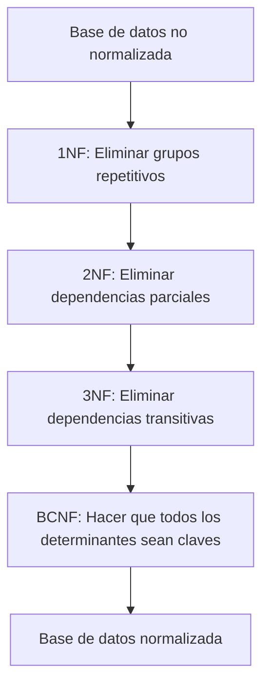

# Fundamentos de Bases de Datos - Diseño de bases de datos

## 5.2 Formas normales (1NF, 2NF, 3NF, BCNF).

---

Las formas normales son un conjunto de reglas que permiten evaluar y mejorar la estructura de una base de datos relacional, eliminando redundancias y anomalías en los datos. El proceso de normalización se realiza mediante la aplicación sucesiva de estas reglas.

### Primera Forma Normal (1NF)

#### Definición

Una relación está en Primera Forma Normal si y solo si todos sus atributos contienen únicamente valores atómicos (indivisibles) y cada atributo contiene un solo valor por tupla.

$$ R \text{ está en 1NF} \iff \forall A \in R, \forall t \in R: t[A] \text{ es atómico} $$

#### Características

- Elimina grupos repetitivos
- Cada intersección de fila y columna contiene exactamente un valor
- No permite atributos multivaluados o compuestos

#### Ejemplo

**Tabla NO normalizada (viola 1NF):**

| Est_ID | Nombre     | Teléfonos          |
| ------ | ---------- | ------------------ |
| 101    | Juan Pérez | 555-1234, 555-5678 |

**Tabla en 1NF:**

| Est_ID | Nombre     | Teléfono |
| ------ | ---------- | -------- |
| 101    | Juan Pérez | 555-1234 |
| 101    | Juan Pérez | 555-5678 |

```sql
-- Creación de tabla en 1NF
CREATE TABLE Estudiantes (
    Est_ID INT PRIMARY KEY,
    Nombre VARCHAR(50),
    Teléfono VARCHAR(15)
);
```

### Segunda Forma Normal (2NF)

#### Definición

Una relación está en Segunda Forma Normal si:

1. Está en 1NF
2. Todos los atributos no clave dependen completamente de la clave primaria

$$R \text{ está en 2NF} \iff R \text{ está en 1NF} \land \forall X → Y \text{ no trivial}, X \text{ no es subconjunto propio de una clave}$$

#### Ejemplo

**Tabla que viola 2NF:**

| Mat_ID | Curso_ID | Nombre_Curso | Calificación |
| ------ | -------- | ------------ | ------------ |
| 101    | C001     | Matemáticas  | 95           |
| 101    | C002     | Física       | 88           |

**Problema:** Nombre_Curso depende solo de Curso_ID, no de la clave completa (Mat_ID, Curso_ID)

**Solución (descomposición en 2NF):**

```sql
-- Tabla 1: Información de calificaciones
CREATE TABLE Calificaciones (
    Mat_ID INT,
    Curso_ID VARCHAR(10),
    Calificación INT,
    PRIMARY KEY (Mat_ID, Curso_ID)
);

-- Tabla 2: Información de cursos
CREATE TABLE Cursos (
    Curso_ID VARCHAR(10) PRIMARY KEY,
    Nombre_Curso VARCHAR(50)
);
```

### Tercera Forma Normal (3NF)

#### Definición

Una relación está en Tercera Forma Normal si:

1. Está en 2NF
2. No existe dependencia transitiva de atributos no clave sobre la clave primaria

$$ R \text{ está en 3NF} \iff R \text{ está en 2NF} \land \forall X → Y \text{ no trivial}, \ (X \text{ es superclave} \lor Y \text{ es atributo primo}) $$

#### Ejemplo

**Tabla que viola 3NF:**
| Emp_ID | Nombre  | Dept_ID | Dept_Nombre | Dept_Ubicación |
|--------|---------|---------|-------------|----------------|
| E001   | Ana García | D01     | Ventas      | Nueva York     |

**Problema:** Dept_Nombre y Dept_Ubicación dependen transitivamente de Emp_ID a través de Dept_ID

**Solución (descomposición en 3NF):**
```sql
-- Tabla 1: Información de empleados
CREATE TABLE Empleados (
    Emp_ID INT PRIMARY KEY,
    Nombre VARCHAR(50),
    Dept_ID VARCHAR(10)
);

-- Tabla 2: Información de departamentos
CREATE TABLE Departamentos (
    Dept_ID VARCHAR(10) PRIMARY KEY,
    Dept_Nombre VARCHAR(50),
    Dept_Ubicación VARCHAR(50)
);
```

### Forma Normal de Boyce-Codd (BCNF)

#### Definición
Una relación está en Boyce-Codd Normal Form si para toda dependencia funcional no trivial $X → Y$, $X$ es una superclave.

$$R \text{ está en BCNF} \iff \forall X → Y \text{ no trivial en } R, X \text{ es superclave}$$

#### Comparación con 3NF
- BCNF es más estricta que 3NF
- Toda relación en BCNF está automáticamente en 3NF
- BCNF elimina todas las dependencias funcionales donde el determinante no es clave

#### Ejemplo

**Tabla que viola BCNF pero está en 3NF:**
| Est_ID | Curso_ID | Profesor   |
|--------|----------|------------|
| 101    | C001     | Dr. Smith  |
| 102    | C001     | Dr. Smith  |
| 103    | C002     | Dr. Jones  |

**Suposición:** Cada profesor enseña solo un curso, pero un curso puede tener varios profesores.

**Dependencias funcionales:**
- Est_ID, Curso_ID → Profesor
- Profesor → Curso_ID

**Problema:** Profesor → Curso_ID es una DF donde el determinante (Profesor) no es superclave.

**Solución (descomposición en BCNF):**
```sql
-- Tabla 1: Estudiantes y profesores
CREATE TABLE Est_Prof (
    Est_ID INT,
    Profesor VARCHAR(50),
    PRIMARY KEY (Est_ID, Profesor)
);

-- Tabla 2: Profesores y cursos
CREATE TABLE Prof_Curso (
    Profesor VARCHAR(50) PRIMARY KEY,
    Curso_ID VARCHAR(10)
);
```

### Diagrama de Proceso de Normalización



### Algoritmo de Descomposición para BCNF

```
Entrada: Relación R, conjunto de DFs F
Salida: Descomposición de R en BCNF

resultado = {R}
repetir
    para cada relación Ri en resultado que no esté en BCNF hacer
        sea X → Y una DF no trivial que viola BCNF en Ri
        reemplazar Ri por:
            R1 = X⁺ (clausura de X)
            R2 = (Ri - Y) ∪ X
hasta que todas las relaciones estén en BCNF
```

### Ejercicios Propuestos

#### Ejercicio 1
Normalice la siguiente tabla a 1NF, 2NF, 3NF y BCNF:

**Ventas**
| OrderID | CustomerID | CustomerName | ProductID | ProductName | Quantity | Price |
|---------|------------|--------------|-----------|-------------|----------|-------|
| 1001    | C001       | Juan Pérez   | P001      | Laptop      | 2        | 800   |
| 1001    | C001       | Juan Pérez   | P002      | Mouse       | 3        | 25    |
| 1002    | C002       | María López  | P001      | Laptop      | 1        | 800   |

Identifique las dependencias funcionales y realice la descomposición apropiada.

#### Ejercicio 2
Dada la relación R(A, B, C, D, E) con las siguientes dependencias funcionales:
- AB → C
- C → D
- D → E
- E → A

Determine:
1. ¿En qué forma normal está R?
2. Descomponga R hasta BCNF

#### Ejercicio 3
Para un sistema de reservas de hotel con la siguiente estructura:
- ReservaID, ClienteID, NombreCliente, FechaEntrada, FechaSalida, HabitaciónID, TipoHabitación, PrecioNoche

Identifique:
1. Las dependencias funcionales
2. Hasta qué forma normal llega sin descomposición
3. Proponga una descomposición hasta BCNF

### Consideraciones Prácticas

#### Cuándo desnormalizar
Aunque la normalización elimina redundancias, en algunos casos puede ser beneficioso desnormalizar para:
- Mejorar el rendimiento de consultas frecuentes
- Simplificar consultas complejas
- Reducir joins en operaciones críticas

#### Ejemplo de desnormalización controlada
```sql
-- Tabla desnormalizada para reportes frecuentes
CREATE TABLE ReporteVentas (
    OrderID INT,
    OrderDate DATE,
    CustomerName VARCHAR(100),
    ProductName VARCHAR(100),
    Quantity INT,
    UnitPrice DECIMAL(10,2),
    TotalAmount DECIMAL(10,2)  -- Atributo derivado (desnormalización)
);
```

### Referencias

1. Elmasri and Navathe. Fundamentals of Database Systems. Capítulo 10: Functional Dependencies and Normalization for Relational Databases.
2. Silberschatz A., Kort H. y Sudarshan S. Fundamentos de BD. Capítulo 7: Relational Database Design.
3. Ullman J.D. and Widom J. A First Course in Data Base System. Capítulo 3: Design Theory for Relational Databases.
4. Harrington J. Relational Database Design and Implementation. Capítulo 6: Normalization.

### Conclusión

Las formas normales proporcionan un marco sistemático para diseñar bases de datos relacionales eficientes y libres de anomalías. Si bien BCNF representa la forma más estricta, en la práctica a menudo se busca un equilibrio entre la normalización teórica y las consideraciones de rendimiento, pudiendo detenerse en 3NF o incluso desnormalizar estratégicamente para casos específicos.
