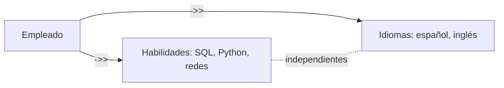

# Fundamentos de Bases de Datos - Diseño de bases de datos

## 5.3 Dependencias Multivaluadas.

---

Una relación en forma normal de Boyce-Codd puede seguir siendo redundante. Si un empleado tiene varias habilidades y habla varios idiomas, y ambos hechos son independientes, la relación `Empleado(nombre, habilidad, idioma)` debe contener **todas** las combinaciones: con 3 habilidades y 2 idiomas, 6 tuplas para guardar 5 hechos. No hay ninguna dependencia funcional no trivial, la única clave son los tres atributos, y la relación está en FNBC; la redundancia viene de otro tipo de restricción, la **dependencia multivaluada**. Este tema la define, da sus reglas de inferencia y muestra cómo se reconoce en los datos; el tema 5.4 define la cuarta forma normal que la elimina.

### Definición

Sea $R$ un esquema, $X, Y \subseteq R$ y $Z = R - X - Y.$ La dependencia multivaluada $X \twoheadrightarrow Y$ se cumple en una instancia $r$ si para todo par de tuplas $t_1, t_2 \in r$ con $t_1[X] = t_2[X]$ existe una tupla $t_3 \in r$ con

$$t_3[X] = t_1[X], \qquad t_3[Y] = t_1[Y], \qquad t_3[Z] = t_2[Z].$$

Aplicando la definición con $t_1$ y $t_2$ intercambiados se obtiene también una $t_4$ con el $Y$ de $t_2$ y el $Z$ de $t_1.$ Dicho de otro modo: para cada valor de $X,$ el conjunto de valores de $Y$ asociados es **independiente** del valor de $Z;$ la relación contiene, para cada $x,$ el producto cartesiano de sus valores de $Y$ y sus valores de $Z.$ Se lee que $X$ multidetermina a $Y.$

La dependencia es **trivial** si $Y \subseteq X$ o $X \cup Y = R:$ en ambos casos $t_3$ es $t_1$ o $t_2$ y se cumple siempre.

Toda dependencia funcional es multivaluada: si $X \to Y,$ basta tomar $t_3 = t_2,$ que tiene el mismo $Y$ que $t_1.$ La inversa no vale. La propiedad central es que $X \twoheadrightarrow Y$ se cumple en $R$ si y solo si la descomposición de $R$ en $XY$ y $XZ$ es **sin pérdida** (Fagin, 1977). Por eso las dependencias multivaluadas son exactamente las que permiten descomponer una relación en dos.

### Reglas de inferencia

Para dependencias multivaluadas, y mezcladas con funcionales, hay un sistema correcto y completo (Beeri, Fagin y Howard, 1977). Las reglas principales, con $W, X, Y, Z \subseteq R:$

1. **Complementación:** si $X \twoheadrightarrow Y,$ entonces $X \twoheadrightarrow R - X - Y.$ Por eso se suele escribir $X \twoheadrightarrow Y \mid Z.$
2. **Aumento:** si $X \twoheadrightarrow Y$ y $V \subseteq W,$ entonces $WX \twoheadrightarrow VY.$
3. **Transitividad:** si $X \twoheadrightarrow Y$ y $Y \twoheadrightarrow Z,$ entonces $X \twoheadrightarrow Z - Y.$
4. **Replicación:** si $X \to Y,$ entonces $X \twoheadrightarrow Y.$
5. **Coalescencia:** si $X \twoheadrightarrow Y,$ $Z \subseteq Y,$ $W \cap Y = \varnothing$ y $W \to Z,$ entonces $X \to Z.$

De ellas se derivan la **unión**, según la cual $X \twoheadrightarrow Y$ y $X \twoheadrightarrow Z$ dan $X \twoheadrightarrow YZ,$ la **intersección** y la **diferencia** de los lados derechos. A diferencia de las funcionales, una multivaluada **no** se descompone por el lado derecho: $X \twoheadrightarrow YZ$ no implica $X \twoheadrightarrow Y.$

### Dependencias funcionales y multivaluadas

| Aspecto                     | Funcional $X \to Y$                                         | Multivaluada $X \twoheadrightarrow Y$                              |
| --------------------------- | ----------------------------------------------------------- | ------------------------------------------------------------------ |
| Qué afirma                  | Cada $x$ tiene un solo $y$                                  | Cada $x$ tiene un conjunto de $y$ independiente del resto          |
| Cómo se viola               | Con dos tuplas                                              | Con una tupla que falta                                           |
| Inserciones                 | Pueden violarla                                             | Pueden obligar a insertar otras tuplas                             |
| Eliminaciones               | Nunca la violan                                             | Pueden violarla                                                    |
| Lado derecho                | Se descompone                                               | No se descompone                                                   |
| Depende de todo el esquema  | No                                                          | Sí: $Z$ es el resto de $R$                                         |

La última fila importa: $X \twoheadrightarrow Y$ puede cumplirse en $R$ y no en una relación con un atributo más. Por eso, al proyectar sobre un subconjunto $S$ con $X \subseteq S,$ lo que se conserva es $X \twoheadrightarrow Y \cap S.$



### Implementación en Python

El programa implementa la prueba de una dependencia multivaluada en una instancia, que devuelve las tuplas que faltan para cumplirla, y una búsqueda de todas las que se cumplen. Para el ejercicio 1 prueba las tres dependencias pedidas. Para el ejercicio 2 construye la relación del hospital a partir de quién trata a quién y quién padece qué, prueba las dependencias, descompone y muestra la anomalía de inserción. Para el ejercicio 3 genera, a partir de tres tuplas, una instancia que cumple las dos dependencias dadas, agregando las tuplas que faltan hasta un punto fijo, y comprueba en ella las dependencias derivadas con las reglas de inferencia.

```python
from itertools import combinations

def dmv(r, atr, X, Y):
    """¿Se cumple X ->> Y en la instancia r? Para cada par t1, t2 que coincide en X debe existir t3
    con t3[X Y] = t1[X Y] y t3[Z] = t2[Z], donde Z es el resto de los atributos."""
    Y = [a for a in Y if a not in X]
    Z = [a for a in atr if a not in X and a not in Y]
    i = {a: k for k, a in enumerate(atr)}
    filas = set(r)
    faltan = []
    for t1 in r:
        for t2 in r:
            if all(t1[i[a]] == t2[i[a]] for a in X):
                t3 = tuple(t1[i[a]] if (a in X or a in Y) else t2[i[a]] for a in atr)
                if t3 not in filas: faltan.append(t3)
    return not faltan, sorted(set(faltan))

def todas_las_dmv(r, atr):              # las no triviales que se cumplen, con X e Y disjuntos y Z no vacío
    out = []
    for k in range(0, len(atr)):
        for X in combinations(atr, k):
            resto = [a for a in atr if a not in X]
            for m in range(1, len(resto)):
                for Y in combinations(resto, m):
                    if resto[0] in Y and dmv(r, atr, X, Y)[0]:     # Y y su complemento son la misma DMV
                        out.append(("".join(X) or "∅", "".join(Y), "".join(a for a in resto if a not in Y)))
    return out

# --- Ejercicio 1 ---
atr = "ABCD"
r1 = [("a1", "b1", "c1", "d1"), ("a1", "b1", "c2", "d2"), ("a1", "b2", "c1", "d2"), ("a1", "b2", "c2", "d1")]
for X, Y in (("A", "B"), ("A", "C"), ("B", "D")):
    ok, faltan = dmv(r1, atr, X, Y)
    print(f"ejercicio 1: {X} ->> {Y}:", ok, f"| faltan {len(faltan)} tuplas, por ejemplo {faltan[0]}" if faltan else "")
print("   DMV no triviales que sí se cumplen (X ->> Y | Z):", todas_las_dmv(r1, atr))

# --- Ejercicio 2: Hospital(doctor, paciente, enfermedad) ---
trata = {"Dra. Ríos": ["Sofía", "Tomás"], "Dr. Lara": ["Sofía"]}
padece = {"Sofía": ["asma", "gastritis"], "Tomás": ["asma"]}
hospital = [(d, p, e) for d, ps in trata.items() for p in ps for e in padece[p]]
atr2 = ("doctor", "paciente", "enfermedad")
print("ejercicio 2:", len(hospital), "tuplas:", hospital)
for X, Y in ((["paciente"], ["enfermedad"]), (["paciente"], ["doctor"]), (["doctor"], ["paciente"]), (["doctor"], ["enfermedad"])):
    print(f"   {X[0]} ->> {Y[0]}:", dmv(hospital, atr2, X, Y)[0])
pd = {(p, d) for d, p, e in hospital}; pe = {(p, e) for d, p, e in hospital}
reunion = {(d, p, e) for (p, d) in pd for (p2, e) in pe if p == p2}
print("   descomposición (paciente, doctor) y (paciente, enfermedad):", len(pd) + len(pe), "tuplas | la reunión reconstruye:",
      reunion == set(hospital))
# si se agrega una enfermedad, la relación original necesita una tupla por doctor; la descompuesta, una sola
padece["Sofía"].append("migraña")
nuevo = [(d, p, e) for d, ps in trata.items() for p in ps for e in padece[p]]
print("   Sofía es diagnosticada con migraña: tuplas nuevas en Hospital", len(nuevo) - len(hospital), "| en la descompuesta 1")
incompleto = nuevo[:-1]
print("   si se inserta solo una de ellas, paciente ->> enfermedad deja de cumplirse:", dmv(incompleto, atr2, ["paciente"], ["enfermedad"])[0])

# --- Ejercicio 3: R(ABCD) con A ->> B y B ->> C. Se genera una instancia que las cumple (persecución hacia adelante) ---
def cumple_todas(r, deps):
    r = set(r)
    while True:
        nuevas = set()
        for X, Y in deps:
            nuevas |= set(dmv(sorted(r), atr, X, Y)[1])
        if not nuevas: return sorted(r)
        r |= nuevas
semilla = [("a1", "b1", "c1", "d1"), ("a1", "b2", "c2", "d2"), ("a2", "b1", "c3", "d3")]
r3 = cumple_todas(semilla, [("A", "B"), ("B", "C")])
print("ejercicio 3: de 3 tuplas semilla, la persecución da", len(r3), "tuplas que cumplen A ->> B y B ->> C")
for X, Y, regla in (("A", "CD", "complementación de A ->> B"), ("B", "AD", "complementación de B ->> C"),
                    ("A", "C", "transitividad: A ->> C − B"), ("A", "BC", "unión de A ->> B y A ->> C"),
                    ("A", "D", "complementación de A ->> BC"), ("B", "A", "no se sigue"), ("C", "D", "no se sigue")):
    print(f"   {X} ->> {Y} ({regla}):", dmv(r3, atr, X, Y)[0])
```

Salida:

```text
ejercicio 1: A ->> B: False | faltan 4 tuplas, por ejemplo ('a1', 'b1', 'c1', 'd2')
ejercicio 1: A ->> C: False | faltan 4 tuplas, por ejemplo ('a1', 'b1', 'c1', 'd2')
ejercicio 1: B ->> D: False | faltan 4 tuplas, por ejemplo ('a1', 'b1', 'c1', 'd2')
   DMV no triviales que sí se cumplen (X ->> Y | Z): [('∅', 'A', 'BCD'), ('B', 'A', 'CD'), ('C', 'A', 'BD'), ('D', 'A', 'BC'), ('BC', 'A', 'D'), ('BD', 'A', 'C'), ('CD', 'A', 'B')]
ejercicio 2: 5 tuplas: [('Dra. Ríos', 'Sofía', 'asma'), ('Dra. Ríos', 'Sofía', 'gastritis'), ('Dra. Ríos', 'Tomás', 'asma'), ('Dr. Lara', 'Sofía', 'asma'), ('Dr. Lara', 'Sofía', 'gastritis')]
   paciente ->> enfermedad: True
   paciente ->> doctor: True
   doctor ->> paciente: False
   doctor ->> enfermedad: False
   descomposición (paciente, doctor) y (paciente, enfermedad): 6 tuplas | la reunión reconstruye: True
   Sofía es diagnosticada con migraña: tuplas nuevas en Hospital 2 | en la descompuesta 1
   si se inserta solo una de ellas, paciente ->> enfermedad deja de cumplirse: False
ejercicio 3: de 3 tuplas semilla, la persecución da 15 tuplas que cumplen A ->> B y B ->> C
   A ->> CD (complementación de A ->> B): True
   B ->> AD (complementación de B ->> C): True
   A ->> C (transitividad: A ->> C − B): True
   A ->> BC (unión de A ->> B y A ->> C): True
   A ->> D (complementación de A ->> BC): True
   B ->> A (no se sigue): False
   C ->> D (no se sigue): False
```

### Ejercicios Propuestos

1. **Verificación.** En $R(A, B, C, D)$ con las tuplas $(a_1, b_1, c_1, d_1),$ $(a_1, b_1, c_2, d_2),$ $(a_1, b_2, c_1, d_2)$ y $(a_1, b_2, c_2, d_1),$ verifica si se cumplen $A \twoheadrightarrow B,$ $A \twoheadrightarrow C$ y $B \twoheadrightarrow D.$

2. **Hospital.** En `Hospital(doctor, paciente, enfermedad)`, cada doctor trata a varios pacientes, cada paciente tiene varias enfermedades y cada doctor trata todas las enfermedades de sus pacientes. Identifica las dependencias multivaluadas, decide si la relación está en 4FN y propón una descomposición.

3. **Inferencia.** En $R(A, B, C, D)$ con $A \twoheadrightarrow B$ y $B \twoheadrightarrow C,$ deriva otras dependencias y encuentra una descomposición sin pérdida en 4FN.

### Soluciones

**Ejercicio 1.** **Ninguna se cumple.** Para $A \twoheadrightarrow B,$ como todas las tuplas tienen $a_1,$ la relación tendría que contener todas las combinaciones de los valores de $B,$ que son 2, con los de $CD,$ que son 4: 8 tuplas, y tiene 4. Con $t_1 = (a_1, b_1, c_1, d_1)$ y $t_2 = (a_1, b_2, c_1, d_2),$ la definición exige $(a_1, b_1, c_1, d_2),$ que no está. $A \twoheadrightarrow C$ falla por la misma razón, con 2 valores de $C$ y 4 de $BD.$ Para $B \twoheadrightarrow D,$ con $b_1$ hay dos tuplas, $(a_1, c_1, d_1)$ y $(a_1, c_2, d_2),$ y faltan $(a_1, b_1, c_1, d_2)$ y $(a_1, b_1, c_2, d_1).$ En estas tuplas, $D$ está determinado por $B$ y $C$ juntos, de modo que $BC \to D$ se cumple, y por eso $D$ no es independiente de $C.$ Las dependencias que el programa encuentra tienen todas a $A$ como lado derecho, y se cumplen solo porque $A$ toma un único valor.

**Ejercicio 2.** Lo que tratan los doctores son pacientes, y las enfermedades pertenecen a los pacientes; como cada doctor trata todas las enfermedades de sus pacientes, para cada paciente el conjunto de sus doctores es independiente del de sus enfermedades:

$$\text{paciente} \twoheadrightarrow \text{doctor} \mid \text{enfermedad}.$$

No hay dependencias funcionales, la clave son los tres atributos y la relación está en FNBC, pero no en 4FN, porque `paciente` no es superclave. `doctor` no multidetermina a `paciente`: el programa lo refuta, porque la Dra. Ríos atiende a Tomás, que no tiene gastritis. La descomposición es `Atiende(paciente, doctor)` y `Padece(paciente, enfermedad)`. El programa muestra la anomalía que corrige: cuando a Sofía, que tiene dos doctores, se le diagnostica migraña, la relación original necesita 2 tuplas nuevas y la descompuesta 1; si solo se inserta una de las dos, la relación deja de cumplir la dependencia. Si un doctor pudiera tratar solo algunas de las enfermedades de un paciente, la dependencia no se cumpliría y la relación ternaria sería correcta tal como está.

**Ejercicio 3.** Por complementación, $A \twoheadrightarrow CD$ y $B \twoheadrightarrow AD.$ Por transitividad, $A \twoheadrightarrow C - B = C.$ Por unión, $A \twoheadrightarrow BC,$ y por complementación de esta, $A \twoheadrightarrow D.$ Así que $A$ multidetermina a cada uno de los otros atributos por separado. En cambio, $B \twoheadrightarrow A$ y $C \twoheadrightarrow D$ no se siguen: el programa genera una instancia que cumple las dos dependencias dadas y en ella esas dos fallan. La descomposición en 4FN usa $A \twoheadrightarrow B$ para separar $(A, B)$ y $(A, C, D);$ en la segunda parte se cumple $A \twoheadrightarrow C,$ que la separa en $(A, C)$ y $(A, D).$ El resultado es $(A, B),$ $(A, C)$ y $(A, D),$ sin pérdida porque cada paso usa una dependencia multivaluada. La dependencia $B \twoheadrightarrow C$ no se puede verificar en ninguna de las partes, porque ninguna contiene $B$ y $C$ juntos; como con FNBC, la 4FN no siempre preserva las dependencias. El tema 5.4 desarrolla el algoritmo.

### Referencias

1. Fagin, R., Multivalued dependencies and a new normal form for relational databases. _ACM Transactions on Database Systems_ 2(3), 1977.
2. Beeri, C., Fagin, R., and Howard, J. H., A complete axiomatization for functional and multivalued dependencies. _Proceedings of ACM SIGMOD_, 1977.
3. Elmasri, R., and Navathe, S. B., _Fundamentals of Database Systems_. Pearson, 2016. Capítulo 14.
4. Silberschatz, A., Korth, H. F., and Sudarshan, S., _Database System Concepts_. McGraw-Hill, 2019. Capítulo 7.
5. Abiteboul, S., Hull, R., and Vianu, V., _Foundations of Databases_. Addison-Wesley, 1995. Capítulo 8.
