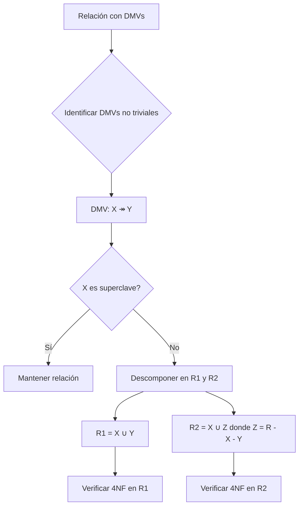
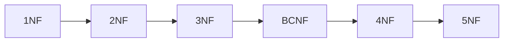

# Fundamentos de Bases de Datos - Diseño de bases de datos

## 5.3 Dependencias Multivaluadas.

---

Las dependencias multivaluadas (DMV) son una extensión de las dependencias funcionales que permiten expresar restricciones más complejas en los datos. Surgen naturalmente cuando existen atributos independientes que pueden tener múltiples valores asociados para una misma combinación de otros atributos.

### Definición Formal

Una dependencia multivaluada $X \twoheadrightarrow Y$ definida en un esquema de relación $R$ especifica que para cada par de tuplas $t_1$ y $t_2$ en $R$ que coinciden en los valores de $X$, existen dos tuplas $t_3$ y $t_4$ tales que:

1. $t_3[X] = t_4[X] = t_1[X] = t_2[X]$
2. $t_3[Y] = t_1[Y]$ y $t_3[R - XY] = t_2[R - XY]$
3. $t_4[Y] = t_2[Y]$ y $t_4[R - XY] = t_1[R - XY]$

$$ X \twoheadrightarrow Y \iff \forall t_1, t_2 \in R: t_1[X] = t_2[X] \Rightarrow $$
$$ \exists t_3, t_4 \in R: t_3[X] = t_4[X] = t_1[X] \land $$
$$ t_3[Y] = t_1[Y] \land t_3[R-XY] = t_2[R-XY] \land $$
$$ t_4[Y] = t_2[Y] \land t_4[R-XY] = t_1[R-XY] $$

### Reglas de Inferencia para DMVs

#### Axiomas Fundamentales

1. **Complementación**: $X \twoheadrightarrow Y \Rightarrow X \twoheadrightarrow (R - X - Y)$
2. **Aumentación**: $X \twoheadrightarrow Y \land V \subseteq W \Rightarrow WX \twoheadrightarrow VY$
3. **Transitividad**: $X \twoheadrightarrow Y \land Y \twoheadrightarrow Z \Rightarrow X \twoheadrightarrow (Z - Y)$

#### Reglas Adicionales

4. **Replicación**: $X \rightarrow Y \Rightarrow X \twoheadrightarrow Y$
5. **Coalescencia**: $X \twoheadrightarrow Y \land Z \subseteq Y \land W \cap Y = \emptyset \land W \rightarrow Z \Rightarrow X \rightarrow Z$

### Cuarta Forma Normal (4NF)

#### Definición

Un esquema de relación $R$ está en Cuarta Forma Normal con respecto a un conjunto de dependencias $D$ (que incluye DFs y DMVs) si para toda dependencia multivaluada no trivial $X \twoheadrightarrow Y$ en $D^+$, $X$ es una superclave de $R$.

$$R \text{ está en 4NF} \iff \forall X \twoheadrightarrow Y \text{ no trivial en } D^+, X \text{ es superclave}$$

#### Dependencia Multivaluada No Trivial

Una DMV $X \twoheadrightarrow Y$ es no trivial si:

1. $Y \nsubseteq X$
2. $X \cup Y \neq R$

### Ejemplo Clásico de DMV

Consideremos una relación que almacena información sobre cursos, profesores y libros de texto:

**Cursos_Profesores_Libros**

| Curso | Profesor | LibroTexto |
| ----- | -------- | ---------- |
| BD1   | Pérez    | libro1     |
| BD1   | Pérez    | libro2     |
| BD1   | Gómez    | libro1     |
| BD1   | Gómez    | libro2     |
| BD2   | López    | libro3     |

En este caso, existe la dependencia multivaluada:

$$ \text{Curso} \twoheadrightarrow \text{Profesor} \ \text{Curso} \twoheadrightarrow \text{LibroTexto} $$

```sql
-- Tabla que muestra el problema de las DMVs
CREATE TABLE CursosProfesoresLibros (
    Curso VARCHAR(50),
    Profesor VARCHAR(50),
    LibroTexto VARCHAR(100),
    PRIMARY KEY (Curso, Profesor, LibroTexto)
);
```

### Normalización a 4NF

Para normalizar a 4NF, descomponemos la relación en dos relaciones que capturen cada una de las DMVs:

```sql
-- Descomposición en 4NF
CREATE TABLE CursosProfesores (
    Curso VARCHAR(50),
    Profesor VARCHAR(50),
    PRIMARY KEY (Curso, Profesor)
);

CREATE TABLE CursosLibros (
    Curso VARCHAR(50),
    LibroTexto VARCHAR(100),
    PRIMARY KEY (Curso, LibroTexto)
);
```

### Diagrama de Descomposición a 4NF



### Algoritmo de Descomposición a 4NF

```
Entrada: Esquema de relación R, conjunto de DFs y DMVs D
Salida: Descomposición de R en 4NF

resultado = {R}
repetir
    para cada relación Ri en resultado que no esté en 4NF hacer
        sea X ↠ Y una DMV no trivial que viola 4NF en Ri
        reemplazar Ri por:
            R1 = XY
            R2 = X(Ri - Y)
hasta que todas las relaciones estén en 4NF
```

### Diferencia entre DFs y DMVs

| Característica | Dependencia Funcional | Dependencia Multivaluada |
|----------------|----------------------|--------------------------|
| Notación | $X \rightarrow Y$ | $X \twoheadrightarrow Y$ |
| Restricción | Un valor de X determina un único valor de Y | Un valor de X determina un conjunto de valores de Y |
| Normalización | Hasta BCNF | Hasta 4NF |
| Trivialidad | $Y \subseteq X$ | $Y \subseteq X$ o $X \cup Y = R$ |

### Ejemplo Práctico: Sistema de Empleados

Supongamos una relación que almacena empleados, sus habilidades y los idiomas que hablan:

**Empleados_Habilidades_Idiomas**
| Empleado | Habilidad | Idioma |
|----------|-----------|--------|
| Juan     | Programar | Español |
| Juan     | Programar | Inglés |
| Juan     | Diseñar   | Español |
| Juan     | Diseñar   | Inglés |
| María    | Analizar  | Francés |

Aquí existe la DMV: $$ \text{Empleado} \twoheadrightarrow \text{Habilidad} \\ \text{Empleado} \twoheadrightarrow \text{Idioma} $$

```sql
-- Descomposición en 4NF
CREATE TABLE EmpleadosHabilidades (
    Empleado VARCHAR(50),
    Habilidad VARCHAR(50),
    PRIMARY KEY (Empleado, Habilidad)
);

CREATE TABLE EmpleadosIdiomas (
    Empleado VARCHAR(50),
    Idioma VARCHAR(50),
    PRIMARY KEY (Empleado, Idioma)
);
```

### Ejercicios Propuestos

#### Ejercicio 1
Dada la relación R(A, B, C, D) con las siguientes tuplas:
- (a1, b1, c1, d1)
- (a1, b1, c2, d2)
- (a1, b2, c1, d2)
- (a1, b2, c2, d1)

Verifique si existen las siguientes DMVs:
1. $A \twoheadrightarrow B$
2. $A \twoheadrightarrow C$
3. $B \twoheadrightarrow D$

#### Ejercicio 2
Para una relación Hospital(Doctor, Paciente, Enfermedad) donde:
- Cada doctor trata múltiples pacientes
- Cada paciente tiene múltiples enfermedades
- Cada doctor trata todas las enfermedades de sus pacientes

Identifique:
1. Las DMVs presentes
2. Si la relación está en 4NF
3. La descomposición apropiada si es necesario

#### Ejercicio 3
Dada la relación R(A, B, C, D) y el conjunto de dependencias:
- $A \twoheadrightarrow B$
- $B \twoheadrightarrow C$

Encuentre:
1. La clausura de dependencias
2. Una descomposición lossless-join en 4NF

### Teorema de Descomposición para DMVs

Si tenemos una DMV $X \twoheadrightarrow Y$ en una relación $R$, la descomposición en $R_1 = XY$ y $R_2 = X(R - Y)$ tiene las siguientes propiedades:

1. **Pérdida de unión (lossless-join)**: $R_1 \bowtie R_2 = R$
2. **Conservación de dependencias**: Las DMVs originales se mantienen

### Implementación de Restricciones para DMVs

```sql
-- Aunque SQL no soporta DMVs directamente, podemos implementar restricciones
CREATE TABLE EmpleadosHabilidadesIdiomas (
    Empleado VARCHAR(50),
    Habilidad VARCHAR(50),
    Idioma VARCHAR(50),
    PRIMARY KEY (Empleado, Habilidad, Idioma)
);

-- Trigger para verificar la DMV: Empleado ↠ Habilidad
CREATE OR REPLACE FUNCTION check_dmv_empleado_habilidad()
RETURNS TRIGGER AS $$
BEGIN
    IF EXISTS (
        -- Verificar que para cada empleado, todos los idiomas aparecen con todas las habilidades
        SELECT 1
        FROM (
            SELECT DISTINCT Empleado, Habilidad
            FROM EmpleadosHabilidadesIdiomas
            WHERE Empleado = NEW.Empleado
        ) H
        CROSS JOIN (
            SELECT DISTINCT Idioma
            FROM EmpleadosHabilidadesIdiomas
            WHERE Empleado = NEW.Empleado
        ) I
        WHERE NOT EXISTS (
            SELECT 1
            FROM EmpleadosHabilidadesIdiomas
            WHERE Empleado = H.Empleado
            AND Habilidad = H.Habilidad
            AND Idioma = I.Idioma
        )
    ) THEN
        RAISE EXCEPTION 'Violación de dependencia multivaluada: Empleado ↠ Habilidad';
    END IF;
    RETURN NEW;
END;
$$ LANGUAGE plpgsql;

CREATE TRIGGER trg_check_dmv
AFTER INSERT OR UPDATE ON EmpleadosHabilidadesIdiomas
FOR EACH ROW EXECUTE FUNCTION check_dmv_empleado_habilidad();
```

### Relación entre 4NF y Otras Formas Normales



### Referencias

1. Elmasri and Navathe. Fundamentals of Database Systems. Capítulo 11: Relational Database Design Algorithms and Further Dependencies.
2. Silberschatz A., Kort H. y Sudarshan S. Fundamentos de BD. Capítulo 7: Relational Database Design.
3. Ullman J.D. and Widom J. A First Course in Data Base System. Capítulo 3: Design Theory for Relational Databases.
4. Harrington J. Relational Database Design and Implementation. Capítulo 7: Advanced Normalization.

### Conclusión

Las dependencias multivaluadas representan una restricción importante en el diseño de bases de datos que no puede ser capturada por las dependencias funcionales. La Cuarta Forma Normal (4NF) asegura que estas dependencias sean apropiadamente manejadas mediante la descomposición de relaciones. El entendimiento de las DMVs es esencial para diseñar esquemas de bases de datos que eviten redundancias y anomalías en casos donde existen relaciones independientes de muchos-a-muchos dentro de una misma entidad.
