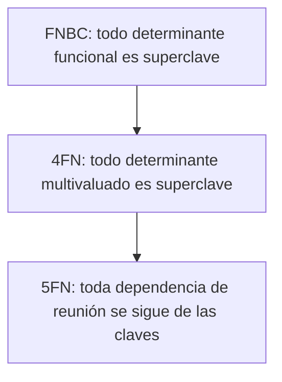

# Fundamentos de Bases de Datos - Diseño de bases de datos

## 5.4 Cuarta forma normal (4NF).

---

La **cuarta forma normal**, definida por Fagin en 1977, extiende la forma normal de Boyce-Codd a las dependencias multivaluadas del tema 5.3: exige que toda dependencia multivaluada no trivial tenga como lado izquierdo una superclave. Una relación en 4FN no guarda productos cartesianos de hechos independientes. Este tema da la definición, el algoritmo de descomposición, sus propiedades y su lugar entre las demás formas normales, con ejemplos de cursos, empleados y tratamientos médicos.

### Definición

Sea $R$ con un conjunto $D$ de dependencias funcionales y multivaluadas. $R$ está en **4FN** si para toda dependencia multivaluada $X \twoheadrightarrow Y$ de $D^+$ se cumple al menos una de dos condiciones:

1. $X \twoheadrightarrow Y$ es trivial, es decir, $Y \subseteq X$ o $X \cup Y = R;$ o
2. $X$ es superclave de $R.$

Como toda dependencia funcional es multivaluada, una relación en 4FN está en FNBC: si $X \to A$ viola FNBC, entonces $X \twoheadrightarrow A$ viola 4FN. Cuando solo hay dependencias funcionales, ambas formas coinciden.

### Un ejemplo

Un curso tiene varios profesores y usa varios libros de texto, y cualquier profesor del curso puede usar cualquiera de sus libros. En `Curso(curso, profesor, libro)` se cumple

$$\text{curso} \twoheadrightarrow \text{profesor} \mid \text{libro}.$$

No hay dependencias funcionales: la clave es $(\text{curso}, \text{profesor}, \text{libro}),$ y la relación está en FNBC. Pero `curso` no es superclave, así que viola la 4FN. Con 3 profesores y 4 libros, el curso ocupa 12 tuplas, y agregar un libro exige 3 tuplas nuevas, una por profesor; si se inserta solo una, la relación queda inconsistente. La descomposición en `Imparte(curso, profesor)` y `Usa(curso, libro)` guarda 7 filas y agregar un libro es agregar una.

### Algoritmo de descomposición

1. Empezar con $\{R\}.$
2. Mientras alguna parte $S$ tenga una dependencia multivaluada no trivial $X \twoheadrightarrow Y$ que se cumpla en $S$ con $X$ que no es superclave de $S,$ reemplazar $S$ por $S_1 = X \cup Y$ y $S_2 = S - (Y - X).$

Cada paso es **sin pérdida**, por el teorema de Fagin: $X \twoheadrightarrow Y$ se cumple en $S$ si y solo si $S = \pi_{XY}(S) \bowtie \pi_{X(S-Y)}(S).$ Como cada paso reduce el número de atributos de las partes, el algoritmo termina.

La dificultad está en saber qué dependencias se cumplen en cada parte. Para las multivaluadas, si $X \subseteq S$ y $X \twoheadrightarrow Y$ se cumple en $R,$ en $\pi_S(R)$ se cumple $X \twoheadrightarrow Y \cap S.$ Pero puede haber otras, derivadas, que hay que obtener con las reglas de inferencia: aplicar el algoritmo solo con las dependencias dadas puede detenerse antes de llegar a 4FN. El cálculo exacto usa la **base de dependencias** de cada conjunto de atributos, un análogo del cierre del tema 5.1.

### Propiedades

- **Sin pérdida:** siempre, por construcción.
- **Preservación de dependencias:** no siempre, igual que con FNBC. Una dependencia multivaluada que involucra atributos que quedan en partes distintas no se puede verificar en una sola tabla.
- **Redundancia:** en una relación en 4FN no hay redundancia causada por dependencias funcionales ni multivaluadas.



Más allá de la 4FN está la **quinta forma normal**, o de proyección-reunión, que trata las **dependencias de reunión**: restricciones que dicen que una relación es la reunión de tres o más de sus proyecciones, sin serlo de ninguna pareja. Aparecen en reglas cíclicas, como "si un agente vende un tipo de producto y representa a una empresa que lo fabrica, entonces vende ese producto de esa empresa". Son raras en la práctica.

### Cuándo aplicarla

La 4FN se necesita cuando una entidad tiene **dos o más atributos multivaluados independientes** y se guardaron en la misma tabla. Si el diseño parte de un diagrama E/R bien hecho, en el que cada atributo multivaluado y cada relación M:N tienen su propia tabla (tema 4.2), las violaciones de 4FN no aparecen. No hay que descomponer si los hechos **no** son independientes: si cada profesor usa solo algunos libros, la relación ternaria `Curso(curso, profesor, libro)` es un hecho propio, no una redundancia, y separarla perdería información.

### Implementación en Python

El programa implementa la prueba de dependencias multivaluadas en una instancia, la reunión natural de las proyecciones de una instancia y el algoritmo de descomposición en 4FN con la regla de proyección. Para el ejercicio 1 muestra que la descomposición por una dependencia que no se cumple agrega tuplas falsas. Para el ejercicio 3 descompone con las dependencias dadas más una derivada, y verifica la descomposición en una instancia generada que cumple las dependencias. Para el ejercicio 2 construye `Tratamientos` a partir de quién atiende a quién, qué padece cada paciente y qué se receta para cada enfermedad; prueba las dependencias, descompone, comprueba en SQLite que la reunión de las tres tablas reconstruye la relación, y compara tamaños y anomalías.

```python
import sqlite3

def dmv(r, atr, X, Y):                    # ¿se cumple X ->> Y en la instancia r (lista de tuplas sobre atr)?
    i = {a: k for k, a in enumerate(atr)}
    filas = set(r)
    for t1 in r:
        for t2 in r:
            if all(t1[i[a]] == t2[i[a]] for a in X):
                if tuple(t1[i[a]] if a in X or a in Y else t2[i[a]] for a in atr) not in filas:
                    return False
    return True

def fmt(X): return "".join(sorted(X)) if all(len(a) == 1 for a in X) else "{" + ", ".join(sorted(X)) + "}"

def descompone_4fn(R, deps, claves):
    """deps: dependencias multivaluadas (X, Y) declaradas sobre R. En una parte S con X ⊆ S se cumple X ->> Y ∩ S
    (regla de proyección). Se separa S en X ∪ (Y ∩ S) y S − (Y ∩ S) mientras haya una no trivial con X no superclave."""
    pasos, pendientes, final = [], [frozenset(R)], []
    while pendientes:
        S = pendientes.pop(0)
        mala = None
        for X, Y in deps:
            X, Yc = frozenset(X), (frozenset(Y) & S) - frozenset(X)
            for Yv in (Yc, S - X - Yc):                                     # la dependencia y su complemento
                if X <= S and Yv and X | Yv != S and not any(k <= X for k in claves):
                    mala = (X, Yv); break
            if mala: break
        if mala is None:
            final.append(S); continue
        X, Y = mala
        partes = [X | Y, S - Y]
        pasos.append(f"{fmt(S)}: {fmt(X)} ->> {fmt(Y)} separa en {fmt(partes[0])} y {fmt(partes[1])}")
        pendientes += partes
    return final, pasos

def reune(partes, r, atr):                # reunión natural de las proyecciones de r
    i = {a: k for k, a in enumerate(atr)}
    res = [dict()]
    for p in partes:
        proy = {tuple((a, t[i[a]]) for a in sorted(p)) for t in r}
        res = [{**d, **dict(q)} for d in res for q in proy if all(d.get(a, v) == v for a, v in q)]
    return {tuple(d[a] for a in atr) for d in res}

# --- Ejercicio 1 ---
atr = "ABCD"
r1 = [("a1", "b1", "c1", "d1"), ("a1", "b1", "c2", "d2"), ("a1", "b2", "c1", "d2"), ("a1", "b2", "c2", "d1")]
print("ejercicio 1:", {f"{x} ->> {y}": dmv(r1, atr, x, y) for x, y in (("A", "B"), ("A", "C"), ("B", "D"))})
print("   la descomposición AB, ACD reconstruye la instancia:", reune(["AB", "ACD"], r1, atr) == set(r1),
      "| tuplas de la reunión:", len(reune(["AB", "ACD"], r1, atr)))

# --- Ejercicio 3: A ->> B, B ->> C sobre ABCD ---
# A ->> C no está dada: se deriva por transitividad (tema 5.3) y hay que incluirla
partes, pasos = descompone_4fn("ABCD", [("A", "B"), ("B", "C"), ("A", "C")], claves=[frozenset("ABCD")])
print("ejercicio 3:", "; ".join(pasos), "=>", sorted("".join(sorted(p)) for p in partes))
def genera(semilla, deps, atr):            # instancia que cumple las dependencias: agrega las tuplas que faltan
    r = set(semilla)
    while True:
        i = {a: k for k, a in enumerate(atr)}
        nuevas = {tuple(t1[i[a]] if a in X or a in Y else t2[i[a]] for a in atr)
                  for X, Y in deps for t1 in r for t2 in r if all(t1[i[a]] == t2[i[a]] for a in X)} - r
        if not nuevas: return sorted(r)
        r |= nuevas
r3 = genera([("a1", "b1", "c1", "d1"), ("a1", "b2", "c2", "d2"), ("a2", "b1", "c3", "d3")], [("A", "B"), ("B", "C")], atr)
print("   en una instancia de", len(r3), "tuplas que cumple las dependencias, AB ⋈ AC ⋈ AD la reconstruye:",
      reune(partes, r3, atr) == set(r3), "| tuplas almacenadas:", sum(len({tuple(t["ABCD".index(a)] for a in sorted(p)) for t in r3}) for p in partes))

# --- Ejercicio 2: Tratamientos(doctor, paciente, enfermedad, medicamento) ---
A2 = ("doctor", "paciente", "enfermedad", "medicamento")
atiende = {"Sofía": ["Dra. Ríos", "Dr. Lara"], "Tomás": ["Dra. Ríos"]}
padece = {"Sofía": ["asma", "gastritis"], "Tomás": ["asma"]}
receta = {"asma": ["salbutamol", "budesonida"], "gastritis": ["omeprazol"]}
trat = [(d, p, e, m) for p in atiende for d in atiende[p] for e in padece[p] for m in receta[e]]
print("ejercicio 2:", len(trat), "tuplas en Tratamientos")
for X, Y in ((["paciente"], ["doctor"]), (["paciente"], ["enfermedad", "medicamento"]), (["enfermedad"], ["medicamento"]),
             (["paciente"], ["enfermedad"]), (["doctor"], ["paciente"])):
    print(f"   {', '.join(X)} ->> {', '.join(Y)}:", dmv(trat, A2, X, Y))
deps2 = [(["paciente"], ["doctor"]), (["enfermedad"], ["medicamento"])]
partes2, pasos2 = descompone_4fn(A2, deps2, claves=[frozenset(A2)])
for p in pasos2: print("  ", p)
print("   partes en 4FN:", sorted(fmt(p) for p in partes2))
db = sqlite3.connect(":memory:")
db.executescript("""CREATE TABLE atiende (paciente, doctor); CREATE TABLE padece (paciente, enfermedad);
                    CREATE TABLE receta (enfermedad, medicamento);""")
db.executemany("INSERT INTO atiende VALUES (?, ?)", sorted({(p, d) for d, p, e, m in trat}))
db.executemany("INSERT INTO padece VALUES (?, ?)", sorted({(p, e) for d, p, e, m in trat}))
db.executemany("INSERT INTO receta VALUES (?, ?)", sorted({(e, m) for d, p, e, m in trat}))
vista = set(db.execute("""SELECT a.doctor, a.paciente, p.enfermedad, r.medicamento
                          FROM atiende a JOIN padece p USING (paciente) JOIN receta r USING (enfermedad)""").fetchall())
print("   en SQL, la reunión de las tres tablas da Tratamientos:", vista == set(trat),
      "| filas:", len(trat), "antes,", sum(db.execute(f"SELECT COUNT(*) FROM {t}").fetchone()[0] for t in ("atiende", "padece", "receta")), "después")
# si un medicamento se receta para el asma, Tratamientos necesita una tupla por cada paciente con asma y cada doctor suyo
receta["asma"].append("montelukast")
trat2 = [(d, p, e, m) for p in atiende for d in atiende[p] for e in padece[p] for m in receta[e]]
print("   agregar montelukast para el asma: tuplas nuevas en Tratamientos", len(trat2) - len(trat), "| filas nuevas en receta 1")
# con más datos, la diferencia crece: 50 pacientes con 2 doctores y 3 enfermedades, 4 medicamentos por enfermedad
P, D, E, M = 50, 2, 3, 4
print(f"   {P} pacientes, {D} doctores y {E} enfermedades cada uno, {M} medicamentos por enfermedad (de 10):",
      "Tratamientos", P * D * E * M, "tuplas | descompuesta", P * D + P * E + 10 * M, "filas")
```

Salida:

```text
ejercicio 1: {'A ->> B': False, 'A ->> C': False, 'B ->> D': False}
   la descomposición AB, ACD reconstruye la instancia: False | tuplas de la reunión: 8
ejercicio 3: ABCD: A ->> B separa en AB y ACD; ACD: A ->> C separa en AC y AD => ['AB', 'AC', 'AD']
   en una instancia de 15 tuplas que cumple las dependencias, AB ⋈ AC ⋈ AD la reconstruye: True | tuplas almacenadas: 12
ejercicio 2: 8 tuplas en Tratamientos
   paciente ->> doctor: True
   paciente ->> enfermedad, medicamento: True
   enfermedad ->> medicamento: True
   paciente ->> enfermedad: False
   doctor ->> paciente: False
   {doctor, enfermedad, medicamento, paciente}: {paciente} ->> {doctor} separa en {doctor, paciente} y {enfermedad, medicamento, paciente}
   {enfermedad, medicamento, paciente}: {enfermedad} ->> {medicamento} separa en {enfermedad, medicamento} y {enfermedad, paciente}
   partes en 4FN: ['{doctor, paciente}', '{enfermedad, medicamento}', '{enfermedad, paciente}']
   en SQL, la reunión de las tres tablas da Tratamientos: True | filas: 8 antes, 9 después
   agregar montelukast para el asma: tuplas nuevas en Tratamientos 3 | filas nuevas en receta 1
   50 pacientes, 2 doctores y 3 enfermedades cada uno, 4 medicamentos por enfermedad (de 10): Tratamientos 1200 tuplas | descompuesta 290 filas
```

### Ejercicios Propuestos

1. **Verificación.** En $R(A, B, C, D)$ con las tuplas $(a_1, b_1, c_1, d_1),$ $(a_1, b_1, c_2, d_2),$ $(a_1, b_2, c_1, d_2)$ y $(a_1, b_2, c_2, d_1),$ determina si se cumplen $A \twoheadrightarrow B,$ $A \twoheadrightarrow C$ y $B \twoheadrightarrow D,$ y qué implica para una descomposición.

2. **Tratamientos.** En `Tratamientos(doctor, paciente, enfermedad, medicamento)`, cada doctor trata a varios pacientes, cada paciente tiene varias enfermedades, para cada enfermedad se pueden recetar varios medicamentos y estos hechos son independientes. Identifica las dependencias multivaluadas, decide si la relación está en 4FN y propón una descomposición.

3. **Descomposición.** En $R(A, B, C, D)$ con $A \twoheadrightarrow B$ y $B \twoheadrightarrow C,$ encuentra la clausura de las dependencias y una descomposición sin pérdida en 4FN.

### Soluciones

**Ejercicio 1.** Ninguna de las tres se cumple (tema 5.3): $D$ depende funcionalmente de $B$ y $C$ juntos, así que los valores de $B$ no son independientes de los de $CD$ para $a_1.$ La consecuencia para el diseño es que la descomposición en $(A, B)$ y $(A, C, D)$ **tiene pérdida**: el programa muestra que la reunión de las proyecciones da 8 tuplas, las 4 originales más 4 falsas, como $(a_1, b_1, c_1, d_2).$ La reunión no pierde tuplas, sino información: ya no se sabe cuáles combinaciones eran verdaderas. Con la dependencia $BC \to D,$ la descomposición correcta en FNBC sería $(B, C, D)$ y $(A, B, C),$ si es una dependencia del esquema y no una coincidencia de estos datos.

**Ejercicio 2.** Para cada paciente, sus doctores son independientes de sus enfermedades y de lo que se le receta:

$$\text{paciente} \twoheadrightarrow \text{doctor} \mid \text{enfermedad}, \text{medicamento}.$$

Y si lo que se receta depende solo de la enfermedad, no del paciente,

$$\text{enfermedad} \twoheadrightarrow \text{medicamento} \mid \text{doctor}, \text{paciente}.$$

No hay dependencias funcionales, la clave son los cuatro atributos y ninguno de los lados izquierdos es superclave: la relación no está en 4FN. La primera dependencia separa `Atiende(paciente, doctor)` y `(paciente, enfermedad, medicamento)`; en esta, la segunda separa `Receta(enfermedad, medicamento)` y `Padece(paciente, enfermedad)`. En cambio, $\text{paciente} \twoheadrightarrow \text{enfermedad}$ sola no se cumple, porque el medicamento va ligado a la enfermedad; el programa lo comprueba. En los datos de ejemplo, la relación tiene 8 tuplas y las tres tablas 9 filas, porque con tan pocos datos el producto cartesiano es pequeño; con 50 pacientes la relación tendría 1200 tuplas contra 290 filas. Lo decisivo es la anomalía: recetar un medicamento nuevo para el asma requiere 3 tuplas nuevas en `Tratamientos`, una por cada par de paciente con asma y doctor suyo, y una sola fila en `Receta`. Si en realidad cada paciente recibe medicamentos distintos para la misma enfermedad, la segunda dependencia no se cumple y la tabla correcta es `Prescripcion(paciente, enfermedad, medicamento)`.

**Ejercicio 3.** Las dependencias derivadas, del tema 5.3, son $A \twoheadrightarrow CD,$ $B \twoheadrightarrow AD,$ $A \twoheadrightarrow C,$ $A \twoheadrightarrow BC$ y $A \twoheadrightarrow D,$ además de las triviales; no hay dependencias funcionales, así que la clave es $ABCD.$ El algoritmo separa con $A \twoheadrightarrow B$ en $(A, B)$ y $(A, C, D),$ y en la segunda parte, con $A \twoheadrightarrow C,$ en $(A, C)$ y $(A, D).$ Si se aplica solo con las dos dependencias dadas, se detiene en $(A, C, D),$ porque $B \twoheadrightarrow C$ no cabe en ella; por eso hay que incluir la derivada. El resultado, $(A, B),$ $(A, C)$ y $(A, D),$ está en 4FN porque cada parte tiene dos atributos y toda dependencia sobre dos atributos es trivial. Es sin pérdida, como verifica el programa en una instancia de 15 tuplas que cumple las dependencias, guardadas en 12 filas. No preserva $B \twoheadrightarrow C.$

### Referencias

1. Fagin, R., Multivalued dependencies and a new normal form for relational databases. _ACM Transactions on Database Systems_ 2(3), 1977.
2. Fagin, R., Normal forms and relational database operators. _Proceedings of ACM SIGMOD_, 1979.
3. Elmasri, R., and Navathe, S. B., _Fundamentals of Database Systems_. Pearson, 2016. Capítulo 14.
4. Silberschatz, A., Korth, H. F., and Sudarshan, S., _Database System Concepts_. McGraw-Hill, 2019. Capítulo 7.
5. Kent, W., A simple guide to five normal forms in relational database theory. _Communications of the ACM_ 26(2), 1983.
