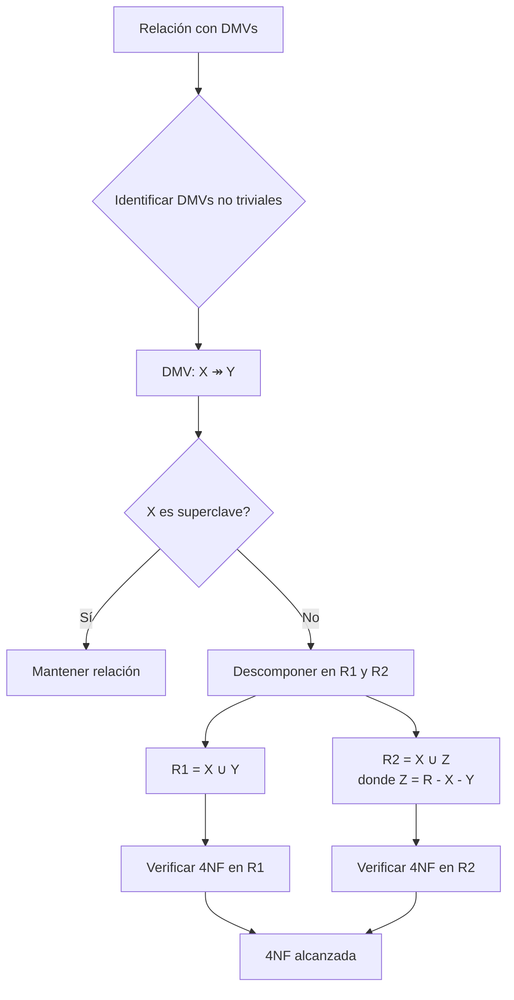
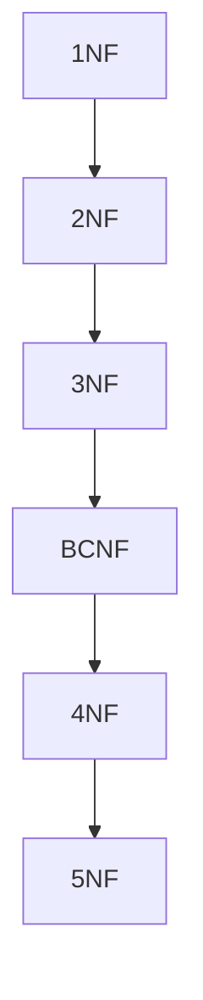

# Fundamentos de Bases de Datos - Diseño de bases de datos

## 5.4 Cuarta forma normal (4NF).

---

La Cuarta Forma Normal (4NF) es una etapa avanzada en el proceso de normalización que aborda problemas de dependencias multivaluadas que no son capturadas por las formas normales anteriores. Surge cuando existen relaciones independientes de muchos-a-muchos dentro de una misma entidad.

### Definición Formal

Un esquema de relación $R$ está en Cuarta Forma Normal con respecto a un conjunto de dependencias $D$ (que incluye dependencias funcionales y multivaluadas) si para toda dependencia multivaluada no trivial $X \twoheadrightarrow Y$ en $D^+$, $X$ es una superclave de $R$.

$$R \text{ está en 4NF} \iff \forall X \twoheadrightarrow Y \text{ no trivial en } D^+, X \text{ es superclave}$$

#### Dependencia Multivaluada No Trivial

Una DMV $X \twoheadrightarrow Y$ es no trivial si:

1. $Y \nsubseteq X$
2. $X \cup Y \neq R$

### Dependencias Multivaluadas (DMVs)

#### Definición

Una dependencia multivaluada $X \twoheadrightarrow Y$ especifica que para cada valor de $X$, existe un conjunto de valores de $Y$ que es independiente de los valores de $R - X - Y$.

$$ X \twoheadrightarrow Y \iff \forall t_1, t_2 \in R: t_1[X] = t_2[X] \Rightarrow $$
$$ \exists t_3, t_4 \in R: t_3[X] = t_4[X] = t_1[X] \land $$
$$ t_3[Y] = t_1[Y] \land t_3[R-XY] = t_2[R-XY] \land $$
$$ t_4[Y] = t_2[Y] \land t_4[R-XY] = t_1[R-XY] $$

### Ejemplo Clásico de Violación de 4NF

#### Escenario: Cursos, Profesores y Libros de Texto

**Tabla NO normalizada (viola 4NF):**

```sql
CREATE TABLE CursosProfesoresLibros (
    Curso VARCHAR(50),
    Profesor VARCHAR(50),
    LibroTexto VARCHAR(100),
    PRIMARY KEY (Curso, Profesor, LibroTexto)
);
```

| Curso | Profesor | LibroTexto |
| ----- | -------- | ---------- |
| BD1   | Pérez    | libro1     |
| BD1   | Pérez    | libro2     |
| BD1   | Gómez    | libro1     |
| BD1   | Gómez    | libro2     |
| BD2   | López    | libro3     |

**Problema:** Existen dos DMVs no triviales:

- $\text{Curso} \twoheadrightarrow \text{Profesor}$
- $\text{Curso} \twoheadrightarrow \text{LibroTexto}$

**Consecuencia:** Redundancia de datos y posibles anomalías de actualización.

### Normalización a 4NF

#### Algoritmo de Descomposición

```
Entrada: Esquema de relación R, conjunto de DFs y DMVs D
Salida: Descomposición de R en 4NF

resultado = {R}
repetir
    para cada relación Ri en resultado que no esté en 4NF hacer
        sea X ↠ Y una DMV no trivial que viola 4NF en Ri
        reemplazar Ri por:
            R1 = XY
            R2 = X(Ri - Y)
hasta que todas las relaciones estén en 4NF
```

#### Aplicación al Ejemplo Anterior

```sql
-- Descomposición en 4NF
CREATE TABLE CursosProfesores (
    Curso VARCHAR(50),
    Profesor VARCHAR(50),
    PRIMARY KEY (Curso, Profesor)
);

CREATE TABLE CursosLibros (
    Curso VARCHAR(50),
    LibroTexto VARCHAR(100),
    PRIMARY KEY (Curso, LibroTexto)
);
```

**Resultado de la descomposición:**

**CursosProfesores:**

| Curso | Profesor |
| ----- | -------- |
| BD1   | Pérez    |
| BD1   | Gómez    |
| BD2   | López    |

**CursosLibros:**

| Curso | LibroTexto |
| ----- | ---------- |
| BD1   | libro1     |
| BD1   | libro2     |
| BD2   | libro3     |

### Diagrama de Proceso de Normalización a 4NF



### Propiedades de la Descomposición 4NF

#### 1. Propiedad de Pérdida de Unión (Lossless-Join)

La descomposición $R_1 = XY$ y $R_2 = X(R - Y)$ tiene la propiedad de pérdida de unión:

$$R_1 \bowtie R_2 = R$$

#### 2. Conservación de Dependencias

Las DMVs originales se conservan en la descomposición.

### Relación entre 4NF y Otras Formas Normales



**Jerarquía:**

- Toda relación en 4NF está automáticamente en BCNF
- Toda relación en BCNF está automáticamente en 3NF
- La 4NF aborda problemas que la BCNF no puede resolver

### Ejemplo Práctico: Sistema de Empleados

#### Escenario

Una empresa donde:

- Los empleados tienen múltiples habilidades
- Los empleados hablan múltiples idiomas
- Las habilidades y idiomas son independientes entre sí

**Tabla que viola 4NF:**

```sql
CREATE TABLE EmpleadosHabilidadesIdiomas (
    EmpleadoID INT,
    Nombre VARCHAR(50),
    Habilidad VARCHAR(50),
    Idioma VARCHAR(50),
    PRIMARY KEY (EmpleadoID, Habilidad, Idioma)
);
```

| EmpleadoID | Nombre | Habilidad | Idioma  |
| ---------- | ------ | --------- | ------- |
| 101        | Juan   | Programar | Español |
| 101        | Juan   | Programar | Inglés  |
| 101        | Juan   | Diseñar   | Español |
| 101        | Juan   | Diseñar   | Inglés  |
| 102        | María  | Analizar  | Francés |

**DMVs identificadas:**

- $\text{EmpleadoID} \twoheadrightarrow \text{Habilidad}$
- $\text{EmpleadoID} \twoheadrightarrow \text{Idioma}$

#### Normalización a 4NF

```sql
-- Tabla 1: Empleados e Habilidades
CREATE TABLE EmpleadosHabilidades (
    EmpleadoID INT,
    Habilidad VARCHAR(50),
    PRIMARY KEY (EmpleadoID, Habilidad)
);

-- Tabla 2: Empleados e Idiomas
CREATE TABLE EmpleadosIdiomas (
    EmpleadoID INT,
    Idioma VARCHAR(50),
    PRIMARY KEY (EmpleadoID, Idioma)
);

-- Tabla 3: Información básica de empleados
CREATE TABLE Empleados (
    EmpleadoID INT PRIMARY KEY,
    Nombre VARCHAR(50)
);
```

### Ejercicios Propuestos

#### Ejercicio 1

Dada la relación R(A, B, C, D) con las siguientes tuplas:

- (a1, b1, c1, d1)
- (a1, b1, c2, d2)
- (a1, b2, c1, d2)
- (a1, b2, c2, d1)

Determine si existen las siguientes DMVs:

1. $A \twoheadrightarrow B$
2. $A \twoheadrightarrow C$
3. $B \twoheadrightarrow D$

#### Ejercicio 2

Para un sistema hospitalario con la relación:
**Tratamientos**(DoctorID, PacienteID, Enfermedad, Medicamento)

Donde:

- Cada doctor trata múltiples pacientes
- Cada paciente tiene múltiples enfermedades
- Para cada enfermedad, se pueden prescribir múltiples medicamentos
- Las relaciones son independientes

Identifique:

1. Las DMVs presentes
2. Si la relación está en 4NF
3. Proponga una descomposición apropiada

#### Ejercicio 3

Dada la relación R(A, B, C, D) y el conjunto de dependencias:

- $A \twoheadrightarrow B$
- $B \twoheadrightarrow C$

Encuentre:

1. La clausura de dependencias
2. Una descomposición lossless-join en 4NF

### Implementación de Restricciones para 4NF

Aunque SQL no soporta DMVs directamente, podemos implementar restricciones mediante triggers:

```sql
-- Ejemplo de trigger para verificar DMV
CREATE OR REPLACE FUNCTION check_dmv_empleado_habilidad()
RETURNS TRIGGER AS $$
BEGIN
    IF EXISTS (
        SELECT 1
        FROM (
            SELECT DISTINCT EmpleadoID, Habilidad
            FROM EmpleadosHabilidadesIdiomas
            WHERE EmpleadoID = NEW.EmpleadoID
        ) H
        CROSS JOIN (
            SELECT DISTINCT Idioma
            FROM EmpleadosHabilidadesIdiomas
            WHERE EmpleadoID = NEW.EmpleadoID
        ) I
        WHERE NOT EXISTS (
            SELECT 1
            FROM EmpleadosHabilidadesIdiomas
            WHERE EmpleadoID = H.EmpleadoID
            AND Habilidad = H.Habilidad
            AND Idioma = I.Idioma
        )
    ) THEN
        RAISE EXCEPTION 'Violación de DMV: EmpleadoID ↠ Habilidad';
    END IF;
    RETURN NEW;
END;
$$ LANGUAGE plpgsql;

CREATE TRIGGER trg_check_dmv
AFTER INSERT OR UPDATE ON EmpleadosHabilidadesIdiomas
FOR EACH ROW EXECUTE FUNCTION check_dmv_empleado_habilidad();
```

### Ventajas de la 4NF

1. **Eliminación de redundancia**: Evita la repetición innecesaria de datos
2. **Prevención de anomalías**: Elimina anomalías de inserción, actualización y borrado
3. **Mejor organización**: Estructura más lógica de los datos
4. **Independencia de datos**: Las relaciones independientes se almacenan por separado

### Consideraciones Prácticas

#### Cuándo aplicar la 4NF

- Cuando existen relaciones independientes de muchos-a-muchos en una misma entidad
- Cuando se detectan redundancias que no se resuelven con BCNF
- En sistemas donde la integridad de datos es crítica

#### Cuándo no aplicar la 4NF

- En tablas muy pequeñas con datos volátiles
- Cuando el rendimiento de consultas se ve afectado negativamente
- En casos donde la desnormalización controlada ofrece beneficios

### Referencias

1. Elmasri and Navathe. Fundamentals of Database Systems. Capítulo 11: Relational Database Design Algorithms and Further Dependencies.
2. Silberschatz A., Kort H. y Sudarshan S. Fundamentos de BD. Capítulo 7: Relational Database Design.
3. Ullman J.D. and Widom J. A First Course in Data Base System. Capítulo 3: Design Theory for Relational Databases.
4. Harrington J. Relational Database Design and Implementation. Capítulo 7: Advanced Normalization.

### Conclusión

La Cuarta Forma Normal (4NF) es una etapa crucial en el diseño de bases de datos que aborda problemas de dependencias multivaluadas no capturadas por las formas normales anteriores. Al garantizar que todos los determinantes de DMVs sean superclaves, la 4NF elimina redundancias y anomalías en casos donde existen relaciones independientes de muchos-a-muchos dentro de una misma entidad. Si bien su aplicación puede resultar en un mayor número de tablas, los beneficios en términos de integridad y consistencia de datos justifican su uso en sistemas donde la calidad de los datos es fundamental.
