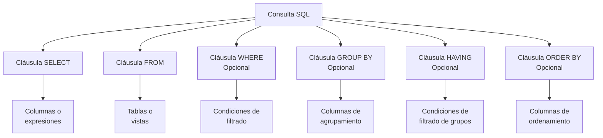

# Fundamentos de Bases de Datos - Lenguaje de consulta SQL

## 6.1 Estructura.

---

SQL (Structured Query Language) es el lenguaje estándar para gestionar y manipular bases de datos relacionales. Su estructura se compone de varios elementos sintácticos que permiten definir, consultar y manipular datos de manera eficiente.

### Definición y Componentes Básicos

SQL es un lenguaje declarativo que permite interactuar con sistemas de gestión de bases de datos relacionales (RDBMS). Su estructura fundamental incluye:

- **Cláusulas**: Componentes principales de las sentencias SQL
- **Expresiones**: Producen valores escalares o tablas
- **Predicados**: Especifican condiciones que evalúan a valores booleanos
- **Consultas**: Recuperan datos basados en criterios específicos
- **Sentencias**: Tienen efectos persistentes en esquemas y datos

### Estructura Básica de una Consulta SELECT

La sentencia SELECT sigue una estructura específica:

```sql
SELECT [DISTINCT | ALL] lista_columnas | *
FROM lista_tablas
[WHERE condición]
[GROUP BY lista_columnas]
[HAVING condición]
[ORDER BY lista_columnas [ASC | DESC]];
```

#### Componentes Sintácticos

##### 1. Cláusula SELECT

Especifica las columnas a recuperar. Puede incluir:

- Nombres de columnas
- Expresiones
- Funciones agregadas
- Constantes

##### 2. Cláusula FROM

Identifica las tablas de donde se extraen los datos.

##### 3. Cláusula WHERE

Filtra las filas basándose en condiciones especificadas.

##### 4. Cláusulas GROUP BY y HAVING

Agrupan filas y filtran grupos respectivamente.

##### 5. Cláusula ORDER BY

Ordena el resultado de la consulta.

### Expresiones y Operadores

#### Expresiones Aritméticas

Las operaciones aritméticas básicas se pueden realizar en consultas:

```sql
SELECT precio, cantidad, precio * cantidad AS total
FROM ventas;
```

#### Operadores de Comparación

- Igualdad: `=`
- Desigualdad: `<>` o `!=`
- Mayor que: `>`
- Menor que: `<`
- Mayor o igual: `>=`
- Menor o igual: `<=`

#### Operadores Lógicos

- AND: Conjunción lógica
- OR: Disyunción lógica
- NOT: Negación lógica

### Funciones en SQL

#### Funciones Agregadas

Realizan cálculos sobre conjuntos de valores:

- `COUNT()`: Cuenta el número de filas
- `SUM()`: Suma de valores
- `AVG()`: Promedio de valores
- `MAX()`: Valor máximo
- `MIN()`: Valor mínimo

La sintaxis general es:

$$ \text{FUNCION}([\text{DISTINCT} | \text{ALL}] \text{expresión}) $$

#### Funciones Escalares

Operan sobre valores individuales:

- `UPPER()`, `LOWER()`: Conversión de mayúsculas/minúsculas
- `SUBSTRING()`: Extrae parte de una cadena
- `ROUND()`: Redondea valores numéricos

### Ejemplos Prácticos

#### Ejemplo 1: Consulta Básica

```sql
SELECT empleado_id, nombre, apellido, salario
FROM empleados
WHERE departamento = 'Ventas'
ORDER BY salario DESC;
```

#### Ejemplo 2: Uso de Funciones Agregadas

```sql
SELECT departamento,
       COUNT(*) AS num_empleados,
       AVG(salario) AS salario_promedio,
       MAX(salario) AS salario_maximo
FROM empleados
GROUP BY departamento
HAVING AVG(salario) > 50000;
```

#### Ejemplo 3: Consulta con Múltiples Tablas

```sql
SELECT e.nombre, e.apellido, d.nombre_departamento
FROM empleados e
JOIN departamentos d ON e.departamento_id = d.departamento_id
WHERE d.ubicacion = 'Madrid';
```

### Diagrama de Sintaxis SQL Básica



### Ejercicios Propuestos

#### Ejercicio 1: Consultas Básicas

Dada la siguiente tabla "productos":

```sql
CREATE TABLE productos (
    id INT PRIMARY KEY,
    nombre VARCHAR(100),
    categoria VARCHAR(50),
    precio DECIMAL(10,2),
    stock INT
);
```

Escribe consultas para:

1. Seleccionar todos los productos de la categoría "Electrónicos"
2. Mostrar nombre y precio de productos con stock mayor a 10
3. Contar cuántos productos hay en cada categoría

#### Ejercicio 2: Funciones Agregadas

Usando la tabla "ventas":

```sql
CREATE TABLE ventas (
    id INT PRIMARY KEY,
    producto_id INT,
    fecha DATE,
    cantidad INT,
    total DECIMAL(10,2)
);
```

Escribe consultas para:

1. Calcular el total de ventas por mes
2. Encontrar el producto más vendido (por cantidad)
3. Calcular el promedio de ventas por día

#### Ejercicio 3: Consultas con Múltiples Tablas

Con las tablas:

```sql
CREATE TABLE clientes (
    id INT PRIMARY KEY,
    nombre VARCHAR(100),
    ciudad VARCHAR(50)
);

CREATE TABLE pedidos (
    id INT PRIMARY KEY,
    cliente_id INT,
    fecha_pedido DATE,
    total DECIMAL(10,2)
);
```

Escribe consultas para:

1. Mostrar todos los pedidos con el nombre del cliente
2. Calcular el total de pedidos por ciudad
3. Encontrar clientes que no han realizado pedidos

### Buenas Prácticas en la Estructura SQL

1. **Usar alias para mejorar la legibilidad**:

```sql
SELECT e.nombre AS empleado, d.nombre AS departamento
FROM empleados e
JOIN departamentos d ON e.departamento_id = d.id;
```

2. **Manejar valores nulos adecuadamente**:

```sql
SELECT nombre, COALESCE(telefono, 'No disponible') AS contacto
FROM clientes;
```

3. **Optimizar condiciones en WHERE**:

```sql
-- Menos eficiente
WHERE YEAR(fecha) = 2023 AND MONTH(fecha) = 10

-- Más eficiente
WHERE fecha >= '2023-10-01' AND fecha < '2023-11-01'
```

### Referencias

#### Bibliografía Básica

1. Elmasri and Navathe. Fundamentals of Database Systems. Addison-Wesley. Cuarta Edición. 2006. (Capítulo 6: The Relational Algebra and Calculus)
2. Silberschatz A., Kort H. y Sudarshan S. Fundamentos de BD. McGraw Hill. Quinta edición. 2006. (Capítulo 3: SQL)
3. Ullman J.D. and Widom J. A First Course in Data Base System. Prentice Hall. Tercera edición. 2008. (Capítulo 6: The Database Language SQL)

#### Bibliografía Complementaria

1. Hamilton G., Cattell R., and Fisher M. JDBC Database access with Java. Addison-Wesley. Segunda Edición. 2002.
2. Harrington J. Relational Database Design and Implementation. Tercera edición. Morgan Kaufmann. 2009. (Capítulo 9: Relational Algebra)
3. Kline K., Kline D., and Hunt B. SQL in a nutshell. O'Reilly. 2008.

### Conclusión

La estructura de SQL proporciona un marco robusto y flexible para interactuar con bases de datos relacionales. Comprender sus componentes fundamentales - las cláusulas SELECT, FROM, WHERE, GROUP BY, HAVING y ORDER BY - es esencial para escribir consultas eficientes y efectivas. La práctica constante con diferentes escenarios y el estudio de casos reales fortalecerá tu dominio de este lenguaje fundamental en el manejo de bases de datos.
