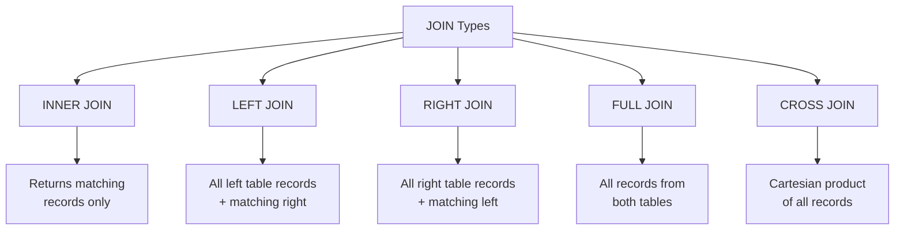
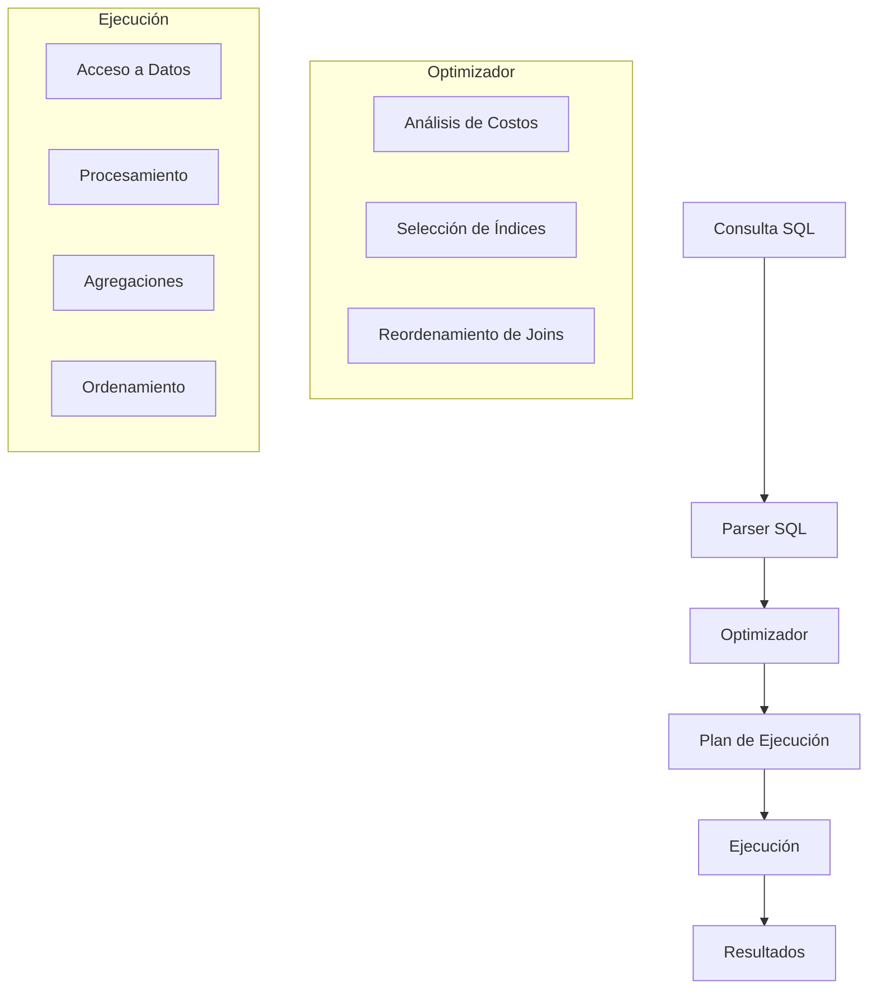

# Fundamentos de Bases de Datos - Lenguaje de consulta SQL

## 6.2 Consultas.

---

Las consultas SQL son el mecanismo fundamental para recuperar información de una base de datos relacional. Según Elmasri y Navathe (2006), una consulta se define como "una expresión que solicita datos específicos de una base de datos".

### Estructura Fundamental de una Consulta SELECT

La sintaxis básica de una consulta SELECT sigue el siguiente patrón:

```sql
SELECT [DISTINCT | ALL] {* | expresión [[AS] alias], ...}
FROM nombre_tabla [[AS] alias]
[WHERE condición]
[GROUP BY expresión [, ...]]
[HAVING condición]
[ORDER BY expresión [ASC | DESC] [, ...]];
```

### Tipos de Consultas

#### Consultas Básicas de Selección

**Definición**: Consultas que recuperan datos de una o más tablas sin transformaciones complejas.

```sql
-- Consulta simple de una tabla
SELECT nombre, apellido, salario
FROM empleados
WHERE departamento = 'Ventas';

-- Consulta con todas las columnas
SELECT *
FROM productos
WHERE precio > 100;
```

#### Consultas con Joins

**Definición**: Consultas que combinan datos de múltiples tablas basándose en relaciones definidas.

##### Tipos de Joins



**Ejemplo de INNER JOIN**:

```sql
SELECT e.nombre, e.apellido, d.nombre_departamento
FROM empleados e
INNER JOIN departamentos d ON e.departamento_id = d.id;
```

**Ejemplo de LEFT JOIN**:

```sql
SELECT c.nombre, p.fecha_pedido, p.total
FROM clientes c
LEFT JOIN pedidos p ON c.id = p.cliente_id;
```

#### Consultas con Funciones Agregadas

**Definición**: Consultas que realizan cálculos sobre conjuntos de valores y devuelven un único valor resultante.

**Funciones agregadas principales**:

- `COUNT()`: Número de elementos
- `SUM()`: Suma de valores
- `AVG()`: Promedio de valores
- `MAX()`: Valor máximo
- `MIN()`: Valor mínimo

**Sintaxis matemática para AVG()**:

$$ \text{AVG}(X) = \frac{1}{n}\sum_{i=1}^{n} x_i $$

**Ejemplo**:

```sql
SELECT
    departamento,
    COUNT(*) AS num_empleados,
    AVG(salario) AS salario_promedio,
    MAX(salario) AS salario_maximo
FROM empleados
GROUP BY departamento;
```

#### Consultas Subordinadas (Subqueries)

**Definición**: Consultas anidadas dentro de otras consultas.

##### Subconsultas Escalares

```sql
SELECT nombre, salario
FROM empleados
WHERE salario > (SELECT AVG(salario) FROM empleados);
```

##### Subconsultas en la Cláusula FROM

```sql
SELECT departamento, promedio_salario
FROM (
    SELECT departamento, AVG(salario) AS promedio_salario
    FROM empleados
    GROUP BY departamento
) AS subconsulta
WHERE promedio_salario > 50000;
```

##### Subconsultas Correlacionadas

```sql
SELECT e.nombre, e.salario, e.departamento
FROM empleados e
WHERE e.salario > (
    SELECT AVG(salario)
    FROM empleados
    WHERE departamento = e.departamento
);
```

#### Consultas con Expresiones Regulares

**Definición**: Consultas que utilizan patrones para buscar coincidencias en cadenas de texto.

```sql
-- Buscar nombres que comienzan con 'A'
SELECT nombre
FROM empleados
WHERE nombre REGEXP '^A';

-- Buscar correos electrónicos válidos
SELECT email
FROM usuarios
WHERE email REGEXP '^[A-Za-z0-9._%+-]+@[A-Za-z0-9.-]+\.[A-Za-z]{2,}$';
```

### Optimización de Consultas

#### Principios de Optimización

1. **Selección de columnas específicas** en lugar de `SELECT *`
2. **Uso apropiado de índices** en condiciones WHERE y JOIN
3. **Evitar funciones en columnas** en condiciones WHERE
4. **Limitar resultados** con cláusula LIMIT cuando sea posible

#### Análisis de Rendimiento

**Costo de consulta estimado**:

$$ C_{\text{query}} = C_{\text{disk}} + C_{\text{cpu}} + C_{\text{memory}} $$

**Ejemplo de consulta optimizada**:

```sql
-- Menos eficiente
SELECT * FROM ventas WHERE YEAR(fecha) = 2023;

-- Más eficiente
SELECT * FROM ventas
WHERE fecha >= '2023-01-01' AND fecha < '2024-01-01';
```

### Ejercicios Propuestos

#### Ejercicio 1: Consultas Básicas

Dada la tabla `empleados`:

```sql
CREATE TABLE empleados (
    id INT PRIMARY KEY,
    nombre VARCHAR(50),
    apellido VARCHAR(50),
    salario DECIMAL(10,2),
    departamento_id INT,
    fecha_contratacion DATE
);
```

1. Escribe una consulta para mostrar nombre, apellido y salario de empleados con salario mayor a 50000.
2. Encuentra los empleados contratados en el año 2023.
3. Calcula cuántos empleados hay en cada departamento.

#### Ejercicio 2: Consultas con Joins

Con las tablas:

```sql
CREATE TABLE departamentos (
    id INT PRIMARY KEY,
    nombre VARCHAR(50),
    ubicacion VARCHAR(50)
);

CREATE TABLE proyectos (
    id INT PRIMARY KEY,
    nombre VARCHAR(100),
    departamento_id INT
);
```

1. Muestra todos los departamentos y sus proyectos (incluye departamentos sin proyectos).
2. Encuentra empleados que no están asignados a ningún departamento.
3. Lista departamentos con más de 5 empleados.

#### Ejercicio 3: Consultas Avanzadas

1. Escribe una consulta que muestre el segundo salario más alto de la empresa.
2. Encuentra empleados cuyo salario es mayor que el promedio de su departamento.
3. Crea una consulta que muestre el crecimiento mensual de ventas.

### Diagrama de Flujo de Ejecución de una Consulta



### Buenas Prácticas en Consultas SQL

1. **Usar alias para mejorar legibilidad**:

```sql
SELECT e.nombre AS empleado, d.nombre AS departamento
FROM empleados e
INNER JOIN departamentos d ON e.departamento_id = d.id;
```

2. **Manejar valores nulos adecuadamente**:

```sql
SELECT nombre, COALESCE(telefono, 'No disponible') AS contacto
FROM clientes;
```

3. **Optimizar condiciones con EXISTS** en lugar de IN para subconsultas:

```sql
-- Más eficiente
SELECT nombre FROM clientes c
WHERE EXISTS (
    SELECT 1 FROM pedidos p
    WHERE p.cliente_id = c.id AND p.total > 1000
);
```

### Referencias Bibliográficas

#### Bibliografía Básica

1. **Elmasri and Navathe (2006)**: _Fundamentals of Database Systems_. Capítulo 6: "The Relational Algebra and Relational Calculus" - Explica los fundamentos teóricos de las consultas relacionales.
2. **Silberschatz et al. (2006)**: _Fundamentos de BD_. Capítulo 3: "SQL" - Detalla la sintaxis y semántica de las consultas SQL.
3. **Ullman and Widom (2008)**: _A First Course in Database Systems_. Capítulo 6: "The Database Language SQL" - Aborda consultas avanzadas y optimización.

#### Bibliografía Complementaria

1. **Harrington (2009)**: _Relational Database Design and Implementation_. Capítulo 9: "Relational Algebra" - Proporciona base matemática para las consultas.
2. **Kline et al. (2008)**: _SQL in a Nutshell_ - Referencia completa de sintaxis SQL para consultas.

### Conclusión

El dominio de las consultas SQL es fundamental para cualquier profesional de bases de datos. Desde consultas básicas de selección hasta consultas avanzadas con subconsultas correlacionadas y optimizaciones de rendimiento, cada tipo de consulta tiene su lugar y aplicación específica. La práctica constante y el entendimiento de los principios teóricos subyacentes son clave para desarrollar habilidades sólidas en la manipulación y recuperación de datos.

La eficiencia en las consultas no solo depende del conocimiento sintáctico, sino también de la comprensión de cómo el motor de bases de datos procesa y optimiza estas consultas internamente.
