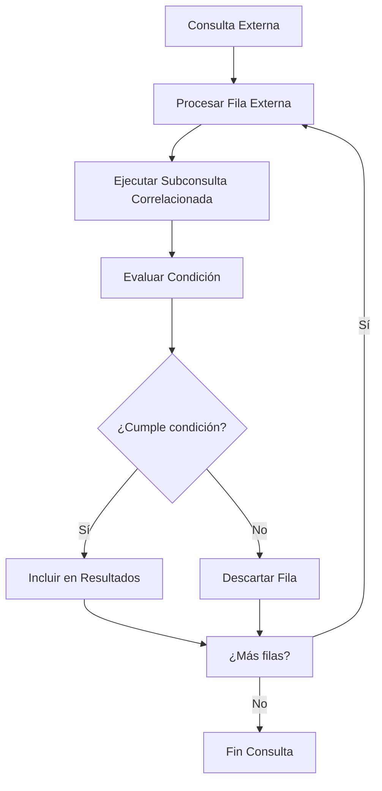

# Fundamentos de Bases de Datos - Lenguaje de consulta SQL

## 6.3 Subconsultas.

---

Las subconsultas, también conocidas como consultas anidadas o subqueries, son una característica poderosa de SQL que permite incluir una consulta dentro de otra. Según Elmasri y Navathe (2006), "una subconsulta es una expresión SELECT que está anidada dentro de otra consulta SQL".

**Definición formal**: Una subconsulta es una consulta completa que aparece dentro de paréntesis como parte de otra consulta, llamada consulta externa.

### Clasificación de las Subconsultas

#### Por Ubicación en la Consulta

- **Subconsultas en la cláusula WHERE**
- **Subconsultas en la cláusula FROM**
- **Subconsultas en la cláusula SELECT**
- **Subconsultas en la cláusula HAVING**

#### Por Comportamiento

- **Subconsultas Escalares**: Devuelven un único valor
- **Subconsultas de Lista**: Devuelven múltiples valores en una columna
- **Subconsultas Correlacionadas**: Hacen referencia a columnas de la consulta externa
- **Subconsultas No Correlacionadas**: Son independientes de la consulta externa

### Sintaxis General

La estructura básica de una subconsulta es:

```sql
SELECT columna1, columna2, ...
FROM tabla
WHERE columna OPERADOR (
    SELECT columna
    FROM tabla
    WHERE condición
);
```

### Tipos de Subconsultas

#### Subconsultas Escalares

**Definición**: Subconsultas que devuelven exactamente un valor (una fila con una columna).

**Fórmula del valor escalar**:

$$ \text{Resultado} = f(\text{Subconsulta}) \quad \text{donde} \quad f: \text{Consulta} \rightarrow \mathbb{R} $$

**Ejemplo**:

```sql
SELECT nombre, salario
FROM empleados
WHERE salario > (
    SELECT AVG(salario)
    FROM empleados
);
```

#### Subconsultas de Lista (Multiple Row)

**Definición**: Subconsultas que devuelven múltiples valores en una sola columna.

**Operadores utilizados**:

- `IN`: Verifica si un valor está en la lista
- `ANY`: Compara con cualquier valor de la lista
- `ALL`: Compara con todos los valores de la lista

**Ejemplo con IN**:

```sql
SELECT nombre, departamento
FROM empleados
WHERE departamento_id IN (
    SELECT id
    FROM departamentos
    WHERE ubicacion = 'Madrid'
);
```

#### Subconsultas Correlacionadas

**Definición**: Subconsultas que hacen referencia a columnas de la consulta externa, ejecutándose una vez por cada fila procesada.

**Característica principal**: La subconsulta depende de la consulta externa para su ejecución.

**Ejemplo**:

```sql
SELECT e1.nombre, e1.salario, e1.departamento
FROM empleados e1
WHERE e1.salario > (
    SELECT AVG(e2.salario)
    FROM empleados e2
    WHERE e2.departamento = e1.departamento
);
```

#### Subconsultas en la Cláusula FROM

**Definición**: Subconsultas que actúan como tablas virtuales dentro de la consulta principal.

**Ejemplo**:

```sql
SELECT d.nombre, sub.promedio_salario
FROM departamentos d
JOIN (
    SELECT departamento_id, AVG(salario) AS promedio_salario
    FROM empleados
    GROUP BY departamento_id
) sub ON d.id = sub.departamento_id;
```

### Operadores para Subconsultas

#### Operador EXISTS

**Definición**: Verifica la existencia de filas en la subconsulta.

**Sintaxis**:

$$ \text{EXISTS}(subconsulta) = \begin{cases} \text{TRUE} & \text{si } subconsulta \geq 1 \text{ fila} \\\ \text{FALSE} & \text{si } subconsulta = 0 \text{ filas} \end{cases} $$

**Ejemplo**:
```sql
SELECT nombre
FROM clientes c
WHERE EXISTS (
    SELECT 1
    FROM pedidos p
    WHERE p.cliente_id = c.id
    AND p.total > 1000
);
```

#### Operadores ANY y ALL

**ANY**: Compara un valor con cualquier valor de la subconsulta
**ALL**: Compara un valor con todos los valores de la subconsulta

**Ejemplo con ANY**:
```sql
SELECT nombre, salario
FROM empleados
WHERE salario > ANY (
    SELECT salario
    FROM empleados
    WHERE departamento = 'Ventas'
);
```

**Ejemplo con ALL**:
```sql
SELECT nombre, salario
FROM empleados
WHERE salario > ALL (
    SELECT salario
    FROM empleados
    WHERE departamento = 'Ventas'
);
```

### Diagrama de Flujo de Subconsultas Correlacionadas



### Ejemplos Prácticos Detallados

#### Ejemplo 1: Subconsulta Escalar
```sql
-- Empleados con salario mayor al promedio
SELECT nombre, salario, departamento
FROM empleados
WHERE salario > (
    SELECT AVG(salario)
    FROM empleados
)
ORDER BY salario DESC;
```

#### Ejemplo 2: Subconsulta con IN
```sql
-- Productos nunca vendidos
SELECT nombre, precio
FROM productos
WHERE id NOT IN (
    SELECT DISTINCT producto_id
    FROM ventas
);
```

#### Ejemplo 3: Subconsulta Correlacionada
```sql
-- Empleados con el salario más alto por departamento
SELECT nombre, salario, departamento
FROM empleados e1
WHERE salario = (
    SELECT MAX(salario)
    FROM empleados e2
    WHERE e2.departamento = e1.departamento
);
```

#### Ejemplo 4: Subconsulta en FROM
```sql
-- Departamentos con promedio salarial superior a 50000
SELECT d.nombre, sub.promedio_salario
FROM departamentos d
JOIN (
    SELECT departamento_id,
           AVG(salario) AS promedio_salario,
           COUNT(*) AS num_empleados
    FROM empleados
    GROUP BY departamento_id
    HAVING AVG(salario) > 50000
) sub ON d.id = sub.departamento_id;
```

### Optimización de Subconsultas

#### Consideraciones de Rendimiento

1. **Subconsultas correlacionadas** pueden ser costosas en rendimiento
2. **Usar EXISTS en lugar de IN** cuando sea posible
3. **Convertir subconsultas a JOINs** cuando sea apropiado

**Ejemplo de optimización**:
```sql
-- Menos eficiente (Subconsulta)
SELECT nombre
FROM clientes
WHERE id IN (SELECT cliente_id FROM pedidos);

-- Más eficiente (JOIN)
SELECT DISTINCT c.nombre
FROM clientes c
JOIN pedidos p ON c.id = p.cliente_id;
```

### Ejercicios Propuestos

#### Ejercicio 1: Subconsultas Básicas
Dada la tabla `empleados`:
```sql
CREATE TABLE empleados (
    id INT PRIMARY KEY,
    nombre VARCHAR(50),
    salario DECIMAL(10,2),
    departamento_id INT,
    fecha_contratacion DATE
);
```

1. Encuentra empleados que ganan más que el salario promedio de su departamento.
2. Lista empleados contratados después del último empleado del departamento 3.
3. Encuentra departamentos que tienen más empleados que el departamento 'Ventas'.

#### Ejercicio 2: Subconsultas con Múltiples Tablas
Con las tablas:
```sql
CREATE TABLE departamentos (
    id INT PRIMARY KEY,
    nombre VARCHAR(50)
);

CREATE TABLE ventas (
    id INT PRIMARY KEY,
    empleado_id INT,
    monto DECIMAL(10,2),
    fecha DATE
);
```

1. Encuentra empleados que nunca han realizado ventas.
2. Lista departamentos donde todos los empleados han realizado ventas superiores a 1000.
3. Encuentra el empleado con las mejores ventas por departamento.

#### Ejercicio 3: Subconsultas Avanzadas
1. Escribe una consulta que muestre los productos más vendidos por categoría.
2. Encuentra clientes que han comprado todos los productos de una categoría específica.
3. Crea una consulta que muestre el crecimiento porcentual de ventas mes a mes.

### Buenas Prácticas

1. **Usar alias descriptivos** para mejorar la legibilidad
2. **Limitar el número de filas** en subconsultas cuando sea posible
3. **Evitar subconsultas correlacionadas** en grandes volúmenes de datos
4. **Utilizar EXISTS** en lugar de IN para verificar existencia
5. **Probar el rendimiento** de subconsultas vs JOINs alternativos

### Referencias Bibliográficas

#### Bibliografía Básica
1. **Elmasri and Navathe (2006)**: *Fundamentals of Database Systems*. Capítulo 6 - Explica los fundamentos teóricos de las subconsultas y su equivalencia con el álgebra relacional.
2. **Silberschatz et al. (2006)**: *Fundamentos de BD*. Capítulo 3 - Detalla la sintaxis y uso práctico de subconsultas en SQL.
3. **Ullman and Widom (2008)**: *A First Course in Database Systems*. Capítulo 6 - Aborda subconsultas correlacionadas y optimización.

#### Bibliografía Complementaria
1. **Harrington (2009)**: *Relational Database Design and Implementation*. Capítulo 9 - Proporciona técnicas avanzadas de subconsultas.
2. **Kline et al. (2008)**: *SQL in a Nutshell* - Referencia completa de sintaxis para subconsultas.

### Conclusión

Las subconsultas son una herramienta poderosa en SQL que permite resolver problemas complejos de manipulación de datos. Su correcto entendimiento y aplicación es fundamental para cualquier profesional de bases de datos. Desde simples consultas escalares hasta complejas subconsultas correlacionadas, cada tipo tiene su aplicación específica y consideraciones de rendimiento.

El dominio de las subconsultas permite escribir consultas más expresivas y potentes, pero siempre debe balancearse con consideraciones de rendimiento y mantenibilidad del código. La práctica constante y el entendimiento de los principios teóricos subyacentes son clave para desarrollar habilidades sólidas en el uso de subconsultas SQL.
