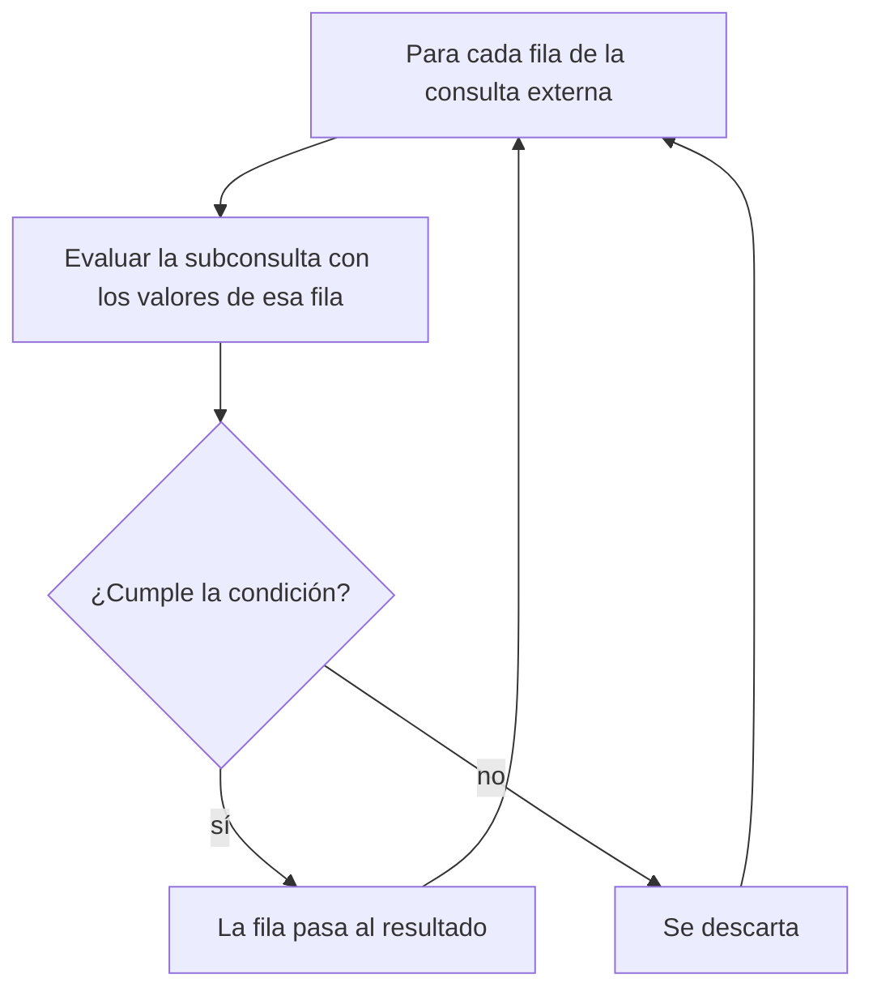

# Fundamentos de Bases de Datos - Lenguaje de consulta SQL

## 6.3 Subconsultas.

---

Una **subconsulta** es un `SELECT` dentro de otra sentencia. Permite escribir por partes preguntas que de otra forma requerirían varias consultas: "los empleados que ganan más que el promedio", "los clientes que compraron todos los productos de una categoría". Este tema clasifica las subconsultas por lo que devuelven y por su relación con la consulta externa, presenta los operadores que las usan (`IN`, `EXISTS`, `ANY`, `ALL`), explica la trampa de `NOT IN` con nulos y muestra cómo se expresa la **división** del álgebra relacional.

### Clasificación

Por lo que devuelven:

- **Escalar:** una fila y una columna. Puede ir en cualquier lugar donde va un valor: en `SELECT`, en `WHERE` o en `HAVING`. Si no devuelve filas, su valor es nulo; si devuelve más de una, el estándar marca un error, y SQLite toma la primera.
- **De columna:** una columna y varias filas, para usarse con `IN`, `ANY` y `ALL`.
- **De tabla:** varias columnas y filas, en `FROM` (una **tabla derivada**, que necesita un alias), en `EXISTS` o en una expresión `WITH`.

Por su relación con la externa:

- **No correlacionada:** no hace referencia a la consulta externa; se puede evaluar una sola vez.
- **Correlacionada:** hace referencia a columnas de la fila externa, como `e.departamento_id`, y conceptualmente se evalúa una vez por cada fila. Los optimizadores suelen transformarla en una reunión o en una agregación previa.

### Operadores

- `x IN (subconsulta)` es verdadero si $x$ es igual a algún valor; equivale a `x = ANY (subconsulta)`.
- `x θ ANY (subconsulta)` es verdadero si la comparación se cumple con **algún** valor; `x θ ALL (subconsulta)`, si se cumple con **todos**. `x > ALL (s)` equivale a `x > (SELECT MAX(...) FROM s)` cuando $s$ no tiene nulos y no está vacía; si está vacía, `ALL` es verdadero y la comparación con `MAX`, desconocida. SQLite no implementa `ANY` ni `ALL`.
- `EXISTS (subconsulta)` es verdadero si la subconsulta devuelve al menos una fila; lo que seleccione no importa, y por costumbre se escribe `SELECT 1`. Nunca es desconocido.

### La trampa de NOT IN

`x NOT IN (a, b, c)` equivale a $x \ne a \land x \ne b \land x \ne c.$ Si alguno de los valores es nulo, su comparación es desconocida, y la conjunción nunca es verdadera: **ninguna fila pasa el filtro**. Por eso "empleados sin ventas" escrito como `id NOT IN (SELECT empleado_id FROM ventas)` devuelve un resultado vacío en cuanto existe una venta con `empleado_id` nulo. `NOT EXISTS` no tiene el problema, porque la condición de la subconsulta con un nulo no selecciona esa fila y `EXISTS` sigue siendo verdadero o falso. La regla práctica: usar `NOT EXISTS`, o filtrar `WHERE columna IS NOT NULL` dentro del `NOT IN`.

### Cuantificación universal: la división

SQL no tiene un "para todo", pero tiene $\lnot \exists,$ y $\forall x\, P(x) \equiv \lnot \exists x\, \lnot P(x).$ "Los clientes que compraron todos los productos de una categoría" se reescribe como "los clientes para los que **no existe** un producto de la categoría que **no** hayan comprado":

```sql
SELECT c.nombre FROM clientes c
WHERE NOT EXISTS (
    SELECT 1 FROM productos p WHERE p.categoria = 'Accesorios'
    AND NOT EXISTS (SELECT 1 FROM ventas v WHERE v.cliente_id = c.id AND v.producto_id = p.id));
```

Es la división $\pi_{\text{cliente}, \text{producto}}(\text{VENTAS}) \div \pi_{\text{producto}}(\sigma_{\text{categoria} = \text{'Accesorios'}}(\text{PRODUCTOS}))$ del tema 4.3. Una alternativa es **contar**: agrupar por cliente y comparar el número de productos distintos de la categoría que compró con el número total de productos de la categoría. Ambas formas tienen el mismo caso límite: si la categoría no tiene productos, todo cliente la cumple, porque un "para todo" sobre un conjunto vacío es verdadero.



### Subconsultas, reuniones y ventanas

Muchas subconsultas tienen una versión equivalente con reuniones o con funciones de ventana (tema 6.2), y conviene conocer las tres. `IN` con una subconsulta equivale a una **semirreunión**, que no duplica filas aunque haya varias coincidencias, a diferencia de un `JOIN`. `NOT EXISTS` es una **antirreunión**, como `LEFT JOIN ... WHERE derecha.clave IS NULL`. "El mejor de cada grupo" se escribe con una subconsulta correlacionada que compara con el máximo del grupo, o con `RANK() OVER (PARTITION BY grupo ORDER BY valor DESC) = 1`. Las versiones correlacionadas son las más fáciles de leer, y los optimizadores modernos suelen ejecutarlas tan bien como las otras; si no, el plan de ejecución lo muestra (tema 6.6).

### Implementación en Python

El programa crea en SQLite departamentos, empleados, productos, clientes y ventas, con un departamento sin empleados, y ejecuta las consultas de los tres ejercicios. Muestra cómo una venta sin empleado vacía el resultado de `NOT IN` y no el de `NOT EXISTS`; cómo un "para todo" sin la condición de existencia acepta un departamento vacío, y resuelve la división de dos maneras, con `NOT EXISTS` doble y contando.

```python
import sqlite3

db = sqlite3.connect(":memory:")
db.executescript("""
CREATE TABLE departamentos (id INTEGER PRIMARY KEY, nombre TEXT NOT NULL);
CREATE TABLE empleados (id INTEGER PRIMARY KEY, nombre TEXT, salario NUMERIC, departamento_id INTEGER, fecha_contratacion TEXT);
CREATE TABLE productos (id INTEGER PRIMARY KEY, nombre TEXT, categoria TEXT);
CREATE TABLE clientes (id INTEGER PRIMARY KEY, nombre TEXT);
CREATE TABLE ventas (id INTEGER PRIMARY KEY, empleado_id INTEGER, cliente_id INTEGER, producto_id INTEGER,
                     cantidad INTEGER, monto NUMERIC, fecha TEXT);
INSERT INTO departamentos VALUES (1, 'Ventas'), (2, 'Soporte'), (3, 'Mayoreo'), (4, 'Sistemas'), (5, 'Logística');
INSERT INTO empleados VALUES
  (1, 'Ana', 30000, 1, '2022-02-01'), (2, 'Beto', 26000, 1, '2023-05-10'), (3, 'Carla', 41000, 1, '2021-08-15'),
  (4, 'Dante', 28000, 2, '2024-01-20'), (5, 'Eva', 33000, 2, '2020-03-03'), (6, 'Fer', 52000, 3, '2022-09-01'),
  (7, 'Gil', 47000, 3, '2023-03-14'), (8, 'Hugo', 35000, 4, '2025-06-01'), (9, 'Iris', 38000, 4, '2024-11-11'),
  (10, 'Juan', 36000, 4, '2025-02-17'), (11, 'Kim', 31000, 4, '2023-01-05');
INSERT INTO productos VALUES (1, 'Laptop', 'Cómputo'), (2, 'Monitor', 'Cómputo'), (3, 'Teclado', 'Accesorios'),
                             (4, 'Ratón', 'Accesorios'), (5, 'Cable', 'Accesorios');
INSERT INTO clientes VALUES (1, 'Rosa'), (2, 'Iván'), (3, 'Lola');
INSERT INTO ventas (empleado_id, cliente_id, producto_id, cantidad, monto, fecha) VALUES
  (1, 1, 1, 1, 18000, '2026-07-05'), (1, 1, 2, 2, 7000, '2026-07-20'), (3, 2, 3, 5, 2500, '2026-08-02'),
  (3, 1, 4, 3, 900, '2026-08-15'), (2, 3, 5, 10, 600, '2026-08-21'), (6, 2, 1, 4, 72000, '2026-09-01'),
  (7, 2, 2, 3, 10500, '2026-09-12'), (6, 1, 3, 1, 1500, '2026-09-30'), (7, 3, 4, 2, 1300, '2026-10-03'),
  (5, 3, 5, 6, 360, '2026-10-09'), (1, 2, 1, 2, 36000, '2026-10-18');
""")
def q(titulo, sql):
    print(f"{titulo}:", db.execute(sql).fetchall())

# --- Ejercicio 1 ---
q("1.1", """SELECT nombre, salario FROM empleados e
            WHERE salario > (SELECT AVG(salario) FROM empleados WHERE departamento_id = e.departamento_id) ORDER BY id""")
q("1.2", """SELECT nombre, fecha_contratacion FROM empleados
            WHERE fecha_contratacion > (SELECT MAX(fecha_contratacion) FROM empleados WHERE departamento_id = 3) ORDER BY 2""")
q("1.3", """SELECT d.nombre, COUNT(*) FROM departamentos d JOIN empleados e ON e.departamento_id = d.id GROUP BY d.id
            HAVING COUNT(*) > (SELECT COUNT(*) FROM empleados e JOIN departamentos d ON d.id = e.departamento_id
                               WHERE d.nombre = 'Ventas')""")

# --- Ejercicio 2 ---
q("2.1 NOT EXISTS", "SELECT nombre FROM empleados e WHERE NOT EXISTS (SELECT 1 FROM ventas v WHERE v.empleado_id = e.id) ORDER BY id")
q("2.1 NOT IN", "SELECT nombre FROM empleados WHERE id NOT IN (SELECT empleado_id FROM ventas) ORDER BY id")
db.execute("INSERT INTO ventas (empleado_id, cliente_id, producto_id, cantidad, monto, fecha) VALUES (NULL, 1, 5, 1, 60, '2026-10-20')")
q("    tras una venta sin empleado, NOT IN", "SELECT nombre FROM empleados WHERE id NOT IN (SELECT empleado_id FROM ventas) ORDER BY id")
q("    NOT EXISTS no cambia", "SELECT COUNT(*) FROM empleados e WHERE NOT EXISTS (SELECT 1 FROM ventas v WHERE v.empleado_id = e.id)")
q("2.2 todo empleado tiene alguna venta de más de 1000", """
    SELECT d.nombre FROM departamentos d
    WHERE EXISTS (SELECT 1 FROM empleados e WHERE e.departamento_id = d.id)
      AND NOT EXISTS (SELECT 1 FROM empleados e WHERE e.departamento_id = d.id
                      AND NOT EXISTS (SELECT 1 FROM ventas v WHERE v.empleado_id = e.id AND v.monto > 1000))""")
q("    sin la primera condición entra un departamento vacío", """
    SELECT COUNT(*) FROM (SELECT 1 FROM departamentos d WHERE NOT EXISTS (SELECT 1 FROM empleados e WHERE e.departamento_id = d.id
                      AND NOT EXISTS (SELECT 1 FROM ventas v WHERE v.empleado_id = e.id AND v.monto > 1000)))""")
q("2.3 mejor vendedor por departamento", """
    WITH tot AS (SELECT e.departamento_id AS dep, e.nombre, SUM(v.monto) AS total
                 FROM empleados e JOIN ventas v ON v.empleado_id = e.id GROUP BY e.id)
    SELECT d.nombre, t.nombre, t.total FROM tot t JOIN departamentos d ON d.id = t.dep
    WHERE t.total = (SELECT MAX(total) FROM tot WHERE dep = t.dep) ORDER BY d.id""")

# --- Ejercicio 3 ---
q("3.1 más vendido por categoría", """
    WITH u AS (SELECT p.categoria, p.nombre, SUM(v.cantidad) AS unidades FROM ventas v JOIN productos p ON p.id = v.producto_id
               GROUP BY p.id)
    SELECT categoria, nombre, unidades FROM u WHERE unidades = (SELECT MAX(unidades) FROM u u2 WHERE u2.categoria = u.categoria)
    ORDER BY categoria""")
q("3.2 compraron todos los productos de Accesorios (división)", """
    SELECT c.nombre FROM clientes c WHERE NOT EXISTS (
        SELECT 1 FROM productos p WHERE p.categoria = 'Accesorios'
        AND NOT EXISTS (SELECT 1 FROM ventas v WHERE v.cliente_id = c.id AND v.producto_id = p.id))""")
q("    lo mismo contando", """
    SELECT c.nombre FROM clientes c JOIN ventas v ON v.cliente_id = c.id JOIN productos p ON p.id = v.producto_id
    WHERE p.categoria = 'Accesorios' GROUP BY c.id
    HAVING COUNT(DISTINCT p.id) = (SELECT COUNT(*) FROM productos WHERE categoria = 'Accesorios')""")
q("    de Cómputo", """
    SELECT c.nombre FROM clientes c WHERE NOT EXISTS (
        SELECT 1 FROM productos p WHERE p.categoria = 'Cómputo'
        AND NOT EXISTS (SELECT 1 FROM ventas v WHERE v.cliente_id = c.id AND v.producto_id = p.id)) ORDER BY c.id""")
q("3.3 crecimiento mensual con subconsulta escalar", """
    WITH m AS (SELECT strftime('%Y-%m', fecha) AS mes, SUM(monto) AS total FROM ventas GROUP BY mes)
    SELECT mes, total, ROUND(100.0 * (total - (SELECT total FROM m m2 WHERE m2.mes < m.mes ORDER BY m2.mes DESC LIMIT 1))
                       / (SELECT total FROM m m2 WHERE m2.mes < m.mes ORDER BY m2.mes DESC LIMIT 1), 1)
    FROM m ORDER BY mes""")
```

Salida:

```text
1.1: [('Carla', 41000), ('Eva', 33000), ('Fer', 52000), ('Iris', 38000), ('Juan', 36000)]
1.2: [('Beto', '2023-05-10'), ('Dante', '2024-01-20'), ('Iris', '2024-11-11'), ('Juan', '2025-02-17'), ('Hugo', '2025-06-01')]
1.3: [('Sistemas', 4)]
2.1 NOT EXISTS: [('Dante',), ('Hugo',), ('Iris',), ('Juan',), ('Kim',)]
2.1 NOT IN: [('Dante',), ('Hugo',), ('Iris',), ('Juan',), ('Kim',)]
    tras una venta sin empleado, NOT IN: []
    NOT EXISTS no cambia: [(5,)]
2.2 todo empleado tiene alguna venta de más de 1000: [('Mayoreo',)]
    sin la primera condición entra un departamento vacío: [(2,)]
2.3 mejor vendedor por departamento: [('Ventas', 'Ana', 61000), ('Soporte', 'Eva', 360), ('Mayoreo', 'Fer', 73500)]
3.1 más vendido por categoría: [('Accesorios', 'Cable', 17), ('Cómputo', 'Laptop', 7)]
3.2 compraron todos los productos de Accesorios (división): [('Rosa',)]
    lo mismo contando: [('Rosa',)]
    de Cómputo: [('Rosa',), ('Iván',)]
3.3 crecimiento mensual con subconsulta escalar: [('2026-07', 25000, None), ('2026-08', 4000, -84.0), ('2026-09', 84000, 2000.0), ('2026-10', 37720, -55.1)]
```

### Ejercicios Propuestos

1. **Subconsultas básicas.** Con `empleados(id, nombre, salario, departamento_id, fecha_contratacion)`, encuentra los empleados que ganan más que el promedio de su departamento, los contratados después del último empleado del departamento 3 y los departamentos con más empleados que Ventas.

2. **Varias tablas.** Con `departamentos(id, nombre)` y `ventas(id, empleado_id, monto, fecha)`, encuentra los empleados que nunca han vendido, los departamentos donde todos los empleados han hecho ventas de más de 1000 y el mejor vendedor de cada departamento.

3. **Subconsultas avanzadas.** Encuentra el producto más vendido de cada categoría, los clientes que compraron todos los productos de una categoría y el crecimiento porcentual de las ventas mes a mes.

### Soluciones

**Ejercicio 1.** La primera es la subconsulta correlacionada del programa: cada empleado se compara con el promedio de su propio departamento. La segunda compara con `MAX(fecha_contratacion)` del departamento 3, una subconsulta escalar no correlacionada; con `> ALL` se escribiría sin `MAX`, pero si el departamento 3 no tuviera empleados, `> ALL` aceptaría a todos y la versión con `MAX` a ninguno. La tercera compara en `HAVING` el número de empleados de cada departamento con el de Ventas, que tiene 3: solo Sistemas, con 4, lo supera. Si no existiera un departamento llamado Ventas, la subconsulta contaría 0 y todos los departamentos con empleados pasarían.

**Ejercicio 2.** **Nunca vendieron:** `NOT EXISTS` es la forma correcta; el programa muestra que `NOT IN` da el mismo resultado hasta que se registra una venta con `empleado_id` nulo, y entonces devuelve una lista vacía. **Todos con ventas de más de 1000:** la frase admite dos lecturas, cada empleado con alguna venta de más de 1000 o cada empleado con ventas que suman más de 1000; el programa usa la primera, con el doble `NOT EXISTS` de la división: no existe un empleado del departamento sin una venta de más de 1000. Solo Mayoreo cumple. La condición `EXISTS` adicional excluye los departamentos sin empleados, que cumplirían el "para todo" trivialmente: sin ella, Logística también aparece. **Mejor vendedor:** se suman las ventas por empleado en una expresión `WITH` y se conservan las filas cuyo total es el máximo de su departamento; si dos empatan, aparecen ambos, y los departamentos sin ventas no aparecen.

**Ejercicio 3.** **Más vendido por categoría:** el mismo patrón del máximo por grupo, sobre unidades por producto: el cable en Accesorios y la laptop en Cómputo. **Todos los productos de una categoría:** la división, que el programa resuelve con `NOT EXISTS` doble y contando con `HAVING COUNT(DISTINCT p.id) = (SELECT COUNT(*) ...)`; solo Rosa compró los tres accesorios, y Rosa e Iván compraron los dos productos de cómputo. La versión que cuenta requiere `DISTINCT`, porque un cliente que compró dos veces el mismo producto contaría doble. **Crecimiento mes a mes:** sin funciones de ventana, el total del mes anterior se obtiene con una subconsulta escalar correlacionada que toma el último mes menor que el actual; el programa da $-84.0$ %, $2000.0$ % y $-55.1$ %. La versión con `LAG` del tema 6.2 es más corta y se evalúa en una pasada.

### Referencias

1. Elmasri, R., and Navathe, S. B., _Fundamentals of Database Systems_. Pearson, 2016. Capítulo 7.
2. Silberschatz, A., Korth, H. F., and Sudarshan, S., _Database System Concepts_. McGraw-Hill, 2019. Capítulo 3.
3. Date, C. J., _SQL and Relational Theory_. O'Reilly, 2015. Capítulos 4 y 11.
4. Celko, J., _SQL for Smarties_. Morgan Kaufmann, 2014. Capítulo sobre división relacional.
