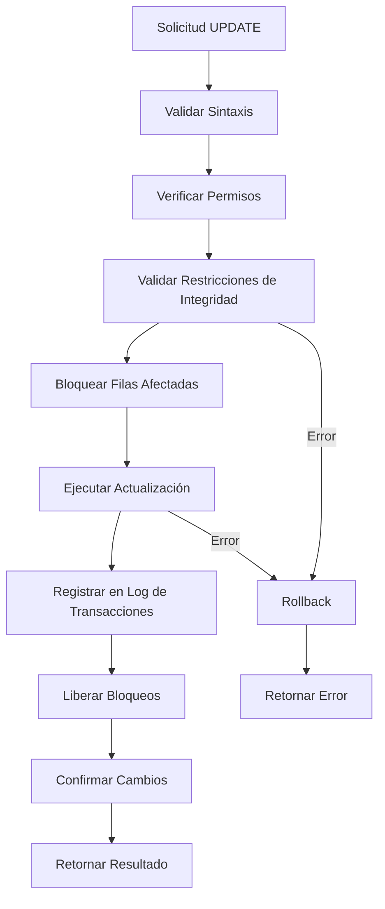

# Fundamentos de Bases de Datos - Lenguaje de consulta SQL

## 6.4 Actualizaciones.

---

Las operaciones de actualización en SQL permiten modificar los datos existentes en una base de datos. Según Silberschatz et al. (2006), "las sentencias de actualización son fundamentales para mantener la integridad y actualidad de los datos en un sistema de bases de datos".

**Definición formal**: Una operación de actualización es una sentencia SQL que modifica el estado de la base de datos alterando los valores de los datos almacenados.

### Sentencias Básicas de Actualización

#### Sentencia UPDATE

La sentencia UPDATE modifica valores existentes en una tabla.

**Sintaxis básica**:

```sql
UPDATE nombre_tabla
SET columna1 = valor1, columna2 = valor2, ...
[WHERE condición];
```

**Fórmula de actualización**:

$$ T\_{\text{actualizada}} = \{ t \in T \mid \text{condición} \rightarrow t[\text{columna}] = \text{nuevo\_valor} \} $$

#### Sentencia DELETE

La sentencia DELETE elimina filas existentes de una tabla.

**Sintaxis básica**:

```sql
DELETE FROM nombre_tabla
[WHERE condición];
```

#### Sentencia INSERT

La sentencia INSERT agrega nuevas filas a una tabla.

**Sintaxis básica**:

```sql
INSERT INTO nombre_tabla (columna1, columna2, ...)
VALUES (valor1, valor2, ...);
```

### Tipos de Actualizaciones

#### Actualizaciones Simples

**Actualización de valores específicos**:

```sql
UPDATE empleados
SET salario = 50000
WHERE id = 101;
```

**Actualización múltiple de columnas**:

```sql
UPDATE productos
SET precio = precio * 1.10,
    stock = stock - 5
WHERE categoria = 'Electrónicos';
```

#### Actualizaciones con Subconsultas

**Actualización basada en resultados de subconsultas**:

```sql
UPDATE empleados
SET salario = salario * 1.15
WHERE departamento_id IN (
    SELECT id
    FROM departamentos
    WHERE nombre = 'Ventas'
);
```

**Actualización con subconsulta correlacionada**:

```sql
UPDATE ventas v
SET comision = (
    SELECT porcentaje_comision
    FROM empleados e
    WHERE e.id = v.empleado_id
) * v.monto
WHERE v.fecha >= '2024-01-01';
```

#### Actualizaciones con JOINs

**Actualización utilizando JOIN implícito**:

```sql
UPDATE empleados e, departamentos d
SET e.salario = e.salario * 1.10
WHERE e.departamento_id = d.id
AND d.ubicacion = 'Madrid';
```

**Actualización con JOIN explícito** (sintaxis estándar):

```sql
UPDATE empleados e
JOIN departamentos d ON e.departamento_id = d.id
SET e.salario = e.salario * 1.10
WHERE d.ubicacion = 'Madrid';
```

### Transacciones y Control de Actualizaciones

#### Gestión de Transacciones

Las transacciones aseguran la atomicidad de las operaciones de actualización.

**Sintaxis de transacciones**:

```sql
START TRANSACTION;

UPDATE cuenta SET saldo = saldo - 1000 WHERE id = 1;
UPDATE cuenta SET saldo = saldo + 1000 WHERE id = 2;

COMMIT; -- Confirma los cambios
-- ROLLBACK; -- Revierte los cambios
```

#### Fórmula de Integridad Transaccional

$$ \text{ACID} = \begin{cases} \text{Atomicidad} \\\ \text{Consistencia} \\\ \text{Aislamiento} \\\ \text{Durabilidad} \end{cases} $$

### Cláusulas Especiales para Actualizaciones

#### Cláusula RETURNING (en algunos SGBD)

**Devuelve los valores actualizados**:
```sql
UPDATE productos
SET precio = precio * 1.05
WHERE categoria = 'Libros'
RETURNING id, nombre, precio;
```

#### Cláusula LIMIT

**Limita el número de filas actualizadas**:
```sql
UPDATE empleados
SET salario = salario * 1.05
WHERE departamento = 'TI'
LIMIT 10;
```

### Diagrama de Flujo del Proceso de Actualización



### Ejemplos Prácticos Detallados

#### Ejemplo 1: Actualización con Expresiones
```sql
-- Aumento porcentual diferenciado por antigüedad
UPDATE empleados
SET salario = CASE
    WHEN fecha_contratacion < '2020-01-01' THEN salario * 1.15
    WHEN fecha_contratacion < '2023-01-01' THEN salario * 1.10
    ELSE salario * 1.05
END
WHERE activo = true;
```

#### Ejemplo 2: Actualización con Subconsulta Correlacionada
```sql
-- Actualizar comisiones basadas en ventas del trimestre
UPDATE empleados e
SET comision = (
    SELECT COALESCE(SUM(monto * 0.1), 0)
    FROM ventas v
    WHERE v.empleado_id = e.id
    AND v.fecha >= '2024-01-01'
    AND v.fecha <= '2024-03-31'
)
WHERE e.departamento = 'Ventas';
```

#### Ejemplo 3: Actualización Masiva con Límite
```sql
-- Actualizar precios de productos en lotes
UPDATE productos
SET precio = ROUND(precio * 1.07, 2)
WHERE categoria = 'Electrónicos'
AND precio < 1000
LIMIT 100;
```

#### Ejemplo 4: Actualización con JOIN Complejo
```sql
-- Actualizar salarios basado en evaluación de desempeño
UPDATE empleados e
JOIN evaluaciones ev ON e.id = ev.empleado_id
JOIN departamentos d ON e.departamento_id = d.id
SET e.salario = CASE
    WHEN ev.puntuacion >= 90 THEN e.salario * 1.20
    WHEN ev.puntuacion >= 80 THEN e.salario * 1.10
    WHEN ev.puntuacion >= 70 THEN e.salario * 1.05
    ELSE e.salario
END
WHERE ev.ano = 2024
AND d.presupuesto > 1000000;
```

### Consideraciones de Integridad Referencial

#### Actualizaciones en Cascada

**Definición**: Las actualizaciones en cascada mantienen la integridad referencial automáticamente.

**Ejemplo de definición de tabla**:
```sql
CREATE TABLE empleados (
    id INT PRIMARY KEY,
    departamento_id INT,
    FOREIGN KEY (departamento_id)
        REFERENCES departamentos(id)
        ON UPDATE CASCADE
        ON DELETE RESTRICT
);
```

#### Fórmula de Integridad Referencial
$$ \forall t \in T_{\text{hija}}, \exists t' \in T_{\text{padre}} \mid t[\text{FK}] = t'[\text{PK}] $$

### Ejercicios Propuestos

#### Ejercicio 1: Actualizaciones Básicas
Dada la tabla `productos`:
```sql
CREATE TABLE productos (
    id INT PRIMARY KEY,
    nombre VARCHAR(100),
    precio DECIMAL(10,2),
    stock INT,
    categoria VARCHAR(50),
    fecha_actualizacion DATE
);
```

1. Aumenta un 8% el precio de todos los productos de la categoría "Electrónicos".
2. Reduce el stock en 5 unidades para productos con precio mayor a 500.
3. Actualiza la fecha de actualización a hoy para productos modificados.

#### Ejercicio 2: Actualizaciones con Subconsultas
Con las tablas:
```sql
CREATE TABLE ventas (
    id INT PRIMARY KEY,
    producto_id INT,
    cantidad INT,
    fecha DATE
);

CREATE TABLE productos (
    id INT PRIMARY KEY,
    nombre VARCHAR(100),
    stock INT
);
```

1. Actualiza el stock restando las cantidades vendidas en el último mes.
2. Aumenta un 10% el precio de productos con ventas superiores a 100 unidades.
3. Marca productos sin ventas en los últimos 6 meses como "inactivos".

#### Ejercicio 3: Actualizaciones Complejas
1. Implementa una actualización que ajuste salarios basándose en evaluación de desempeño y presupuesto del departamento.
2. Crea una transacción que transfiera fondos entre cuentas con verificación de saldo.
3. Actualiza precios considerando inflación acumulada por categoría.

### Buenas Prácticas en Actualizaciones

1. **Siempre usar WHERE** en UPDATE y DELETE para evitar modificaciones accidentales.
2. **Probar con SELECT** antes de ejecutar UPDATE/DELETE.
3. **Usar transacciones** para operaciones críticas.
4. **Limitar el alcance** con condiciones específicas.
5. **Realizar backups** antes de actualizaciones masivas.

**Ejemplo de buena práctica**:
```sql
-- Primero verificar con SELECT
SELECT * FROM empleados
WHERE salario > 100000
AND departamento = 'TI';

-- Luego ejecutar UPDATE
UPDATE empleados
SET salario = salario * 1.05
WHERE salario > 100000
AND departamento = 'TI';
```

### Referencias Bibliográficas

#### Bibliografía Básica
1. **Elmasri and Navathe (2006)**: *Fundamentals of Database Systems*. Capítulo 5 - Explica los fundamentos de las operaciones de actualización y su impacto en la integridad de datos.
2. **Silberschatz et al. (2006)**: *Fundamentos de BD*. Capítulo 3 - Detalla la sintaxis y semántica de las sentencias de actualización SQL.
3. **Ullman and Widom (2008)**: *A First Course in Database Systems*. Capítulo 6 - Aborda transacciones y control de concurrencia en actualizaciones.

#### Bibliografía Complementaria
1. **Harrington (2009)**: *Relational Database Design and Implementation*. Capítulo 11 - Cubre técnicas avanzadas de actualización y mantenimiento de datos.
2. **Kline et al. (2008)**: *SQL in a Nutshell* - Referencia completa de sintaxis para operaciones de actualización.

### Conclusión

Las operaciones de actualización en SQL son herramientas poderosas para mantener la integridad y actualidad de los datos. El dominio de las sentencias UPDATE, DELETE e INSERT, junto con el entendimiento de transacciones y control de integridad, es esencial para cualquier profesional de bases de datos.

La práctica responsable incluye siempre verificar las condiciones WHERE, utilizar transacciones para operaciones críticas y comprender el impacto de las actualizaciones en la integridad referencial. Las actualizaciones deben ejecutarse con precaución, especialmente en ambientes productivos, y siempre respaldadas por adecuadas estrategias de backup y recovery.
