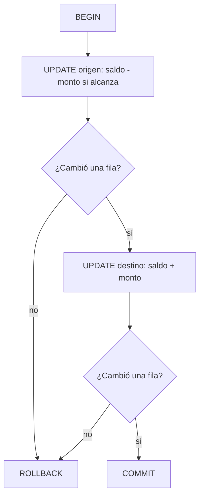

# Fundamentos de Bases de Datos - Lenguaje de consulta SQL

## 6.4 Actualizaciones.

---

Las sentencias de modificación de SQL (`INSERT`, `UPDATE`, `DELETE` y `MERGE`) cambian el estado de la base de datos. Igual que `SELECT`, son **declarativas** y trabajan sobre **conjuntos**: un `UPDATE` describe qué filas cambian y cómo, y el SMBD lo aplica a todas a la vez, como una sola operación atómica que respeta las restricciones de integridad. Este tema presenta las cuatro sentencias, las actualizaciones que dependen de otras tablas, el papel de las transacciones y las restricciones, y los errores más comunes.

### INSERT

```sql
INSERT INTO productos (nombre, precio, stock) VALUES ('Lámpara', 450, 10), ('Foco', 35, 200);
INSERT INTO historico SELECT * FROM ventas WHERE fecha < '2026-01-01';
```

Conviene nombrar siempre las columnas: así la sentencia no se rompe cuando se agrega una columna a la tabla. Las columnas omitidas reciben su valor `DEFAULT` o nulo. Para insertar o actualizar según exista la fila, SQL:2003 define `MERGE`, y PostgreSQL y SQLite ofrecen `INSERT ... ON CONFLICT (clave) DO UPDATE SET ...`, llamado **upsert**.

### UPDATE

```sql
UPDATE productos SET precio = precio * 1.08, fecha_actualizacion = CURRENT_DATE
WHERE categoria = 'Electrónicos';
```

Todas las expresiones de `SET` se evalúan con los valores **anteriores** de la fila: `SET a = b, b = a` intercambia dos columnas. La sentencia es atómica: si una sola fila viola una restricción, ninguna cambia. Sin `WHERE`, cambia **todas** las filas de la tabla.

Una actualización puede depender de otras tablas de dos maneras: con una **subconsulta correlacionada** en `SET` o en `WHERE`, que es estándar, o con `UPDATE ... FROM`, una extensión de PostgreSQL, SQL Server y SQLite que reúne la tabla con otra y usa sus columnas. Con `FROM`, si una fila de la tabla se reúne con varias filas de la otra, el resultado es indefinido; por eso conviene reunir con una subconsulta que ya esté agregada, una fila por clave.

### DELETE

```sql
DELETE FROM ventas WHERE fecha < '2020-01-01';
```

Las claves foráneas determinan qué pasa con las filas que hacen referencia a las borradas: `RESTRICT` o `NO ACTION` impide el borrado, `CASCADE` borra también las dependientes, `SET NULL` y `SET DEFAULT` cambian la referencia (tema 8.3). `TRUNCATE TABLE`, que no está en SQLite, vacía una tabla sin registrar cada fila; es más rápido pero no dispara los disparadores por fila.

### RETURNING

PostgreSQL, SQLite desde la versión 3.35 y otros SMBD permiten agregar `RETURNING columnas` a cualquiera de las tres sentencias, para obtener las filas afectadas con sus valores nuevos sin una consulta adicional; SQL Server usa `OUTPUT`. Es útil para obtener una clave generada o para registrar qué cambió.

### Transacciones

Varias sentencias que deben aplicarse juntas, como el retiro de una cuenta y el depósito en otra, se agrupan en una **transacción**: `BEGIN`, las sentencias y `COMMIT` para confirmar, o `ROLLBACK` para deshacer todo. El SMBD garantiza las propiedades **ACID**: atomicidad, consistencia, aislamiento y durabilidad (tema 9). Dentro de una transacción, una verificación seguida de una modificación, como "si el saldo alcanza, retirar", debe hacerse de forma que otra transacción no cambie el saldo en medio. Lo más sencillo es poner la verificación en la propia sentencia, `UPDATE ... WHERE saldo >= monto`, y comprobar cuántas filas cambió.



### Buenas prácticas

- Probar el `WHERE` con un `SELECT` antes de ejecutar un `UPDATE` o un `DELETE`, y hacerlo dentro de una transacción para poder deshacerlo.
- Declarar las reglas como restricciones (`CHECK`, claves foráneas), para que el SMBD rechace los cambios inválidos aunque la sentencia esté mal escrita.
- Mantener los datos derivados con disparadores, o calcularlos con vistas, en lugar de confiar en que cada aplicación los actualice.
- Para cambios masivos en tablas grandes, hacerlos por lotes, para no bloquear la tabla ni hacer crecer la bitácora de transacciones.

### Implementación en Python

El programa crea los productos y ventas de los ejercicios en SQLite, con restricciones `CHECK` y un disparador que actualiza la fecha de modificación, y ejecuta las actualizaciones pedidas. Usa `RETURNING` para mostrar las filas cambiadas, muestra un `UPDATE` que falla completo por una sola fila, y resuelve las actualizaciones que dependen de las ventas con `UPDATE ... FROM`, con `IN` y con `NOT EXISTS`. Para el ejercicio 3 reparte aumentos de salario dentro de un presupuesto, implementa una transferencia atómica que se revierte si falta saldo o la cuenta destino no existe, y aplica la inflación acumulada por categoría.

```python
import sqlite3

HOY = "2026-11-03"
db = sqlite3.connect(":memory:", isolation_level=None)          # transacciones explícitas con BEGIN y COMMIT
db.executescript(f"""
CREATE TABLE productos (id INTEGER PRIMARY KEY, nombre TEXT, precio NUMERIC CHECK (precio > 0),
                        stock INTEGER CHECK (stock >= 0), categoria TEXT, fecha_actualizacion TEXT,
                        estado TEXT NOT NULL DEFAULT 'activo');
-- ejercicio 1.3: la fecha se actualiza sola en cualquier cambio de precio o existencias
CREATE TRIGGER marca_fecha AFTER UPDATE OF precio, stock ON productos
WHEN OLD.precio IS NOT NEW.precio OR OLD.stock IS NOT NEW.stock
BEGIN UPDATE productos SET fecha_actualizacion = '{HOY}' WHERE id = NEW.id; END;
CREATE TABLE ventas (id INTEGER PRIMARY KEY, producto_id INTEGER REFERENCES productos, cantidad INTEGER, fecha TEXT);
INSERT INTO productos (id, nombre, precio, stock, categoria, fecha_actualizacion) VALUES
  (1, 'Televisor', 8999, 12, 'Electrónicos', '2026-01-15'), (2, 'Audífonos', 799, 140, 'Electrónicos', '2026-01-15'),
  (3, 'Cafetera', 1299, 3, 'Hogar', '2026-02-01'), (4, 'Licuadora', 999, 20, 'Hogar', '2026-02-01'),
  (5, 'Cuaderno', 45, 500, 'Papelería', '2026-03-10'), (6, 'Plumas', 30, 800, 'Papelería', '2026-03-10');
INSERT INTO ventas (producto_id, cantidad, fecha) VALUES
  (1, 2, '2026-10-05'), (2, 60, '2026-10-12'), (2, 55, '2026-10-28'), (5, 40, '2026-10-30'), (5, 30, '2026-08-01'),
  (3, 1, '2026-04-20'), (6, 12, '2026-07-15'), (4, 5, '2026-03-01');
""")
def tabla(titulo, cols="id, nombre, precio, stock, fecha_actualizacion, estado"):
    print(f"{titulo}:", db.execute(f"SELECT {cols} FROM productos ORDER BY id").fetchall())

# --- Ejercicio 1 ---
filas = db.execute("""UPDATE productos SET precio = ROUND(precio * 1.08, 2) WHERE categoria = 'Electrónicos'
                      RETURNING nombre, precio""").fetchall()
print("1.1 +8 % en Electrónicos:", sorted(filas))
filas = db.execute("UPDATE productos SET stock = stock - 5 WHERE precio > 500 AND stock >= 5 RETURNING nombre, stock").fetchall()
print("1.2 −5 unidades si el precio es mayor que 500 y alcanza el stock:", sorted(filas))
print("    la cafetera tenía 3: sin la condición stock >= 5, el UPDATE completo falla ->", end=" ")
try:
    db.execute("UPDATE productos SET stock = stock - 5 WHERE precio > 500")
except sqlite3.IntegrityError as e:
    print(e, "| stock de televisor y cafetera sin cambios:",
          db.execute("SELECT stock FROM productos WHERE id IN (1, 3) ORDER BY id").fetchall())
tabla("1.3 las fechas cambiaron solas", "nombre, fecha_actualizacion")

# --- Ejercicio 2 ---
db.execute("""UPDATE productos SET stock = stock - v.vendido
              FROM (SELECT producto_id, SUM(cantidad) AS vendido FROM ventas
                    WHERE fecha >= date(:hoy, 'start of month', '-1 month') AND fecha < date(:hoy, 'start of month')
                    GROUP BY producto_id) AS v
              WHERE v.producto_id = productos.id""", {"hoy": HOY})
tabla("2.1 stock menos lo vendido en octubre", "nombre, stock")
db.execute("""UPDATE productos SET precio = ROUND(precio * 1.10, 2)
              WHERE id IN (SELECT producto_id FROM ventas GROUP BY producto_id HAVING SUM(cantidad) > 100)""")
tabla("2.2 +10 % con más de 100 unidades vendidas", "nombre, precio")
n = db.execute("""UPDATE productos SET estado = 'inactivo'
                  WHERE NOT EXISTS (SELECT 1 FROM ventas v WHERE v.producto_id = productos.id AND v.fecha >= date(?, '-6 months'))""",
               (HOY,)).rowcount
tabla(f"2.3 {n} sin ventas desde el {db.execute('SELECT date(?, ?)', (HOY, '-6 months')).fetchone()[0]}", "nombre, estado")

# --- Ejercicio 3.1: ajuste de salarios por desempeño, sin exceder el presupuesto del departamento ---
db.executescript("""
CREATE TABLE empleados (id INTEGER PRIMARY KEY, nombre TEXT, depto TEXT, salario NUMERIC, evaluacion INTEGER);
CREATE TABLE presupuesto (depto TEXT PRIMARY KEY, aumento_max NUMERIC);
INSERT INTO empleados VALUES (1, 'Ana', 'TI', 40000, 5), (2, 'Beto', 'TI', 30000, 3), (3, 'Carla', 'TI', 35000, 4),
                             (4, 'Dante', 'Ventas', 25000, 5), (5, 'Eva', 'Ventas', 28000, 2);
INSERT INTO presupuesto VALUES ('TI', 4000), ('Ventas', 3000);
""")
antes = dict(db.execute("SELECT depto, SUM(salario) FROM empleados GROUP BY depto"))
# aumento deseado por evaluación; si el departamento no alcanza, se escala proporcionalmente
db.execute("""
WITH deseado AS (SELECT id, depto, salario * CASE evaluacion WHEN 5 THEN 0.08 WHEN 4 THEN 0.05 WHEN 3 THEN 0.02 ELSE 0 END AS a
                 FROM empleados),
     factor AS (SELECT d.depto, MIN(1.0, p.aumento_max / SUM(d.a)) AS f FROM deseado d JOIN presupuesto p USING (depto) GROUP BY d.depto)
UPDATE empleados SET salario = ROUND(salario + (SELECT d.a * f.f FROM deseado d JOIN factor f USING (depto) WHERE d.id = empleados.id), 2)
""")
print("3.1:", db.execute("SELECT nombre, salario FROM empleados ORDER BY id").fetchall(),
      "| aumento total por depto:", [(d, round(s - antes[d], 2)) for d, s in db.execute("SELECT depto, SUM(salario) FROM empleados GROUP BY depto ORDER BY depto")])

# --- Ejercicio 3.2: transferencia atómica con verificación de saldo ---
db.executescript("""CREATE TABLE cuentas (numero TEXT PRIMARY KEY, saldo NUMERIC NOT NULL CHECK (saldo >= 0));
                    INSERT INTO cuentas VALUES ('A', 1000), ('B', 200);""")
def transferir(origen, destino, monto):
    try:
        db.execute("BEGIN IMMEDIATE")                      # bloquea la base para escribir antes de leer el saldo
        if db.execute("UPDATE cuentas SET saldo = saldo - ? WHERE numero = ? AND saldo >= ?", (monto, origen, monto)).rowcount != 1:
            raise ValueError("saldo insuficiente o cuenta inexistente")
        if db.execute("UPDATE cuentas SET saldo = saldo + ? WHERE numero = ?", (monto, destino)).rowcount != 1:
            raise ValueError("cuenta destino inexistente")
        db.execute("COMMIT"); return "hecha"
    except (ValueError, sqlite3.Error) as e:
        db.execute("ROLLBACK"); return f"revertida ({e})"
for o, d, m in (("A", "B", 300), ("B", "A", 900), ("A", "Z", 100)):
    print(f"3.2 transferir {m} de {o} a {d}:", transferir(o, d, m), "| saldos", db.execute("SELECT * FROM cuentas ORDER BY numero").fetchall())

# --- Ejercicio 3.3: inflación acumulada por categoría ---
db.executescript("""CREATE TABLE inflacion (categoria TEXT, mes TEXT, tasa NUMERIC);
INSERT INTO inflacion VALUES ('Electrónicos', '2026-08', 0.004), ('Electrónicos', '2026-09', 0.006), ('Electrónicos', '2026-10', 0.005),
                             ('Hogar', '2026-08', 0.010), ('Hogar', '2026-09', 0.008), ('Hogar', '2026-10', 0.012);""")
# la inflación acumulada es el producto de (1 + tasa); el logaritmo convierte el producto en una suma agregable
db.execute("""UPDATE productos SET precio = ROUND(precio * (SELECT EXP(SUM(LN(1 + tasa))) FROM inflacion i
                                                          WHERE i.categoria = productos.categoria), 2)
              WHERE categoria IN (SELECT categoria FROM inflacion)""")
print("3.3 acumulada:", db.execute("SELECT categoria, ROUND(100 * (EXP(SUM(LN(1 + tasa))) - 1), 3) FROM inflacion GROUP BY categoria").fetchall(),
      "| suma simple:", db.execute("SELECT categoria, ROUND(100 * SUM(tasa), 3) FROM inflacion GROUP BY categoria").fetchall())
tabla("    precios", "nombre, precio")
```

Salida:

```text
1.1 +8 % en Electrónicos: [('Audífonos', 862.92), ('Televisor', 9718.92)]
1.2 −5 unidades si el precio es mayor que 500 y alcanza el stock: [('Audífonos', 135), ('Licuadora', 15), ('Televisor', 7)]
    la cafetera tenía 3: sin la condición stock >= 5, el UPDATE completo falla -> CHECK constraint failed: stock >= 0 | stock de televisor y cafetera sin cambios: [(7,), (3,)]
1.3 las fechas cambiaron solas: [('Televisor', '2026-11-03'), ('Audífonos', '2026-11-03'), ('Cafetera', '2026-02-01'), ('Licuadora', '2026-11-03'), ('Cuaderno', '2026-03-10'), ('Plumas', '2026-03-10')]
2.1 stock menos lo vendido en octubre: [('Televisor', 5), ('Audífonos', 20), ('Cafetera', 3), ('Licuadora', 15), ('Cuaderno', 460), ('Plumas', 800)]
2.2 +10 % con más de 100 unidades vendidas: [('Televisor', 9718.92), ('Audífonos', 949.21), ('Cafetera', 1299), ('Licuadora', 999), ('Cuaderno', 45), ('Plumas', 30)]
2.3 2 sin ventas desde el 2026-05-03: [('Televisor', 'activo'), ('Audífonos', 'activo'), ('Cafetera', 'inactivo'), ('Licuadora', 'inactivo'), ('Cuaderno', 'activo'), ('Plumas', 'activo')]
3.1: [('Ana', 42306.31), ('Beto', 30432.43), ('Carla', 36261.26), ('Dante', 27000), ('Eva', 28000)] | aumento total por depto: [('TI', 4000.0), ('Ventas', 2000)]
3.2 transferir 300 de A a B: hecha | saldos [('A', 700), ('B', 500)]
3.2 transferir 900 de B a A: revertida (saldo insuficiente o cuenta inexistente) | saldos [('A', 700), ('B', 500)]
3.2 transferir 100 de A a Z: revertida (cuenta destino inexistente) | saldos [('A', 700), ('B', 500)]
3.3 acumulada: [('Electrónicos', 1.507), ('Hogar', 3.03)] | suma simple: [('Electrónicos', 1.5), ('Hogar', 3.0)]
    precios: [('Televisor', 9865.42), ('Audífonos', 963.52), ('Cafetera', 1338.36), ('Licuadora', 1029.27), ('Cuaderno', 45), ('Plumas', 30)]
```

### Ejercicios Propuestos

1. **Actualizaciones básicas.** Con `productos(id, nombre, precio, stock, categoria, fecha_actualizacion)`, aumenta 8 % el precio de los productos de la categoría "Electrónicos", reduce en 5 unidades el stock de los productos con precio mayor que 500 y pon la fecha de hoy en los productos modificados.

2. **Con subconsultas.** Con `ventas(id, producto_id, cantidad, fecha)`, resta del stock las cantidades vendidas el último mes, aumenta 10 % el precio de los productos con más de 100 unidades vendidas y marca como inactivos los productos sin ventas en los últimos 6 meses.

3. **Actualizaciones complejas.** Ajusta los salarios según la evaluación de desempeño y el presupuesto de cada departamento; escribe una transacción que transfiera fondos entre cuentas verificando el saldo, y actualiza los precios con la inflación acumulada de cada categoría.

### Soluciones

**Ejercicio 1.** `UPDATE productos SET precio = ROUND(precio * 1.08, 2) WHERE categoria = 'Electrónicos'`. Para el stock, la condición debe incluir `stock >= 5`: la cafetera tiene 3, y sin esa condición el `CHECK (stock >= 0)` rechaza la sentencia **completa**, como muestra el programa, y no cambia ninguna fila. Si en cambio se quiere dejar en 0 los que no alcanzan, se usa `SET stock = MAX(stock - 5, 0)`, o `GREATEST` en otros SMBD. Para la fecha hay dos opciones: incluirla en cada `UPDATE` (`SET ..., fecha_actualizacion = CURRENT_DATE`) o, mejor, un disparador `AFTER UPDATE OF precio, stock` que la ponga siempre, para que ninguna aplicación lo olvide. El disparador del programa compara los valores con `IS NOT`, para no marcar las filas cuyo valor no cambió.

**Ejercicio 2.** "El último mes" se interpreta como el mes calendario anterior, del 1 al 31 de octubre; "los últimos 30 días" sería otra consulta. La resta se hace con `UPDATE ... FROM` sobre una subconsulta agregada por producto, para que cada producto se reúna con una sola fila; el estándar lo escribe como `SET stock = stock - (SELECT COALESCE(SUM(cantidad), 0) FROM ventas WHERE ...)`, donde `COALESCE` evita que los productos sin ventas queden con stock nulo. El aumento usa `id IN (SELECT producto_id ... HAVING SUM(cantidad) > 100)`: solo los audífonos, con 115 unidades. Los inactivos se marcan con `NOT EXISTS` de una venta en los últimos 6 meses, desde el 3 de mayo: la cafetera y la licuadora. Con `NOT IN` habría que excluir los `producto_id` nulos (tema 6.3). Marcar es mejor que borrar, porque los productos inactivos siguen teniendo ventas históricas que hacen referencia a ellos.

**Ejercicio 3.**

1. **Salarios:** el aumento deseado depende de la evaluación, 8 % para un 5, 5 % para un 4 y 2 % para un 3. Si la suma de un departamento excede su presupuesto, todos se escalan por el mismo factor, $\min(1, \text{presupuesto} / \text{suma}).$ En TI, los aumentos deseados suman 5550 y el presupuesto es 4000, así que se aplica el 72 %; en Ventas suman 2000 y caben en 3000. Todo se hace en un solo `UPDATE` con expresiones `WITH`, así que los cálculos usan los salarios anteriores.
2. **Transferencia:** se abre la transacción con `BEGIN IMMEDIATE`, que en SQLite reserva la escritura desde el principio; se resta del origen solo si el saldo alcanza, se suma al destino, y se confirma únicamente si cada `UPDATE` cambió exactamente una fila. Si no, `ROLLBACK`. El `CHECK (saldo >= 0)` es una segunda defensa. En el programa, la segunda transferencia se revierte por saldo insuficiente y la tercera por una cuenta destino inexistente, en ambos casos sin cambiar ningún saldo.
3. **Inflación:** la inflación acumulada no es la suma de las tasas mensuales, sino $\prod_i (1 + r_i) - 1.$ SQL no tiene un agregado de producto, pero $\prod_i (1 + r_i) = \exp\big(\sum_i \ln(1 + r_i)\big),$ que sí se puede calcular. En el ejemplo, 1.507 % en lugar de 1.5 % para Electrónicos y 3.03 % en lugar de 3.0 % para Hogar; la diferencia crece con el número de periodos y con las tasas.

### Referencias

1. Elmasri, R., and Navathe, S. B., _Fundamentals of Database Systems_. Pearson, 2016. Capítulo 6.
2. Silberschatz, A., Korth, H. F., and Sudarshan, S., _Database System Concepts_. McGraw-Hill, 2019. Capítulos 3 y 4.
3. ISO/IEC 9075-2:2023, _SQL — Part 2: Foundation_. Secciones sobre las sentencias de modificación de datos.
4. SQLite, _UPDATE_, _RETURNING_ y _UPSERT_. Documentación en línea, sqlite.org.
