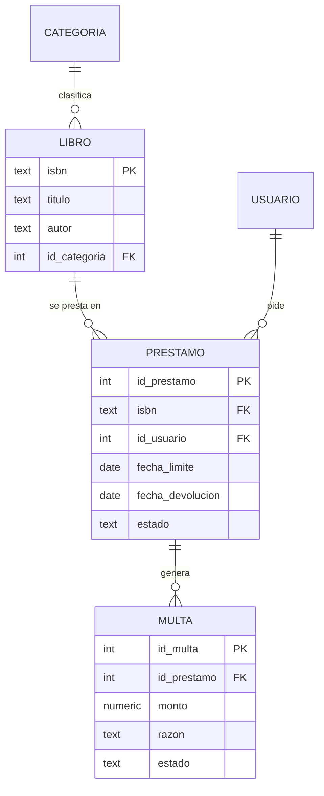

# Fundamentos de Bases de Datos - Lenguaje de consulta SQL

## 6.5 Definición de esquemas.

---

El **lenguaje de definición de datos** (DDL) de SQL crea, modifica y elimina los objetos de una base de datos: esquemas, tablas, restricciones, índices, vistas, secuencias y disparadores. Una definición cuidadosa hace que el SMBD mismo haga cumplir las reglas del negocio, en lugar de dejarlas a cada aplicación (la regla 10 de Codd, tema 4.5). Este tema presenta las sentencias del DDL, los tipos de datos, las restricciones, la evolución de un esquema con `ALTER TABLE` y las diferencias de SQLite con el estándar.

### Esquemas

Un **esquema** es un espacio de nombres que agrupa objetos: `CREATE SCHEMA ventas;` y luego `CREATE TABLE ventas.pedido (...)`. Permite separar módulos de una aplicación y otorgar permisos por módulo. En SQLite, el equivalente más cercano es una base de datos adjunta con `ATTACH`.

### Tipos de datos

| Familia     | Tipos del estándar                                      | Uso y advertencias                                                              |
| ----------- | ------------------------------------------------------- | ------------------------------------------------------------------------------- |
| Enteros     | `SMALLINT`, `INTEGER`, `BIGINT`                         | Claves, contadores                                                              |
| Exactos     | `DECIMAL(p, s)`, `NUMERIC(p, s)`                        | Dinero: `DECIMAL(10, 2)` guarda 25.10 exactamente                               |
| Aproximados | `REAL`, `DOUBLE PRECISION`, `FLOAT`                     | Mediciones; nunca para dinero                                                  |
| Cadenas     | `CHAR(n)`, `VARCHAR(n)`, `TEXT` o `CLOB`                | `CHAR(n)` rellena con espacios                                                  |
| Fechas      | `DATE`, `TIME`, `TIMESTAMP [WITH TIME ZONE]`, `INTERVAL` | Guardar instantes en UTC con zona horaria                                       |
| Otros       | `BOOLEAN`, `BINARY`, `BLOB`, `JSON`, `UUID`             | Según el SMBD                                                                   |

SQLite tiene **tipado dinámico**: una columna declara una **afinidad**, no un tipo, y acepta cualquier valor salvo que la tabla se declare `STRICT`. Guarda las fechas como texto ISO 8601, números o días julianos, y las funciones de fecha trabajan con las tres formas.

### CREATE TABLE y restricciones

Las restricciones pueden ir junto a una columna o, si afectan a varias, al final de la tabla:

- `NOT NULL`: la columna no admite nulos.
- `DEFAULT expresión`: el valor que recibe si la inserción la omite.
- `PRIMARY KEY`: clave primaria; implica `UNIQUE` y, en el estándar, `NOT NULL`. En SQLite, una clave `INTEGER PRIMARY KEY` es el identificador interno de la fila y se genera sola.
- `UNIQUE`: clave alternativa; admite varios nulos en la mayoría de los SMBD.
- `CHECK (condición)`: una condición sobre los valores de la fila; se rechaza la fila si la condición es **falsa**, y se acepta si es desconocida.
- `REFERENCES tabla (columnas)` o `FOREIGN KEY (...) REFERENCES ...`, con `ON DELETE` y `ON UPDATE` para elegir `NO ACTION`, `RESTRICT`, `CASCADE`, `SET NULL` o `SET DEFAULT`. En SQLite hay que activarlas en cada conexión con `PRAGMA foreign_keys = ON`.

Las restricciones pueden tener nombre (`CONSTRAINT ck_monto CHECK (monto > 0)`), que aparece en los mensajes de error y permite eliminarlas después. En el estándar se pueden declarar `DEFERRABLE` para verificarlas al final de la transacción.

### ALTER y DROP

```sql
ALTER TABLE libro ADD COLUMN editorial VARCHAR(100);
ALTER TABLE libro RENAME COLUMN autor TO autores;
ALTER TABLE usuario ADD CONSTRAINT ck_email CHECK (email LIKE '%_@_%._%');
ALTER TABLE libro DROP COLUMN editorial;
DROP TABLE multa;          -- falla si otras tablas hacen referencia a ella, salvo con CASCADE
```

SQLite implementa `ADD COLUMN`, `RENAME TO`, `RENAME COLUMN` y, desde la versión 3.35, `DROP COLUMN`, pero no `ADD CONSTRAINT` ni `ALTER COLUMN`. Para cambiar las restricciones de una tabla se **reconstruye**: dentro de una transacción, con las claves foráneas desactivadas, se crea la tabla nueva, se copian los datos, se borra la vieja, se renombra la nueva, se recrean sus índices, disparadores y vistas, y se verifica con `PRAGMA foreign_key_check` que no quedaron referencias rotas. En un sistema en producción, cada cambio de esquema se escribe como una **migración** versionada que se puede aplicar y revertir.

### Índices

`CREATE [UNIQUE] INDEX nombre ON tabla (columnas)` crea una estructura auxiliar, por lo general un árbol B, que acelera las búsquedas y los ordenamientos por esas columnas a cambio de espacio y de un costo en cada inserción y actualización. No es parte del modelo relacional, sino del nivel interno: crearlo no cambia ningún resultado (tema 1.3). Las claves primarias y las restricciones `UNIQUE` ya crean un índice. El tema 6.6 explica cuándo conviene uno.

### Vistas

`CREATE VIEW nombre AS SELECT ...` define una tabla virtual cuyo contenido se calcula al consultarla. Sirven para el nivel externo de la arquitectura de tres niveles, para simplificar consultas frecuentes y para la seguridad (tema 7).



### Implementación en Python

El programa crea en SQLite el esquema de la biblioteca del ejercicio 1 con sus restricciones y prueba tres operaciones que el esquema rechaza. Para el ejercicio 3 agrega una columna, consulta los índices de la tabla, agrega una restricción de correo reconstruyendo la tabla con el procedimiento descrito, y crea la vista de los préstamos activos. Para el ejercicio 2 migra la tabla de pedidos con columnas repetidas a cuatro tablas en 3FN con `INSERT ... SELECT`, y compara una consulta en las dos versiones.

```python
import sqlite3

db = sqlite3.connect(":memory:", isolation_level=None)
db.execute("PRAGMA foreign_keys = ON")

# --- Ejercicio 1: esquema de la biblioteca ---
db.executescript("""
CREATE TABLE categoria (id_categoria INTEGER PRIMARY KEY, nombre TEXT NOT NULL UNIQUE);
CREATE TABLE libro (
    isbn         TEXT PRIMARY KEY CHECK (length(isbn) = 13),
    titulo       TEXT NOT NULL,
    autor        TEXT NOT NULL,
    id_categoria INTEGER NOT NULL REFERENCES categoria ON UPDATE CASCADE ON DELETE RESTRICT
);
CREATE TABLE usuario (
    id_usuario INTEGER PRIMARY KEY,
    nombre     TEXT NOT NULL,
    email      TEXT NOT NULL UNIQUE,
    tipo       TEXT NOT NULL DEFAULT 'estudiante' CHECK (tipo IN ('estudiante', 'profesor', 'externo'))
);
CREATE TABLE prestamo (
    id_prestamo      INTEGER PRIMARY KEY,
    isbn             TEXT NOT NULL REFERENCES libro,
    id_usuario       INTEGER NOT NULL REFERENCES usuario,
    fecha_prestamo   TEXT NOT NULL,
    fecha_limite     TEXT NOT NULL,
    fecha_devolucion TEXT,
    estado           TEXT NOT NULL DEFAULT 'activo' CHECK (estado IN ('activo', 'devuelto', 'perdido')),
    CHECK (fecha_limite > fecha_prestamo),
    CHECK ((estado = 'devuelto') = (fecha_devolucion IS NOT NULL))
);
CREATE TABLE multa (
    id_multa    INTEGER PRIMARY KEY,
    id_prestamo INTEGER NOT NULL REFERENCES prestamo ON DELETE CASCADE,
    monto       NUMERIC NOT NULL CHECK (monto > 0),
    razon       TEXT NOT NULL CHECK (razon IN ('retraso', 'daño', 'pérdida')),
    estado      TEXT NOT NULL DEFAULT 'pendiente' CHECK (estado IN ('pendiente', 'pagada', 'condonada')),
    UNIQUE (id_prestamo, razon)
);
INSERT INTO categoria VALUES (1, 'Novela'), (2, 'Bases de datos');
INSERT INTO libro VALUES ('9780307474728', 'Cien años de soledad', 'García Márquez', 1),
                         ('9780133970777', 'Fundamentals of Database Systems', 'Elmasri y Navathe', 2);
INSERT INTO usuario (nombre, email, tipo) VALUES ('Ana', 'ana@ejemplo.mx', 'profesor');
INSERT INTO usuario (nombre, email) VALUES ('Luis', 'luis@ejemplo.mx');
INSERT INTO prestamo (isbn, id_usuario, fecha_prestamo, fecha_limite, fecha_devolucion, estado) VALUES
    ('9780307474728', 1, '2026-10-01', '2026-10-15', '2026-10-20', 'devuelto'),
    ('9780133970777', 2, '2026-10-25', '2026-11-08', NULL, 'activo');
INSERT INTO multa (id_prestamo, monto, razon) VALUES (1, 50, 'retraso');
""")
print("ejercicio 1, tablas:", [n for (n,) in db.execute("SELECT name FROM sqlite_master WHERE type = 'table' ORDER BY rowid")])
print("   valor por omisión del tipo de Luis:", db.execute("SELECT tipo FROM usuario WHERE nombre = 'Luis'").fetchone()[0])
for sql in ("INSERT INTO prestamo (isbn, id_usuario, fecha_prestamo, fecha_limite, estado) VALUES ('9780307474728', 1, '2026-11-01', '2026-11-15', 'devuelto')",
            "INSERT INTO multa (id_prestamo, monto, razon) VALUES (1, 30, 'retraso')",
            "DELETE FROM categoria WHERE id_categoria = 1"):
    try:
        db.execute(sql)
    except sqlite3.IntegrityError as e:
        print("   rechazado:", e)

# --- Ejercicio 3: modificar el esquema ---
db.execute("ALTER TABLE libro ADD COLUMN editorial TEXT")                                  # 3.1
print("3.1 columnas de libro:", [c[1] for c in db.execute("PRAGMA table_info(libro)")])
db.execute("CREATE INDEX idx_libro_titulo ON libro(titulo)")                               # 3.2, ver la solución
print("3.2 índices de libro:", [(r[1], r[2]) for r in db.execute("PRAGMA index_list(libro)")])
# 3.3: SQLite no tiene ALTER TABLE ... ADD CONSTRAINT; se reconstruye la tabla en una transacción
db.execute("PRAGMA foreign_keys = OFF")
db.executescript("""
BEGIN;
CREATE TABLE usuario_nuevo (
    id_usuario INTEGER PRIMARY KEY,
    nombre     TEXT NOT NULL,
    email      TEXT NOT NULL UNIQUE CHECK (email LIKE '_%@_%._%' AND email NOT LIKE '% %'),
    tipo       TEXT NOT NULL DEFAULT 'estudiante' CHECK (tipo IN ('estudiante', 'profesor', 'externo'))
);
INSERT INTO usuario_nuevo SELECT * FROM usuario;
DROP TABLE usuario;
ALTER TABLE usuario_nuevo RENAME TO usuario;
COMMIT;
""")
db.execute("PRAGMA foreign_keys = ON")
print("3.3 claves foráneas rotas tras reconstruir:", db.execute("PRAGMA foreign_key_check").fetchall())
for correo in ("eva@ejemplo.mx", "sin-arroba.mx", "eva@sinpunto", "con espacio@ejemplo.mx"):
    try:
        db.execute("INSERT INTO usuario (nombre, email) VALUES ('Eva', ?)", (correo,)); print(f"   aceptado: {correo}")
        db.execute("DELETE FROM usuario WHERE email = ?", (correo,))
    except sqlite3.IntegrityError as e:
        print(f"   rechazado: {correo}")
db.execute("""CREATE VIEW prestados_ahora AS                                               -- 3.4
              SELECT l.titulo, u.nombre, p.fecha_limite, julianday('2026-11-03') > julianday(p.fecha_limite) AS vencido
              FROM prestamo p JOIN libro l USING (isbn) JOIN usuario u USING (id_usuario) WHERE p.estado = 'activo'""")
print("3.4 prestados_ahora:", db.execute("SELECT * FROM prestados_ahora").fetchall())

# --- Ejercicio 2: pedidos con columnas repetidas, a 3FN ---
db.executescript("""
CREATE TABLE pedidos_plana (pedido_id INTEGER, fecha TEXT, cliente_id INTEGER, cliente_nombre TEXT,
    producto1_id INTEGER, producto1_nombre TEXT, producto1_cantidad INTEGER,
    producto2_id INTEGER, producto2_nombre TEXT, producto2_cantidad INTEGER);
INSERT INTO pedidos_plana VALUES (1, '2026-10-01', 7, 'Rosa', 10, 'Teclado', 2, 11, 'Ratón', 1),
                                 (2, '2026-10-02', 8, 'Iván', 10, 'Teclado', 1, NULL, NULL, NULL),
                                 (3, '2026-10-04', 7, 'Rosa', 12, 'Monitor', 1, 10, 'Teclado', 3);
CREATE TABLE cliente (cliente_id INTEGER PRIMARY KEY, nombre TEXT NOT NULL);
CREATE TABLE producto (producto_id INTEGER PRIMARY KEY, nombre TEXT NOT NULL);
CREATE TABLE pedido (pedido_id INTEGER PRIMARY KEY, fecha TEXT NOT NULL, cliente_id INTEGER NOT NULL REFERENCES cliente);
CREATE TABLE linea_pedido (pedido_id INTEGER REFERENCES pedido, producto_id INTEGER REFERENCES producto,
                           cantidad INTEGER NOT NULL CHECK (cantidad > 0), PRIMARY KEY (pedido_id, producto_id));
INSERT INTO cliente SELECT DISTINCT cliente_id, cliente_nombre FROM pedidos_plana;
INSERT INTO producto SELECT producto1_id, producto1_nombre FROM pedidos_plana
                     UNION SELECT producto2_id, producto2_nombre FROM pedidos_plana WHERE producto2_id IS NOT NULL;
INSERT INTO pedido SELECT pedido_id, fecha, cliente_id FROM pedidos_plana;
INSERT INTO linea_pedido SELECT pedido_id, producto1_id, producto1_cantidad FROM pedidos_plana
                         UNION ALL SELECT pedido_id, producto2_id, producto2_cantidad FROM pedidos_plana WHERE producto2_id IS NOT NULL;
""")
print("ejercicio 2, filas:", {t: db.execute(f"SELECT COUNT(*) FROM {t}").fetchone()[0] for t in ("cliente", "producto", "pedido", "linea_pedido")})
print("   un pedido con tres productos ya es posible:",
      db.execute("INSERT INTO linea_pedido VALUES (3, 11, 2)").rowcount == 1,
      "| unidades de Teclado:", db.execute("SELECT SUM(cantidad) FROM linea_pedido WHERE producto_id = 10").fetchone()[0],
      "| en la tabla plana:", db.execute("""SELECT SUM(CASE WHEN producto1_id = 10 THEN producto1_cantidad ELSE 0 END)
                                                  + SUM(CASE WHEN producto2_id = 10 THEN producto2_cantidad ELSE 0 END) FROM pedidos_plana""").fetchone()[0])
```

Salida:

```text
ejercicio 1, tablas: ['categoria', 'libro', 'usuario', 'prestamo', 'multa']
   valor por omisión del tipo de Luis: estudiante
   rechazado: CHECK constraint failed: (estado = 'devuelto') = (fecha_devolucion IS NOT NULL)
   rechazado: UNIQUE constraint failed: multa.id_prestamo, multa.razon
   rechazado: FOREIGN KEY constraint failed
3.1 columnas de libro: ['isbn', 'titulo', 'autor', 'id_categoria', 'editorial']
3.2 índices de libro: [('idx_libro_titulo', 0), ('sqlite_autoindex_libro_1', 1)]
3.3 claves foráneas rotas tras reconstruir: []
   aceptado: eva@ejemplo.mx
   rechazado: sin-arroba.mx
   rechazado: eva@sinpunto
   rechazado: con espacio@ejemplo.mx
3.4 prestados_ahora: [('Fundamentals of Database Systems', 'Luis', '2026-11-08', 0)]
ejercicio 2, filas: {'cliente': 2, 'producto': 3, 'pedido': 3, 'linea_pedido': 5}
   un pedido con tres productos ya es posible: True | unidades de Teclado: 6 | en la tabla plana: 6
```

### Ejercicios Propuestos

1. **Diseño.** Diseña un esquema para una biblioteca con libros (título, autor, ISBN, categoría), usuarios (nombre, email, tipo), préstamos (fecha de préstamo, fecha de devolución, estado) y multas (monto, razón, estado).

2. **Normalización.** Normaliza a 3FN la tabla `pedidos(pedido_id, fecha, cliente_id, cliente_nombre, producto1_id, producto1_nombre, producto1_cantidad, producto2_id, producto2_nombre, producto2_cantidad)`.

3. **Modificación.** Sobre el esquema del ejercicio 1, agrega una columna `editorial` a los libros, crea un índice sobre el ISBN, agrega una restricción `CHECK` que valide los correos y crea una vista de los libros prestados actualmente.

### Soluciones

**Ejercicio 1.** Es el DDL del programa, con cinco tablas. La categoría es una tabla propia, para que no haya dos grafías de la misma, con `ON DELETE RESTRICT`: no se puede borrar una categoría con libros. El tipo de usuario y los estados son dominios cerrados con `CHECK ... IN (...)` y valores por omisión. El préstamo distingue la **fecha límite** de la **fecha de devolución**, que el enunciado mezcla bajo un solo nombre: la primera se conoce al prestar, la segunda solo al devolver, y sin ambas no se pueden calcular retrasos. Un `CHECK` de tabla liga el estado con la fecha de devolución, para que no haya un préstamo "devuelto" sin fecha. La multa hace referencia al préstamo, con `ON DELETE CASCADE`, y `UNIQUE (id_prestamo, razon)` impide cobrar dos veces el mismo retraso. El programa muestra esas tres restricciones rechazando cambios inválidos.

**Ejercicio 2.** Las columnas `producto1_*` y `producto2_*` son un **grupo repetido** disfrazado: la tabla no está en 1FN en el sentido del diseño, limita los pedidos a dos productos, deja nulos cuando hay uno solo, y obliga a buscar cada producto en dos columnas. La normalización produce `cliente(cliente_id, nombre)`, `producto(producto_id, nombre)`, `pedido(pedido_id, fecha, cliente_id)` y `linea_pedido(pedido_id, producto_id, cantidad)`, con las dependencias $\text{cliente\_id} \to \text{nombre},$ $\text{producto\_id} \to \text{nombre}$ y $\text{pedido\_id} \to \text{fecha}, \text{cliente\_id}$ separadas. La migración usa `UNION` para los productos, que elimina duplicados, y `UNION ALL` para las líneas, que no debe eliminarlos. Después de migrar, un pedido puede tener tres productos, y contar las unidades de un producto es una suma simple en lugar de dos expresiones `CASE`.

**Ejercicio 3.** La columna se agrega con `ALTER TABLE ... ADD COLUMN`, y las filas existentes la reciben nula. El índice sobre el ISBN **sobra**: el ISBN es la clave primaria y ya tiene uno, `sqlite_autoindex_libro_1` en el programa; crear otro duplicaría el costo de mantenimiento sin acelerar nada. Si se buscan libros por título, ese índice sí tiene sentido, y es el que crea el programa. La restricción de correo se agregaría en el estándar con `ALTER TABLE usuario ADD CONSTRAINT ck_email CHECK (...)`, que falla si alguna fila existente no la cumple; en SQLite hay que reconstruir la tabla. La condición `email LIKE '_%@_%._%' AND email NOT LIKE '% %'` exige algo antes y después de la arroba, un punto en el dominio y ningún espacio. Es una validación de forma, no de existencia: la única manera de saber si un correo existe es enviarle un mensaje. La vista `prestados_ahora` reúne los préstamos activos con el libro y el usuario y calcula si están vencidos al 3 de noviembre de 2026.

### Referencias

1. Elmasri, R., and Navathe, S. B., _Fundamentals of Database Systems_. Pearson, 2016. Capítulos 6 y 7.
2. Silberschatz, A., Korth, H. F., and Sudarshan, S., _Database System Concepts_. McGraw-Hill, 2019. Capítulos 3 y 4.
3. SQLite, _CREATE TABLE_, _ALTER TABLE_ y _Datatypes In SQLite_. Documentación en línea, sqlite.org.
4. PostgreSQL Global Development Group, _PostgreSQL Documentation_, capítulo 5: Data Definition.
