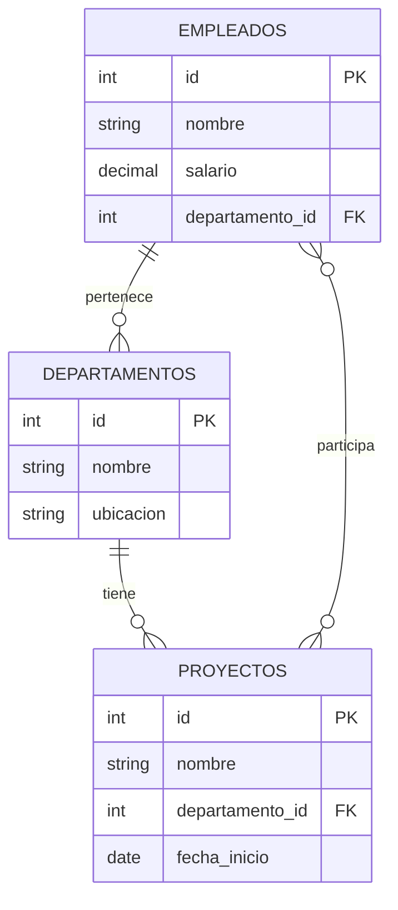

# Fundamentos de Bases de Datos - Lenguaje de consulta SQL

## 6.5 Definición de esquemas.

---

La definición de esquemas en SQL es el proceso de crear y modificar la estructura de una base de datos. Según Elmasri y Navathe (2006), "el esquema de una base de datos define su estructura lógica, incluyendo tablas, columnas, restricciones y relaciones".

**Definición formal**: Un esquema de base de datos es la estructura lógica que define la organización de los datos, incluyendo tablas, vistas, índices y restricciones de integridad.

### Sentencias DDL (Data Definition Language)

#### CREATE SCHEMA

Crea un nuevo esquema de base de datos.

**Sintaxis básica**:

```sql
CREATE SCHEMA nombre_esquema
[AUTHORIZATION usuario];
```

**Ejemplo**:

```sql
CREATE SCHEMA ventas
AUTHORIZATION dba;
```

#### CREATE TABLE

Crea una nueva tabla en el esquema.

**Sintaxis completa**:

```sql
CREATE TABLE nombre_tabla (
    columna1 tipo_dato [restricciones],
    columna2 tipo_dato [restricciones],
    ...
    [restricciones_de_tabla]
);
```

### Tipos de Datos SQL

#### Datos Numéricos

- `INT` o `INTEGER`: Números enteros
- `DECIMAL(p, s)` o `NUMERIC(p, s)`: Números decimales precisos
- `FLOAT`, `REAL`: Números de punto flotante

**Fórmula de precisión decimal**:

$$ \text{Valor} = \frac{\text{Entero}}{10^s} $$

#### Datos de Texto

- `CHAR(n)`: Cadena de longitud fija
- `VARCHAR(n)`: Cadena de longitud variable
- `TEXT`: Texto de longitud variable grande

#### Datos Temporales

- `DATE`: Fecha (YYYY-MM-DD)
- `TIME`: Hora (HH:MM:SS)
- `TIMESTAMP`: Fecha y hora

### Restricciones de Integridad

#### Restricciones de Columna

**PRIMARY KEY**:

```sql
CREATE TABLE empleados (
    id INT PRIMARY KEY,
    nombre VARCHAR(100)
);
```

**FOREIGN KEY**:

```sql
CREATE TABLE pedidos (
    id INT PRIMARY KEY,
    empleado_id INT REFERENCES empleados(id)
);
```

**UNIQUE**:

```sql
CREATE TABLE usuarios (
    id INT PRIMARY KEY,
    email VARCHAR(100) UNIQUE
);
```

**CHECK**:

```sql
CREATE TABLE productos (
    id INT PRIMARY KEY,
    precio DECIMAL(10,2) CHECK (precio > 0),
    stock INT CHECK (stock >= 0)
);
```

#### Restricciones de Tabla

**Clave primaria compuesta**:

```sql
CREATE TABLE matricula (
    estudiante_id INT,
    curso_id INT,
    fecha DATE,
    PRIMARY KEY (estudiante_id, curso_id)
);
```

**Clave foránea con acciones**:

```sql
CREATE TABLE ventas (
    id INT PRIMARY KEY,
    producto_id INT,
    cantidad INT,
    FOREIGN KEY (producto_id)
        REFERENCES productos(id)
        ON DELETE CASCADE
        ON UPDATE SET NULL
);
```

### Modificación de Esquemas

#### ALTER TABLE

Modifica la estructura de una tabla existente.

**Agregar columna**:

```sql
ALTER TABLE empleados
ADD COLUMN fecha_nacimiento DATE;
```

**Modificar columna**:

```sql
ALTER TABLE productos
ALTER COLUMN precio TYPE DECIMAL(12,2);
```

**Eliminar columna**:

```sql
ALTER TABLE clientes
DROP COLUMN telefono;
```

**Agregar restricción**:

```sql
ALTER TABLE ventas
ADD CONSTRAINT fk_producto
FOREIGN KEY (producto_id) REFERENCES productos(id);
```

#### DROP TABLE

Elimina una tabla de la base de datos.

```sql
DROP TABLE nombre_tabla [CASCADE | RESTRICT];
```

### Índices y Optimización

#### CREATE INDEX

Crea índices para mejorar el rendimiento de las consultas.

**Sintaxis**:

```sql
CREATE [UNIQUE] INDEX nombre_indice
ON nombre_tabla (columna1, columna2, ...);
```

**Ejemplo**:

```sql
CREATE INDEX idx_empleados_departamento
ON empleados (departamento_id);
```

### Vistas

#### CREATE VIEW

Crea una vista virtual basada en una consulta.

**Sintaxis**:

```sql
CREATE VIEW nombre_vista AS
SELECT columna1, columna2, ...
FROM tabla
WHERE condición;
```

**Ejemplo**:

```sql
CREATE VIEW vista_empleados_activos AS
SELECT id, nombre, salario
FROM empleados
WHERE activo = true;
```

### Diagrama de Relaciones de Esquema



### Ejemplos Completos de Esquemas

#### Ejemplo 1: Esquema de Sistema de Ventas

```sql
CREATE SCHEMA sistema_ventas;

CREATE TABLE clientes (
    id INT PRIMARY KEY,
    nombre VARCHAR(100) NOT NULL,
    email VARCHAR(100) UNIQUE,
    telefono VARCHAR(15),
    fecha_registro DATE DEFAULT CURRENT_DATE
);

CREATE TABLE categorias (
    id INT PRIMARY KEY,
    nombre VARCHAR(50) NOT NULL,
    descripcion TEXT
);

CREATE TABLE productos (
    id INT PRIMARY KEY,
    nombre VARCHAR(100) NOT NULL,
    precio DECIMAL(10,2) CHECK (precio > 0),
    stock INT DEFAULT 0 CHECK (stock >= 0),
    categoria_id INT REFERENCES categorias(id),
    fecha_creacion TIMESTAMP DEFAULT CURRENT_TIMESTAMP
);

CREATE TABLE ventas (
    id INT PRIMARY KEY,
    cliente_id INT REFERENCES clientes(id),
    fecha TIMESTAMP DEFAULT CURRENT_TIMESTAMP,
    total DECIMAL(12,2) CHECK (total >= 0)
);

CREATE TABLE detalle_ventas (
    venta_id INT REFERENCES ventas(id),
    producto_id INT REFERENCES productos(id),
    cantidad INT CHECK (cantidad > 0),
    precio_unitario DECIMAL(10,2),
    PRIMARY KEY (venta_id, producto_id)
);
```

#### Ejemplo 2: Esquema con Herencia

```sql
CREATE TABLE personas (
    id INT PRIMARY KEY,
    nombre VARCHAR(100) NOT NULL,
    fecha_nacimiento DATE,
    tipo VARCHAR(20) CHECK (tipo IN ('estudiante', 'profesor'))
);

CREATE TABLE estudiantes (
    id INT PRIMARY KEY REFERENCES personas(id),
    matricula VARCHAR(20) UNIQUE,
    carrera VARCHAR(50)
) INHERITS (personas);

CREATE TABLE profesores (
    id INT PRIMARY KEY REFERENCES personas(id),
    departamento VARCHAR(50),
    salario DECIMAL(10,2)
) INHERITS (personas);
```

### Normalización de Esquemas

#### Primera Forma Normal (1NF)

$$ \text{1NF} = \begin{cases} \text{Valores atómicos} \\\ \text{Sin grupos repetitivos} \end{cases} $$

#### Segunda Forma Normal (2NF)

$$ \text{2NF} = \text{1NF} + \text{Dependencia completa de la clave primaria} $$

#### Tercera Forma Normal (3NF)

$$ \text{3NF} = \text{2NF} + \text{No dependencias transitivas} $$

### Ejercicios Propuestos

#### Ejercicio 1: Diseño de Esquema
Diseña un esquema para un sistema de biblioteca que incluya:
- Libros (título, autor, ISBN, categoría)
- Usuarios (nombre, email, tipo)
- Préstamos (fecha préstamo, fecha devolución, estado)
- Multas (monto, razón, estado)

#### Ejercicio 2: Normalización
Dada la siguiente tabla no normalizada:
```sql
CREATE TABLE pedidos (
    pedido_id INT,
    fecha DATE,
    cliente_id INT,
    cliente_nombre VARCHAR(100),
    producto1_id INT,
    producto1_nombre VARCHAR(100),
    producto1_cantidad INT,
    producto2_id INT,
    producto2_nombre VARCHAR(100),
    producto2_cantidad INT
);
```
Normaliza la tabla a 3NF.

#### Ejercicio 3: Modificación de Esquema
Partiendo del esquema del Ejercicio 1:
1. Agrega un campo "editorial" a la tabla libros
2. Crea un índice sobre el campo ISBN
3. Agrega una restricción CHECK para validar emails
4. Crea una vista para libros prestados actualmente

### Buenas Prácticas en Definición de Esquemas

1. **Usar nombres descriptivos** y consistentes
2. **Definir restricciones de integridad** apropiadas
3. **Elegir tipos de datos** adecuados para cada columna
4. **Usar claves primarias** apropiadas
5. **Documentar el esquema** con comentarios

**Ejemplo de documentación**:
```sql
COMMENT ON TABLE empleados IS 'Tabla que almacena información de empleados';
COMMENT ON COLUMN empleados.salario IS 'Salario anual del empleado en USD';
```

### Referencias Bibliográficas

#### Bibliografía Básica
1. **Elmasri and Navathe (2006)**: *Fundamentals of Database Systems*. Capítulo 3 - Explica los fundamentos del modelo relacional y definición de esquemas.
2. **Silberschatz et al. (2006)**: *Fundamentos de BD*. Capítulo 2 - Detalla el diseño de esquemas y normalización.
3. **Ullman and Widom (2008)**: *A First Course in Database Systems*. Capítulo 2 - Aborda el diseño lógico de bases de datos.

#### Bibliografía Complementaria
1. **Harrington (2009)**: *Relational Database Design and Implementation*. Capítulos 4-6 - Cubre diseño de esquemas y normalización avanzada.
2. **Kline et al. (2008)**: *SQL in a Nutshell* - Referencia completa de DDL SQL.

### Conclusión

La definición de esquemas es fundamental para el diseño de bases de datos relacionales. Un esquema bien diseñado asegura la integridad de los datos, facilita el mantenimiento y optimiza el rendimiento. El dominio de las sentencias DDL, junto con los principios de normalización y diseño de bases de datos, es esencial para cualquier profesional en el área.

La práctica incluye no solo la creación inicial de esquemas, sino también su evolución y mantenimiento a lo largo del tiempo. Un buen diseño de esquema considera tanto los requisitos actuales como las necesidades futuras de la aplicación, balanceando la normalización con consideraciones de rendimiento y usabilidad.
