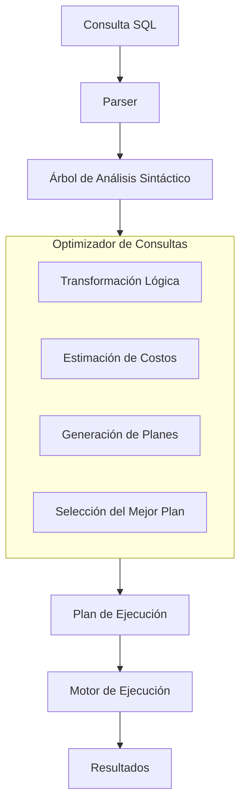

# Fundamentos de Bases de Datos - Lenguaje de consulta SQL

## 6.6 Optimización.

---

La optimización de consultas SQL es el proceso de mejorar el rendimiento de las consultas mediante técnicas que reducen el tiempo de ejecución y el consumo de recursos. Según Silberschatz et al. (2006), "el optimizador de consultas transforma una consulta SQL en un plan de ejecución eficiente".

**Definición formal**: La optimización de consultas es el proceso de seleccionar la estrategia de ejecución más eficiente para una consulta dada, considerando el costo computacional y de I/O.

### Componentes del Optimizador de Consultas

#### Arquitectura del Optimizador



### Modelo de Costos en Optimización

#### Fórmula General de Costo

$$ C_{\text{total}} = C_{\text{CPU}} + C_{\text{I/O}} + C_{\text{memoria}} $$

#### Costo de Acceso a Disco

$$ C_{\text{I/O}} = N_{\text{bloques}} \times T_{\text{acceso}} $$

Donde:

- $N_{\text{bloques}}$ = Número de bloques accedidos
- $T_{\text{acceso}}$ = Tiempo de acceso por bloque

#### Selectividad de Predicados

$$ S = \frac{\text{Número de filas que satisfacen la condición}}{\text{Total de filas en la tabla}} $$

### Técnicas de Optimización

#### Optimización de Índices

**Creación de índices estratégicos**:

```sql
-- Índice simple
CREATE INDEX idx_empleados_departamento ON empleados(departamento_id);

-- Índice compuesto
CREATE INDEX idx_ventas_fecha_cliente ON ventas(fecha, cliente_id);

-- Índice único
CREATE UNIQUE INDEX idx_clientes_email ON clientes(email);
```

**Costo de acceso con índice**:

$$ C_{\text{índice}} = \text{altura}_\text{árbol} + \frac{\text{filas}}{\text{fanout}} $$

#### Optimización de Joins

##### Algoritmos de Join

- **Nested Loop Join**: $C = O(n \times m)$
- **Hash Join**: $C = O(n + m)$
- **Sort-Merge Join**: $C = O(n \log n + m \log m)$

**Ejemplo de join optimizado**:

```sql
-- Menos eficiente
SELECT * FROM tabla1, tabla2 WHERE tabla1.id = tabla2.id;

-- Más eficiente
SELECT * FROM tabla1
INNER JOIN tabla2 ON tabla1.id = tabla2.id;
```

#### Optimización de Subconsultas

**Transformación de subconsultas**:

```sql
-- Subconsulta no correlacionada (menos eficiente)
SELECT nombre FROM empleados
WHERE departamento_id IN (
    SELECT id FROM departamentos WHERE ubicacion = 'Madrid'
);

-- Join equivalente (más eficiente)
SELECT e.nombre FROM empleados e
JOIN departamentos d ON e.departamento_id = d.id
WHERE d.ubicacion = 'Madrid';
```

### Análisis de Planes de Ejecución

#### EXPLAIN y ANALYZE

**Uso de EXPLAIN**:

```sql
EXPLAIN ANALYZE
SELECT nombre, salario
FROM empleados
WHERE departamento = 'Ventas'
AND salario > 50000;
```

**Interpretación del plan**:

- **Seq Scan**: Escaneo secuencial (costoso)
- **Index Scan**: Escaneo por índice (eficiente)
- **Bitmap Heap Scan**: Escaneo con bitmap
- **Nested Loop**: Join de bucles anidados

#### Estadísticas del Optimizador

**Actualización de estadísticas**:

```sql
ANALYZE nombre_tabla;
```

**Fórmula de estimación de cardinalidad**:

$$ \text{Cardinalidad estimada} = N \times \prod_{i=1}^{k} S_i $$

Donde:

- $N$ = Número total de filas
- $S_i$ = Selectividad del predicado i

### Técnicas Avanzadas de Optimización

#### Particionamiento de Tablas

**Creación de tablas particionadas**:

```sql
CREATE TABLE ventas (
    id SERIAL PRIMARY KEY,
    fecha DATE NOT NULL,
    monto DECIMAL(10,2)
) PARTITION BY RANGE (fecha);

CREATE TABLE ventas_2023 PARTITION OF ventas
FOR VALUES FROM ('2023-01-01') TO ('2024-01-01');
```

**Beneficio del particionamiento**:

$$ C_{\text{particionado}} = \frac{C_{\text{total}}}{\text{número de particiones}} $$

#### Materialized Views

**Creación de vistas materializadas**:

```sql
CREATE MATERIALIZED VIEW mv_ventas_mensuales AS
SELECT
    DATE_TRUNC('month', fecha) AS mes,
    SUM(monto) AS total_ventas,
    COUNT(*) AS numero_ventas
FROM ventas
GROUP BY DATE_TRUNC('month', fecha);
```

**Actualización de vistas**:

```sql
REFRESH MATERIALIZED VIEW mv_ventas_mensuales;
```

### Optimización de Consultas Específicas

#### Consultas con Agregaciones

**Optimización de GROUP BY**:

```sql
-- Menos eficiente
SELECT departamento, AVG(salario)
FROM empleados
GROUP BY departamento;

-- Más eficiente con índice
CREATE INDEX idx_empleados_departamento_salario
ON empleados(departamento, salario);
```

#### Consultas con Paginación

**Paginación eficiente**:

```sql
-- Menos eficiente
SELECT * FROM ventas
ORDER BY fecha DESC
LIMIT 10 OFFSET 100;

-- Más eficiente con keyset pagination
SELECT * FROM ventas
WHERE fecha < '2024-01-01'
ORDER BY fecha DESC
LIMIT 10;
```

### Ejemplos Prácticos de Optimización

#### Ejemplo 1: Optimización de Consulta Compleja

**Consulta original**:

```sql
SELECT c.nombre, SUM(v.monto) as total_ventas
FROM clientes c
JOIN ventas v ON c.id = v.cliente_id
WHERE v.fecha BETWEEN '2024-01-01' AND '2024-03-31'
AND c.pais = 'España'
GROUP BY c.id, c.nombre
HAVING SUM(v.monto) > 10000
ORDER BY total_ventas DESC;
```

**Optimizaciones aplicadas**:

```sql
-- Crear índices necesarios
CREATE INDEX idx_ventas_fecha_cliente ON ventas(fecha, cliente_id);
CREATE INDEX idx_clientes_pais ON clientes(pais);

-- Usar filtros tempranos
WITH ventas_spain AS (
    SELECT v.cliente_id, v.monto
    FROM ventas v
    JOIN clientes c ON v.cliente_id = c.id
    WHERE v.fecha BETWEEN '2024-01-01' AND '2024-03-31'
    AND c.pais = 'España'
)
SELECT c.nombre, SUM(vs.monto) as total_ventas
FROM clientes c
JOIN ventas_spain vs ON c.id = vs.cliente_id
GROUP BY c.id, c.nombre
HAVING SUM(vs.monto) > 10000
ORDER BY total_ventas DESC;
```

#### Ejemplo 2: Optimización de Subconsultas

**Consulta original**:

```sql
SELECT nombre, salario
FROM empleados
WHERE salario > (SELECT AVG(salario) FROM empleados)
AND departamento_id IN (
    SELECT id FROM departamentos WHERE presupuesto > 1000000
);
```

**Consulta optimizada**:

```sql
WITH avg_salary AS (
    SELECT AVG(salario) as avg_sal FROM empleados
),
rich_departments AS (
    SELECT id FROM departamentos WHERE presupuesto > 1000000
)
SELECT e.nombre, e.salario
FROM empleados e
CROSS JOIN avg_salary
JOIN rich_departments rd ON e.departamento_id = rd.id
WHERE e.salario > avg_salary.avg_sal;
```

### Ejercicios Propuestos

#### Ejercicio 1: Análisis de Plan de Ejecución

Dada la siguiente consulta:

```sql
SELECT p.nombre, c.nombre as categoria, COUNT(v.id) as ventas
FROM productos p
JOIN categorias c ON p.categoria_id = c.id
LEFT JOIN ventas v ON p.id = v.producto_id
WHERE p.precio > 100
AND c.nombre = 'Electrónicos'
GROUP BY p.id, c.nombre
HAVING COUNT(v.id) > 5;
```

1. Ejecuta EXPLAIN ANALYZE y analiza el plan
2. Identifica cuellos de botella
3. Propone índices para optimizar
4. Reescribe la consulta si es necesario

#### Ejercicio 2: Optimización de Joins

Tenemos tres tablas:

```sql
CREATE TABLE orders (id INT, customer_id INT, order_date DATE);
CREATE TABLE customers (id INT, country VARCHAR(50));
CREATE TABLE order_items (order_id INT, product_id INT, quantity INT);
```

Escribe y optimiza una consulta que:

- Calcule el total de ventas por país
- Filtre por fecha del último trimestre
- Incluya solo países con más de 100 órdenes

#### Ejercicio 3: Optimización de Agregaciones

Dada una tabla de logs con millones de registros:

```sql
CREATE TABLE server_logs (
    id BIGSERIAL PRIMARY KEY,
    server_id INT,
    log_time TIMESTAMP,
    response_time INT,
    status_code INT
);
```

Optimiza una consulta que calcule:

- El percentil 95 del tiempo de respuesta por servidor
- Por hora del día
- Para el último mes

### Herramientas de Monitoreo y Análisis

#### Consultas de Rendimiento

**Identificación de consultas lentas**:

```sql
SELECT query, total_time, calls, rows
FROM pg_stat_statements
ORDER BY total_time DESC
LIMIT 10;
```

**Monitorización de índices**:

```sql
SELECT
    tablename,
    indexname,
    idx_scan as scans,
    idx_tup_read as tuples_read,
    idx_tup_fetch as tuples_fetched
FROM pg_stat_all_indexes
WHERE schemaname = 'public';
```

### Referencias Bibliográficas

#### Bibliografía Básica

1. **Elmasri and Navathe (2006)**: _Fundamentals of Database Systems_. Capítulo 15 - "Algorithms for Query Processing and Optimization"
2. **Silberschatz et al. (2006)**: _Fundamentos de BD_. Capítulo 13 - "Query Processing and Optimization"
3. **Ullman and Widom (2008)**: _A First Course in Database Systems_. Capítulo 16 - "Query Compilation"

#### Bibliografía Complementaria

1. **Harrington (2009)**: _Relational Database Design and Implementation_. Capítulo 20 - "Query Optimization"
2. **Kline et al. (2008)**: _SQL in a Nutshell_ - Capítulo sobre optimización de rendimiento

### Conclusión

La optimización de consultas SQL es un proceso continuo que combina el conocimiento teórico de algoritmos de procesamiento con la práctica de análisis de planes de ejecución. Un optimizador efectivo debe:

1. **Entender la estructura de los datos** y las estadísticas
2. **Aplicar índices estratégicamente** para acelerar accesos
3. **Transformar consultas** para reducir complejidad computacional
4. **Monitorear continuamente** el rendimiento
5. **Balancear** normalización con desnormalización controlada

La optimización no es solo técnica, sino también un arte que requiere experiencia y comprensión profunda tanto del motor de base de datos como del dominio de la aplicación.
