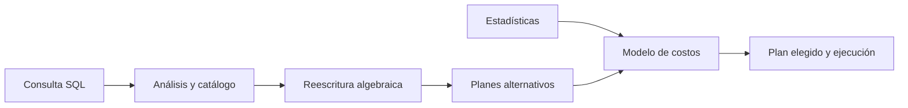

# Fundamentos de Bases de Datos - Lenguaje de consulta SQL

## 6.6 Optimización.

---

Como SQL es declarativo, una misma consulta se puede ejecutar de muchas maneras: en distinto orden de reuniones, con distintos algoritmos de reunión, usando o no cada índice. Entre el mejor y el peor plan puede haber varios órdenes de magnitud de diferencia. El **optimizador** del SMBD elige el plan, y el diseñador influye en esa elección con índices, estadísticas y la forma de escribir la consulta. Este tema describe cómo trabaja un optimizador, cómo se leen los planes, cómo se eligen los índices y qué técnicas complementarias existen, con ejemplos en SQLite.

### Etapas del procesamiento de una consulta

1. **Análisis:** se verifica la sintaxis y se resuelven los nombres contra el catálogo.
2. **Reescritura:** las vistas se sustituyen por su definición, las subconsultas se transforman en reuniones cuando es posible, y se aplican las leyes de equivalencia del álgebra (tema 4.3): las selecciones se empujan hacia las tablas y se eliminan columnas que no se usan.
3. **Optimización por costo:** se generan planes alternativos, se estima el costo de cada uno con un **modelo de costos** y se elige el más barato. El espacio de órdenes de reunión crece como $n!$ para $n$ tablas, por lo que se usa programación dinámica, como en el optimizador de System R (Selinger y otros, 1979), o heurísticas.
4. **Ejecución** del plan elegido.



### Modelo de costos y estadísticas

El costo dominante es el acceso a disco, que se mide en **páginas** leídas; en memoria, el número de filas procesadas. Para estimarlo, el optimizador necesita saber cuántas filas produce cada paso, y eso depende de la **selectividad** de cada condición: la fracción de filas que la cumplen. Con estadísticas como el número de filas $n_r$ de una tabla y el número de valores distintos $V(A, r)$ de una columna, la selectividad de $A = c$ se estima como $1 / V(A, r),$ y la de un rango con histogramas. Las estadísticas se recalculan con `ANALYZE`; si están desactualizadas, el optimizador puede elegir un plan pésimo.

### Algoritmos de acceso y de reunión

- **Recorrido completo** (*scan*): lee todas las filas. Es lo mejor si se necesita una fracción grande de la tabla.
- **Búsqueda por índice:** un árbol B localiza las filas que cumplen una igualdad o un rango con un costo logarítmico, más una lectura por fila encontrada. Un índice **cubre** una consulta si contiene todas las columnas que esta necesita, y entonces la tabla no se lee.
- **Reunión por ciclos anidados:** para cada fila de la tabla externa se buscan sus parejas en la interna. Con un índice sobre la columna de reunión de la interna, cuesta del orden de $n_{\text{ext}} \log n_{\text{int}};$ sin él, $n_{\text{ext}} \cdot n_{\text{int}}.$
- **Reunión por mezcla:** ordena ambas entradas por la columna de reunión y las recorre a la vez; del orden de $n \log n.$
- **Reunión por dispersión** (*hash join*): construye una tabla de dispersión con la entrada menor y recorre la mayor; del orden de $n_1 + n_2.$ Es la habitual en PostgreSQL y otros SMBD para reuniones grandes por igualdad.

SQLite solo usa ciclos anidados, pero crea **índices automáticos** temporales y **filtros de Bloom** para que la tabla interna se busque rápido, como muestra el programa.

### Planes de ejecución

`EXPLAIN` muestra el plan sin ejecutarlo; `EXPLAIN ANALYZE` en PostgreSQL lo ejecuta y muestra tiempos y filas reales de cada paso, y `EXPLAIN QUERY PLAN` en SQLite da un resumen. Los términos de SQLite: `SCAN t` es un recorrido completo, `SEARCH t USING INDEX i (a=?)` es una búsqueda por índice, `COVERING INDEX` indica que el índice basta, y `USE TEMP B-TREE FOR GROUP BY` u `ORDER BY` indica que hace falta ordenar.

### Diseño de índices

- Indexar las columnas de las claves foráneas, porque se usan en las reuniones y en la verificación de los borrados.
- Para una condición $a = c_1 \land b \gt c_2,$ conviene un índice compuesto sobre $(a, b),$ con las columnas de igualdad primero y la de rango después. Un índice $(a, b)$ sirve para condiciones sobre $a$ solo, pero no sobre $b$ sola.
- Incluir las columnas que la consulta devuelve, si son pocas, para que el índice la cubra.
- No aplicar funciones a la columna indexada en el `WHERE`: `strftime('%m', fecha) = '07'` no puede usar un índice sobre `fecha`, y `fecha >= '2026-07-01' AND fecha < '2026-08-01'` sí. Si la función es necesaria, se puede crear un **índice sobre la expresión**.
- No indexar todo: cada índice ocupa espacio y se actualiza en cada inserción, modificación y borrado.

### Otras técnicas

- **Particionamiento:** dividir una tabla grande, por ejemplo por mes, para que una consulta sobre un periodo lea solo sus particiones y para borrar datos antiguos eliminando particiones.
- **Vistas materializadas** y **tablas de resumen:** guardar el resultado de una agregación costosa y refrescarlo periódicamente; es desnormalización controlada (tema 5.2).
- **Reescribir la consulta:** eliminar una reunión externa que no aporta, cambiar `NOT IN` por `NOT EXISTS`, evitar `SELECT *`, paginar con una condición sobre la clave (`WHERE id > último`) en lugar de `OFFSET` grandes, que obligan a leer y descartar todas las filas anteriores.

### Implementación en Python

El programa genera datos deterministas en SQLite para los tres ejercicios: 60,000 ventas, 20,000 órdenes con sus líneas y 120,000 registros de servidores. Para cada ejercicio muestra el plan antes y después de crear índices, y comprueba que el resultado no cambia. En el ejercicio 1 verifica una reescritura; en el 2, el efecto de aplicar una función a la columna de fecha; en el 3, calcula el percentil 95 por servidor y por hora con funciones de ventana, lo verifica con Python para un grupo y construye una tabla de resumen.

```python
import random, sqlite3

rng = random.Random(5366)
db = sqlite3.connect(":memory:")
def plan(sql, p=()): return [r[3] for r in db.execute("EXPLAIN QUERY PLAN " + sql, p)]
def muestra(titulo, sql, p=()):
    print(f"{titulo}:"); [print("   ", paso) for paso in plan(sql, p)]

# --- Ejercicio 1 ---
db.executescript("""
CREATE TABLE categorias (id INTEGER PRIMARY KEY, nombre TEXT);
CREATE TABLE productos (id INTEGER PRIMARY KEY, nombre TEXT, categoria_id INTEGER, precio NUMERIC);
CREATE TABLE ventas (id INTEGER PRIMARY KEY, producto_id INTEGER, fecha TEXT, cantidad INTEGER);
""")
db.executemany("INSERT INTO categorias VALUES (?, ?)", [(i, "Electrónicos" if i == 1 else f"Cat{i}") for i in range(1, 21)])
db.executemany("INSERT INTO productos VALUES (?, ?, ?, ?)",
               [(i, f"P{i}", rng.randint(1, 20), rng.randint(10, 2000)) for i in range(1, 2001)])
db.executemany("INSERT INTO ventas (producto_id, fecha, cantidad) VALUES (?, ?, ?)",
               [(rng.randint(1, 2000), f"2026-{rng.randint(1, 10):02d}-{rng.randint(1, 28):02d}", rng.randint(1, 5)) for _ in range(60000)])
q1 = """SELECT p.nombre, c.nombre AS categoria, COUNT(v.id) AS ventas
        FROM productos p JOIN categorias c ON p.categoria_id = c.id LEFT JOIN ventas v ON p.id = v.producto_id
        WHERE p.precio > 100 AND c.nombre = 'Electrónicos'
        GROUP BY p.id, c.nombre HAVING COUNT(v.id) > 35"""
r_antes = sorted(db.execute(q1).fetchall())
muestra("ejercicio 1, sin índices", q1)
db.executescript("""
CREATE INDEX idx_ventas_producto ON ventas(producto_id);
CREATE INDEX idx_productos_categoria ON productos(categoria_id, precio);
CREATE INDEX idx_categorias_nombre ON categorias(nombre);
ANALYZE;
""")
muestra("ejercicio 1, con índices", q1)
print("   mismo resultado:", sorted(db.execute(q1).fetchall()) == r_antes, "|", len(r_antes), "productos")
# el LEFT JOIN no aporta: HAVING COUNT(v.id) > 35 descarta los productos sin ventas, así que equivale a JOIN
q1b = q1.replace("LEFT JOIN", "JOIN")
print("   con JOIN en lugar de LEFT JOIN, mismo resultado:", sorted(db.execute(q1b).fetchall()) == r_antes)

# --- Ejercicio 2 ---
db.executescript("""
CREATE TABLE customers (id INTEGER PRIMARY KEY, country TEXT);
CREATE TABLE orders (id INTEGER PRIMARY KEY, customer_id INTEGER, order_date TEXT);
CREATE TABLE order_items (order_id INTEGER, product_id INTEGER, quantity INTEGER);
""")
paises = ["México", "Perú", "Chile", "Uruguay", "Bolivia", "Ecuador"]
pesos = [40, 20, 15, 5, 3, 2]
db.executemany("INSERT INTO customers VALUES (?, ?)", [(i, rng.choices(paises, pesos)[0]) for i in range(1, 3001)])
db.executemany("INSERT INTO orders VALUES (?, ?, ?)",
               [(i, rng.randint(1, 3000), f"2026-{rng.randint(1, 10):02d}-{rng.randint(1, 28):02d}") for i in range(1, 20001)])
db.executemany("INSERT INTO order_items VALUES (?, ?, ?)",
               [(o, rng.randint(1, 500), rng.randint(1, 4)) for o in range(1, 20001) for _ in range(rng.randint(1, 3))])
q2 = """SELECT c.country, COUNT(DISTINCT o.id) AS ordenes, SUM(i.quantity) AS unidades
        FROM orders o JOIN customers c ON c.id = o.customer_id JOIN order_items i ON i.order_id = o.id
        WHERE o.order_date >= :ini AND o.order_date < :fin
        GROUP BY c.country HAVING COUNT(DISTINCT o.id) > 100 ORDER BY unidades DESC"""
trimestre = {"ini": "2026-07-01", "fin": "2026-10-01"}
r2 = db.execute(q2, trimestre).fetchall()
muestra("ejercicio 2, sin índices", q2, trimestre)
db.executescript("""CREATE INDEX idx_orders_fecha ON orders(order_date, customer_id);
                    CREATE INDEX idx_items_order ON order_items(order_id, quantity); ANALYZE;""")
muestra("ejercicio 2, con índices", q2, trimestre)
print("   resultado:", r2, "| igual con índices:", db.execute(q2, trimestre).fetchall() == r2)
q2_mala = q2.replace("o.order_date >= :ini AND o.order_date < :fin", "strftime('%m', o.order_date) IN ('07', '08', '09')")
print("   con una función sobre la columna, el índice de fecha ya no delimita la búsqueda:", plan(q2_mala)[:3])

# --- Ejercicio 3: percentil 95 del tiempo de respuesta por servidor y hora, último mes ---
db.execute("CREATE TABLE server_logs (id INTEGER PRIMARY KEY, server_id INTEGER, log_time TEXT, response_time INTEGER, status_code INTEGER)")
filas = []
for k in range(120000):
    dia, hora = rng.randint(1, 61), rng.randint(0, 23)
    base = 80 + (60 if 9 <= hora <= 18 else 0)                     # más carga en horario laboral
    t = int(rng.expovariate(1 / base)) + 5
    fecha = f"2026-{9 if dia <= 30 else 10:02d}-{(dia - 1) % 30 + 1:02d}"
    filas.append((rng.randint(1, 4), f"{fecha} {hora:02d}:{rng.randint(0, 59):02d}:00", t, rng.choice([200] * 19 + [500])))
db.executemany("INSERT INTO server_logs (server_id, log_time, response_time, status_code) VALUES (?, ?, ?, ?)", filas)
db.execute("CREATE INDEX idx_logs ON server_logs(log_time, server_id, response_time)")       # índice que cubre la consulta
q3 = """
WITH mes AS (SELECT server_id, CAST(strftime('%H', log_time) AS INTEGER) AS hora, response_time
             FROM server_logs WHERE log_time >= :ini AND log_time < :fin),
     ord AS (SELECT server_id, hora, response_time,
                    ROW_NUMBER() OVER (PARTITION BY server_id, hora ORDER BY response_time) AS k,
                    COUNT(*) OVER (PARTITION BY server_id, hora) AS n FROM mes)
SELECT server_id, hora, MIN(response_time) AS p95, MAX(n) AS n FROM ord WHERE k >= 0.95 * n   -- percentil 95, método del rango más cercano
GROUP BY server_id, hora ORDER BY server_id, hora"""
r3 = db.execute(q3, {"ini": "2026-10-01", "fin": "2026-11-01"}).fetchall()
print("ejercicio 3:", len(r3), "grupos (4 servidores × 24 horas); servidor 1 a las 3, 10 y 15 h:",
      [(h, p, n) for s, h, p, n in r3 if s == 1 and h in (3, 10, 15)])
print("   plan:", [p for p in plan(q3, {"ini": "2026-10-01", "fin": "2026-11-01"}) if "server_logs" in p])
# verificación del percentil con Python para un grupo
xs = sorted(t for s, lt, t, _ in filas if s == 1 and lt.startswith("2026-10") and lt[11:13] == "10")
print("   comprobación en Python para servidor 1, 10 h:", xs[-(-95 * len(xs) // 100) - 1], "con", len(xs), "registros")
db.executescript("""CREATE TABLE resumen_hora AS
    SELECT server_id, strftime('%Y-%m-%d %H', log_time) AS hora, COUNT(*) AS n, AVG(response_time) AS media
    FROM server_logs GROUP BY server_id, hora;""")
print("   tabla de resumen precalculada:", db.execute("SELECT COUNT(*) FROM resumen_hora").fetchone()[0], "filas en lugar de", len(filas))
```

Salida:

```text
ejercicio 1, sin índices:
    SCAN p
    SEARCH c USING INTEGER PRIMARY KEY (rowid=?)
    BLOOM FILTER ON v (producto_id=?)
    SEARCH v USING AUTOMATIC COVERING INDEX (producto_id=?) LEFT-JOIN
ejercicio 1, con índices:
    SCAN p
    BLOOM FILTER ON c (id=?)
    SEARCH c USING INTEGER PRIMARY KEY (rowid=?)
    SEARCH v USING COVERING INDEX idx_ventas_producto (producto_id=?) LEFT-JOIN
   mismo resultado: True | 15 productos
   con JOIN en lugar de LEFT JOIN, mismo resultado: True
ejercicio 2, sin índices:
    SCAN i
    SEARCH o USING INTEGER PRIMARY KEY (rowid=?)
    SEARCH c USING INTEGER PRIMARY KEY (rowid=?)
    USE TEMP B-TREE FOR GROUP BY
    USE TEMP B-TREE FOR count(DISTINCT)
    USE TEMP B-TREE FOR ORDER BY
ejercicio 2, con índices:
    SEARCH o USING COVERING INDEX idx_orders_fecha (order_date>? AND order_date<?)
    SEARCH c USING INTEGER PRIMARY KEY (rowid=?)
    SEARCH i USING COVERING INDEX idx_items_order (order_id=?)
    USE TEMP B-TREE FOR GROUP BY
    USE TEMP B-TREE FOR count(DISTINCT)
    USE TEMP B-TREE FOR ORDER BY
   resultado: [('México', 2886, 14483), ('Perú', 1437, 7131), ('Chile', 986, 5046), ('Uruguay', 377, 1891), ('Bolivia', 196, 962), ('Ecuador', 129, 670)] | igual con índices: True
   con una función sobre la columna, el índice de fecha ya no delimita la búsqueda: ['SCAN o', 'SEARCH c USING INTEGER PRIMARY KEY (rowid=?)', 'SEARCH i USING COVERING INDEX idx_items_order (order_id=?)']
ejercicio 3: 96 grupos (4 servidores × 24 horas); servidor 1 a las 3, 10 y 15 h: [(3, 242, 627), (10, 393, 641), (15, 403, 605)]
   plan: ['SEARCH server_logs USING COVERING INDEX idx_logs (log_time>? AND log_time<?)']
   comprobación en Python para servidor 1, 10 h: 393 con 641 registros
   tabla de resumen precalculada: 5760 filas en lugar de 120000
```

### Ejercicios Propuestos

1. **Plan de ejecución.** Analiza el plan de la consulta, identifica los cuellos de botella, propón índices y reescríbela si hace falta:

    ```sql
    SELECT p.nombre, c.nombre AS categoria, COUNT(v.id) AS ventas
    FROM productos p
    JOIN categorias c ON p.categoria_id = c.id
    LEFT JOIN ventas v ON p.id = v.producto_id
    WHERE p.precio > 100 AND c.nombre = 'Electrónicos'
    GROUP BY p.id, c.nombre
    HAVING COUNT(v.id) > 5;
    ```

2. **Reuniones.** Con `orders(id, customer_id, order_date)`, `customers(id, country)` y `order_items(order_id, product_id, quantity)`, escribe y optimiza una consulta que calcule las ventas por país en el último trimestre, solo para los países con más de 100 órdenes.

3. **Agregaciones.** Con una tabla `server_logs(id, server_id, log_time, response_time, status_code)` de millones de registros, optimiza una consulta que calcule el percentil 95 del tiempo de respuesta por servidor y por hora del día, para el último mes.

### Soluciones

**Ejercicio 1.** Sin índices, SQLite recorre `productos` completa y, para reunir con `ventas`, construye un **índice automático** temporal sobre `producto_id`: lo hace en cada ejecución, y esa es la señal de que falta un índice permanente. Los índices propuestos son `ventas(producto_id)`, que además cubre el conteo; `productos(categoria_id, precio)`, con la igualdad primero y el rango después, y `categorias(nombre)`. Con ellos, el plan busca las ventas en el índice. Con solo 20 categorías, el optimizador prefiere recorrer los productos y buscar la categoría por su clave, con un filtro de Bloom, en lugar de usar el índice de nombre: con estadísticas, decide que no conviene, y en una tabla de categorías grande sí lo usaría. Reescritura: el `LEFT JOIN` no aporta nada, porque `HAVING COUNT(v.id) > 5` descarta los productos sin ventas, que son los únicos que la reunión externa agregaría; con `JOIN` el resultado es el mismo y el optimizador tiene más libertad para elegir el orden. En los datos del programa el umbral se subió a 35 para que el resultado sea pequeño.

**Ejercicio 2.**

```sql
SELECT c.country, COUNT(DISTINCT o.id) AS ordenes, SUM(i.quantity) AS unidades
FROM orders o JOIN customers c ON c.id = o.customer_id JOIN order_items i ON i.order_id = o.id
WHERE o.order_date >= '2026-07-01' AND o.order_date < '2026-10-01'
GROUP BY c.country HAVING COUNT(DISTINCT o.id) > 100;
```

Las tablas del enunciado no tienen claves primarias: lo primero es declararlas, y crear índices sobre las claves foráneas. `COUNT(DISTINCT o.id)` es necesario porque la reunión con las líneas repite cada orden tantas veces como líneas tiene. Sin índices, el plan recorre todas las líneas de todas las órdenes; con `orders(order_date, customer_id)`, el filtro del trimestre se resuelve como un rango del índice y solo se procesan las órdenes del periodo, y con `order_items(order_id, quantity)` las líneas se leen del índice sin tocar la tabla. Si la fecha se filtra con `strftime('%m', o.order_date) IN (...)`, el plan vuelve a recorrer todas las órdenes. Las ventas por país se miden en unidades porque el esquema no tiene precios. Todos los países superan las 100 órdenes en el trimestre; Ecuador, con 129, es el más cercano al umbral.

**Ejercicio 3.** El estándar tiene `PERCENTILE_CONT(0.95) WITHIN GROUP (ORDER BY response_time)`, que PostgreSQL y Oracle implementan. SQLite no lo tiene, y el programa lo calcula con funciones de ventana: numera las filas de cada grupo de servidor y hora por tiempo de respuesta y toma la primera cuya posición alcanza el 95 % del grupo, que es el percentil por el método del **rango más cercano**; la verificación en Python da el mismo valor. Para millones de registros:

- Un índice sobre `(log_time, server_id, response_time)` restringe la lectura al último mes y cubre la consulta.
- **Particionar** la tabla por mes para leer solo la partición necesaria y borrar los meses antiguos sin recorrer la tabla.
- Mantener una **tabla de resumen** por servidor y hora, que reduce 120,000 registros a 5760 filas. El percentil no se puede combinar a partir de percentiles parciales, a diferencia de la suma o el conteo, así que el resumen debe guardar un **histograma** de tiempos por intervalos, o un resumen aproximado como t-digest, del que se estima el percentil.
- Si basta una estimación, muestrear los registros.

El horario laboral tiene tiempos mayores, como se ve en el percentil de las 10 y 15 horas comparado con el de las 3.

### Referencias

1. Selinger, P. G., et al., Access path selection in a relational database management system. _Proceedings of ACM SIGMOD_, 1979.
2. Silberschatz, A., Korth, H. F., and Sudarshan, S., _Database System Concepts_. McGraw-Hill, 2019. Capítulos 14, 15 y 16.
3. Elmasri, R., and Navathe, S. B., _Fundamentals of Database Systems_. Pearson, 2016. Capítulos 18 y 19.
4. Winand, M., _SQL Performance Explained_. Autoedición, 2012.
5. SQLite, _The SQLite Query Optimizer Overview_ y _EXPLAIN QUERY PLAN_. Documentación en línea, sqlite.org.
