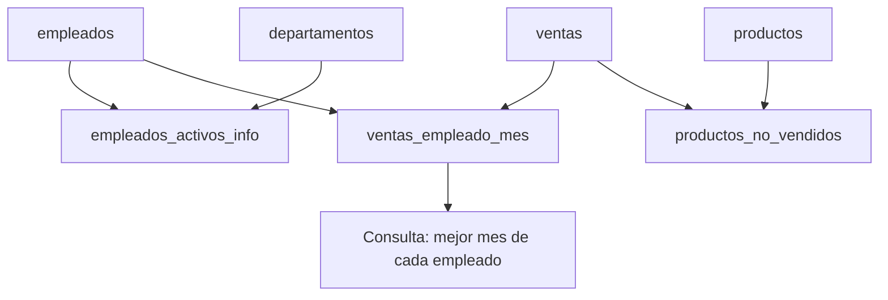

# Fundamentos de Bases de Datos - Vistas

## 7.1 Declaración.

---

Una **vista** es una tabla virtual definida por una consulta. No guarda filas: el SMBD guarda en el catálogo su definición y, cada vez que se consulta la vista, la sustituye por esa consulta. Las vistas son el mecanismo del **nivel externo** de la arquitectura de tres niveles (tema 1.3): dan a cada grupo de usuarios la parte de la base que necesita, con los nombres y los datos derivados que le convienen, y le ocultan el resto. Este tema presenta la sintaxis para declararlas, sus usos, sus variantes (vistas temporales, materializadas y recursivas) y su relación con los cambios del esquema.

### Sintaxis

```sql
CREATE [OR REPLACE] [TEMPORARY] [RECURSIVE] VIEW nombre [(columnas)]
AS consulta
[WITH [CASCADED | LOCAL] CHECK OPTION];

DROP VIEW [IF EXISTS] nombre [CASCADE | RESTRICT];
```

- La lista de **columnas** da nombre a las columnas de la vista; si se omite, se toman los nombres o alias de la consulta. Es obligatoria, o hay que usar alias, cuando dos columnas tendrían el mismo nombre, como `e.nombre` y `d.nombre`, o cuando una columna es una expresión.
- `OR REPLACE` redefine una vista existente; en PostgreSQL solo si la nueva conserva las columnas de la anterior.
- `TEMPORARY` crea una vista que desaparece al cerrar la sesión.
- `WITH CHECK OPTION` impide que una inserción o actualización a través de la vista produzca una fila que la vista no mostraría (tema 7.3). SQLite no la implementa, y se emula con disparadores.

La consulta puede usar reuniones, agregaciones, subconsultas, funciones de ventana e incluso otras vistas: las vistas se **componen**. El estándar no permite `ORDER BY` en una vista, porque una tabla no tiene orden; varios SMBD lo aceptan, pero el orden solo está garantizado en la consulta externa.

### Usos

- **Simplificar:** una reunión de cinco tablas que se usa a diario se escribe una vez como vista y se consulta como tabla.
- **Seguridad:** se otorga a un usuario permiso sobre la vista y no sobre las tablas, `GRANT SELECT ON empleados_publico TO analista`, y así solo ve ciertas columnas, como el nombre sin el salario, o ciertas filas, como los empleados de su departamento.
- **Independencia lógica:** si el esquema conceptual cambia, por ejemplo al dividir una tabla en dos, una vista con el nombre de la tabla original reconstruye lo que las aplicaciones esperaban (tema 1.3).
- **Datos derivados:** totales, edades, nombres completos y otros valores calculados que siempre están actualizados porque no se guardan.
- **Consistencia:** una definición única de un concepto del negocio, como "cliente activo" o "venta neta", evita que cada consulta lo calcule de forma distinta.

### Vistas materializadas

Una vista **materializada** sí guarda el resultado de su consulta, como una tabla, y se **refresca** cuando se pide (`REFRESH MATERIALIZED VIEW` en PostgreSQL) o automáticamente al cambiar las tablas base (Oracle, SQL Server con vistas indexadas). Es útil para agregaciones costosas que se consultan mucho y cambian poco; a cambio, sus datos pueden estar desactualizados entre refrescos. SQLite no las tiene; se simulan con una tabla y disparadores, o recalculando la tabla periódicamente.

### Dependencias

Una vista depende de las tablas y columnas que usa. En PostgreSQL, `DROP TABLE` falla si una vista depende de la tabla, salvo con `CASCADE`, que borra también la vista. SQLite no registra la dependencia: permite borrar la tabla, y la vista falla al consultarla. Algunos cambios sí se propagan: al renombrar una columna, SQLite y PostgreSQL actualizan las vistas que la usan.



### Implementación en Python

El programa crea en SQLite las tablas de los ejercicios y las tres vistas pedidas, con el año actual fijado en una constante para que el resultado sea reproducible. Consulta la vista del ejercicio 2 como si fuera una tabla, y emula `WITH CHECK OPTION` en la vista del ejercicio 3 con un disparador `INSTEAD OF`. Al final muestra que las vistas están en el catálogo, que reflejan los cambios de las tablas sin redefinirse, que SQLite permite borrar una tabla de la que depende una vista, y que renombrar una columna reescribe las vistas que la usan.

```python
import sqlite3

HOY = "2026-11-03"
db = sqlite3.connect(":memory:")
db.execute("PRAGMA foreign_keys = ON")
db.executescript("""
CREATE TABLE departamentos (id INTEGER PRIMARY KEY, nombre TEXT NOT NULL, ciudad TEXT);
CREATE TABLE empleados (id INTEGER PRIMARY KEY, nombre TEXT, apellido TEXT, departamento_id INTEGER REFERENCES departamentos,
                        activo INTEGER NOT NULL DEFAULT 1, salario NUMERIC);
CREATE TABLE productos (id INTEGER PRIMARY KEY, nombre TEXT, precio NUMERIC);
CREATE TABLE ventas (id INTEGER PRIMARY KEY, empleado_id INTEGER REFERENCES empleados, producto_id INTEGER REFERENCES productos,
                     fecha TEXT, monto NUMERIC);
INSERT INTO departamentos VALUES (1, 'Ventas', 'Puebla'), (2, 'Sistemas', 'Monterrey');
INSERT INTO empleados VALUES (1, 'Ana', 'Ruiz', 1, 1, 30000), (2, 'Beto', 'Soto', 1, 0, 26000), (3, 'Carla', 'Paz', 2, 1, 45000),
                             (4, 'Dante', 'Mora', 1, 1, 28000);
INSERT INTO productos VALUES (1, 'Laptop', 18000), (2, 'Monitor', 3500), (3, 'Teclado', 500), (4, 'Webcam', 900);
INSERT INTO ventas (empleado_id, producto_id, fecha, monto) VALUES
  (1, 1, '2025-12-20', 18000), (1, 2, '2026-01-15', 3500), (1, 3, '2026-01-28', 1000), (4, 2, '2026-01-30', 7000),
  (2, 1, '2026-02-03', 18000), (4, 3, '2026-03-11', 500), (1, 1, '2026-03-21', 36000);
""")

# --- Ejercicio 1 ---
db.execute("""CREATE VIEW empleados_activos_info (nombre, apellido, departamento, ciudad) AS
              SELECT e.nombre, e.apellido, d.nombre, d.ciudad
              FROM empleados e JOIN departamentos d ON e.departamento_id = d.id
              WHERE e.activo = 1""")
print("ejercicio 1:", db.execute("SELECT * FROM empleados_activos_info ORDER BY apellido").fetchall())

# --- Ejercicio 2: el año actual fijado en HOY para que el resultado sea reproducible ---
db.execute(f"""CREATE VIEW ventas_empleado_mes AS
               SELECT e.id AS empleado_id, e.nombre || ' ' || e.apellido AS empleado,
                      CAST(strftime('%m', v.fecha) AS INTEGER) AS mes, COUNT(*) AS num_ventas, SUM(v.monto) AS monto_total
               FROM empleados e JOIN ventas v ON v.empleado_id = e.id
               WHERE v.fecha >= date('{HOY}', 'start of year') AND v.fecha < date('{HOY}', 'start of year', '+1 year')
               GROUP BY e.id, mes""")
print("ejercicio 2:", db.execute("SELECT empleado, mes, num_ventas, monto_total FROM ventas_empleado_mes ORDER BY empleado_id, mes").fetchall())
# una vista se usa como tabla: se puede filtrar, reunir y agregar sobre ella
print("   sobre la vista, el mejor mes de cada empleado:", db.execute("""
    SELECT empleado, mes, monto_total FROM ventas_empleado_mes v
    WHERE monto_total = (SELECT MAX(monto_total) FROM ventas_empleado_mes w WHERE w.empleado_id = v.empleado_id)
    ORDER BY empleado_id""").fetchall())

# --- Ejercicio 3: productos sin ventas, con NOT EXISTS (una vista de una sola tabla) ---
db.execute("""CREATE VIEW productos_no_vendidos AS
              SELECT p.* FROM productos p WHERE NOT EXISTS (SELECT 1 FROM ventas v WHERE v.producto_id = p.id)""")
print("ejercicio 3:", db.execute("SELECT * FROM productos_no_vendidos").fetchall())
# SQLite no implementa WITH CHECK OPTION; se emula con un disparador INSTEAD OF que verifica la condición de la vista
db.executescript("""
CREATE TRIGGER pnv_insert INSTEAD OF INSERT ON productos_no_vendidos
BEGIN
    SELECT RAISE(ABORT, 'la fila no cumple la condición de la vista')
    WHERE EXISTS (SELECT 1 FROM ventas WHERE producto_id = NEW.id);
    INSERT INTO productos VALUES (NEW.id, NEW.nombre, NEW.precio);
END;
""")
db.execute("INSERT INTO productos_no_vendidos VALUES (5, 'Bocina', 1200)")
print("   insertado por la vista:", db.execute("SELECT * FROM productos_no_vendidos ORDER BY id").fetchall())
db.execute("INSERT INTO ventas (empleado_id, producto_id, fecha, monto) VALUES (3, 5, '2026-04-01', 1200)")
print("   tras venderla, la bocina sale de la vista:", db.execute("SELECT * FROM productos_no_vendidos").fetchall())
try:
    db.execute("INSERT INTO productos_no_vendidos VALUES (2, 'Monitor', 3500)")
except sqlite3.IntegrityError as e:
    print("   el monitor, que tiene ventas, rechazado:", e)

# --- las vistas viven en el catálogo y no guardan filas ---
print("catálogo:", db.execute("SELECT type, name FROM sqlite_master WHERE type = 'view' ORDER BY name").fetchall())
db.execute("UPDATE empleados SET activo = 0 WHERE nombre = 'Dante'")
print("al desactivar a Dante, la vista cambia sin tocarla:", db.execute("SELECT nombre FROM empleados_activos_info ORDER BY nombre").fetchall())
db.executescript("CREATE TABLE temporal (x); CREATE VIEW sobre_temporal AS SELECT x FROM temporal; DROP TABLE temporal;")
try:
    db.execute("SELECT * FROM sobre_temporal")
except sqlite3.Error as e:
    print("SQLite permite borrar una tabla que una vista usa; la vista falla después:", e)
db.execute("DROP VIEW sobre_temporal")              # una vista rota impide incluso modificar otras tablas
try:
    db.execute("ALTER TABLE departamentos RENAME COLUMN ciudad TO localidad")
    print("renombrar la columna: SQLite reescribe la vista:",
          db.execute("SELECT sql FROM sqlite_master WHERE name = 'empleados_activos_info'").fetchone()[0].split("SELECT")[1].split("FROM")[0].strip())
except sqlite3.Error as e:
    print("renombrar la columna:", e)
```

Salida:

```text
ejercicio 1: [('Dante', 'Mora', 'Ventas', 'Puebla'), ('Carla', 'Paz', 'Sistemas', 'Monterrey'), ('Ana', 'Ruiz', 'Ventas', 'Puebla')]
ejercicio 2: [('Ana Ruiz', 1, 2, 4500), ('Ana Ruiz', 3, 1, 36000), ('Beto Soto', 2, 1, 18000), ('Dante Mora', 1, 1, 7000), ('Dante Mora', 3, 1, 500)]
   sobre la vista, el mejor mes de cada empleado: [('Ana Ruiz', 3, 36000), ('Beto Soto', 2, 18000), ('Dante Mora', 1, 7000)]
ejercicio 3: [(4, 'Webcam', 900)]
   insertado por la vista: [(4, 'Webcam', 900), (5, 'Bocina', 1200)]
   tras venderla, la bocina sale de la vista: [(4, 'Webcam', 900)]
   el monitor, que tiene ventas, rechazado: la fila no cumple la condición de la vista
catálogo: [('view', 'empleados_activos_info'), ('view', 'productos_no_vendidos'), ('view', 'ventas_empleado_mes')]
al desactivar a Dante, la vista cambia sin tocarla: [('Ana',), ('Carla',)]
SQLite permite borrar una tabla que una vista usa; la vista falla después: no such table: main.temporal
renombrar la columna: SQLite reescribe la vista: e.nombre, e.apellido, d.nombre, d.localidad
```

### Ejercicios Propuestos

1. **Empleados activos.** Crea una vista con el nombre de cada empleado activo, su departamento y la ciudad.

2. **Ventas por mes.** Crea una vista con el total de ventas de cada empleado en cada mes del año actual.

3. **Productos sin ventas.** Crea una vista con los productos que nunca se han vendido, con `WITH CHECK OPTION`.

### Soluciones

**Ejercicio 1.** La vista reúne empleados y departamentos y filtra los activos. La ciudad es del departamento, no del empleado: en un esquema normalizado se toma de `departamentos`, y si cada empleado tuviera su propia ciudad se tomaría de `empleados`. Se nombran las columnas en la cabecera porque `e.nombre` y `d.nombre` tendrían el mismo nombre. Beto no aparece porque está inactivo, y cuando Dante se desactiva, sale de la vista sin redefinirla. La columna `activo` es un entero en SQLite, que no tiene un tipo booleano; en PostgreSQL sería `BOOLEAN` y la condición `WHERE e.activo`.

**Ejercicio 2.**

```sql
CREATE VIEW ventas_empleado_mes AS
SELECT e.id AS empleado_id, e.nombre || ' ' || e.apellido AS empleado,
       EXTRACT(MONTH FROM v.fecha) AS mes, COUNT(*) AS num_ventas, SUM(v.monto) AS monto_total
FROM empleados e JOIN ventas v ON v.empleado_id = e.id
WHERE v.fecha >= DATE_TRUNC('year', CURRENT_DATE) AND v.fecha < DATE_TRUNC('year', CURRENT_DATE) + INTERVAL '1 year'
GROUP BY e.id, e.nombre, e.apellido, EXTRACT(MONTH FROM v.fecha);
```

Con `CURRENT_DATE`, la vista cambia de contenido el 1 de enero sin que nadie la toque, lo cual es lo que se quiere, pero hace que el resultado dependa del día en que se consulta; el programa fija la fecha para que sea reproducible. El filtro por intervalo, en lugar de `EXTRACT(YEAR FROM fecha) = ...`, permite usar un índice sobre la fecha (tema 6.6). Se agrupa por el identificador del empleado, no por su nombre, para no juntar a dos empleados homónimos. La venta de Ana de diciembre de 2025 queda fuera. El programa usa la vista en otra consulta para obtener el mejor mes de cada empleado.

**Ejercicio 3.** La solución habitual, `SELECT p.* FROM productos p LEFT JOIN ventas v ON ... WHERE v.producto_id IS NULL WITH CHECK OPTION`, **no se puede declarar** en PostgreSQL: `WITH CHECK OPTION` solo se admite en vistas actualizables, y una vista con una reunión no lo es. Con `NOT EXISTS`, la vista lee de una sola tabla y sí es actualizable, así que admite la opción:

```sql
CREATE VIEW productos_no_vendidos AS
SELECT p.* FROM productos p
WHERE NOT EXISTS (SELECT 1 FROM ventas v WHERE v.producto_id = p.id)
WITH CHECK OPTION;
```

Con ella, insertar por la vista un producto nuevo funciona, y se rechazaría una fila que la vista no mostraría. En este caso la protección es casi nula: con una clave foránea de `ventas` a `productos`, un producto nuevo no puede tener ventas previas, y cambiar el identificador de un producto visible por el de uno con ventas choca antes con la clave primaria. Y hay algo que la opción **no** impide: registrar una venta en la tabla `ventas` hace que el producto salga de la vista, porque la opción solo verifica las operaciones hechas a través de la vista. `WITH CHECK OPTION` es útil sobre todo en vistas con condiciones sobre columnas propias, como la del tema 7.3. En SQLite, el programa emula la opción con un disparador `INSTEAD OF INSERT` que rechaza las filas que no cumplirían la condición.

### Referencias

1. Elmasri, R., and Navathe, S. B., _Fundamentals of Database Systems_. Pearson, 2016. Capítulo 7.
2. Silberschatz, A., Korth, H. F., and Sudarshan, S., _Database System Concepts_. McGraw-Hill, 2019. Capítulo 4.
3. PostgreSQL Global Development Group, _CREATE VIEW_ y _CREATE MATERIALIZED VIEW_. Documentación en línea, postgresql.org.
4. SQLite, _CREATE VIEW_ y _CREATE TRIGGER_. Documentación en línea, sqlite.org.
