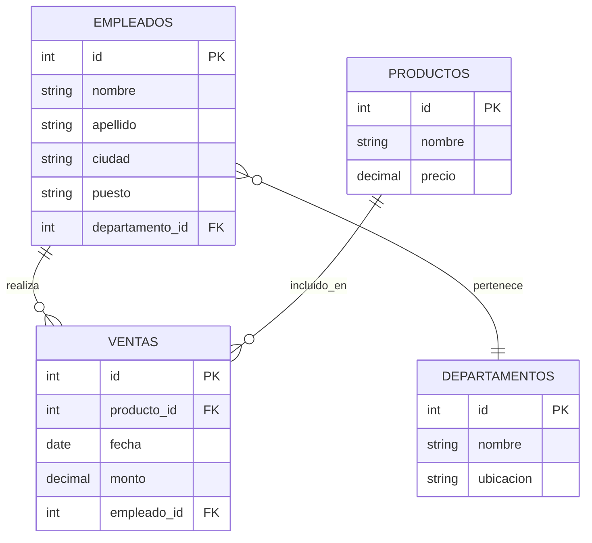

# Fundamentos de Bases de Datos - Vistas

## 7.1 Declaración.

---

Una vista es una tabla virtual derivada de una o más tablas base existentes en la base de datos. No almacena datos físicamente, sino que representa una perspectiva particular de los datos almacenados en las tablas base.

**Definición formal:** Una vista V es una relación virtual definida por una expresión de consulta Q:

$$ V = \pi\_{A\_1, A\_2, ..., A\_n}(\sigma\_{\text{condición}}(R\_1 \times R\_2 \times ... \times R\_m)) $$

donde:

- $\pi$ representa la proyección (selección de columnas)
- $\sigma$ representa la selección (filtrado de filas)
- $R_1, R_2, ..., R_m$ son las relaciones base

### Sintaxis Básica de Declaración de Vistas

#### Sintaxis SQL estándar

```sql
CREATE VIEW nombre_vista [(columna1, columna2, ..., columnan)]
AS consulta_select
[WITH [CASCADED | LOCAL] CHECK OPTION];
```

#### Elementos de la declaración

- **nombre_vista**: Identificador único para la vista
- **lista de columnas**: Opcional, nombres para las columnas de la vista
- **consulta_select**: Consulta SELECT que define los datos de la vista
- **WITH CHECK OPTION**: Garantiza que las operaciones de modificación cumplan con los criterios de la vista

### Tipos de Vistas

#### 1. Vistas Horizontales (Restricción de filas)

```sql
CREATE VIEW empleados_madrid
AS SELECT * FROM empleados
WHERE ciudad = 'Madrid';
```

#### 2. Vistas Verticales (Restricción de columnas)

```sql
CREATE VIEW info_basica_empleados
AS SELECT id, nombre, apellido, puesto
FROM empleados;
```

#### 3. Vistas con Joins

```sql
CREATE VIEW empleados_departamentos
AS SELECT e.id, e.nombre, e.apellido, d.nombre as departamento
FROM empleados e
JOIN departamentos d ON e.departamento_id = d.id;
```

#### 4. Vistas con Funciones de Agregación

```sql
CREATE VIEW resumen_ventas
AS SELECT producto_id,
          COUNT(*) as total_ventas,
          SUM(monto) as ingreso_total,
          AVG(monto) as promedio_venta
FROM ventas
GROUP BY producto_id;
```

### Diagrama de Relaciones para Ejemplos



### Ejemplos Prácticos

#### Ejemplo 1: Vista Simple

```sql
-- Crear vista de empleados con salario superior a 50000
CREATE VIEW empleados_altos_salarios
AS SELECT id, nombre, apellido, salario, departamento
FROM empleados
WHERE salario > 50000;
```

#### Ejemplo 2: Vista con Columnas Renombradas

```sql
CREATE VIEW info_contacto_empleados (
    codigo_empleado,
    nombre_completo,
    telefono_oficina,
    extension
)
AS SELECT emp_id,
          nombre || ' ' || apellido,
          telefono,
          ext
FROM empleados;
```

#### Ejemplo 3: Vista con WITH CHECK OPTION

```sql
CREATE VIEW empleados_ventas
AS SELECT * FROM empleados
WHERE departamento = 'Ventas'
WITH CHECK OPTION;
```

### Consideraciones Importantes

#### Actualización de Vistas

No todas las vistas son actualizables. Una vista es actualizable si cumple con:

- Define solo una tabla en la cláusula FROM
- No contiene funciones de agregación, GROUP BY o HAVING
- No utiliza DISTINCT en la selección
- Incluye la clave primaria de la tabla base

#### Ventajas de las Vistas

1. **Seguridad**: Restricción de acceso a datos sensibles
2. **Abstracción**: Ocultamiento de la complejidad del esquema
3. **Consistencia**: Definición centralizada de lógica de negocio
4. **Personalización**: Perspectivas diferentes para distintos usuarios

### Ejercicios Propuestos

#### Ejercicio 1

Crea una vista que muestre el nombre del empleado, su departamento y la ciudad, solo para empleados activos.

<details>
<summary>Solución sugerida</summary>

```sql
CREATE VIEW empleados_activos_info
AS SELECT e.nombre, e.apellido, d.nombre as departamento, e.ciudad
FROM empleados e
JOIN departamentos d ON e.departamento_id = d.id
WHERE e.activo = true;
```

</details>

#### Ejercicio 2

Crea una vista que calcule el total de ventas por empleado por mes para el año actual.

<details>
<summary>Solución sugerida</summary>

```sql
CREATE VIEW ventas_empleado_mes_actual
AS SELECT e.id as empleado_id,
          e.nombre || ' ' || e.apellido as empleado,
          EXTRACT(MONTH FROM v.fecha) as mes,
          COUNT(v.id) as total_ventas,
          SUM(v.monto) as monto_total
FROM empleados e
JOIN ventas v ON e.id = v.empleado_id
WHERE EXTRACT(YEAR FROM v.fecha) = EXTRACT(YEAR FROM CURRENT_DATE)
GROUP BY e.id, e.nombre, e.apellido, EXTRACT(MONTH FROM v.fecha);
```

</details>

#### Ejercicio 3

Crea una vista que muestre los productos que nunca han sido vendidos, usando WITH CHECK OPTION.

<details>
<summary>Solución sugerida</summary>

```sql
CREATE VIEW productos_no_vendidos
AS SELECT p.*
FROM productos p
LEFT JOIN ventas v ON p.id = v.producto_id
WHERE v.producto_id IS NULL
WITH CHECK OPTION;
```

</details>

### Buenas Prácticas en la Declaración de Vistas

1. **Nomenclatura clara**: Usar nombres descriptivos que indiquen el propósito
2. **Documentación**: Incluir comentarios sobre el objetivo de la vista
3. **Optimización**: Considerar el impacto en el rendimiento
4. **Mantenimiento**: Revisar periódicamente las vistas obsoletas

### Referencias

#### Bibliografía Básica

1. Elmasri and Navathe. Fundamentals of Database Systems. Addison-Wesley. Cuarta Edición. 2006. (Capítulo 8: The Relational Algebra and Relational Calculus)
2. Silberschatz A., Kort H. y Sudarshan S. Fundamentos de BD. McGraw Hill. Quinta edición. 2006. (Capítulo 3: SQL)
3. Ullman J.D. and Widom J. A First Course in Data Base System. Prentice Hall. Tercera edición. 2008. (Capítulo 6: Constraints and Triggers)

#### Bibliografía Complementaria

1. Harrington J. Relational Database Design and Implementation. Tercera edición. Morgan Kaufmann. 2009. (Capítulo 14: Views)
2. Kline K., Kline D., and Hunt B. SQL in a nutshell. O'Reilly. 2008. (Capítulo 7: Views)

### Autoevaluación

1. ¿Qué es una vista en una base de datos relacional?
2. ¿Cuáles son las ventajas principales del uso de vistas?
3. ¿Bajo qué condiciones una vista es actualizable?
4. ¿Para qué sirve la cláusula WITH CHECK OPTION?
5. ¿Cómo afectan las vistas al rendimiento de la base de datos?

Esta guía proporciona una base sólida para comprender la declaración y uso de vistas en sistemas de bases de datos relacionales, siguiendo los estándares SQL y las mejores prácticas recomendadas en la literatura especializada.
