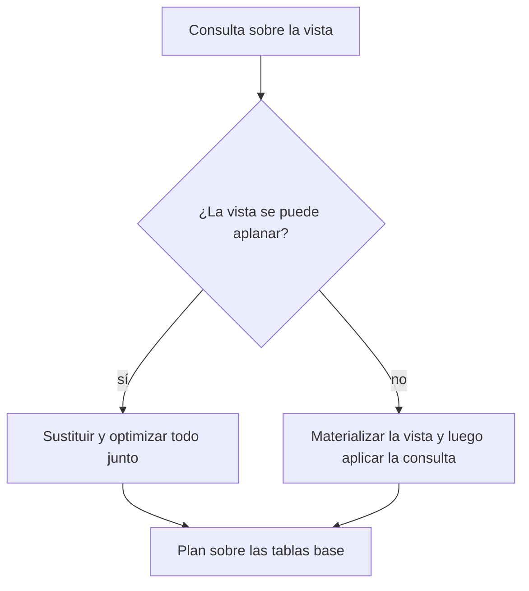

# Fundamentos de Bases de Datos - Vistas

## 7.2 Consulta.

---

Una vista se consulta exactamente igual que una tabla: puede aparecer en `FROM`, reunirse con tablas u otras vistas, filtrarse, agruparse y usarse en subconsultas. Lo que cambia es lo que hace el SMBD por debajo. Este tema explica cómo se procesa una consulta sobre una vista, por **sustitución** o por **materialización**, qué consecuencias tiene para el rendimiento, y los errores de interpretación más comunes al combinar vistas con filtros y reuniones externas.

### Sustitución de la vista

Al recibir una consulta que menciona una vista, el SMBD reemplaza el nombre de la vista por su definición, como una subconsulta en `FROM`, y optimiza la consulta completa. Si la vista es

```sql
CREATE VIEW empleados_departamentos AS
SELECT e.id, e.nombre, e.apellido, d.nombre AS departamento
FROM empleados e JOIN departamentos d ON d.id = e.departamento_id;
```

la consulta `SELECT nombre FROM empleados_departamentos WHERE departamento = 'Ventas'` se convierte en

```sql
SELECT nombre FROM (SELECT e.id, e.nombre, e.apellido, d.nombre AS departamento
                    FROM empleados e JOIN departamentos d ON d.id = e.departamento_id) AS v
WHERE departamento = 'Ventas';
```

y el optimizador **aplana** la subconsulta, empuja la condición sobre `departamento` hasta la tabla `departamentos` y elige un plan como si se hubiera escrito la reunión directamente. Por eso una vista simple no tiene costo de rendimiento.

### Cuándo no se puede aplanar

Si la vista tiene `GROUP BY`, `DISTINCT`, funciones de ventana, `LIMIT` o una unión, el optimizador no siempre puede combinarla con la consulta externa. Entonces la **materializa**: calcula su resultado completo, en SQLite como una **corrutina** o una tabla temporal, y aplica después la consulta externa. Un filtro de la consulta externa solo se puede empujar dentro de la vista si se refiere a columnas de agrupación y no a columnas calculadas que el optimizador no sabe invertir. En `ventas_resumen`, con la columna `anio = strftime('%Y', fecha)`, la condición `anio = 2024` no se traduce en un rango sobre `fecha`, así que se calcula el resumen de **todos** los años y luego se descartan los demás. Las soluciones son:

- Exponer en la vista las columnas originales, como `fecha`, para que la consulta filtre por rango y el índice se use.
- Materializar el resumen en una tabla o una vista materializada, con un índice por año.
- En SMBD que lo permitan, crear un **índice sobre la expresión** `strftime('%Y', fecha)`.



### Errores de interpretación

- **El periodo de la vista no es el de la pregunta.** Si la vista acumula las compras del último año, ordenar por su total no responde una pregunta sobre el último trimestre; hay que volver a las tablas base para ese periodo.
- **Filtros sobre la vista que cambian su significado.** Un `HAVING` dentro de la vista se aplica antes de cualquier filtro externo; "clientes premium que compraron en octubre" no es lo mismo que "clientes que serían premium contando solo octubre".
- **Reuniones externas con condiciones en `WHERE`.** En `vista LEFT JOIN tabla ON ... WHERE tabla.col = 'x'`, el `WHERE` elimina las filas sin pareja y convierte la reunión en interna (tema 6.2); la condición sobre la tabla de la derecha va en el `ON`.
- **Vistas apiladas.** Una vista sobre otra vista sobre otra puede ocultar reuniones repetidas o agregaciones innecesarias. Conviene revisar el plan completo, no solo la consulta visible.

### Implementación en Python

El programa crea los datos de los tres ejercicios en SQLite, con la fecha actual fija. Para el ejercicio 1 compara la respuesta habitual, que ordena por el total anual de la vista, con la que calcula el gasto del último trimestre. Para el ejercicio 2 ejecuta la consulta con la condición del proyecto en `ON` y en `WHERE`. Para el ejercicio 3 compara el plan de una consulta sobre la vista de resumen por año con el de una vista que expone la fecha, y con una tabla materializada con índice.

```python
import random, sqlite3

HOY = "2026-11-03"
rng = random.Random(5372)
db = sqlite3.connect(":memory:")
db.executescript("""
CREATE TABLE clientes (id INTEGER PRIMARY KEY, nombre TEXT, email TEXT);
CREATE TABLE pedidos (id INTEGER PRIMARY KEY, cliente_id INTEGER, fecha TEXT, monto NUMERIC);
CREATE TABLE departamentos (id INTEGER PRIMARY KEY, nombre TEXT);
CREATE TABLE empleados (id INTEGER PRIMARY KEY, nombre TEXT, apellido TEXT, departamento_id INTEGER);
CREATE TABLE proyectos (id INTEGER PRIMARY KEY, nombre TEXT, empleado_id INTEGER, estado TEXT);
CREATE TABLE productos (id INTEGER PRIMARY KEY, categoria TEXT, precio NUMERIC);
CREATE TABLE ventas (id INTEGER PRIMARY KEY, producto_id INTEGER, fecha TEXT, cantidad INTEGER);
""")
db.executemany("INSERT INTO clientes VALUES (?, ?, ?)", [(i, f"Cliente {i}", f"c{i}@ejemplo.mx") for i in range(1, 41)])
db.executemany("INSERT INTO pedidos (cliente_id, fecha, monto) VALUES (?, ?, ?)",
               [(rng.randint(1, 40), f"{rng.choice([2025, 2026])}-{rng.randint(1, 12):02d}-{rng.randint(1, 28):02d}",
                 rng.randint(100, 4000)) for _ in range(900)])
db.execute("DELETE FROM pedidos WHERE fecha > ?", (HOY,))                      # nada en el futuro

# --- Ejercicio 1: la vista del enunciado, con la fecha actual fija ---
db.execute(f"""CREATE VIEW clientes_premium AS
    SELECT c.id, c.nombre, c.email, SUM(p.monto) AS total_compras
    FROM clientes c JOIN pedidos p ON c.id = p.cliente_id
    WHERE p.fecha >= date('{HOY}', '-1 year')
    GROUP BY c.id, c.nombre, c.email HAVING SUM(p.monto) > 25000""")
top_anual = db.execute("SELECT nombre, total_compras FROM clientes_premium ORDER BY total_compras DESC LIMIT 5").fetchall()
print("1. los 5 con más compras en el año (la solución habitual):", top_anual)
top_trim = db.execute(f"""
    SELECT cp.nombre, SUM(p.monto) AS trimestre FROM clientes_premium cp JOIN pedidos p ON p.cliente_id = cp.id
    WHERE p.fecha >= date('{HOY}', '-3 months') GROUP BY cp.id ORDER BY trimestre DESC, cp.id LIMIT 5""").fetchall()
print("   los 5 premium con más gasto en el último trimestre:", top_trim)
print("   ¿coinciden?", [n for n, _ in top_anual] == [n for n, _ in top_trim])

# --- Ejercicio 2 ---
db.executescript("""
INSERT INTO departamentos VALUES (1, 'Sistemas'), (2, 'Ventas');
INSERT INTO empleados VALUES (1, 'Ana', 'Ruiz', 1), (2, 'Beto', 'Soto', 1), (3, 'Carla', 'Paz', 2), (4, 'Dante', 'Mora', 2);
INSERT INTO proyectos VALUES (1, 'Portal', 1, 'Activo'), (2, 'App', 1, 'Activo'), (3, 'Migración', 1, 'Cerrado'),
                             (4, 'CRM', 3, 'Activo'), (5, 'Reportes', 2, 'Cerrado');
CREATE VIEW empleados_departamentos AS
    SELECT e.id, e.nombre, e.apellido, d.nombre AS departamento FROM empleados e JOIN departamentos d ON d.id = e.departamento_id;
""")
print("2. con la condición en ON:", db.execute("""
    SELECT ed.departamento, ed.nombre, COUNT(p.id) FROM empleados_departamentos ed
    LEFT JOIN proyectos p ON p.empleado_id = ed.id AND p.estado = 'Activo'
    GROUP BY ed.id ORDER BY ed.departamento, COUNT(p.id) DESC, ed.nombre""").fetchall())
print("   con la condición en WHERE, la reunión externa se pierde:", db.execute("""
    SELECT ed.departamento, ed.nombre, COUNT(p.id) FROM empleados_departamentos ed
    LEFT JOIN proyectos p ON p.empleado_id = ed.id WHERE p.estado = 'Activo'
    GROUP BY ed.id ORDER BY ed.departamento, COUNT(p.id) DESC, ed.nombre""").fetchall())

# --- Ejercicio 3: una vista de resumen y su plan ---
db.executemany("INSERT INTO productos VALUES (?, ?, ?)", [(i, rng.choice(["Audio", "Cómputo", "Hogar"]), rng.randint(50, 900)) for i in range(1, 301)])
db.executemany("INSERT INTO ventas (producto_id, fecha, cantidad) VALUES (?, ?, ?)",
               [(rng.randint(1, 300), f"{rng.randint(2022, 2026)}-{rng.randint(1, 12):02d}-{rng.randint(1, 28):02d}", rng.randint(1, 6))
                for _ in range(40000)])
db.executescript("""
CREATE INDEX idx_ventas_fecha ON ventas(fecha, producto_id, cantidad);
CREATE VIEW ventas_resumen AS
    SELECT p.categoria, CAST(strftime('%Y', v.fecha) AS INTEGER) AS anio, SUM(v.cantidad * p.precio) AS ingreso_total
    FROM ventas v JOIN productos p ON p.id = v.producto_id GROUP BY p.categoria, anio;
-- la misma información, con columnas que permiten filtrar por rango de fechas
CREATE VIEW ventas_detalle AS
    SELECT p.categoria, v.fecha, v.cantidad * p.precio AS ingreso FROM ventas v JOIN productos p ON p.id = v.producto_id;
ANALYZE;
""")
def plan(sql): return [r[3] for r in db.execute("EXPLAIN QUERY PLAN " + sql)]
q_a = "SELECT categoria, anio, ingreso_total FROM ventas_resumen WHERE anio = 2024 ORDER BY categoria"
q_b = """SELECT categoria, 2024, SUM(ingreso) FROM ventas_detalle WHERE fecha >= '2024-01-01' AND fecha < '2025-01-01'
         GROUP BY categoria ORDER BY categoria"""
print("3. sobre ventas_resumen:", db.execute(q_a).fetchall())
print("   plan:", plan(q_a))
print("   sobre ventas_detalle con rango:", db.execute(q_b).fetchall() == db.execute(q_a).fetchall())
print("   plan:", plan(q_b))
db.executescript("""CREATE TABLE resumen_mat AS SELECT * FROM ventas_resumen;
                    CREATE INDEX idx_resumen ON resumen_mat(anio, categoria);""")
print("   tabla materializada:", db.execute("SELECT COUNT(*) FROM resumen_mat").fetchone()[0], "filas | plan:",
      plan("SELECT * FROM resumen_mat WHERE anio = 2024"))
```

Salida:

```text
1. los 5 con más compras en el año (la solución habitual): [('Cliente 21', 46931), ('Cliente 15', 36096), ('Cliente 27', 34126), ('Cliente 11', 33142), ('Cliente 33', 31825)]
   los 5 premium con más gasto en el último trimestre: [('Cliente 31', 11874), ('Cliente 28', 11373), ('Cliente 7', 10000), ('Cliente 9', 9526), ('Cliente 33', 8640)]
   ¿coinciden? False
2. con la condición en ON: [('Sistemas', 'Ana', 2), ('Sistemas', 'Beto', 0), ('Ventas', 'Carla', 1), ('Ventas', 'Dante', 0)]
   con la condición en WHERE, la reunión externa se pierde: [('Sistemas', 'Ana', 2), ('Ventas', 'Carla', 1)]
3. sobre ventas_resumen: [('Audio', 2024, 4949167), ('Cómputo', 2024, 3986559), ('Hogar', 2024, 4733938)]
   plan: ['CO-ROUTINE ventas_resumen', 'SCAN v', 'SEARCH p USING INTEGER PRIMARY KEY (rowid=?)', 'USE TEMP B-TREE FOR GROUP BY', 'SCAN ventas_resumen', 'USE TEMP B-TREE FOR ORDER BY']
   sobre ventas_detalle con rango: True
   plan: ['SEARCH v USING COVERING INDEX idx_ventas_fecha (fecha>? AND fecha<?)', 'SEARCH p USING INTEGER PRIMARY KEY (rowid=?)', 'USE TEMP B-TREE FOR GROUP BY']
   tabla materializada: 15 filas | plan: ['SEARCH resumen_mat USING INDEX idx_resumen (anio=?)']
```

### Ejercicios Propuestos

1. **Clientes premium.** Dada la vista

    ```sql
    CREATE VIEW clientes_premium AS
    SELECT c.id, c.nombre, c.email, SUM(p.monto) AS total_compras
    FROM clientes c JOIN pedidos p ON c.id = p.cliente_id
    WHERE p.fecha >= CURRENT_DATE - INTERVAL '1 year'
    GROUP BY c.id, c.nombre, c.email
    HAVING SUM(p.monto) > 10000;
    ```

    escribe una consulta con los 5 clientes premium de mayor gasto en el último trimestre.

2. **Proyectos por empleado.** Con la vista `empleados_departamentos` y la tabla `proyectos(id, nombre, empleado_id, estado)`, muestra cuántos proyectos activos tiene cada empleado, por departamento.

3. **Plan de una vista.** Analiza el plan de una consulta sobre una vista de resumen de ventas por categoría y año, y propón optimizaciones.

### Soluciones

**Ejercicio 1.** La respuesta frecuente, `SELECT ... FROM clientes_premium ORDER BY total_compras DESC LIMIT 5`, ordena por el gasto del **año**, no del trimestre. La consulta correcta usa la vista para saber quiénes son premium y las tablas base para el gasto del trimestre:

```sql
SELECT cp.nombre, cp.email, SUM(p.monto) AS gasto_trimestre
FROM clientes_premium cp JOIN pedidos p ON p.cliente_id = cp.id
WHERE p.fecha >= CURRENT_DATE - INTERVAL '3 months'
GROUP BY cp.id, cp.nombre, cp.email
ORDER BY gasto_trimestre DESC LIMIT 5;
```

En los datos del programa, con el umbral ajustado a 25,000 para que haya varios clientes premium, las dos listas tienen un solo cliente en común. La interpretación supone que "premium" se sigue definiendo con el año completo; si se quisiera el umbral aplicado al trimestre, la vista no sirve y hay que escribir otra consulta.

**Ejercicio 2.**

```sql
SELECT ed.departamento, ed.nombre, ed.apellido, COUNT(p.id) AS proyectos_activos
FROM empleados_departamentos ed
LEFT JOIN proyectos p ON p.empleado_id = ed.id AND p.estado = 'Activo'
GROUP BY ed.id, ed.departamento, ed.nombre, ed.apellido
ORDER BY ed.departamento, proyectos_activos DESC;
```

La condición sobre el estado va en el `ON` y se cuenta `p.id`, no `*`, para que los empleados sin proyectos activos aparezcan con 0. Con la condición en `WHERE`, Beto, que solo tiene un proyecto cerrado, y Dante, que no tiene proyectos, desaparecen del resultado. Se agrupa por `ed.id` para no juntar empleados homónimos.

**Ejercicio 3.** En el plan, `CO-ROUTINE ventas_resumen` y `SCAN v` indican que SQLite calcula el resumen de todos los años, recorriendo todas las ventas, y luego filtra el año 2024: el filtro sobre la columna calculada `anio` no llega a la tabla. Crear índices sobre `ventas(fecha)` no cambia nada mientras la condición sea sobre `anio`. Las optimizaciones, comprobadas en el programa: una vista `ventas_detalle` que expone `fecha` permite filtrar con un rango, y el plan pasa a buscar en el índice de fecha, que además cubre la consulta, con el mismo resultado; o una tabla de resumen materializada con un índice sobre `(anio, categoria)`, que responde con 3 de sus 15 filas. La primera opción siempre está al día; la segunda es mucho más rápida, pero hay que refrescarla cuando cambian las ventas.

### Referencias

1. Silberschatz, A., Korth, H. F., and Sudarshan, S., _Database System Concepts_. McGraw-Hill, 2019. Capítulos 4 y 16.
2. Elmasri, R., and Navathe, S. B., _Fundamentals of Database Systems_. Pearson, 2016. Capítulos 7 y 19.
3. SQLite, _The SQLite Query Optimizer Overview_, secciones sobre aplanamiento de subconsultas y corrutinas. Documentación en línea, sqlite.org.
4. PostgreSQL Global Development Group, _The Rule System_, capítulo sobre vistas. Documentación en línea, postgresql.org.
