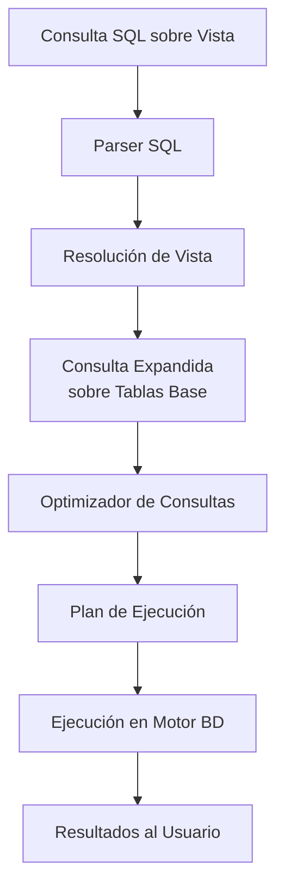

# Fundamentos de Bases de Datos - Vistas

## 7.2 Consulta.

---

Las vistas, al ser tablas virtuales, se consultan exactamente igual que las tablas base mediante la sentencia SELECT. El sistema de gestión de bases de datos (DBMS) se encarga de transformar la consulta sobre la vista en una consulta equivalente sobre las tablas base subyacentes mediante un proceso llamado **resolución de vistas**.

### Proceso de Resolución de Vistas

#### Algoritmo de Resolución

Cuando se ejecuta una consulta sobre una vista:

$$ Q\_{vista} = \pi\_{A}(\sigma\_{C}(V)) $$

El DBMS la transforma en:

$$ Q\_{base} = \pi\_{A}(\sigma\_{C}(Q\_{\text{definición}})) $$

donde $ Q\_{\text{definición}} $ es la consulta que define la vista V.

#### Ejemplo de Resolución

```sql
-- Vista definida como:
CREATE VIEW empleados_madrid AS
SELECT id, nombre, apellido, salario
FROM empleados
WHERE ciudad = 'Madrid';

-- Consulta sobre la vista:
SELECT nombre, apellido
FROM empleados_madrid
WHERE salario > 50000;

-- Se resuelve como:
SELECT nombre, apellido
FROM empleados
WHERE ciudad = 'Madrid' AND salario > 50000;
```

### Sintaxis de Consulta de Vistas

#### Consulta Básica

```sql
SELECT columna1, columna2, ...
FROM nombre_vista
[WHERE condición]
[GROUP BY columna(s)]
[HAVING condición]
[ORDER BY columna(s)];
```

#### Consulta con Joins entre Vistas y Tablas

```sql
SELECT v.columna1, t.columna2
FROM vista v
JOIN tabla t ON v.id = t.vista_id
WHERE v.columna3 = 'valor';
```

### Diagrama de Proceso de Consulta



### Ejemplos Prácticos de Consulta

#### Ejemplo 1: Consulta Simple sobre Vista

```sql
-- Consultar todos los empleados de Madrid con salario > 40000
SELECT nombre, apellido, salario
FROM empleados_madrid
WHERE salario > 40000
ORDER BY salario DESC;
```

#### Ejemplo 2: Consulta con Agregación sobre Vista

```sql
-- Calcular el salario promedio por departamento
SELECT departamento, AVG(salario) as salario_promedio
FROM vista_empleados_departamento
GROUP BY departamento
HAVING AVG(salario) > 45000;
```

#### Ejemplo 3: Consulta con Join entre Vista y Tabla

```sql
-- Combinar vista de empleados con tabla de proyectos
SELECT ve.nombre, ve.apellido, p.nombre_proyecto, p.fecha_inicio
FROM vista_empleados ve
JOIN proyectos p ON ve.id = p.empleado_id
WHERE p.estado = 'Activo';
```

### Optimización de Consultas sobre Vistas

#### Técnicas de Optimización

1. **Reescritura de Consultas**: Transformar la consulta sobre la vista en consulta sobre tablas base
2. **Materialización de Vistas**: Almacenar físicamente los resultados de la vista
3. **Indexación de Vistas**: Crear índices sobre vistas materializadas

#### Ejemplo de Optimización

```sql
-- Vista compleja
CREATE VIEW ventas_resumen AS
SELECT p.categoria,
       EXTRACT(YEAR FROM v.fecha) as año,
       EXTRACT(MONTH FROM v.fecha) as mes,
       COUNT(*) as total_ventas,
       SUM(v.monto) as ingreso_total
FROM ventas v
JOIN productos p ON v.producto_id = p.id
GROUP BY p.categoria, EXTRACT(YEAR FROM v.fecha), EXTRACT(MONTH FROM v.fecha);

-- Consulta optimizada
SELECT categoria, año, ingreso_total
FROM ventas_resumen
WHERE año = 2024 AND mes = 3
ORDER BY ingreso_total DESC;
```

### Consideraciones de Rendimiento

#### Factores que Afectan el Rendimiento

1. **Complejidad de la Vista**: Vistas con múltiples joins y agregaciones
2. **Volumen de Datos**: Cantidad de datos en tablas base
3. **Índices Disponibles**: Existencia de índices en columnas filtradas
4. **Estatísticas del Optimizador**: Información disponible para el planificador

#### Estrategias para Mejorar Rendimiento

```sql
-- Crear índices sobre columnas frecuentemente consultadas
CREATE INDEX idx_empleados_ciudad ON empleados(ciudad);
CREATE INDEX idx_empleados_salario ON empleados(salario);

-- Usar vistas materializadas para consultas complejas
CREATE MATERIALIZED VIEW ventas_trimestrales
AS SELECT /* consulta compleja */
REFRESH MATERIALIZED VIEW ventas_trimestrales;
```

### Ejercicios Propuestos

#### Ejercicio 1

Dada la siguiente vista:

```sql
CREATE VIEW clientes_premium AS
SELECT c.id, c.nombre, c.email, SUM(p.monto) as total_compras
FROM clientes c
JOIN pedidos p ON c.id = p.cliente_id
WHERE p.fecha >= CURRENT_DATE - INTERVAL '1 year'
GROUP BY c.id, c.nombre, c.email
HAVING SUM(p.monto) > 10000;
```

Escribe una consulta que muestre los 5 clientes premium con mayor gasto en el último trimestre.

<details>
<summary>Solución sugerida</summary>

```sql
SELECT nombre, email, total_compras
FROM clientes_premium
ORDER BY total_compras DESC
LIMIT 5;
```

</details>

#### Ejercicio 2

Crea una consulta que use la vista `empleados_departamentos` y la tabla `proyectos` para mostrar cuántos proyectos activos tiene cada empleado por departamento.

<details>
<summary>Solución sugerida</summary>

```sql
SELECT ed.departamento,
       ed.nombre,
       ed.apellido,
       COUNT(p.id) as proyectos_activos
FROM empleados_departamentos ed
LEFT JOIN proyectos p ON ed.id = p.empleado_id AND p.estado = 'Activo'
GROUP BY ed.departamento, ed.nombre, ed.apellido
ORDER BY ed.departamento, proyectos_activos DESC;
```

</details>

#### Ejercicio 3

Analiza el plan de ejecución de una consulta sobre una vista compleja y propone optimizaciones.

<details>
<summary>Solución sugerida</summary>

```sql
-- Ver plan de ejecución
EXPLAIN ANALYZE
SELECT categoria, año, SUM(ingreso_total)
FROM ventas_resumen
WHERE año = 2024
GROUP BY categoria, año;

-- Optimización: crear índices en fecha y categoria
CREATE INDEX idx_ventas_fecha ON ventas(fecha);
CREATE INDEX idx_productos_categoria ON productos(categoria);
```

</details>

### Casos Especiales de Consulta

#### Consultas Recursivas sobre Vistas

```sql
-- Vista jerárquica de empleados y supervisores
CREATE VIEW jerarquia_empleados AS
WITH RECURSIVE jerarquia AS (
    SELECT id, nombre, supervisor_id, 1 as nivel
    FROM empleados
    WHERE supervisor_id IS NULL
    UNION ALL
    SELECT e.id, e.nombre, e.supervisor_id, j.nivel + 1
    FROM empleados e
    JOIN jerarquia j ON e.supervisor_id = j.id
)
SELECT * FROM jerarquia;

-- Consultar la jerarquía completa
SELECT * FROM jerarquia_empleados
ORDER BY nivel, nombre;
```

#### Vistas con Subconsultas

```sql
-- Vista que usa subconsultas correlacionadas
CREATE VIEW empleados_con_ventas AS
SELECT e.*,
       (SELECT COUNT(*) FROM ventas v WHERE v.empleado_id = e.id) as total_ventas,
       (SELECT SUM(monto) FROM ventas v WHERE v.empleado_id = e.id) as total_monto
FROM empleados e;

-- Consultar empleados con ventas superiores a 10000
SELECT nombre, apellido, total_ventas, total_monto
FROM empleados_con_ventas
WHERE total_monto > 10000;
```

### Referencias

#### Bibliografía Básica

1. Elmasri and Navathe. Fundamentals of Database Systems. Addison-Wesley. Cuarta Edición. 2006. (Capítulo 8: The Relational Algebra and Relational Calculus - Sección 8.4)
2. Silberschatz A., Kort H. y Sudarshan S. Fundamentos de BD. McGraw Hill. Quinta edición. 2006. (Capítulo 3: SQL - Sección 3.7)
3. Ullman J.D. and Widom J. A First Course in Data Base System. Prentice Hall. Tercera edición. 2008. (Capítulo 5: Constraints and Triggers - Sección 5.3)

#### Bibliografía Complementaria

1. Harrington J. Relational Database Design and Implementation. Tercera edición. Morgan Kaufmann. 2009. (Capítulo 14: Views - Sección 14.3)
2. Kline K., Kline D., and Hunt B. SQL in a nutshell. O'Reilly. 2008. (Capítulo 7: Views - Sección 7.4)

### Buenas Prácticas en Consulta de Vistas

1. **Conocer la Definición**: Entender qué tablas y condiciones define la vista
2. **Analizar el Plan de Ejecución**: Usar EXPLAIN para entender el rendimiento
3. **Evitar Consultas Anidadas**: Minimizar el uso de vistas que consultan otras vistas
4. **Considerar Vistas Materializadas**: Para consultas frecuentes y complejas

### Autoevaluación

1. ¿Cómo transforma el DBMS una consulta sobre una vista en una consulta sobre tablas base?
2. ¿Qué ventajas ofrece consultar vistas en lugar de tablas base directamente?
3. ¿Cómo afecta la complejidad de una vista al rendimiento de las consultas?
4. ¿Qué es una vista materializada y cuándo debería usarse?
5. ¿Cómo se pueden optimizar las consultas sobre vistas complejas?
