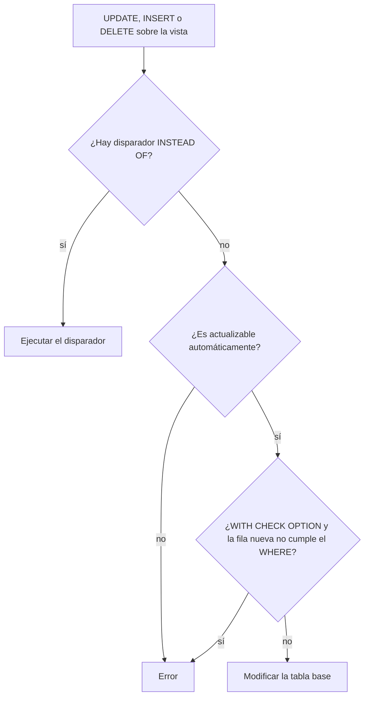

# Fundamentos de Bases de Datos - Vistas

## 7.3 Actualización

---

Consultar una vista siempre tiene sentido; **modificarla** no siempre. Un `UPDATE`, `INSERT` o `DELETE` sobre una vista tiene que traducirse en cambios sobre las tablas base, y esa traducción debe ser **única** y producir exactamente el efecto pedido sobre la vista. Para algunas vistas existe una sola traducción razonable, para otras hay muchas y para otras ninguna. Este tema explica cuándo una vista es actualizable, qué hace `WITH CHECK OPTION`, y cómo los disparadores `INSTEAD OF` permiten definir la traducción a mano.

### El problema de la traducción

Sea $V = f(B)$ una vista definida por la consulta $f$ sobre las tablas base $B,$ y sea $u$ una modificación de la vista. Se busca una modificación $u'$ de las tablas tal que

$$f(u'(B)) = u(f(B)),$$

es decir, que modificar las tablas y recalcular la vista dé lo mismo que modificar la vista directamente. Además, $u'$ no debe cambiar nada que no sea necesario. Los casos:

- **Selección y proyección de una tabla con su clave:** cada fila de la vista corresponde a exactamente una fila de la tabla, y la traducción es directa. Insertar requiere que las columnas omitidas tengan un valor por omisión o admitan nulos.
- **Columnas calculadas:** `precio * 1.16` no se puede asignar, porque habría que despejar el precio; `nombre || ' ' || apellido` tampoco, porque no se sabe dónde partir la cadena.
- **Agregación:** subir el promedio de un departamento de 35,000 a 38,500 se logra con infinitas combinaciones de salarios. No hay traducción única.
- **Reuniones:** borrar una fila de una reunión puede hacerse borrando de cualquiera de las tablas, con efectos distintos sobre otras filas de la vista; insertar exige insertar en ambas o encontrar la fila correspondiente.
- **`DISTINCT` y uniones:** una fila de la vista puede venir de varias filas base, o de cualquiera de las dos ramas.

El problema se formalizó con la teoría de **complementos de vistas** (Bancilhon y Spyratos, 1981): una actualización es traducible sin ambigüedad si se puede hacer manteniendo fija la parte de la base que la vista no muestra.

### Vistas actualizables automáticamente

El estándar SQL y los SMBD definen reglas sintácticas conservadoras. En PostgreSQL, una vista es **actualizable automáticamente** si:

- tiene exactamente una tabla o vista actualizable en `FROM`;
- no usa `GROUP BY`, `HAVING`, `DISTINCT`, `LIMIT`, `OFFSET`, `UNION`, `INTERSECT`, `EXCEPT` ni funciones de ventana en el nivel superior;
- y entonces se pueden modificar sus columnas que son referencias simples a columnas de la tabla; las calculadas son de solo lectura.

Las subconsultas en `WHERE` sí se permiten, como en una vista con `NOT EXISTS`. MySQL y SQL Server permiten además modificar vistas con reuniones si cada sentencia afecta a una sola de las tablas. SQLite no actualiza ninguna vista: toda modificación requiere un disparador.

### WITH CHECK OPTION

Una vista actualizable con condición en `WHERE` permite operaciones que **sacan** filas de la vista: en una vista de productos con existencias bajas, `UPDATE ... SET stock = 100` hace que el producto desaparezca de ella. `WITH CHECK OPTION` lo prohíbe: toda fila insertada o actualizada a través de la vista debe cumplir la condición de la vista. Con `CASCADED`, el valor por omisión, se verifican también las condiciones de las vistas sobre las que está definida; con `LOCAL`, solo las de esta.

Dos detalles importan. La condición debe ser **verdadera**, no solo no falsa: una fila para la que la condición es desconocida, por un nulo, se rechaza. Y la opción solo afecta lo que se hace **a través** de la vista: un `UPDATE` sobre la tabla base puede sacar filas de la vista libremente.

### Disparadores INSTEAD OF

Para cualquier vista se puede definir la traducción con un disparador `INSTEAD OF INSERT`, `UPDATE` o `DELETE`: el SMBD no intenta modificar la vista, sino que ejecuta el cuerpo del disparador, que tiene acceso a la fila nueva (`NEW`) y a la anterior (`OLD`). El diseñador decide la política: qué tabla modificar, cómo resolver nombres en claves, qué hacer con un dato ambiguo. Es el mecanismo de SQLite para toda vista, y el de PostgreSQL, Oracle y SQL Server para las que no son actualizables automáticamente.



### Implementación en Python

Como SQLite no actualiza vistas, el programa implementa con disparadores `INSTEAD OF` el comportamiento que el estándar da a la vista del ejercicio 1, con su opción de verificación, y prueba las tres operaciones del enunciado y una más; el resultado coincide con el de PostgreSQL. Para el ejercicio 2 escribe el disparador de inserción de la vista con reuniones, resolviendo los nombres de cliente y producto en claves y rechazando los nombres inexistentes o ambiguos. Para el ejercicio 3 muestra tres maneras distintas de lograr el mismo promedio y un disparador que fija una de ellas como política.

```python
import sqlite3

db = sqlite3.connect(":memory:")
db.execute("PRAGMA foreign_keys = ON")

def intenta(sql, etiqueta):
    try:
        db.execute(sql); print(f"   {etiqueta}: aceptada")      # en vistas con disparador, rowcount no informa
    except sqlite3.Error as e:
        print(f"   {etiqueta}: rechazada -> {e}")

# --- Ejercicio 1: vista de una tabla con WITH CHECK OPTION, emulada con disparadores ---
db.executescript("""
CREATE TABLE productos (producto_id INTEGER PRIMARY KEY, nombre TEXT, precio NUMERIC, stock INTEGER, stock_minimo INTEGER);
INSERT INTO productos VALUES (101, 'Tóner', 50, 3, 10), (102, 'Papel', 40, 30, 10);
CREATE VIEW productos_stock_minimo AS
    SELECT producto_id, nombre, precio, stock FROM productos WHERE stock <= stock_minimo;
-- UPDATE: solo filas visibles; la fila nueva debe seguir siendo visible
CREATE TRIGGER psm_upd INSTEAD OF UPDATE ON productos_stock_minimo
BEGIN
    SELECT RAISE(ABORT, 'la nueva fila viola la opción de verificación de la vista')
    WHERE NOT (NEW.stock <= (SELECT stock_minimo FROM productos WHERE producto_id = OLD.producto_id));
    UPDATE productos SET nombre = NEW.nombre, precio = NEW.precio, stock = NEW.stock WHERE producto_id = OLD.producto_id;
END;
-- INSERT: las columnas que la vista no tiene reciben su valor por omisión (aquí, nulo)
CREATE TRIGGER psm_ins INSTEAD OF INSERT ON productos_stock_minimo
BEGIN
    SELECT RAISE(ABORT, 'la nueva fila viola la opción de verificación de la vista')
    WHERE (NEW.stock <= NULL) IS NOT 1;
    INSERT INTO productos (producto_id, nombre, precio, stock) VALUES (NEW.producto_id, NEW.nombre, NEW.precio, NEW.stock);
END;
""")
print("ejercicio 1, vista inicial:", db.execute("SELECT * FROM productos_stock_minimo").fetchall())
intenta("UPDATE productos_stock_minimo SET stock = 20 WHERE producto_id = 101", "a) stock = 20")
intenta("INSERT INTO productos_stock_minimo VALUES (201, 'Producto X', 50, 5)", "b) insertar (201, 'Producto X', 50, 5)")
intenta("UPDATE productos_stock_minimo SET precio = 60 WHERE producto_id = 101", "c) precio = 60")
intenta("UPDATE productos_stock_minimo SET precio = 60 WHERE producto_id = 102", "   precio = 60 al producto 102, que no está en la vista")
print("   tabla base:", db.execute("SELECT * FROM productos ORDER BY producto_id").fetchall())

# --- Ejercicio 2: INSTEAD OF INSERT en una vista con reuniones ---
db.executescript("""
CREATE TABLE clientes (cliente_id INTEGER PRIMARY KEY, nombre TEXT NOT NULL);
CREATE TABLE catalogo (producto_id INTEGER PRIMARY KEY, nombre TEXT NOT NULL);
CREATE TABLE ventas (venta_id INTEGER PRIMARY KEY, fecha TEXT NOT NULL,
                     cliente_id INTEGER NOT NULL REFERENCES clientes, producto_id INTEGER NOT NULL REFERENCES catalogo);
INSERT INTO clientes VALUES (1, 'Rosa'), (2, 'Iván'), (3, 'Iván');
INSERT INTO catalogo VALUES (10, 'Teclado'), (11, 'Monitor');
CREATE VIEW ventas_detalladas AS
    SELECT v.venta_id, v.fecha, c.nombre AS cliente, p.nombre AS producto
    FROM ventas v JOIN clientes c ON v.cliente_id = c.cliente_id JOIN catalogo p ON v.producto_id = p.producto_id;
CREATE TRIGGER vd_ins INSTEAD OF INSERT ON ventas_detalladas
BEGIN
    SELECT RAISE(ABORT, 'cliente inexistente') WHERE NOT EXISTS (SELECT 1 FROM clientes WHERE nombre = NEW.cliente);
    SELECT RAISE(ABORT, 'nombre de cliente ambiguo') WHERE (SELECT COUNT(*) FROM clientes WHERE nombre = NEW.cliente) > 1;
    SELECT RAISE(ABORT, 'producto inexistente') WHERE NOT EXISTS (SELECT 1 FROM catalogo WHERE nombre = NEW.producto);
    INSERT INTO ventas (venta_id, fecha, cliente_id, producto_id)
    VALUES (NEW.venta_id, NEW.fecha, (SELECT cliente_id FROM clientes WHERE nombre = NEW.cliente),
            (SELECT producto_id FROM catalogo WHERE nombre = NEW.producto));
END;
""")
print("ejercicio 2:")
intenta("INSERT INTO ventas_detalladas VALUES (1, '2026-11-01', 'Rosa', 'Monitor')", "venta a Rosa")
intenta("INSERT INTO ventas_detalladas VALUES (2, '2026-11-02', 'Iván', 'Teclado')", "venta a Iván")
intenta("INSERT INTO ventas_detalladas VALUES (3, '2026-11-02', 'Lola', 'Teclado')", "venta a Lola")
intenta("INSERT INTO ventas_detalladas VALUES (4, '2026-11-02', 'Rosa', 'Webcam')", "venta de una webcam")
print("   ventas:", db.execute("SELECT * FROM ventas").fetchall(), "| vista:", db.execute("SELECT * FROM ventas_detalladas").fetchall())
intenta("UPDATE ventas_detalladas SET cliente = 'Rosa' WHERE venta_id = 1", "UPDATE sin disparador")

# --- Ejercicio 3: vista con agregación ---
db.executescript("""
CREATE TABLE departamentos (departamento_id INTEGER PRIMARY KEY, nombre TEXT);
CREATE TABLE empleados (id INTEGER PRIMARY KEY, nombre TEXT, salario NUMERIC, departamento_id INTEGER REFERENCES departamentos);
INSERT INTO departamentos VALUES (1, 'Sistemas'), (2, 'Ventas');
INSERT INTO empleados VALUES (1, 'Ana', 40000, 1), (2, 'Beto', 30000, 1), (3, 'Carla', 25000, 2);
CREATE VIEW salario_promedio_departamentos AS
    SELECT d.nombre, AVG(e.salario) AS salario_promedio
    FROM departamentos d JOIN empleados e ON d.departamento_id = e.departamento_id GROUP BY d.nombre;
""")
print("ejercicio 3:", db.execute("SELECT * FROM salario_promedio_departamentos ORDER BY nombre").fetchall())
# subir el promedio de Sistemas a 38500 admite infinitas traducciones; tres de ellas:
for nombre, salarios in (("todos +3500", (43500, 33500)), ("todos +10 %", (44000, 33000)), ("solo Beto", (40000, 37000))):
    print(f"   {nombre}: salarios {salarios}, promedio {sum(salarios) / 2}")
# una política explícita: el disparador reparte el cambio en proporción al salario
db.executescript("""
CREATE TRIGGER spd_upd INSTEAD OF UPDATE OF salario_promedio ON salario_promedio_departamentos
BEGIN
    UPDATE empleados SET salario = ROUND(salario * NEW.salario_promedio / OLD.salario_promedio, 2)
    WHERE departamento_id = (SELECT departamento_id FROM departamentos WHERE nombre = OLD.nombre);
END;
""")
db.execute("UPDATE salario_promedio_departamentos SET salario_promedio = 38500 WHERE nombre = 'Sistemas'")
print("   con la política proporcional:", db.execute("SELECT nombre, salario FROM empleados ORDER BY id").fetchall(),
      "| vista:", db.execute("SELECT * FROM salario_promedio_departamentos ORDER BY nombre").fetchall())
```

Salida:

```text
ejercicio 1, vista inicial: [(101, 'Tóner', 50, 3)]
   a) stock = 20: rechazada -> la nueva fila viola la opción de verificación de la vista
   b) insertar (201, 'Producto X', 50, 5): rechazada -> la nueva fila viola la opción de verificación de la vista
   c) precio = 60: aceptada
      precio = 60 al producto 102, que no está en la vista: aceptada
   tabla base: [(101, 'Tóner', 60, 3, 10), (102, 'Papel', 40, 30, 10)]
ejercicio 2:
   venta a Rosa: aceptada
   venta a Iván: rechazada -> nombre de cliente ambiguo
   venta a Lola: rechazada -> cliente inexistente
   venta de una webcam: rechazada -> producto inexistente
   ventas: [(1, '2026-11-01', 1, 11)] | vista: [(1, '2026-11-01', 'Rosa', 'Monitor')]
   UPDATE sin disparador: rechazada -> cannot modify ventas_detalladas because it is a view
ejercicio 3: [('Sistemas', 35000.0), ('Ventas', 25000.0)]
   todos +3500: salarios (43500, 33500), promedio 38500.0
   todos +10 %: salarios (44000, 33000), promedio 38500.0
   solo Beto: salarios (40000, 37000), promedio 38500.0
   con la política proporcional: [('Ana', 44000), ('Beto', 33000), ('Carla', 25000)] | vista: [('Sistemas', 38500.0), ('Ventas', 25000.0)]
```

### Ejercicios Propuestos

1. **Opción de verificación.** Dada la vista

    ```sql
    CREATE VIEW productos_stock_minimo AS
    SELECT producto_id, nombre, precio, stock FROM productos
    WHERE stock <= stock_minimo
    WITH CHECK OPTION;
    ```

    ¿qué ocurre con `UPDATE productos_stock_minimo SET stock = 20 WHERE producto_id = 101`, con `INSERT INTO productos_stock_minimo VALUES (201, 'Producto X', 50, 5)` y con `UPDATE productos_stock_minimo SET precio = 60 WHERE producto_id = 101`?

2. **INSTEAD OF.** Escribe un disparador que permita insertar en la vista

    ```sql
    CREATE VIEW ventas_detalladas AS
    SELECT v.venta_id, v.fecha, c.nombre AS cliente, p.nombre AS producto
    FROM ventas v
    JOIN clientes c ON v.cliente_id = c.cliente_id
    JOIN productos p ON v.producto_id = p.producto_id;
    ```

3. **Vista no actualizable.** Explica por qué no es actualizable la vista siguiente y propón una alternativa:

    ```sql
    CREATE VIEW salario_promedio_departamentos AS
    SELECT d.nombre, AVG(e.salario) AS salario_promedio
    FROM departamentos d JOIN empleados e ON d.departamento_id = e.departamento_id
    GROUP BY d.nombre;
    ```

### Soluciones

**Ejercicio 1.** La vista es actualizable: una sola tabla, sin agregación, con la clave. Con el producto 101 con stock 3 y mínimo 10:

- **a) Error.** La fila nueva tendría stock 20, mayor que su mínimo de 10, y saldría de la vista; la opción lo impide.
- **b) Error,** aunque a primera vista parezca válida. La vista no incluye `stock_minimo`, así que la fila insertada recibe su valor por omisión, nulo si no se declaró otro. La condición $5 \le \text{nulo}$ es **desconocida**, y la opción exige que sea verdadera. PostgreSQL lo rechaza con el mensaje "new row violates check option". Funcionaría si `stock_minimo` tuviera un valor por omisión de al menos 5.
- **c) Éxito.** Cambiar el precio no afecta la condición, y el producto 101 está en la vista.

Un caso adicional: el mismo `UPDATE` de precio sobre el producto 102, que tiene stock 30 y no está en la vista, no da error, pero no modifica ninguna fila: una vista solo deja modificar las filas que muestra. El programa reproduce los cuatro casos con disparadores en SQLite.

**Ejercicio 2.** La vista muestra nombres, y la tabla `ventas` guarda claves, así que el disparador debe **resolver** cada nombre en su clave:

```sql
CREATE TRIGGER vd_ins INSTEAD OF INSERT ON ventas_detalladas
BEGIN
    SELECT RAISE(ABORT, 'cliente inexistente') WHERE NOT EXISTS (SELECT 1 FROM clientes WHERE nombre = NEW.cliente);
    SELECT RAISE(ABORT, 'nombre de cliente ambiguo') WHERE (SELECT COUNT(*) FROM clientes WHERE nombre = NEW.cliente) > 1;
    SELECT RAISE(ABORT, 'producto inexistente') WHERE NOT EXISTS (SELECT 1 FROM productos WHERE nombre = NEW.producto);
    INSERT INTO ventas (venta_id, fecha, cliente_id, producto_id)
    VALUES (NEW.venta_id, NEW.fecha,
            (SELECT cliente_id FROM clientes WHERE nombre = NEW.cliente),
            (SELECT producto_id FROM productos WHERE nombre = NEW.producto));
END;
```

Es la sintaxis de SQLite; en PostgreSQL el cuerpo va en una función que devuelve `NEW`, y en Oracle se escribe `:NEW`. Las verificaciones son lo importante: sin ellas, un nombre inexistente daría una clave nula, y uno repetido haría que la subconsulta tomara un cliente cualquiera. En el programa hay dos clientes llamados Iván, y la venta a Iván se rechaza por ambigua. La decisión de diseño de fondo es otra: una vista con nombres es cómoda para leer, pero para escribir conviene que la aplicación envíe claves. El disparador también podría crear el cliente si no existe; eso es una política, que conviene hacer explícita.

**Ejercicio 3.** No es actualizable por la **agregación**: la vista tiene una fila por departamento que resume varias filas de empleados. Pedir que el promedio de Sistemas sea 38,500 admite infinitas traducciones, y el programa muestra tres: sumar 3500 a todos, subir 10 % a todos, o subir solo a Beto. Además, `nombre` del departamento no identifica la fila si hay dos departamentos con el mismo nombre. Las alternativas:

1. Modificar los salarios en `empleados` directamente, o a través de una vista **sin agregación**, como `empleados_departamentos`, que sí es actualizable si la reunión se resuelve con un disparador o si el SMBD lo permite.
2. Si de verdad se quiere "ajustar el promedio", definir esa operación con un disparador `INSTEAD OF UPDATE` que implemente una política explícita, como el aumento proporcional del programa, que lleva a Ana a 44,000 y a Beto a 33,000.

La segunda es posible, pero esconde una decisión de negocio en un disparador; normalmente es mejor un procedimiento con un nombre que describa lo que hace.

### Referencias

1. Bancilhon, F., and Spyratos, N., Update semantics of relational views. _ACM Transactions on Database Systems_ 6(4), 1981.
2. Dayal, U., and Bernstein, P. A., On the correct translation of update operations on relational views. _ACM Transactions on Database Systems_ 7(3), 1982.
3. Silberschatz, A., Korth, H. F., and Sudarshan, S., _Database System Concepts_. McGraw-Hill, 2019. Capítulo 4.
4. PostgreSQL Global Development Group, _CREATE VIEW_, sección Updatable Views. Documentación en línea, postgresql.org.
5. SQLite, _CREATE TRIGGER_, sección INSTEAD OF triggers. Documentación en línea, sqlite.org.
