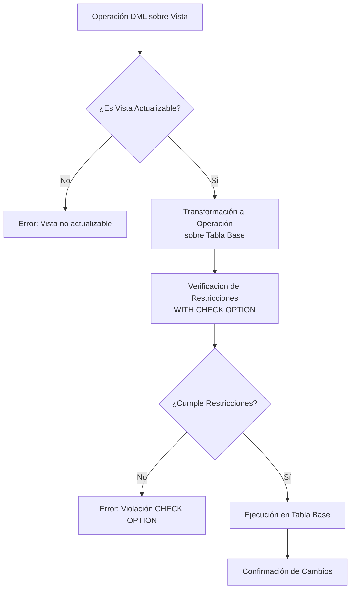

# Fundamentos de Bases de Datos - Vistas

## 7.3 Actualización

---

La actualización de vistas se refiere a la modificación de datos en las tablas base a través de operaciones DML (Data Manipulation Language) ejecutadas sobre vistas. Sin embargo, no todas las vistas son actualizables debido a restricciones inherentes en su definición.

### Teoría de Actualización de Vistas

#### Problema Fundamental

Dada una vista $V$ definida como:

$$V = \pi_{A}(\sigma_{C}(R))$$

Una actualización sobre $V$ debe mapearse a una actualización equivalente sobre $R$, pero este mapeo no siempre es posible de manera única.

#### Condiciones para la Actualización

Una vista es actualizable si cumple con las **reglas de actualización**:

1. Define exactamente una tabla en la cláusula FROM
2. No contiene funciones de agregación, GROUP BY o HAVING
3. No utiliza DISTINCT en la selección
4. Incluye la clave primaria de la tabla base
5. No utiliza operaciones de conjunto (UNION, INTERSECT, EXCEPT)

### Sintaxis de Actualización

#### UPDATE sobre Vistas

```sql
UPDATE nombre_vista
SET columna1 = valor1, columna2 = valor2, ...
[WHERE condición];
```

#### INSERT sobre Vistas

```sql
INSERT INTO nombre_vista [(columna1, columna2, ...)]
VALUES (valor1, valor2, ...);
```

#### DELETE sobre Vistas

```sql
DELETE FROM nombre_vista
[WHERE condición];
```

### Diagrama de Proceso de Actualización



### Cláusula WITH CHECK OPTION

#### Funcionamiento y Propósito

La cláusula `WITH CHECK OPTION` garantiza que todas las inserciones y actualizaciones realizadas a través de la vista cumplan con los criterios de selección de la vista.

```sql
CREATE VIEW empleados_madrid AS
SELECT * FROM empleados
WHERE ciudad = 'Madrid'
WITH CHECK OPTION;
```

#### Tipos de CHECK OPTION

- **LOCAL**: Verifica solo las condiciones de la vista actual
- **CASCADED**: Verifica todas las condiciones de vistas en la jerarquía

### Ejemplos Prácticos

#### Ejemplo 1: Vista Actualizable Simple

```sql
-- Vista actualizable
CREATE VIEW clientes_activos AS
SELECT cliente_id, nombre, email, telefono
FROM clientes
WHERE estado = 'Activo'
WITH CHECK OPTION;

-- Actualización permitida
UPDATE clientes_activos
SET telefono = '+34 912345678'
WHERE cliente_id = 101;

-- Inserción permitida
INSERT INTO clientes_activos (nombre, email, telefono, estado)
VALUES ('Juan Pérez', 'juan@email.com', '+34 600000000', 'Activo');
```

#### Ejemplo 2: Vista No Actualizable

```sql
-- Vista no actualizable (agregación)
CREATE VIEW ventas_por_producto AS
SELECT producto_id, COUNT(*) as total_ventas, SUM(monto) as ingreso_total
FROM ventas
GROUP BY producto_id;

-- Esta operación generará error
UPDATE ventas_por_producto
SET ingreso_total = 1500
WHERE producto_id = 5;
```

#### Ejemplo 3: Vista con JOIN (Limitaciones)

```sql
-- Vista con JOIN (generalmente no actualizable)
CREATE VIEW pedidos_clientes AS
SELECT p.pedido_id, p.fecha, c.nombre, c.email
FROM pedidos p
JOIN clientes c ON p.cliente_id = c.cliente_id;

-- La mayoría de DBMS no permitirá esta actualización
UPDATE pedidos_clientes
SET nombre = 'Carlos Ruiz'
WHERE pedido_id = 1001;
```

### Reglas de Actualización por Sistema Gestor

#### PostgreSQL

```sql
-- Vista actualizable simple
CREATE VIEW vista_actualizable AS
SELECT id, nombre, salario
FROM empleados
WHERE departamento = 'Ventas';

-- Sistemas basados en reglas permiten actualizaciones
UPDATE vista_actualizable
SET salario = salario * 1.1
WHERE id = 42;
```

#### Oracle

```sql
-- Oracle requiere INSTEAD OF triggers para vistas complejas
CREATE OR REPLACE TRIGGER tr_vista_compleja
INSTEAD OF UPDATE ON vista_compleja
FOR EACH ROW
BEGIN
    UPDATE tabla_base
    SET columna = :NEW.columna
    WHERE id = :OLD.id;
END;
/
```

### INSTEAD OF Triggers

#### Mecanismo para Vistas Complejas

Los triggers `INSTEAD OF` permiten definir comportamiento personalizado para operaciones DML sobre vistas no actualizables.

```sql
CREATE VIEW empleados_departamentos AS
SELECT e.empleado_id, e.nombre, e.apelido, d.nombre_depto
FROM empleados e
JOIN departamentos d ON e.depto_id = d.depto_id;

CREATE TRIGGER tr_insert_emp_depto
INSTEAD OF INSERT ON empleados_departamentos
FOR EACH ROW
BEGIN
    INSERT INTO empleados (empleado_id, nombre, apelido, depto_id)
    VALUES (:NEW.empleado_id, :NEW.nombre, :NEW.apelido,
            (SELECT depto_id FROM departamentos
             WHERE nombre_depto = :NEW.nombre_depto));
END;
/
```

### Ejercicios Propuestos

#### Ejercicio 1

Dada la siguiente vista:

```sql
CREATE VIEW productos_stock_minimo AS
SELECT producto_id, nombre, precio, stock
FROM productos
WHERE stock <= stock_minimo
WITH CHECK OPTION;
```

¿Qué ocurrirá al ejecutar estas operaciones?

```sql
a) UPDATE productos_stock_minimo SET stock = 20 WHERE producto_id = 101;
b) INSERT INTO productos_stock_minimo VALUES (201, 'Producto X', 50, 5);
c) UPDATE productos_stock_minimo SET precio = 60 WHERE producto_id = 101;
```

<details>
<summary>Solución sugerida</summary>

a) **Error** - Violaría WITH CHECK OPTION (stock > stock_minimo)
b) **Éxito** - Cumple con la condición stock <= stock_minimo
c) **Éxito** - La modificación de precio no afecta la condición de la vista
</details>

#### Ejercicio 2

Crea un INSTEAD OF trigger para permitir inserciones en la vista:

```sql
CREATE VIEW ventas_detalladas AS
SELECT v.venta_id, v.fecha, c.nombre as cliente, p.nombre as producto
FROM ventas v
JOIN clientes c ON v.cliente_id = c.cliente_id
JOIN productos p ON v.producto_id = p.producto_id;
```

<details>
<summary>Solución sugerida</summary>

```sql
CREATE TRIGGER tr_insert_ventas_detalladas
INSTEAD OF INSERT ON ventas_detalladas
FOR EACH ROW
BEGIN
    INSERT INTO ventas (venta_id, fecha, cliente_id, producto_id)
    VALUES (:NEW.venta_id, :NEW.fecha,
            (SELECT cliente_id FROM clientes WHERE nombre = :NEW.cliente),
            (SELECT producto_id FROM productos WHERE nombre = :NEW.producto));
END;
/
```

</details>

#### Ejercicio 3

Analiza por qué la siguiente vista no es actualizable y propone una alternativa:

```sql
CREATE VIEW salario_promedio_departamentos AS
SELECT d.nombre, AVG(e.salario) as salario_promedio
FROM departamentos d
JOIN empleados e ON d.departamento_id = e.departamento_id
GROUP BY d.nombre;
```

<details>
<summary>Solución sugerida</summary>

**Problema**: Usa función de agregación (AVG) y GROUP BY
**Alternativa**: Crear vista de empleados y calcular promedio en consultas:

```sql
CREATE VIEW empleados_departamentos AS
SELECT e.*, d.nombre as nombre_departamento
FROM empleados e
JOIN departamentos d ON e.departamento_id = d.departamento_id;
```

</details>

### Limitaciones y Consideraciones

#### Problemas Comunes

1. **Ambiguidad en Updates**: Múltiples tablas base pueden afectar la misma vista
2. **Pérdida de Información**: Columnas no incluidas en la vista pueden requerir valores por defecto
3. **Validación de Constraints**: Restricciones en tablas base deben cumplirse

#### Estrategias de Manejo

```sql
-- Usar valores por defecto para columnas omitidas
CREATE VIEW vista_segura AS
SELECT id, nombre, salario
FROM empleados
WHERE activo = true;

-- Al insertar, el DBMS usará valores por defecto para 'activo'
INSERT INTO vista_segura (id, nombre, salario)
VALUES (1001, 'Maria', 50000);
```

### Referencias

#### Bibliografía Básica

1. Elmasri and Navathe. Fundamentals of Database Systems. Addison-Wesley. Cuarta Edición. 2006. (Capítulo 8: The Relational Algebra and Relational Calculus - Sección 8.5)
2. Silberschatz A., Kort H. y Sudarshan S. Fundamentos de BD. McGraw Hill. Quinta edición. 2006. (Capítulo 3: SQL - Sección 3.8)
3. Ullman J.D. and Widom J. A First Course in Data Base System. Prentice Hall. Tercera edición. 2008. (Capítulo 5: Constraints and Triggers - Sección 5.4)

#### Bibliografía Complementaria

1. Harrington J. Relational Database Design and Implementation. Tercera edición. Morgan Kaufmann. 2009. (Capítulo 14: Views - Sección 14.4)
2. Kline K., Kline D., and Hunt B. SQL in a nutshell. O'Reilly. 2008. (Capítulo 7: Views - Sección 7.5)

### Buenas Prácticas

1. **Usar WITH CHECK OPTION** para mantener la integridad de los datos
2. **Documentar limitaciones** de actualización de cada vista
3. **Implementar INSTEAD OF triggers** para vistas complejas necesarias
4. **Validar siempre** el resultado de operaciones de actualización

### Autoevaluación

1. ¿Qué condiciones debe cumplir una vista para ser actualizable?
2. ¿Cómo funciona la cláusula WITH CHECK OPTION?
3. ¿Qué son los INSTEAD OF triggers y cuándo se usan?
4. ¿Por qué las vistas con agregaciones no son actualizables?
5. ¿Cómo manejan los diferentes DBMS las actualizaciones de vistas?
