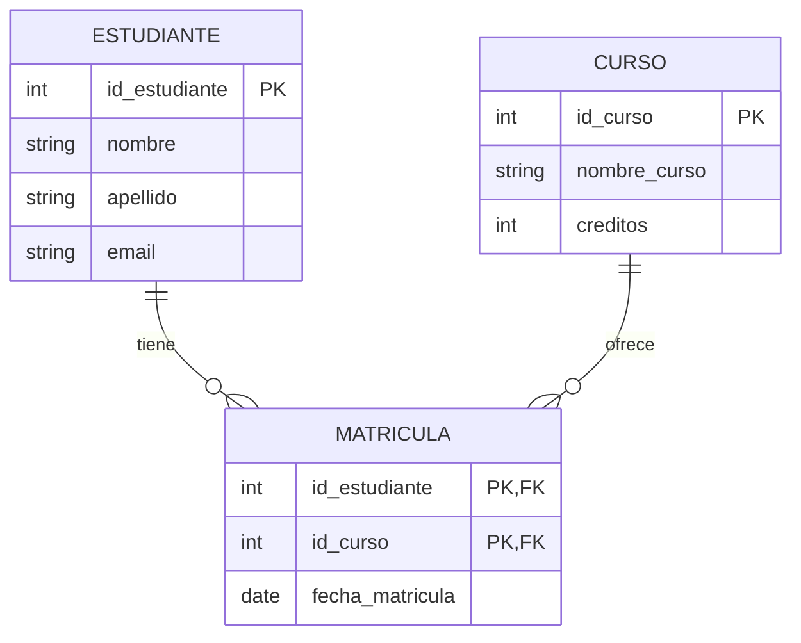

# Fundamentos de Bases de Datos - Integridad

## 8.1 Integridad de Entidad.

---

La integridad de entidad es un concepto fundamental en el modelo relacional que garantiza la unicidad y identificación única de cada fila o tupla en una tabla. Esta restricción es esencial para mantener la consistencia y confiabilidad de los datos en una base de datos.

### Definición de Integridad de Entidad

Según Elmasri y Navathe (2006), la **integridad de entidad** establece que en una relación (tabla) no pueden existir dos tuplas (filas) idénticas y que cada tupla debe ser única e identificable de manera única. Esto se logra mediante la definición de una **clave primaria** (primary key) para cada tabla.

La regla de integridad de entidad establece que:

- Ningún atributo que forme parte de la clave primaria puede contener valores nulos (NULL)
- No pueden existir dos tuplas con los mismos valores en los atributos de la clave primaria

### Conceptos Matemáticos

En términos formales, si tenemos una relación R con atributos A₁, A₂, ..., Aₙ, y K ⊆ {A₁, A₂, ..., Aₙ} es la clave primaria, entonces:

$$∀ t₁, t₂ ∈ R, t₁[K] = t₂[K] ⇒ t₁ = t₂$$

Y además:

$$∀ t ∈ R, t[K] ≠ NULL$$

Donde:

- R: Relación (tabla)
- t: Tupla (fila)
- K: Conjunto de atributos que forman la clave primaria
- t[K]: Valor de la clave primaria para la tupla t

### Implementación en SQL

#### Creación de Claves Primarias

```sql
-- Sintaxis básica para definir clave primaria
CREATE TABLE Estudiante (
    id_estudiante INT PRIMARY KEY,
    nombre VARCHAR(50) NOT NULL,
    apellido VARCHAR(50) NOT NULL,
    email VARCHAR(100) UNIQUE
);

-- Definición compuesta de clave primaria
CREATE TABLE Matricula (
    id_estudiante INT,
    id_curso INT,
    fecha_matricula DATE,
    PRIMARY KEY (id_estudiante, id_curso),
    FOREIGN KEY (id_estudiante) REFERENCES Estudiante(id_estudiante),
    FOREIGN KEY (id_curso) REFERENCES Curso(id_curso)
);
```

#### Verificación de Integridad

```sql
-- Consulta para verificar valores nulos en clave primaria
SELECT * FROM Estudiante WHERE id_estudiante IS NULL;

-- Consulta para verificar duplicados en clave primaria
SELECT id_estudiante, COUNT(*)
FROM Estudiante
GROUP BY id_estudiante
HAVING COUNT(*) > 1;
```

### Diagrama de Entidad-Relación



### Ejemplos Prácticos

#### Ejemplo 1: Tabla con Clave Primaria Simple

```sql
CREATE TABLE Producto (
    codigo_producto INT PRIMARY KEY,
    nombre VARCHAR(100) NOT NULL,
    precio DECIMAL(10,2) CHECK (precio > 0),
    stock INT DEFAULT 0
);

-- Inserción válida
INSERT INTO Producto VALUES (101, 'Laptop', 1200.00, 15);

-- Inserción inválida (viola integridad de entidad)
INSERT INTO Producto VALUES (101, 'Tablet', 300.00, 20); -- Error: clave duplicada
INSERT INTO Producto VALUES (NULL, 'Mouse', 25.00, 50); -- Error: valor nulo en PK
```

#### Ejemplo 2: Tabla con Clave Primaria Compuesta

```sql
CREATE TABLE Ventas (
    id_vendedor INT,
    id_producto INT,
    fecha_venta DATE,
    cantidad INT,
    PRIMARY KEY (id_vendedor, id_producto, fecha_venta)
);

-- Inserción válida
INSERT INTO Ventas VALUES (1, 101, '2024-01-15', 2);
INSERT INTO Ventas VALUES (1, 102, '2024-01-15', 1);

-- Inserción inválida
INSERT INTO Ventas VALUES (1, 101, '2024-01-15', 3); -- Error: combinación duplicada
```

### Ejercicios Propuestos

#### Ejercicio 1: Diseño de Esquema

Diseña las tablas para un sistema de biblioteca considerando:

- Libros (deben tener ISBN único)
- Autores (pueden tener múltiples libros)
- Préstamos (un libro puede ser prestado múltiples veces)

```sql
-- Escribe tu solución aquí
```

#### Ejercicio 2: Identificación de Problemas

Analiza el siguiente código y identifica los problemas de integridad de entidad:

```sql
CREATE TABLE Empleado (
    id_empleado INT,
    nombre VARCHAR(50),
    departamento VARCHAR(50)
);

INSERT INTO Empleado VALUES (NULL, 'Juan Pérez', 'Ventas');
INSERT INTO Empleado VALUES (101, 'María López', 'Marketing');
INSERT INTO Empleado VALUES (101, 'Carlos Ruiz', 'TI');
```

#### Ejercicio 3: Corrección de Esquema

Corrige el esquema anterior para garantizar la integridad de entidad:

```sql
-- Escribe tu solución aquí
```

### Casos Especiales y Consideraciones

#### Claves Suplentes vs. Claves Naturales

```sql
-- Clave natural (basada en datos del negocio)
CREATE TABLE Ciudad (
    codigo_postal VARCHAR(10) PRIMARY KEY,
    nombre_ciudad VARCHAR(100) NOT NULL,
    provincia VARCHAR(50)
);

-- Clave suplente (artificial)
CREATE TABLE Ciudad (
    id_ciudad INT AUTO_INCREMENT PRIMARY KEY,
    codigo_postal VARCHAR(10) UNIQUE,
    nombre_ciudad VARCHAR(100) NOT NULL,
    provincia VARCHAR(50)
);
```

#### Integridad en Actualizaciones

```sql
-- Actualización que preserva la integridad
UPDATE Producto SET codigo_producto = 102 WHERE codigo_producto = 101;

-- Es mejor usar transacciones para mantener consistencia
BEGIN TRANSACTION;
UPDATE Ventas SET id_producto = 102 WHERE id_producto = 101;
UPDATE Producto SET codigo_producto = 102 WHERE codigo_producto = 101;
COMMIT;
```

### Buenas Prácticas

1. **Siempre definir clave primaria** en cada tabla
2. **Usar claves simples** cuando sea posible
3. **Evitar el uso de datos variables** como claves primarias
4. **Considerar el uso de auto-incremento** para claves suplentes
5. **Documentar las restricciones** de integridad en el esquema

### Referencias

#### Bibliografía Básica

1. Elmasri and Navathe. _Fundamentals of Database Systems_. Addison-Wesley. Cuarta Edición. 2006. (Capítulo 3: The Relational Data Model and Relational Database Constraints)
2. Silberschatz A., Kort H. y Sudarshan S. _Fundamentos de BD_. McGraw Hill. Quinta edición. 2006. (Capítulo 6: Integridad y Seguridad)
3. Ullman J.D. and Widom J. _A First Course in Data Base System_. Prentice Hall. Tercera edición. 2008. (Capítulo 2: The Relational Model of Data)

#### Bibliografía Complementaria

1. Harrington J. _Relational Database Design and Implementation_. Tercera edición. Morgan Kaufmann. 2009. (Capítulo 4: Entities and Relationships)
2. Kline K., Kline D., and Hunt B. _SQL in a nutshell_. O'Reilly. 2008. (Capítulo 2: Foundational Concepts)

### Autoevaluación

1. ¿Por qué es importante la integridad de entidad en una base de datos relacional?
2. ¿Qué sucede si se intenta insertar una tupla con valores nulos en la clave primaria?
3. ¿Cómo se maneja la integridad de entidad en claves primarias compuestas?
4. Explica la diferencia entre clave natural y clave suplente
5. ¿Qué mecanismos proporciona SQL para garantizar la integridad de entidad?
