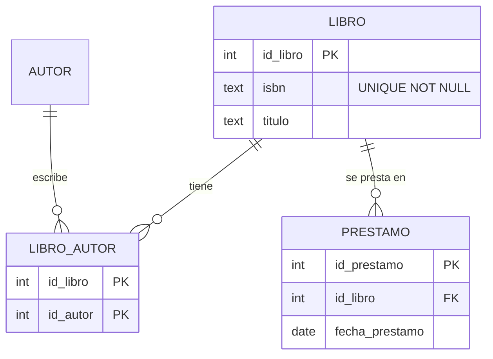

# Fundamentos de Bases de Datos - Integridad

## 8.1 Integridad de Entidad.

---

Las **restricciones de integridad** son las condiciones que toda instancia válida de la base debe cumplir; el SMBD las verifica en cada modificación y rechaza las que las violarían. Se agrupan en cuatro clases, que son los temas de esta unidad: de **entidad** (este tema), de **dominio** (8.2), **referencial** (8.3) y **de usuario** o semánticas (8.4). La integridad de entidad garantiza que cada fila de una tabla se pueda identificar: que tenga una clave primaria, que esa clave no se repita y que no sea nula.

### Definición

Sea $R$ con clave primaria $PK.$ La **regla de integridad de entidad** exige que, en toda instancia $r$ de $R,$

$$\forall t \in r: \; \forall A \in PK: \; t[A] \text{ no es nulo},$$

y la **restricción de clave** exige que

$$\forall t_1, t_2 \in r: \; t_1[PK] = t_2[PK] \;\Rightarrow\; t_1 = t_2.$$

La primera se justifica porque un nulo en la clave significa que no se sabe qué entidad representa la fila, y entonces no se puede hacer referencia a ella, ni distinguirla de otra, ni actualizarla con seguridad. Para una clave compuesta, **ninguno** de sus atributos puede ser nulo, no solo la combinación. Las claves alternativas, declaradas `UNIQUE`, no tienen la restricción de no nulidad salvo que se declare: SQL permite varios nulos en una columna `UNIQUE`, porque dos nulos no se consideran iguales (SQL Server es la excepción, y PostgreSQL 15 agregó `UNIQUE NULLS NOT DISTINCT`).

### Implementación en SQL

```sql
CREATE TABLE empleado (
    id_empleado INTEGER NOT NULL,
    nombre      VARCHAR(50) NOT NULL,
    CONSTRAINT pk_empleado PRIMARY KEY (id_empleado)
);
CREATE TABLE matricula (
    id_estudiante INTEGER NOT NULL,
    id_curso      INTEGER NOT NULL,
    semestre      CHAR(6) NOT NULL,
    PRIMARY KEY (id_estudiante, id_curso, semestre)
);
```

`PRIMARY KEY` implica `UNIQUE` y `NOT NULL` en el estándar, y el SMBD crea un índice para verificar la unicidad rápido. Nombrar la restricción ayuda a leer los mensajes de error y a eliminarla después. Para generar claves, el estándar ofrece `GENERATED ALWAYS AS IDENTITY`; PostgreSQL también `SERIAL`, MySQL `AUTO_INCREMENT` y SQLite `INTEGER PRIMARY KEY`.

SQLite tiene dos peculiaridades que conviene conocer. Por compatibilidad con versiones antiguas, una clave primaria que **no** sea `INTEGER PRIMARY KEY` admite nulos, salvo que se declare `NOT NULL` o la tabla sea `STRICT`. Y una columna `INTEGER PRIMARY KEY` es un alias del identificador interno de la fila: insertar un nulo en ella no es un error, sino que genera un número nuevo.

### Claves naturales y suplentes

Una **clave natural** tiene significado en el dominio: el ISBN de un libro, el RFC o la CURP de una persona, el código de un aeropuerto. Una **clave suplente** (*surrogate*) es un identificador sin significado que genera el sistema, como un entero consecutivo o un UUID.

| Aspecto                 | Natural                                                 | Suplente                                                 |
| ----------------------- | ------------------------------------------------------- | -------------------------------------------------------- |
| Estabilidad             | Puede cambiar (error de captura, cambio de norma)       | No cambia nunca                                          |
| Existencia              | Puede faltar al registrar (un libro antiguo sin ISBN)   | Siempre existe                                           |
| Tamaño en claves foráneas | Variable, a veces largo                                | Corto y fijo                                             |
| Significado             | Visible, útil al consultar                              | Ninguno: requiere reunir para saber qué es              |
| Duplicados del mundo real | Los impide                                             | No los impide por sí sola                                |

La práctica habitual combina ambas: una clave suplente como clave primaria y la natural como clave alternativa `UNIQUE NOT NULL`. Así las claves foráneas usan el identificador estable y la base sigue impidiendo, por ejemplo, dos libros con el mismo ISBN. La última fila de la tabla es la razón: sin la restricción `UNIQUE` sobre la clave natural, una clave suplente permite registrar dos veces la misma entidad con números distintos.



### Implementación en Python

El programa crea en SQLite la tabla sin clave del ejercicio 2 y muestra los problemas que provoca: dos empleados con el mismo identificador y uno que no se puede encontrar por su clave. Muestra las dos peculiaridades de SQLite y la versión corregida del ejercicio 3. Para el ejercicio 1 crea la biblioteca con claves suplentes, el ISBN como clave alternativa y claves compuestas en la tabla de autoría, prueba las violaciones posibles y corrige un ISBN sin afectar las demás tablas. Al final cuenta los nulos y los repetidos de la tabla original, la verificación que hay que hacer antes de declarar una clave sobre datos existentes.

```python
import sqlite3

db = sqlite3.connect(":memory:")
db.execute("PRAGMA foreign_keys = ON")

def intenta(sql, etiqueta):
    try:
        db.execute(sql); print(f"   aceptado: {etiqueta}")
    except sqlite3.IntegrityError as e:
        print(f"   rechazado: {etiqueta} -> {e}")

# --- Ejercicio 2: el esquema del enunciado, sin clave ---
db.executescript("""
CREATE TABLE empleado_sin_clave (id_empleado INT, nombre VARCHAR(50), departamento VARCHAR(50));
INSERT INTO empleado_sin_clave VALUES (NULL, 'Juan Pérez', 'Ventas');
INSERT INTO empleado_sin_clave VALUES (101, 'María López', 'Marketing');
INSERT INTO empleado_sin_clave VALUES (101, 'Carlos Ruiz', 'TI');
""")
print("ejercicio 2: se aceptan las tres filas:", db.execute("SELECT * FROM empleado_sin_clave").fetchall())
print("   ¿quién es el empleado 101?", db.execute("SELECT nombre FROM empleado_sin_clave WHERE id_empleado = 101").fetchall())
print("   ¿y cómo se busca a Juan por su clave? id_empleado = NULL da",
      db.execute("SELECT COUNT(*) FROM empleado_sin_clave WHERE id_empleado = NULL").fetchone()[0], "filas")

# --- Ejercicio 3: corregido. Atención a una peculiaridad de SQLite ---
db.execute("CREATE TABLE con_pk_texto (codigo TEXT PRIMARY KEY, nombre TEXT)")
intenta("INSERT INTO con_pk_texto VALUES (NULL, 'sin código')", "nulo en una PRIMARY KEY de texto, sin NOT NULL (SQLite)")
intenta("INSERT INTO con_pk_texto VALUES (NULL, 'otro sin código')", "un segundo nulo en la misma clave")
db.executescript("""
CREATE TABLE empleado (
    id_empleado  INTEGER NOT NULL,
    nombre       VARCHAR(50) NOT NULL,
    departamento VARCHAR(50) NOT NULL,
    CONSTRAINT pk_empleado PRIMARY KEY (id_empleado)
);
""")
print("ejercicio 3, con clave primaria y NOT NULL:")
intenta("INSERT INTO empleado VALUES (NULL, 'Juan Pérez', 'Ventas')", "id nulo")
intenta("INSERT INTO empleado VALUES (101, 'María López', 'Marketing')", "101 María")
intenta("INSERT INTO empleado VALUES (101, 'Carlos Ruiz', 'TI')", "101 Carlos")
intenta("UPDATE empleado SET id_empleado = NULL WHERE id_empleado = 101", "cambiar la clave a nulo")
print("   la tabla:", db.execute("SELECT * FROM empleado ORDER BY id_empleado").fetchall(),
      "<- en SQLite, una clave INTEGER PRIMARY KEY nula se reemplaza por un número nuevo")
db.execute("CREATE TABLE empleado_int (id_empleado INT NOT NULL PRIMARY KEY, nombre TEXT NOT NULL)")   # INT, no INTEGER
intenta("INSERT INTO empleado_int VALUES (NULL, 'Juan Pérez')", "id nulo en una clave INT, que no es alias del rowid")

# --- Ejercicio 1: biblioteca, con clave suplente para el libro y el ISBN como clave alternativa ---
db.executescript("""
CREATE TABLE autor (id_autor INTEGER PRIMARY KEY, nombre TEXT NOT NULL);
CREATE TABLE libro (id_libro INTEGER PRIMARY KEY, isbn TEXT NOT NULL UNIQUE, titulo TEXT NOT NULL);
CREATE TABLE libro_autor (id_libro INTEGER NOT NULL REFERENCES libro, id_autor INTEGER NOT NULL REFERENCES autor,
                          PRIMARY KEY (id_libro, id_autor));
CREATE TABLE prestamo (id_prestamo INTEGER PRIMARY KEY, id_libro INTEGER NOT NULL REFERENCES libro,
                       socio TEXT NOT NULL, fecha_prestamo TEXT NOT NULL, fecha_devolucion TEXT,
                       UNIQUE (id_libro, fecha_prestamo));
INSERT INTO autor (nombre) VALUES ('Elmasri'), ('Navathe');
INSERT INTO libro (isbn, titulo) VALUES ('9780133970777', 'Fundamentals of Database Systems');
INSERT INTO libro_autor VALUES (1, 1), (1, 2);
INSERT INTO prestamo (id_libro, socio, fecha_prestamo, fecha_devolucion) VALUES (1, 'Ana', '2026-09-01', '2026-09-14'),
                                                                                (1, 'Luis', '2026-10-01', NULL);
""")
print("ejercicio 1:")
intenta("INSERT INTO libro (isbn, titulo) VALUES ('9780133970777', 'Copia con el mismo ISBN')", "ISBN repetido")
intenta("INSERT INTO libro_autor VALUES (1, 1)", "el mismo autor dos veces en el mismo libro")
intenta("INSERT INTO libro_autor VALUES (1, NULL)", "autor nulo en una clave compuesta")
intenta("INSERT INTO prestamo (id_libro, socio, fecha_prestamo) VALUES (1, 'Marta', '2026-10-01')", "dos préstamos del libro el mismo día")
print("   préstamos del libro 1:", db.execute("SELECT id_prestamo, socio, fecha_prestamo FROM prestamo WHERE id_libro = 1").fetchall())
# clave suplente: corregir un ISBN mal capturado no toca ninguna otra tabla
db.execute("UPDATE libro SET isbn = '9780133970778' WHERE id_libro = 1")
print("   tras corregir el ISBN, préstamos y autores siguen ligados:",
      db.execute("SELECT COUNT(*) FROM prestamo JOIN libro USING (id_libro) WHERE isbn = '9780133970778'").fetchone()[0],
      db.execute("SELECT COUNT(*) FROM libro_autor JOIN libro USING (id_libro) WHERE isbn = '9780133970778'").fetchone()[0])
# detección de violaciones en datos existentes antes de declarar una clave
print("verificación previa en la tabla sin clave: nulos",
      db.execute("SELECT COUNT(*) FROM empleado_sin_clave WHERE id_empleado IS NULL").fetchone()[0],
      "| repetidos", db.execute("SELECT id_empleado, COUNT(*) FROM empleado_sin_clave WHERE id_empleado IS NOT NULL GROUP BY id_empleado HAVING COUNT(*) > 1").fetchall())
```

Salida:

```text
ejercicio 2: se aceptan las tres filas: [(None, 'Juan Pérez', 'Ventas'), (101, 'María López', 'Marketing'), (101, 'Carlos Ruiz', 'TI')]
   ¿quién es el empleado 101? [('María López',), ('Carlos Ruiz',)]
   ¿y cómo se busca a Juan por su clave? id_empleado = NULL da 0 filas
   aceptado: nulo en una PRIMARY KEY de texto, sin NOT NULL (SQLite)
   aceptado: un segundo nulo en la misma clave
ejercicio 3, con clave primaria y NOT NULL:
   aceptado: id nulo
   aceptado: 101 María
   rechazado: 101 Carlos -> UNIQUE constraint failed: empleado.id_empleado
   rechazado: cambiar la clave a nulo -> datatype mismatch
   la tabla: [(1, 'Juan Pérez', 'Ventas'), (101, 'María López', 'Marketing')] <- en SQLite, una clave INTEGER PRIMARY KEY nula se reemplaza por un número nuevo
   rechazado: id nulo en una clave INT, que no es alias del rowid -> NOT NULL constraint failed: empleado_int.id_empleado
ejercicio 1:
   rechazado: ISBN repetido -> UNIQUE constraint failed: libro.isbn
   rechazado: el mismo autor dos veces en el mismo libro -> UNIQUE constraint failed: libro_autor.id_libro, libro_autor.id_autor
   rechazado: autor nulo en una clave compuesta -> NOT NULL constraint failed: libro_autor.id_autor
   rechazado: dos préstamos del libro el mismo día -> UNIQUE constraint failed: prestamo.id_libro, prestamo.fecha_prestamo
   préstamos del libro 1: [(1, 'Ana', '2026-09-01'), (2, 'Luis', '2026-10-01')]
   tras corregir el ISBN, préstamos y autores siguen ligados: 2 2
verificación previa en la tabla sin clave: nulos 1 | repetidos [(101, 2)]
```

### Ejercicios Propuestos

1. **Diseño.** Diseña las tablas de una biblioteca con libros, que deben tener un ISBN único, autores, que pueden tener varios libros, y préstamos, en la que un libro se puede prestar muchas veces.

2. **Problemas.** Identifica los problemas de integridad de entidad del siguiente código:

    ```sql
    CREATE TABLE Empleado (id_empleado INT, nombre VARCHAR(50), departamento VARCHAR(50));
    INSERT INTO Empleado VALUES (NULL, 'Juan Pérez', 'Ventas');
    INSERT INTO Empleado VALUES (101, 'María López', 'Marketing');
    INSERT INTO Empleado VALUES (101, 'Carlos Ruiz', 'TI');
    ```

3. **Corrección.** Corrige el esquema del ejercicio 2 para garantizar la integridad de entidad.

4. **Repaso.** ¿Por qué importa la integridad de entidad? ¿Qué pasa al insertar una fila con nulos en la clave primaria? ¿Cómo se aplica a las claves compuestas? ¿Qué diferencia hay entre una clave natural y una suplente? ¿Qué mecanismos da SQL para garantizarla?

### Soluciones

**Ejercicio 1.** `libro(id_libro, isbn, titulo)` con `id_libro` como clave suplente e `isbn UNIQUE NOT NULL`; `autor(id_autor, nombre)`; `libro_autor(id_libro, id_autor)` con clave compuesta, que impide registrar dos veces al mismo autor en un libro y no admite nulos en ninguna de sus partes; `prestamo(id_prestamo, id_libro, socio, fecha_prestamo, fecha_devolucion)` con clave suplente, porque el mismo libro se presta muchas veces, y una clave alternativa `(id_libro, fecha_prestamo)` si la regla es que un ejemplar no se presta dos veces el mismo día. La clave suplente del libro paga su costo al corregir un ISBN mal capturado: solo cambia una fila de `libro`, y los préstamos y autorías siguen ligados.

**Ejercicio 2.** La tabla no tiene clave primaria, y por eso:

- Acepta un empleado con identificador **nulo**: Juan no se puede buscar por su clave, porque `id_empleado = NULL` nunca es verdadero, ni ser referenciado desde otra tabla.
- Acepta dos empleados con el identificador **101**: una consulta por ese identificador devuelve a María y a Carlos, un `UPDATE ... WHERE id_empleado = 101` los modifica a los dos, y una clave foránea hacia 101 sería ambigua.
- Además, nada impide registrar dos veces a la misma persona con identificadores distintos; eso requeriría una clave natural adicional.

**Ejercicio 3.**

```sql
CREATE TABLE empleado (
    id_empleado  INTEGER NOT NULL,
    nombre       VARCHAR(50) NOT NULL,
    departamento VARCHAR(50) NOT NULL,
    CONSTRAINT pk_empleado PRIMARY KEY (id_empleado)
);
```

Con ella, la tercera inserción se rechaza por clave repetida. La primera se rechaza en el estándar por el nulo; en SQLite, como `id_empleado` es `INTEGER PRIMARY KEY`, el nulo se reemplaza por un número nuevo y Juan recibe el 1, como muestra el programa. Si se quiere que SQLite rechace el nulo, la columna debe declararse con otro tipo, como `INT`, o la tabla como `STRICT`. Para aplicar la corrección sobre los datos existentes, primero hay que resolver los conflictos, porque `ALTER TABLE ... ADD PRIMARY KEY` falla con nulos o repetidos: asignar un identificador a Juan y otro a Carlos, después de comprobar con consultas cuáles son. Lo mejor es que el sistema genere los identificadores, con `GENERATED ALWAYS AS IDENTITY`, para que no se capturen a mano. El departamento debería ser una clave foránea a una tabla de departamentos (tema 8.3).

**Ejercicio 4.** Importa porque sin ella no se puede identificar, referenciar ni actualizar una fila sin ambigüedad. Una inserción con nulo en la clave primaria se rechaza, salvo la excepción de SQLite descrita. En una clave compuesta, ningún atributo puede ser nulo, y lo que no se repite es la combinación: dos matrículas pueden compartir estudiante o curso, pero no los tres valores. Una clave natural tiene significado en el dominio y puede cambiar; una suplente no tiene significado y no cambia, y lo habitual es usar la suplente como primaria y declarar la natural `UNIQUE`. Los mecanismos son `PRIMARY KEY`, `UNIQUE`, `NOT NULL` y la generación automática de identificadores.

### Referencias

1. Codd, E. F., Extending the database relational model to capture more meaning. _ACM Transactions on Database Systems_ 4(4), 1979.
2. Elmasri, R., and Navathe, S. B., _Fundamentals of Database Systems_. Pearson, 2016. Capítulo 5.
3. Date, C. J., _An Introduction to Database Systems_. Addison-Wesley, 2003. Capítulo 9.
4. SQLite, _CREATE TABLE_, secciones sobre ROWID y la restricción PRIMARY KEY. Documentación en línea, sqlite.org.
