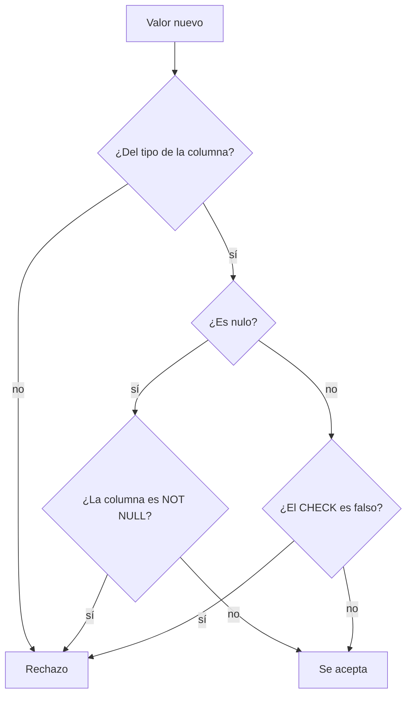

# Fundamentos de Bases de Datos - Integridad

## 8.2 Integridad de Dominio.

---

La **integridad de dominio** garantiza que cada valor de una columna pertenezca al conjunto de valores válidos para ella: que una edad sea un entero entre 0 y 150, que un correo tenga la forma de un correo, que un estado sea uno de una lista. Es la restricción más simple, porque se verifica mirando un solo valor, o una sola fila, y la más frecuente. Este tema presenta los mecanismos con que SQL la expresa (tipos de datos, `NOT NULL`, `CHECK`, `DEFAULT` y dominios con nombre), su interacción con los nulos y las diferencias entre los SMBD.

### Definición

Para cada atributo $A$ de una relación $R,$ con dominio $D_A,$

$$\forall t \in r(R): \; t[A] \in D_A \;\lor\; (t[A] \text{ es nulo} \land A \text{ admite nulos}).$$

El dominio se describe con un **tipo** de dato y, si hace falta, con un **predicado** adicional: el dominio de las calificaciones es el de los números decimales $x$ con $0 \le x \le 10.$ Las restricciones que relacionan varias columnas de una misma fila, como que la salida sea posterior a la entrada, se llaman **de tupla**; se escriben con el mismo mecanismo y se suelen estudiar junto con las de dominio.

### Mecanismos

- **Tipo de dato:** `INTEGER`, `DECIMAL(p, s)`, `VARCHAR(n)`, `DATE`, `BOOLEAN`. El tipo ya restringe: `DECIMAL(3, 2)` admite valores con valor absoluto menor que 10 y dos decimales, y `VARCHAR(10)`, cadenas de a lo más 10 caracteres.
- **`NOT NULL`:** el valor es obligatorio.
- **`CHECK (condición)`:** cualquier condición sobre los valores de la fila: rangos (`BETWEEN`), listas (`IN`), patrones (`LIKE`, o expresiones regulares donde las haya), longitudes y relaciones entre columnas.
- **`DEFAULT`:** el valor que recibe la columna si la inserción la omite. No es una restricción, pero evita nulos y debe pertenecer al dominio.
- **Dominios con nombre:** el estándar define `CREATE DOMAIN`, que PostgreSQL implementa, para declarar una vez un tipo con sus restricciones y usarlo en muchas columnas:

```sql
CREATE DOMAIN correo AS VARCHAR(254) CHECK (VALUE ~ '^[^@\s]+@[^@\s]+\.[^@\s]+$');
CREATE TABLE cliente (id INTEGER PRIMARY KEY, email correo NOT NULL);
```

- **Tablas de catálogo:** cuando la lista de valores válidos cambia con el tiempo, como los departamentos de una empresa, conviene una tabla con los valores y una clave foránea hacia ella (tema 8.3), en lugar de un `CHECK ... IN (...)` que obliga a modificar el esquema.

### CHECK y la lógica de tres valores

Un `CHECK` **rechaza** la fila si su condición es **falsa**, y la **acepta** si es verdadera o desconocida. Con un promedio nulo, `promedio BETWEEN 0 AND 10` es desconocida y la fila se acepta. Es una decisión del estándar, para que las columnas que admiten nulos no necesiten agregar `OR promedio IS NULL` a cada condición; la consecuencia es que, si el valor es obligatorio, hace falta además `NOT NULL`. Es lo contrario de `WHERE`, que descarta las filas con condición desconocida, y de `WITH CHECK OPTION`, que también las rechaza (tema 7.3).

### Diferencias entre SMBD

| Situación                                  | PostgreSQL                 | MySQL estricto             | SQLite                                 |
| ------------------------------------------ | -------------------------- | -------------------------- | -------------------------------------- |
| Cadena más larga que `VARCHAR(n)`          | Error                      | Error                      | Se acepta completa                     |
| Valor fuera de la precisión de `DECIMAL`   | Error                      | Error                      | Se acepta                              |
| Texto en una columna numérica              | Error                      | Error                      | Se acepta, salvo en tablas `STRICT`    |
| Fecha inválida en una columna de fecha     | Error                      | Error                      | Se acepta: las fechas son texto        |
| Expresiones regulares en `CHECK`           | `~`                        | `REGEXP`                   | `REGEXP` si la aplicación lo define    |

SQLite trata los tipos como **afinidades**: indican cómo convertir un valor, no qué valores se admiten. En SQLite, por lo tanto, toda la integridad de dominio debe expresarse con `CHECK` o con tablas `STRICT`, que verifican el tipo pero solo admiten los tipos `INTEGER`, `REAL`, `TEXT`, `BLOB` y `ANY`.



### Implementación en Python

El programa define en Python una función de expresiones regulares y la registra en SQLite para poder usar `REGEXP` en un `CHECK`. Crea la tabla de empleados del ejercicio 1 como tabla `STRICT` con todas sus restricciones y prueba un valor válido y uno inválido por cada regla. Para el ejercicio 2 crea la tabla del enunciado y muestra lo que SQLite acepta, a diferencia de otros SMBD; para el ejercicio 3 crea la versión corregida y prueba de nuevo, incluido un promedio nulo.

```python
import re, sqlite3

db = sqlite3.connect(":memory:")
# SQLite no trae REGEXP; el operador X REGEXP Y llama a la función regexp(Y, X) que defina la aplicación
db.create_function("regexp", 2, lambda patron, valor: valor is not None and re.fullmatch(patron, valor) is not None,
                   deterministic=True)

def intenta(sql, params, etiqueta):
    try:
        db.execute(sql, params); print(f"   aceptado: {etiqueta}")
    except sqlite3.Error as e:
        print(f"   rechazado: {etiqueta} -> {e}")

# --- Ejercicio 1 ---
db.execute(r"""
CREATE TABLE empleado (
    id_empleado  INTEGER PRIMARY KEY CHECK (id_empleado > 0),
    nombre       TEXT NOT NULL CHECK (length(trim(nombre)) BETWEEN 2 AND 50),
    apellido     TEXT NOT NULL CHECK (length(trim(apellido)) BETWEEN 2 AND 50),
    email        TEXT NOT NULL UNIQUE CHECK (email REGEXP '[A-Za-z0-9._%+-]+@[A-Za-z0-9.-]+\.[A-Za-z]{2,}'),
    salario      INTEGER NOT NULL CHECK (salario BETWEEN 1000 AND 10000),   -- STRICT no admite NUMERIC
    departamento TEXT NOT NULL CHECK (departamento IN ('Ventas', 'TI', 'RH', 'Finanzas'))
) STRICT""")
sql = "INSERT INTO empleado VALUES (?, ?, ?, ?, ?, ?)"
print("ejercicio 1:")
for fila, etiqueta in (((1, "Ana", "Ruiz", "ana.ruiz@empresa.mx", 4500, "TI"), "válido"),
                       ((-3, "Beto", "Soto", "beto@empresa.mx", 4000, "TI"), "id negativo"),
                       ((2, "B", "Soto", "beto@empresa.mx", 4000, "TI"), "nombre de un carácter"),
                       ((3, "Carla", "Paz", "carla@empresa", 4000, "RH"), "correo sin dominio de nivel superior"),
                       ((4, "Dante", "Mora", "dante@empresa.mx", 15000, "Ventas"), "salario fuera de rango"),
                       ((5, "Eva", "Gil", "eva@empresa.mx", 3000, "Legal"), "departamento no permitido"),
                       ((6, "Fer", "Luna", "fer@empresa.mx", "mucho", "TI"), "salario de texto"),
                       ((7, "Gil", "Vera", "gil@empresa.mx", 1000, "Finanzas"), "salario en el límite inferior")):
    intenta(sql, fila, etiqueta)

# --- Ejercicio 2: el esquema del enunciado en SQLite, que no aplica longitudes ni precisiones ---
db.executescript("""
CREATE TABLE estudiante_original (id_estudiante INT, nombre VARCHAR(10), promedio DECIMAL(3,2) CHECK (promedio > 0),
                                  fecha_inscripcion DATE DEFAULT '2020-01-01',
                                  carrera VARCHAR(20) CHECK (carrera IN ('Ingeniería', 'Medicina')));
""")
print("ejercicio 2:")
intenta("INSERT INTO estudiante_original VALUES (1, 'Ana María Rodríguez', 5.5, '2023-08-15', 'Arquitectura')", (),
        "la inserción del enunciado")
intenta("INSERT INTO estudiante_original VALUES (2, 'Ana María Rodríguez', 5.5, '2023-08-15', 'Medicina')", (),
        "el mismo nombre de 19 caracteres en VARCHAR(10), con una carrera válida")
intenta("INSERT INTO estudiante_original VALUES (3, 'Iris', 57.25, '2023-08-15', 'Ingeniería')", (), "promedio 57.25 en DECIMAL(3,2)")
intenta("INSERT INTO estudiante_original VALUES (4, 'Noé', 8.2, 'el lunes', NULL)", (), "fecha 'el lunes' y carrera nula")
intenta("INSERT INTO estudiante_original (id_estudiante, nombre, promedio) VALUES (5, 'Raúl', 9)", (), "sin fecha ni carrera")
print("   contenido:", db.execute("SELECT * FROM estudiante_original").fetchall())

# --- Ejercicio 3: corregido, con las reglas explícitas ---
db.execute("""
CREATE TABLE estudiante (
    id_estudiante     INTEGER PRIMARY KEY,
    nombre            TEXT NOT NULL CHECK (length(nombre) BETWEEN 2 AND 100),
    promedio          REAL CHECK (promedio BETWEEN 0 AND 10),
    fecha_inscripcion TEXT NOT NULL DEFAULT (date('now')) CHECK (date(fecha_inscripcion) IS fecha_inscripcion),
    carrera           TEXT NOT NULL CHECK (carrera IN ('Ingeniería', 'Medicina', 'Arquitectura', 'Derecho'))
) STRICT""")
print("ejercicio 3:")
for fila, etiqueta in (((1, "Ana María Rodríguez", 5.5, "2023-08-15", "Arquitectura"), "la fila del enunciado"),
                       ((2, "Iris", 57.25, "2023-08-15", "Ingeniería"), "promedio 57.25"),
                       ((3, "Noé", 8.2, "el lunes", "Derecho"), "fecha inválida"),
                       ((4, "Raúl", None, "2023-08-15", "Medicina"), "promedio desconocido (nulo)"),
                       ((5, "Lola", 10.0, "2024-01-20", "Medicina"), "promedio perfecto, 10")):
    intenta("INSERT INTO estudiante VALUES (?, ?, ?, ?, ?)", fila, etiqueta)
# CHECK acepta una condición desconocida: con nulo, 'promedio BETWEEN 0 AND 10' no es falsa
print("   CHECK con nulo:", db.execute("SELECT NULL BETWEEN 0 AND 10").fetchone()[0], "-> no es falso, así que se acepta")
```

Salida:

```text
ejercicio 1:
   aceptado: válido
   rechazado: id negativo -> CHECK constraint failed: id_empleado > 0
   rechazado: nombre de un carácter -> CHECK constraint failed: length(trim(nombre)) BETWEEN 2 AND 50
   rechazado: correo sin dominio de nivel superior -> CHECK constraint failed: email REGEXP '[A-Za-z0-9._%+-]+@[A-Za-z0-9.-]+\.[A-Za-z]{2,}'
   rechazado: salario fuera de rango -> CHECK constraint failed: salario BETWEEN 1000 AND 10000
   rechazado: departamento no permitido -> CHECK constraint failed: departamento IN ('Ventas', 'TI', 'RH', 'Finanzas')
   rechazado: salario de texto -> cannot store TEXT value in INTEGER column empleado.salario
   aceptado: salario en el límite inferior
ejercicio 2:
   rechazado: la inserción del enunciado -> CHECK constraint failed: carrera IN ('Ingeniería', 'Medicina')
   aceptado: el mismo nombre de 19 caracteres en VARCHAR(10), con una carrera válida
   aceptado: promedio 57.25 en DECIMAL(3,2)
   aceptado: fecha 'el lunes' y carrera nula
   aceptado: sin fecha ni carrera
   contenido: [(2, 'Ana María Rodríguez', 5.5, '2023-08-15', 'Medicina'), (3, 'Iris', 57.25, '2023-08-15', 'Ingeniería'), (4, 'Noé', 8.2, 'el lunes', None), (5, 'Raúl', 9, '2020-01-01', None)]
ejercicio 3:
   aceptado: la fila del enunciado
   rechazado: promedio 57.25 -> CHECK constraint failed: promedio BETWEEN 0 AND 10
   rechazado: fecha inválida -> CHECK constraint failed: date(fecha_inscripcion) IS fecha_inscripcion
   aceptado: promedio desconocido (nulo)
   aceptado: promedio perfecto, 10
   CHECK con nulo: None -> no es falso, así que se acepta
```

### Ejercicios Propuestos

1. **Diseño.** Diseña una tabla `Empleado` con un identificador numérico positivo, nombre y apellido de entre 2 y 50 caracteres, un correo con formato válido, un salario entre 1000 y 10000 y un departamento que sea uno de Ventas, TI, RH o Finanzas.

2. **Problemas.** Identifica los problemas de integridad de dominio del siguiente código:

    ```sql
    CREATE TABLE Estudiante (
        id_estudiante INT,
        nombre VARCHAR(10),
        promedio DECIMAL(3,2) CHECK (promedio > 0),
        fecha_inscripcion DATE DEFAULT '2020-01-01',
        carrera VARCHAR(20) CHECK (carrera IN ('Ingeniería', 'Medicina'))
    );
    INSERT INTO Estudiante VALUES (1, 'Ana María Rodríguez', 5.5, '2023-08-15', 'Arquitectura');
    ```

3. **Corrección.** Corrige el esquema del ejercicio 2.

4. **Repaso.** ¿Qué es la integridad de dominio? ¿Cuáles son sus mecanismos? ¿Cómo interactúa con los nulos? ¿Qué diferencia hay entre una restricción de columna y una de tabla? ¿Qué ventajas tienen los dominios con nombre?

### Soluciones

**Ejercicio 1.** Es la tabla del programa. El correo se valida con la expresión regular `[A-Za-z0-9._%+-]+@[A-Za-z0-9.-]+\.[A-Za-z]{2,}`, que exige algo antes de la arroba, un dominio y una terminación de al menos dos letras. Es una validación razonable, no completa: la sintaxis completa de un correo, en el RFC 5322, admite formas que casi nadie usa, y solo enviar un mensaje confirma que el correo existe. Las longitudes se miden sobre `trim(nombre)`, para que un nombre de espacios no cuente. El salario es entero porque las tablas `STRICT` no admiten `NUMERIC`; en PostgreSQL sería `NUMERIC(8, 2)`. Los límites de `BETWEEN` son inclusivos, así que un salario de 1000 se acepta. La lista de departamentos es candidata a una tabla de catálogo si puede crecer.

**Ejercicio 2.** Los problemas son estos:

- `id_estudiante` no tiene clave primaria ni `NOT NULL`, un problema de integridad de entidad.
- `nombre VARCHAR(10)` es demasiado corto: "Ana María Rodríguez" tiene 19 caracteres. PostgreSQL rechaza la inserción ("value too long"), MySQL en modo estricto también, y SQLite la acepta completa, sin truncar.
- `promedio DECIMAL(3,2)` admite valores menores que 10, así que un promedio de 10.00 en una escala de 0 a 10 es imposible; incluso 9.999 se redondea a 10.00 y falla. `CHECK (promedio > 0)` no tiene límite superior y excluye el 0, que es un promedio válido.
- `DEFAULT '2020-01-01'` es una fecha arbitraria que hace pasar por real un dato desconocido; si no se conoce la fecha, es mejor exigirla o usar la fecha actual.
- La lista de carreras deja fuera Arquitectura, y por eso la inserción del enunciado se rechaza. Además, `carrera` admite nulos, y un nulo pasa el `CHECK`.

**Ejercicio 3.** Es la segunda tabla del programa: clave primaria; nombre de 2 a 100 caracteres; promedio entre 0 y 10 inclusive, y tipo `REAL` en SQLite o `NUMERIC(4, 2)` en el estándar, para que quepa el 10; fecha obligatoria, válida y, por omisión, la del día; carrera obligatoria y de una lista más completa, o mejor de una tabla de carreras con clave foránea. Con ella, la fila del enunciado se acepta y se rechazan un promedio de 57.25 y una fecha inválida. Un promedio nulo se sigue aceptando, porque un alumno de primer ingreso todavía no lo tiene; si se quisiera prohibir, haría falta `NOT NULL`.

**Ejercicio 4.** La integridad de dominio exige que cada valor pertenezca al conjunto de valores válidos de su columna; importa porque los datos inválidos se propagan a las consultas y los informes, y es mucho más barato rechazarlos al insertarlos que limpiarlos después. Sus mecanismos son el tipo, `NOT NULL`, `CHECK`, `DEFAULT`, los dominios con nombre y las tablas de catálogo. Con los nulos, un `CHECK` acepta la fila si la condición es desconocida, así que la obligatoriedad se declara aparte con `NOT NULL`. Una restricción de **columna** se escribe junto a la columna y solo puede mencionarla a ella; una de **tabla** se escribe al final y puede relacionar varias columnas de la fila, como `CHECK (fecha_fin > fecha_inicio)`. Un dominio con nombre define la regla una sola vez, la aplica igual en todas las columnas que lo usan y permite cambiarla en un solo lugar.

### Referencias

1. Elmasri, R., and Navathe, S. B., _Fundamentals of Database Systems_. Pearson, 2016. Capítulos 5 y 6.
2. Date, C. J., _SQL and Relational Theory_. O'Reilly, 2015. Capítulo 2.
3. PostgreSQL Global Development Group, _CREATE DOMAIN_ y _Constraints_. Documentación en línea, postgresql.org.
4. SQLite, _Datatypes In SQLite_ y _STRICT Tables_. Documentación en línea, sqlite.org.
5. Resnick, P. (ed.), _RFC 5322: Internet Message Format_. IETF, 2008.
