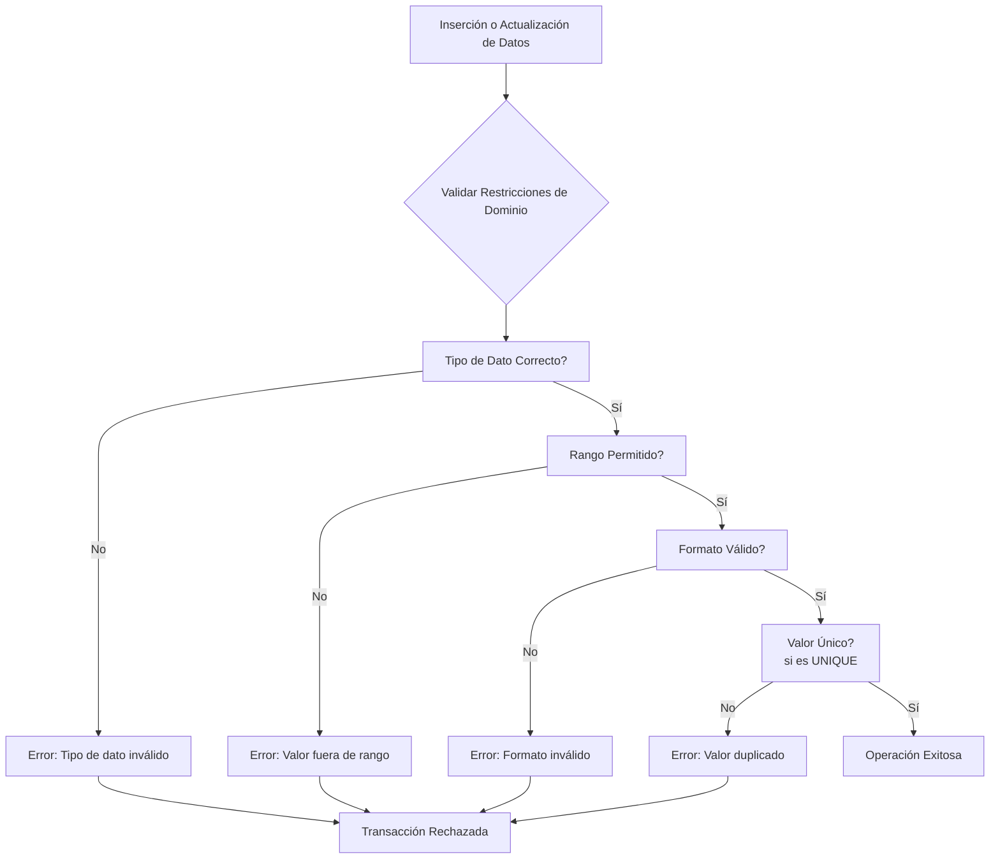

# Fundamentos de Bases de Datos - Integridad

## 8.2 Integridad de Dominio.

---

La integridad de dominio es un concepto fundamental en bases de datos que garantiza que los valores almacenados en una columna cumplan con las restricciones definidas para ese dominio de datos. Esta restricción asegura la calidad y validez de la información almacenada en cada atributo de una tabla.

### Definición de Integridad de Dominio

Según Elmasri y Navathe (2006), la **integridad de dominio** especifica que todos los valores de un atributo (columna) deben pertenecer a un dominio específico. Un dominio define el conjunto de valores válidos que puede tomar un atributo, incluyendo:

- Tipo de dato (entero, cadena, fecha, etc.)
- Rango de valores permitidos
- Restricciones específicas
- Valores predeterminados
- Reglas de formato

Matemáticamente, si tenemos un atributo A con dominio D, entonces:

$$∀ t ∈ R, t[A] ∈ D ∨ t[A] = NULL$$

Donde:

- R: Relación (tabla)
- t: Tupla (fila)
- A: Atributo (columna)
- D: Dominio del atributo A

### Tipos de Restricciones de Dominio

#### Restricciones de Tipo de Dato

```sql
CREATE TABLE Empleado (
    id_empleado INT PRIMARY KEY,
    nombre VARCHAR(50) NOT NULL,
    apellido VARCHAR(50) NOT NULL,
    fecha_nacimiento DATE,
    salario DECIMAL(10,2),
    activo BOOLEAN DEFAULT TRUE
);
```

#### Restricciones de Rango (CHECK)

```sql
CREATE TABLE Producto (
    id_producto INT PRIMARY KEY,
    nombre VARCHAR(100) NOT NULL,
    precio DECIMAL(10,2) CHECK (precio > 0),
    stock INT CHECK (stock >= 0),
    categoria VARCHAR(50) CHECK (categoria IN ('Electrónicos', 'Ropa', 'Alimentos', 'Hogar'))
);
```

#### Valores Predeterminados (DEFAULT)

```sql
CREATE TABLE Pedido (
    id_pedido INT PRIMARY KEY,
    fecha_pedido DATE DEFAULT CURRENT_DATE,
    estado VARCHAR(20) DEFAULT 'Pendiente' CHECK (estado IN ('Pendiente', 'En proceso', 'Enviado', 'Entregado')),
    total DECIMAL(10,2)
);
```

### Implementación en SQL

#### Creación de Dominios Personalizados

Algunos sistemas de gestión de bases de datos permiten crear dominios personalizados:

```sql
-- PostgreSQL
CREATE DOMAIN dinero AS DECIMAL(10,2) CHECK (VALUE >= 0);
CREATE DOMAIN email AS VARCHAR(255) CHECK (VALUE ~ '^[A-Za-z0-9._%+-]+@[A-Za-z0-9.-]+\.[A-Za-z]{2,}$');

-- Uso de dominios personalizados
CREATE TABLE Cliente (
    id_cliente INT PRIMARY KEY,
    nombre VARCHAR(100) NOT NULL,
    correo_electronico email,
    saldo dinero DEFAULT 0
);
```

#### Restricciones con Expresiones Regulares

```sql
-- PostgreSQL (sintaxis similar en otros SGBD)
CREATE TABLE Usuario (
    id_usuario SERIAL PRIMARY KEY,
    username VARCHAR(30) CHECK (username ~ '^[a-zA-Z0-9_]{3,30}$'),
    password VARCHAR(100) CHECK (length(password) >= 8),
    telefono VARCHAR(15) CHECK (telefono ~ '^[0-9()+-\s]{10,15}$')
);
```

### Diagrama de Restricciones de Dominio



### Ejemplos Prácticos

#### Ejemplo 1: Validación de Edad

```sql
CREATE TABLE Persona (
    id_persona INT PRIMARY KEY,
    nombre VARCHAR(100) NOT NULL,
    fecha_nacimiento DATE CHECK (fecha_nacimiento <= CURRENT_DATE - INTERVAL '18 years'),
    genero CHAR(1) CHECK (genero IN ('M', 'F', 'O')), -- Masculino, Femenino, Otro
    altura DECIMAL(3,2) CHECK (altura BETWEEN 0.5 AND 2.5)
);

-- Inserción válida
INSERT INTO Persona VALUES (1, 'María López', '1990-05-15', 'F', 1.65);

-- Inserción inválida (edad menor a 18 años)
INSERT INTO Persona VALUES (2, 'Juan Pérez', '2010-03-20', 'M', 1.40);
-- Error: viola restricción de check en "fecha_nacimiento"
```

#### Ejemplo 2: Validación de Código de Producto

```sql
CREATE TABLE Inventario (
    codigo_producto VARCHAR(10) PRIMARY KEY CHECK (codigo_producto ~ '^[A-Z]{3}-[0-9]{4}$'),
    nombre VARCHAR(100) NOT NULL,
    precio DECIMAL(10,2) CHECK (precio > 0),
    existencia INT CHECK (existencia >= 0) DEFAULT 0,
    fecha_ingreso DATE DEFAULT CURRENT_DATE
);

-- Inserción válida
INSERT INTO Inventario (codigo_producto, nombre, precio, existencia)
VALUES ('ABC-1234', 'Laptop Gaming', 1200.00, 10);

-- Inserción inválida (formato de código incorrecto)
INSERT INTO Inventario (codigo_producto, nombre, precio, existencia)
VALUES ('123-ABCD', 'Tablet', 300.00, 5);
-- Error: viola restricción de check en "codigo_producto"
```

### Ejercicios Propuestos

#### Ejercicio 1: Diseño de Tabla con Restricciones de Dominio

Diseña una tabla "Empleado" con las siguientes restricciones de dominio:

- ID numérico positivo
- Nombre y apellido entre 2 y 50 caracteres
- Email con formato válido
- Salario entre 1000 y 10000
- Departamento debe ser uno de: 'Ventas', 'TI', 'RH', 'Finanzas'

```sql
-- Escribe tu solución aquí
CREATE TABLE Empleado (
    -- Completa la definición de la tabla
);
```

#### Ejercicio 2: Identificación de Problemas

Analiza el siguiente código y identifica los problemas de integridad de dominio:

```sql
CREATE TABLE Estudiante (
    id_estudiante INT,
    nombre VARCHAR(10), -- ¿Problema?
    promedio DECIMAL(3,2) CHECK (promedio > 0), -- ¿Problema?
    fecha_inscripcion DATE DEFAULT '2020-01-01',
    carrera VARCHAR(20) CHECK (carrera IN ('Ingeniería', 'Medicina'))
);

INSERT INTO Estudiante VALUES (1, 'Ana María Rodríguez', 5.5, '2023-08-15', 'Arquitectura');
```

#### Ejercicio 3: Corrección de Esquema

Corrige el esquema anterior para garantizar la integridad de dominio:

```sql
-- Escribe tu solución aquí
```

### Casos Especiales y Consideraciones

#### Valores NULL y Restricciones de Dominio

```sql
CREATE TABLE Ejemplo (
    id INT PRIMARY KEY,
    -- NOT NULL prohíbe valores nulos
    campo_obligatorio VARCHAR(50) NOT NULL,
    -- Sin NOT NULL, permite NULL a menos que CHECK lo prohiba
    campo_opcional VARCHAR(50) CHECK (campo_opcional IS NOT NULL OR campo_opcional = 'ValorEspecial'),
    -- Permite NULL explícitamente
    campo_nulleable VARCHAR(50) NULL CHECK (campo_nulleable IN ('A', 'B', 'C'))
);
```

#### Restricciones a Nivel de Tabla

```sql
CREATE TABLE Reserva (
    id_reserva INT PRIMARY KEY,
    fecha_inicio DATE NOT NULL,
    fecha_fin DATE NOT NULL,
    -- Restricción a nivel de tabla que involucra múltiples columnas
    CONSTRAINT fecha_valida CHECK (fecha_fin > fecha_inicio),
    CONSTRAINT max_dias CHECK (fecha_fin <= fecha_inicio + INTERVAL '30 days')
);
```

### Buenas Prácticas

1. **Definir restricciones apropiadas** para cada columna según el dominio del atributo
2. **Usar tipos de datos específicos** para el dominio (DATE para fechas, DECIMAL para montos)
3. **Implementar validaciones complejas** con restricciones CHECK
4. **Establecer valores predeterminados** apropiados
5. **Documentar las restricciones** de dominio en el esquema de la base de datos

### Referencias

#### Bibliografía Básica

1. Elmasri and Navathe. _Fundamentals of Database Systems_. Addison-Wesley. Cuarta Edición. 2006. (Capítulo 3: The Relational Data Model and Relational Database Constraints)
2. Silberschatz A., Kort H. y Sudarshan S. _Fundamentos de BD_. McGraw Hill. Quinta edición. 2006. (Capítulo 6: Integridad y Seguridad)
3. Ullman J.D. and Widom J. _A First Course in Data Base System_. Prentice Hall. Tercera edición. 2008. (Capítulo 2: The Relational Model of Data)

#### Bibliografía Complementaria

1. Harrington J. _Relational Database Design and Implementation_. Tercera edición. Morgan Kaufmann. 2009. (Capítulo 7: Database Constraints)
2. Kline K., Kline D., and Hunt B. _SQL in a nutshell_. O'Reilly. 2008. (Capítulo 2: Foundational Concepts)

### Autoevaluación

1. ¿Qué es la integridad de dominio y por qué es importante en bases de datos?
2. ¿Cuáles son los tipos principales de restricciones de dominio?
3. ¿Cómo se manejan los valores NULL en las restricciones de dominio?
4. Explica la diferencia entre restricciones de columna y de tabla
5. ¿Qué ventajas ofrecen los dominios personalizados en un SGBD?
