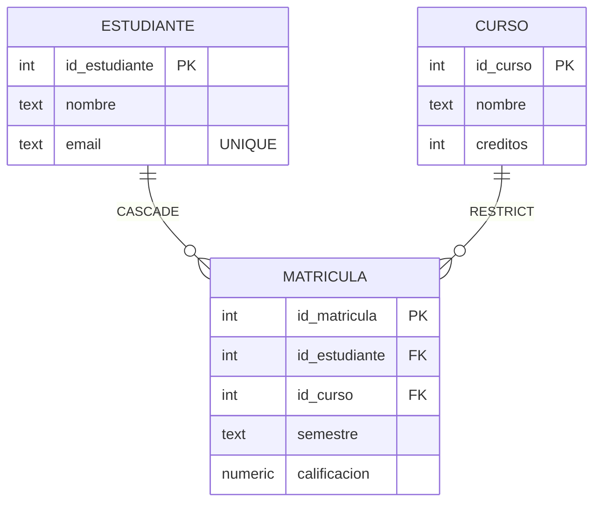

# Fundamentos de Bases de Datos - Integridad

## 8.3 Integridad de Referencial.

---

La **integridad referencial** garantiza que las referencias entre tablas sean válidas: si un préstamo dice que es del socio 42, el socio 42 existe. Se expresa con **claves foráneas**, y es la restricción que mantiene unido un esquema normalizado, en el que la información de una entidad está repartida en varias tablas. Este tema la define, explica las **acciones referenciales** que deciden qué pasa al borrar o actualizar una fila referenciada, y trata los casos especiales: claves compuestas con nulos, referencias circulares y claves foráneas hacia columnas que no son clave.

### Definición

Sea $R$ la relación **referenciante** (o hija), $S$ la **referenciada** (o padre), $FK$ un conjunto de atributos de $R$ y $K$ una clave candidata de $S,$ con dominios compatibles. La restricción $R[FK] \subseteq S[K]$ exige

$$\forall t \in r(R): \; t[FK] \text{ tiene algún nulo} \;\lor\; \exists s \in r(S): \; s[K] = t[FK].$$

Es una **dependencia de inclusión**: los valores no nulos de $FK$ forman un subconjunto de los valores de $K.$ La clave referenciada debe ser una clave candidata, declarada `PRIMARY KEY` o `UNIQUE`; si no, una referencia podría señalar a varias filas. $R$ y $S$ pueden ser la misma tabla, como en la relación entre un empleado y su jefe.

### Qué operaciones pueden violarla

| Operación                                     | ¿Puede violarla?   | Qué hace el SMBD                                |
| --------------------------------------------- | ------------------ | ----------------------------------------------- |
| Insertar en la hija                           | Sí                 | Rechaza si el padre no existe                    |
| Actualizar la clave foránea en la hija        | Sí                 | Rechaza si el padre nuevo no existe             |
| Borrar en el padre                            | Sí                 | Aplica la acción `ON DELETE`                    |
| Actualizar la clave en el padre               | Sí                 | Aplica la acción `ON UPDATE`                    |
| Insertar en el padre o borrar en la hija      | No                 | Nada                                            |

### Acciones referenciales

- **`NO ACTION`**, el valor por omisión: rechaza la operación si deja referencias huérfanas, verificando al final de la sentencia, o al final de la transacción si la restricción es diferida.
- **`RESTRICT`:** igual, pero verifica de inmediato, aunque la restricción sea diferible.
- **`CASCADE`:** propaga la operación: al borrar el padre se borran las hijas, y al cambiar la clave del padre se cambia en las hijas.
- **`SET NULL`:** pone la clave foránea de las hijas en nulo; requiere que la columna admita nulos.
- **`SET DEFAULT`:** la pone en su valor por omisión, que debe existir en el padre.

La elección expresa una regla del negocio. Borrar un estudiante con `CASCADE` borra sus matrículas, lo que tiene sentido si las matrículas no tienen valor sin él; borrar un curso con `RESTRICT` impide perder el historial académico; `SET NULL` en un producto cuyo proveedor desaparece conserva el producto como "sin proveedor". `ON UPDATE CASCADE` rara vez se necesita con claves suplentes, que no cambian.

### Casos especiales

- **Claves compuestas con nulos.** Con la semántica por omisión, `MATCH SIMPLE`, si **algún** componente de la clave foránea es nulo, la restricción no se verifica: `(curso, seccion) = ('XYZ', NULL)` se acepta aunque no exista el curso XYZ. `MATCH FULL` exige que la clave foránea sea completamente nula o completamente válida; PostgreSQL lo implementa y SQLite no.
- **Referencias circulares.** Si cada departamento tiene un jefe y cada empleado un departamento, ambos con `NOT NULL`, ninguna de las dos filas se puede insertar primero. La solución es declarar las restricciones `DEFERRABLE INITIALLY DEFERRED`, para que se verifiquen en el `COMMIT`, e insertar ambas filas en una transacción. Otra opción es permitir nulos temporalmente y actualizar después.
- **Índices.** El SMBD indexa la clave referenciada, pero no siempre la clave foránea; sin un índice sobre ella, cada borrado en el padre recorre toda la tabla hija para buscar referencias. Conviene crearlo.
- **SQLite** verifica las claves foráneas solo si se ejecuta `PRAGMA foreign_keys = ON` en cada conexión; sin él, las declara pero no las aplica.



### Implementación en Python

El programa ejecuta en SQLite las tres operaciones del ejercicio 2 y muestra el estado de los productos tras cada una; crea el esquema universitario del ejercicio 1 con acciones distintas para estudiantes y cursos, y las prueba; reproduce el error del esquema del ejercicio 3 y lo corrige. Al final muestra una clave foránea compuesta que acepta un componente nulo, y una referencia circular entre departamentos y empleados resuelta con verificación diferida.

```python
import sqlite3

db = sqlite3.connect(":memory:", isolation_level=None)
db.execute("PRAGMA foreign_keys = ON")

def intenta(sql, etiqueta):
    try:
        db.execute(sql); print(f"   aceptado: {etiqueta}")
    except sqlite3.Error as e:
        print(f"   rechazado: {etiqueta} -> {e}")

# --- Ejercicio 2: Proveedor y Producto con ON DELETE SET NULL y ON UPDATE CASCADE ---
db.executescript("""
CREATE TABLE proveedor (id_proveedor INT PRIMARY KEY, nombre VARCHAR(100));
CREATE TABLE producto (id_producto INT PRIMARY KEY, nombre VARCHAR(100), id_proveedor INT,
                       FOREIGN KEY (id_proveedor) REFERENCES proveedor(id_proveedor) ON DELETE SET NULL ON UPDATE CASCADE);
INSERT INTO proveedor VALUES (1, 'Aceros del Norte'), (2, 'Plásticos MX');
INSERT INTO producto VALUES (10, 'Tornillo', 1), (11, 'Tuerca', 1), (12, 'Tapa', 2);
""")
print("ejercicio 2:")
db.execute("UPDATE proveedor SET id_proveedor = 100 WHERE id_proveedor = 1")
print("   2) tras cambiar el proveedor 1 a 100:", db.execute("SELECT * FROM producto ORDER BY id_producto").fetchall())
db.execute("DELETE FROM proveedor WHERE id_proveedor = 100")
print("   1) tras borrar ese proveedor:", db.execute("SELECT * FROM producto ORDER BY id_producto").fetchall())
intenta("INSERT INTO producto VALUES (500, 'Producto X', 999)", "3) producto con proveedor 999")
intenta("INSERT INTO producto VALUES (501, 'Producto Y', NULL)", "producto sin proveedor")

# --- Ejercicio 1: universidad ---
db.executescript("""
CREATE TABLE estudiante (id_estudiante INTEGER PRIMARY KEY, nombre TEXT NOT NULL, email TEXT NOT NULL UNIQUE);
CREATE TABLE curso (id_curso INTEGER PRIMARY KEY, nombre TEXT NOT NULL, creditos INTEGER NOT NULL CHECK (creditos > 0));
CREATE TABLE matricula (
    id_matricula  INTEGER PRIMARY KEY,
    id_estudiante INTEGER NOT NULL REFERENCES estudiante ON DELETE CASCADE ON UPDATE CASCADE,
    id_curso      INTEGER NOT NULL REFERENCES curso ON DELETE RESTRICT ON UPDATE CASCADE,
    semestre      TEXT NOT NULL,
    calificacion  NUMERIC CHECK (calificacion BETWEEN 0 AND 10),
    UNIQUE (id_estudiante, id_curso, semestre));
INSERT INTO estudiante VALUES (1, 'Elena', 'elena@uni.mx'), (2, 'Marco', 'marco@uni.mx');
INSERT INTO curso VALUES (10, 'Bases de datos', 8), (11, 'Cálculo', 10);
INSERT INTO matricula (id_estudiante, id_curso, semestre, calificacion) VALUES (1, 10, '2026-1', 9.5), (1, 11, '2026-1', 8),
                                                                               (2, 10, '2026-1', 7);
""")
print("ejercicio 1:")
intenta("DELETE FROM curso WHERE id_curso = 10", "borrar un curso con matrículas (RESTRICT)")
intenta("DELETE FROM estudiante WHERE id_estudiante = 1", "borrar a Elena (CASCADE)")
print("   matrículas restantes:", db.execute("SELECT id_estudiante, id_curso FROM matricula").fetchall())
intenta("INSERT INTO matricula (id_estudiante, id_curso, semestre) VALUES (2, 99, '2026-2')", "matrícula en un curso inexistente")

# --- Ejercicio 3: clave foránea hacia una columna que no es clave ---
db.executescript("""
CREATE TABLE autor (id_autor INT, nombre VARCHAR(100));
CREATE TABLE libro (id_libro INT PRIMARY KEY, titulo VARCHAR(200), id_autor INT,
                    FOREIGN KEY (id_autor) REFERENCES autor(id_autor) ON DELETE RESTRICT);
""")
print("ejercicio 3, original (las tablas se crean sin error):")
intenta("INSERT INTO autor VALUES (1, 'Rulfo')", "insertar un autor")
intenta("INSERT INTO libro VALUES (1, 'Pedro Páramo', 1)", "insertar un libro")
db.executescript("""
DROP TABLE libro; DROP TABLE autor;
CREATE TABLE autor (id_autor INTEGER PRIMARY KEY, nombre VARCHAR(100) NOT NULL);
CREATE TABLE libro (id_libro INTEGER PRIMARY KEY, titulo VARCHAR(200) NOT NULL,
                    id_autor INTEGER NOT NULL REFERENCES autor(id_autor) ON DELETE RESTRICT ON UPDATE CASCADE);
CREATE INDEX idx_libro_autor ON libro(id_autor);
INSERT INTO autor VALUES (1, 'Rulfo'), (2, 'Paz');
INSERT INTO libro VALUES (1, 'Pedro Páramo', 1);
""")
print("ejercicio 3, corregido:")
intenta("INSERT INTO autor VALUES (1, 'Otro')", "autor con id repetido")
intenta("DELETE FROM autor WHERE id_autor = 1", "borrar a Rulfo, que tiene un libro")
intenta("DELETE FROM autor WHERE id_autor = 2", "borrar a Paz, sin libros")

# --- claves foráneas compuestas y nulos parciales (MATCH SIMPLE) ---
db.executescript("""
CREATE TABLE grupo (curso TEXT, seccion INTEGER, PRIMARY KEY (curso, seccion));
CREATE TABLE inscrito (alumno TEXT, curso TEXT, seccion INTEGER, FOREIGN KEY (curso, seccion) REFERENCES grupo);
INSERT INTO grupo VALUES ('BD', 1), ('BD', 2);
""")
print("clave foránea compuesta:")
intenta("INSERT INTO inscrito VALUES ('Ana', 'BD', 3)", "(BD, 3), que no existe")
intenta("INSERT INTO inscrito VALUES ('Ana', 'XYZ', NULL)", "(XYZ, nulo): con un componente nulo no se verifica")

# --- referencias circulares: departamento con jefe y empleado con departamento ---
db.executescript("""
CREATE TABLE departamento (id INTEGER PRIMARY KEY, nombre TEXT,
                           id_jefe INTEGER NOT NULL REFERENCES empleado DEFERRABLE INITIALLY DEFERRED);
CREATE TABLE empleado (id INTEGER PRIMARY KEY, nombre TEXT,
                       id_depto INTEGER NOT NULL REFERENCES departamento DEFERRABLE INITIALLY DEFERRED);
""")
print("referencias circulares, con verificación diferida:")
db.execute("BEGIN")
db.execute("INSERT INTO departamento VALUES (1, 'Sistemas', 7)")          # el jefe 7 todavía no existe
db.execute("INSERT INTO empleado VALUES (7, 'Iris', 1)")
db.execute("COMMIT")
print("   departamento y jefe creados en una transacción:", db.execute("SELECT * FROM departamento").fetchall())
db.execute("BEGIN")
db.execute("INSERT INTO departamento VALUES (2, 'Legal', 8)")
try:
    db.execute("COMMIT")
except sqlite3.IntegrityError as e:
    print("   sin crear al jefe 8, el COMMIT falla:", e); db.execute("ROLLBACK")
print("   huérfanos:", db.execute("PRAGMA foreign_key_check").fetchall())
```

Salida:

```text
ejercicio 2:
   2) tras cambiar el proveedor 1 a 100: [(10, 'Tornillo', 100), (11, 'Tuerca', 100), (12, 'Tapa', 2)]
   1) tras borrar ese proveedor: [(10, 'Tornillo', None), (11, 'Tuerca', None), (12, 'Tapa', 2)]
   rechazado: 3) producto con proveedor 999 -> FOREIGN KEY constraint failed
   aceptado: producto sin proveedor
ejercicio 1:
   rechazado: borrar un curso con matrículas (RESTRICT) -> FOREIGN KEY constraint failed
   aceptado: borrar a Elena (CASCADE)
   matrículas restantes: [(2, 10)]
   rechazado: matrícula en un curso inexistente -> FOREIGN KEY constraint failed
ejercicio 3, original (las tablas se crean sin error):
   aceptado: insertar un autor
   rechazado: insertar un libro -> foreign key mismatch - "libro" referencing "autor"
ejercicio 3, corregido:
   rechazado: autor con id repetido -> UNIQUE constraint failed: autor.id_autor
   rechazado: borrar a Rulfo, que tiene un libro -> FOREIGN KEY constraint failed
   aceptado: borrar a Paz, sin libros
clave foránea compuesta:
   rechazado: (BD, 3), que no existe -> FOREIGN KEY constraint failed
   aceptado: (XYZ, nulo): con un componente nulo no se verifica
referencias circulares, con verificación diferida:
   departamento y jefe creados en una transacción: [(1, 'Sistemas', 7)]
   sin crear al jefe 8, el COMMIT falla: FOREIGN KEY constraint failed
   huérfanos: []
```

### Ejercicios Propuestos

1. **Universidad.** Diseña `Estudiante(id_estudiante, nombre, email)`, `Curso(id_curso, nombre, creditos)` y `Matricula(id_matricula, id_estudiante, id_curso, semestre, calificacion)` con sus claves primarias, foráneas y acciones.

2. **Operaciones.** Con el esquema

    ```sql
    CREATE TABLE Proveedor (id_proveedor INT PRIMARY KEY, nombre VARCHAR(100));
    CREATE TABLE Producto (
        id_producto INT PRIMARY KEY, nombre VARCHAR(100), id_proveedor INT,
        FOREIGN KEY (id_proveedor) REFERENCES Proveedor(id_proveedor) ON DELETE SET NULL ON UPDATE CASCADE
    );
    ```

    ¿qué ocurre con `DELETE FROM Proveedor WHERE id_proveedor = 1`, con `UPDATE Proveedor SET id_proveedor = 100 WHERE id_proveedor = 1` y con `INSERT INTO Producto VALUES (500, 'Producto X', 999)`?

3. **Corrección.** Identifica y corrige los problemas de:

    ```sql
    CREATE TABLE Autor (id_autor INT, nombre VARCHAR(100));
    CREATE TABLE Libro (
        id_libro INT PRIMARY KEY, titulo VARCHAR(200), id_autor INT,
        FOREIGN KEY (id_autor) REFERENCES Autor(id_autor) ON DELETE RESTRICT
    );
    ```

4. **Repaso.** ¿Qué es la integridad referencial? ¿Qué diferencia hay entre `RESTRICT` y `CASCADE`? ¿Cómo se tratan los nulos en las claves foráneas? ¿Cuándo conviene `SET NULL` en lugar de `CASCADE`? ¿Qué problemas causan las referencias circulares y cómo se resuelven?

### Soluciones

**Ejercicio 1.** Es el esquema del programa y del diagrama. `matricula` tiene clave suplente y una clave alternativa `(id_estudiante, id_curso, semestre)`, para que un estudiante no se inscriba dos veces en el mismo curso el mismo semestre, pero pueda repetirlo otro. Las dos claves foráneas son `NOT NULL`, porque una matrícula sin estudiante o sin curso no tiene sentido. Al estudiante se le da `ON DELETE CASCADE`, que borra sus matrículas si se le da de baja del sistema, y al curso `ON DELETE RESTRICT`, para que no se pueda borrar un curso con historial. Es discutible: muchas instituciones prefieren no borrar nunca a un estudiante, sino marcarlo como inactivo, y entonces lo adecuado es `RESTRICT` en ambas.

**Ejercicio 2.** Conviene analizarlas en el orden 2, 1, 3:

- **Actualización:** con `ON UPDATE CASCADE`, los productos del proveedor 1 pasan a hacer referencia al 100.
- **Borrado:** con `ON DELETE SET NULL`, el proveedor se borra y sus productos quedan con `id_proveedor` nulo; los de otros proveedores no cambian. En el programa se borra el proveedor 100, que es el antiguo 1.
- **Inserción:** se rechaza, porque el proveedor 999 no existe. Un producto con proveedor nulo sí se acepta, porque la columna lo admite.

**Ejercicio 3.** El problema principal es que `Autor` **no tiene clave**: `id_autor` admite valores repetidos, así que una referencia al autor 1 podría señalar a varias filas. PostgreSQL rechaza la creación de `Libro` con el mensaje "there is no unique constraint matching given keys for referenced table". SQLite crea las tablas, pero da "foreign key mismatch" cuando se usa la clave foránea, como muestra el programa. Problemas secundarios: `nombre` y `titulo` admiten nulos, `id_autor` en `Libro` admite nulos (un libro sin autor) y no hay índice sobre la clave foránea. Además, un libro con varios autores no cabe en este esquema: si es posible, la relación es M:N y necesita una tabla `libro_autor`. La corrección declara `id_autor` como clave primaria, agrega `NOT NULL` y el índice; el programa comprueba que entonces se rechazan un autor con identificador repetido y el borrado de un autor con libros.

**Ejercicio 4.** La integridad referencial exige que toda clave foránea no nula corresponda a una fila existente de la tabla referenciada. `RESTRICT` impide borrar o actualizar una fila referenciada; `CASCADE` propaga la operación a las filas que la referencian. Una clave foránea nula no se verifica, y en una compuesta basta un componente nulo con `MATCH SIMPLE`; para que la referencia sea obligatoria se agrega `NOT NULL`. `SET NULL` conviene cuando la fila hija tiene sentido sin el padre: un producto sin proveedor, un empleado sin jefe, un pedido cuyo vendedor dejó la empresa. Las referencias circulares impiden insertar la primera fila si ambas claves foráneas son obligatorias; se resuelven con restricciones diferidas e inserción en una transacción, o haciendo opcional una de las dos referencias.

### Referencias

1. Date, C. J., Referential integrity. _Proceedings of VLDB_, 1981.
2. Elmasri, R., and Navathe, S. B., _Fundamentals of Database Systems_. Pearson, 2016. Capítulos 5 y 6.
3. Silberschatz, A., Korth, H. F., and Sudarshan, S., _Database System Concepts_. McGraw-Hill, 2019. Capítulo 4.
4. SQLite, _SQLite Foreign Key Support_. Documentación en línea, sqlite.org.
5. PostgreSQL Global Development Group, _Constraints_, sección Foreign Keys. Documentación en línea, postgresql.org.
